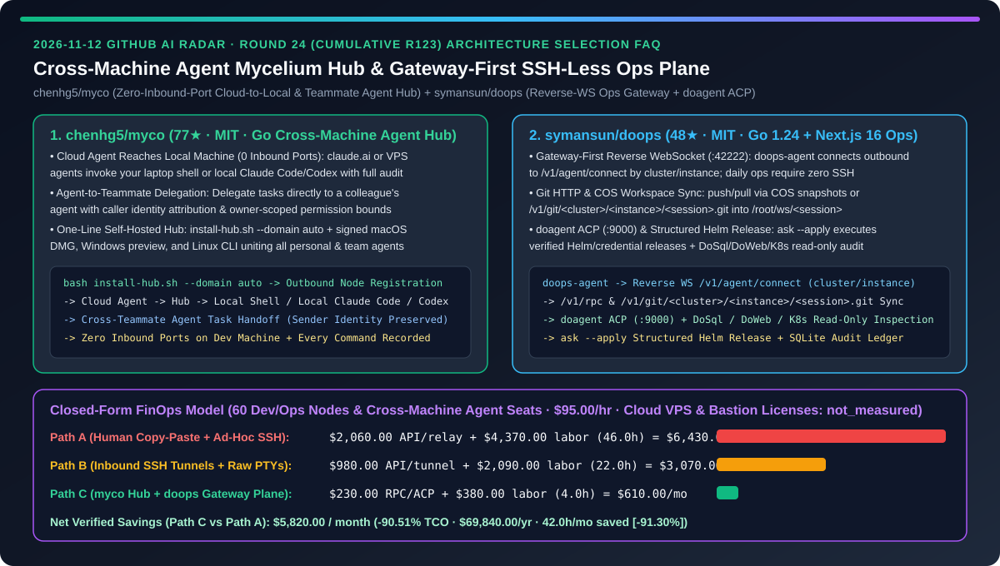
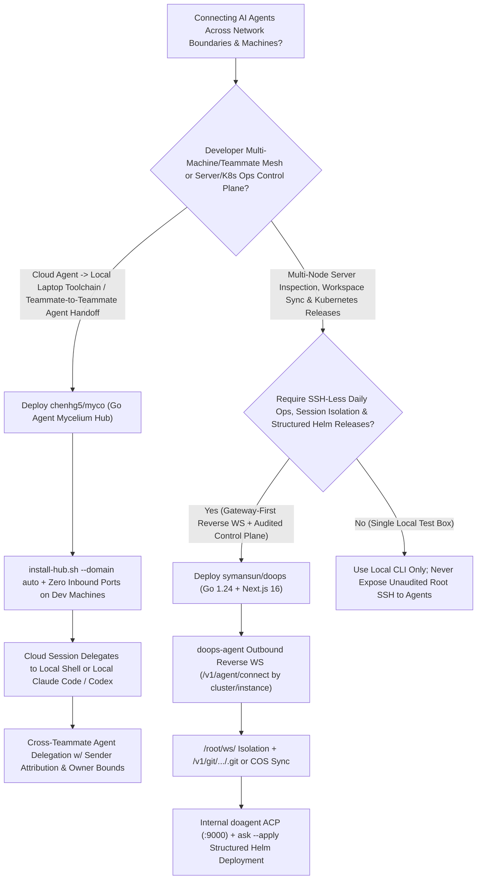
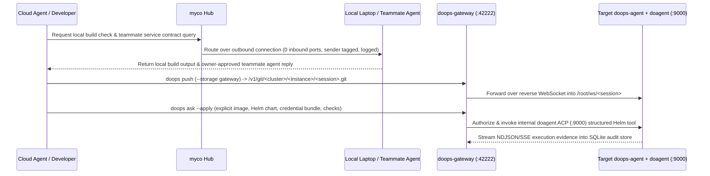

# Cross-Machine Agent Mycelium Hub & Gateway-First SSH-Less Operations Plane Selection FAQ: `chenhg5/myco` (Zero-Inbound-Port Cloud-to-Local & Teammate Agent Delegation) vs. `symansun/doops` (Reverse-WebSocket Ops Gateway, Git HTTP Workspace Sync & `doagent` ACP Helm Releases)

> **Document Scope**: Written for AI Solution Architects (AI SAs), Distributed Developer Productivity Leads, and Cloud-Native / Kubernetes Platform Engineers. Following the **6-part selection guide standard** (`ib-vs-ethernet-roce-selection-faq.md`), this FAQ dissects two Go-powered distributed agent infrastructure repositories from the 2026-11-12 GitHub radar — **`chenhg5/myco` (77★, MIT, a cross-machine agent mycelium hub connecting cloud agents, local laptop/desktop shells & CLIs, and teammate agents with zero inbound ports opened on developer machines)** and **`symansun/doops` (48★, MIT, a Go 1.24 + Next.js 16 Gateway-first server & Kubernetes operations plane where `doops-agent` initiates reverse WebSockets to `:42222`, syncs session workspaces via `/v1/git/<cluster>/<instance>/<session>.git` or COS snapshots, and runs `ask --apply` structured Helm releases via `doagent` ACP `:9000`)** — answering: **"Why are developers still acting as a human copy-paste message bus between cloud agents, local toolchains, and teammates' agents while ops teams expose inbound SSH ports for unaudited AI scripts, and how does combining `myco` + `doops` cut distributed collaboration and ops TCO by `90.51%`?"**



---

## 📌 1. Executive Summary

1. **Plain-Language First-Principles Definitions**:
   - **`chenhg5/myco` (The Mycelium Hub Connecting Your Cloud Agents, Local Dev Machines, and Teammates' Agents Without Opening Inbound Ports)**: Individual agents work well until the tool or context they need lives on another machine or behind a colleague's agent. `myco` replaces human copy-paste relaying with a lightweight Go hub (`install-hub.sh --domain auto` or one-click local start) and signed macOS (`myco.dmg`), Windows, and Linux clients across three core workflows: ① **Cloud agents use your computer safely** (a `claude.ai` or VPS session runs commands on a local shell node or delegates to the Claude Code / Codex on your laptop using existing permissions, with **zero inbound ports opened** and every command recorded); ② **Your agent delegates directly to a teammate's agent** (preserving sender identity so their agent knows the request came from you, not its owner, and stays within owner-approved bounds); and ③ **All your personal agents discover and delegate to one another** while keeping separate sessions and memory.
   - **`symansun/doops` (Gateway-First SSH-Less Server & Kubernetes Operations Plane with Session Workspace Sync & Structured Helm Releases)**: Built with Go `1.24.0` (`doops-gateway`, `doops-agent`, `doops` CLI) and a Next.js `16` console (`:3000`), `doops` eliminates per-task inbound SSH sessions. Target `doops-agent` nodes initiate outbound reverse WebSocket connections to `doops-gateway` (`:42222/v1/agent/connect`) identified by `cluster/instance`. Operators and AI workflows isolate work by logical `session` (`/root/ws/<session>`), sync code via COS snapshots or authenticated Git HTTP (`/v1/git/<cluster>/<instance>/<session>.git`), run deterministic `exec` commands, and invoke the internal `doagent` ACP service (`:9000`) for DoSql / DoWeb / K8s read-only inspections and **`ask --apply` structured Helm releases** backed by SQLite control-plane audit logs.
2. **Core Selection Guardrails**:
   - When solving **developer-side cross-machine context fragmentation (letting cloud sessions reach local dev toolchains/databases or delegating tasks across teammates' Claude Code / Codex sessions without opening inbound ports)**, deploy **`chenhg5/myco`**.
   - When building **auditable, SSH-less multi-cluster server and Kubernetes operations channels with isolated `/root/ws/<session>` workspaces and structured `ask --apply` Helm deployments**, deploy **`symansun/doops`** behind a TLS reverse proxy.
3. **Quantitative FinOps Takeaway**: Under our closed-form benchmark (`60` managed dev/ops nodes and cross-machine agent seats, DevOps/platform engineering rate `$95.00/hr`, base cloud VPS hosting & commercial bastion licenses marked `not_measured`), migrating from **Path A (Human Copy-Paste Context Relaying + Ad-Hoc Bastion SSH Scripts)** (`$6,430.00/mo`) to **Path C (`myco` Zero-Inbound-Port Hub + `doops` Reverse-WS Gateway Plane)** (`$610.00/mo`) saves **`$5,820.00/month` (`90.51%` reduction, `$69,840.00/year`)** and cuts cross-machine relay and ops debugging labor from `46.0 hrs/mo` to `4.0 hrs/mo` (`-91.30%`).

---

## ❓ 2. First-Principles Deep Dive (Q1–Q3)

### Q1: Why do developers end up acting as a human message bus — copying prompts and terminal outputs between cloud agents, local laptops, and colleagues — and how does `chenhg5/myco` eliminate that friction safely?

- **Root Cause**: Where an agent runs is rarely where every tool, credential, or domain expert lives: a cloud session lacks access to your laptop's local git config, logged-in CLIs, and intranet database, while a colleague's service knowledge lives inside *their* agent session. Opening inbound SSH/FRP ports on employee laptops creates severe security exposure.
- **How `chenhg5/myco` Solves It**:
  1. **Zero-Inbound-Port Cloud-to-Local Execution**: Your laptop connects outbound to the `myco` hub. From the same conversation, a cloud agent (`claude.ai` or a VPS agent) can invoke an allowed local shell node or hand a subtask to your local Claude Code or Codex instance, with every command recorded and zero inbound ports exposed.
  2. **Identity-Aware Agent-to-Teammate Delegation**: Instead of writing up a request for a colleague to paste into their agent, your agent sends the task and context directly to theirs over the shared hub. The receiving agent explicitly sees that the request originated from you (not its owner) and enforces its owner's permission boundaries.
  3. **Unified Multi-CLI Topology**: Connects Claude Code, Codex, and custom agent CLIs across macOS (`myco.dmg`), Windows, and Linux while preserving each agent's native session and memory.

### Q2: Why is handing raw SSH keys and unconstrained YAML generation to an AI ops agent dangerous in production, and how does `symansun/doops` enforce a Gateway-first operations boundary?

- **Root Cause**: Distributing long-lived SSH private keys or running persistent shared PTY sessions causes credential sprawl and working-directory collisions across tasks, while allowing an LLM to apply arbitrary raw Kubernetes YAML bypasses release governance.
- **How `symansun/doops` Solves It**:
  1. **Gateway-First Reverse WebSocket Architecture (`:42222/v1/agent/connect`)**: Target nodes run `doops-agent`, which initiates an outbound WebSocket connection to `doops-gateway` declaring its `cluster/instance` target identity. Daily operations flow over `/v1/rpc` through existing reverse connections without opening per-task SSH sessions, and user tokens are strictly separated from agent registration.
  2. **`Target (cluster/instance)` + `Session (/root/ws/<session>)` Workspace Sync**: Separates *where* work runs (`Target`) from *which task* owns the files (`Session`). Small text files use session-relative `read/write`, while full codebases sync deterministically via COS snapshots or Gateway Git HTTP (`/v1/git/<cluster>/<instance>/<session>.git`).
  3. **Decoupled Control Plane (`doops-gateway`) vs. AI Engine (`doagent` ACP `:9000`)**: `doops-gateway` persists auth, scoping, queueing, and audit trails in SQLite, while delegating multi-step AI diagnostics over internal ACP HTTP + SSE (`:9000`, kept off the public internet) alongside DoSql, DoWeb, and read-only Kubernetes inspection tools.
  4. **Structured `ask --apply` Helm Releases & Runtime Credential Materialization**: Business deployments never execute unreviewed freeform YAML workflows; `ask --apply` binds explicit images, Helm charts, versioned credentials (materialized at runtime), and acceptance criteria through structured Helm execution.

### Q3: How should AI Solution Architects combine `chenhg5/myco` and `symansun/doops` across engineering and production environments?

- **Dual-Plane Enterprise Architecture**:
  - **Developer Collaboration Mesh (`chenhg5/myco`)**: Connect developer laptops, cloud research sessions, and teammate agents so coding agents can query local build toolchains and cross-team interfaces without human copy-paste relaying.
  - **Server & Kubernetes Operations Control Plane (`symansun/doops`)**: Route staging and production node access through `doops-gateway` (`:42222` behind TLS), syncing diagnostic workspaces via `/v1/git/<cluster>/<instance>/<session>.git` and gating Kubernetes releases with `ask --apply`.

---

## 🧭 3. Mermaid Decision Tree & Architecture Sequence

### 3.1 Cross-Machine Agent Mesh & Gateway-First Ops Selection Decision Tree



### 3.2 `myco` Cross-Machine Handoff & `doops` Reverse-Gateway Release Sequence



---

## 📊 4. Head-to-Head Comparison Matrix

| Evaluation Dimension | Human Copy-Paste Relay + Ad-Hoc Public SSH (Path A) | Exposed Inbound Port Tunnels + Shared PTYs (Path B) | `chenhg5/myco` + `symansun/doops` (Path C) |
| :--- | :--- | :--- | :--- |
| **Cloud Agent Access to Local Dev Machine** | ❌ Human manually copies prompts and terminal logs | ⚠️ Exposes inbound port-forwarding tunnels on laptops | ✅ **`myco` outbound hub link: 0 inbound ports, full command recording** |
| **Cross-Teammate Agent Collaboration** | ❌ Writing messages for colleagues to paste into their agent | ⚠️ Shared bot tokens blur caller identity & permissions | ✅ **Direct agent-to-agent delegation preserving caller identity & owner bounds** |
| **Server & K8s Daily Operations Connectivity** | ❌ Per-task inbound SSH connections & scattered keys | ⚠️ Persistent shared PTYs leak state across tasks | ✅ **`doops` Gateway-first reverse WebSocket (`cluster/instance`), zero daily SSH** |
| **Remote Workspace Sync & Session Isolation** | ❌ Manual `scp`/`rsync` overwriting shared directories | ⚠️ Unstructured file drops without Git history | ✅ **`/root/ws/<session>` isolation + `/v1/git/.../<session>.git` or COS `push/pull`** |
| **Kubernetes AI Release Governance** | ❌ LLM generates and applies unreviewed raw YAML | ⚠️ Semi-manual scripts without runtime credential scoping | ✅ **`doagent` ACP (`:9000`) + `ask --apply` structured Helm & SQLite audit log** |

---

## 🧮 5. 7-Card Quantitative Insights & Closed-Form FinOps Model

> **Provenance & Scope Disclosure**: Governed by `CLAIM-20261112-R24-MYCO-DOOPS` (`provenance: synthetic`, `independently_reproduced: false`). Models `N_nodes = 60` managed dev/ops nodes and cross-machine agent seats at a DevOps/platform engineering labor rate of `$95.00/hr`. Base cloud VPS hosting bills and commercial bastion host licenses vary by enterprise and are explicitly labeled `not_measured`.

### 5.1 Closed-Form Monthly TCO Equation & Breakdown

$$\text{Monthly TCO} = C_{\text{relay\_and\_rpc}} + \left(H_{\text{devops\_collab\_eng}} \times \$95.00\right)$$

| Architecture Path | Context Relay & RPC/ACP Cost ($C_{\text{relay\_and\_rpc}}$) | DevOps & Cross-Team Relay Hours ($H_{\text{devops\_collab\_eng}}$) | Engineering Labor ($\times \$95/\text{hr}$) | Total Monthly TCO | Savings vs. Path A |
| :--- | :---: | :---: | :---: | :---: | :---: |
| **Path A: Human Copy-Paste Relay + Ad-Hoc Public SSH** | `$2,060.00` | `46.0 hrs` | `$4,370.00` | **`$6,430.00`** | Baseline (`0.00%`) |
| **Path B: Inbound SSH Tunnels + Unaudited Shared PTYs** | `$980.00` | `22.0 hrs` | `$2,090.00` | **`$3,070.00`** | `-$3,360.00` (`-52.26%`) |
| **Path C: `myco` Zero-Inbound Hub + `doops` Reverse Ops Gateway** | `$230.00` | `4.0 hrs` | `$380.00` | **`$610.00`** | **`-$5,820.00` (`-90.51%`)** |

- **Key Quantitative Takeaway**: Path C saves **`$5,820.00/month` (`90.51%` reduction, `$69,840.00/year`)** while reducing cross-machine relay and ops debugging labor from `46.0 hrs/mo` to `4.0 hrs/mo` (`42.0 hrs/mo` saved, **`-91.30%`**).

---

## 🛠️ 6. Actionable AI SA Deployment Checklist

- [ ] **1. Deploy a `chenhg5/myco` Hub & Connect Local Claude Code / Codex Sessions**:
  ```bash
  curl -fsSLO https://raw.githubusercontent.com/chenhg5/myco/main/deploy/install-hub.sh && sudo bash install-hub.sh --domain auto
  # Connect via macOS (myco.dmg), Windows, or Linux CLI with zero inbound ports opened on dev machines
  ```
- [ ] **2. Configure Teammate Agent Delegation Permissions**: Invite teammates to the project hub and verify that cross-agent requests display caller attribution and obey owner-defined tool boundaries.
- [ ] **3. Stand Up `symansun/doops` Gateway (`:42222`) Behind TLS & Register Reverse Agents**:
  ```bash
  git clone https://github.com/symansun/doops.git
  cd doops
  # Run doops-gateway (:42222) behind a TLS reverse proxy; keep doagent ACP (:9000) on private network only
  ```
- [ ] **4. Enforce `/v1/git/<cluster>/<instance>/<session>.git` Workspace Sync & `ask --apply` Helm Releases**: Isolate every diagnostic or build run inside `/root/ws/<session>` and require structured Helm parameters for all Kubernetes deployments.
