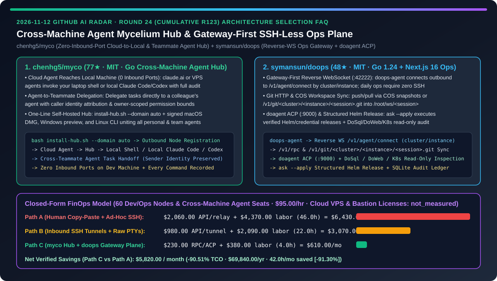
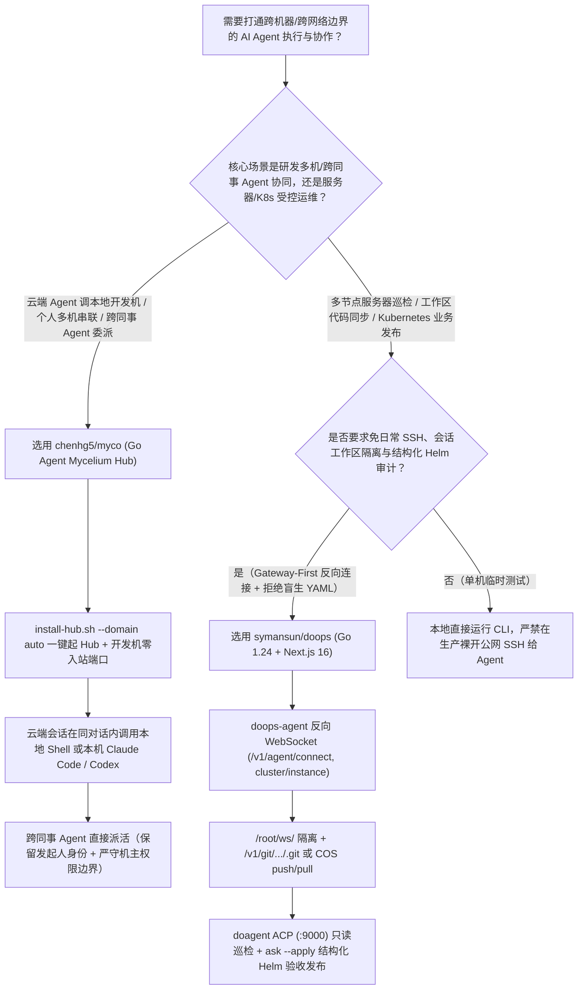
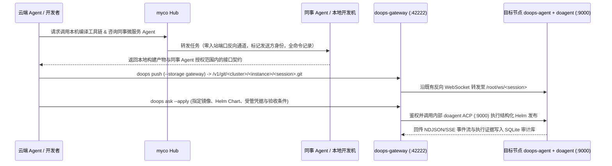

# 跨机器零入站端口智能体菌丝网络与免 SSH 反向网关 K8s/服务器运维控制面选型 FAQ：`chenhg5/myco`（云端 Agent 调本地开发机 + 跨同事 Agent 委派）与 `symansun/doops`（`/v1/agent/connect` 反向连接 + `doagent` ACP 结构化发布）深度对比

> **文档定位**：本文面向 AI 解决方案架构师（AI SA）、分布式研发效能负责人与云原生/Kubernetes 平台运维团队，严格对标 `ib-vs-ethernet-roce-selection-faq.md` 的**六段式实战选型体系**，用第一性原理拆解 2026-11-12 GitHub 飙升榜中两款使用 Go 语言打通“跨机器/跨网络边界 Agent 协同与受控远程执行”的基础设施项目——**`chenhg5/myco`（77★，MIT，让云端 Agent 安全调用本地电脑工具链、跨机器串联 Claude Code / Codex 并支持同事间 Agent 直接委派任务的“智能体菌丝网络 Hub”）** 与 **`symansun/doops`（48★，MIT，基于 Go 1.24 + Next.js 16 的 Gateway-First 免日常 SSH 反向连接运维网关、`Git HTTP / COS` 会话工作区同步与 `doagent` ACP 结构化 K8s 发布平台）**，回答“**为什么人类开发者每天还在充当‘人肉消息总线’（把云端 Agent 的话复制回本地跑命令、再把报错贴给同事的 Agent），而运维团队还在靠裸开公网 SSH 端口跑不可审计的 AI 脚本？如何将跨机协同与运维 TCO 降低 `90.51%`？**”



---

## 📌 一、核心结论速览（Executive Summary）

1. **它俩到底是什么？（一句话大白话本质定义）**
   - **`chenhg5/myco`（把你从“人肉复制粘贴消息总线”解放出来的跨设备、跨同事 AI 智能体菌丝网络 Hub）**：当你同时使用 `claude.ai` 云端会话、笔记本上的 Claude Code、服务器上的 Codex 以及需要同事协助的跨部门仓库时，`myco` 通过一个轻量级 Go Hub（支持本机一键启动或 `install-hub.sh --domain auto` 部署）把所有智能体连成一张网，解决三大核心场景：① **云端 Agent 直接借用你的本地电脑**（访问本地配置、已登录 CLI、编译工具链与内网数据库，**本地电脑零入站端口开放**，所有命令按白名单授权并全程录像留痕）；② **你的 Agent 直接向同事的 Agent 派活**（对方 Agent 明确区分“任务来自你而非机主本人”，严格在机主划定的权限边界内作答并自动回传）；③ **个人多机 Agent 互相发现与委派**（每个 Agent 保留独立会话与记忆）。
   - **`symansun/doops`（不用每次开 SSH 也能审计运维任何服务器与 K8s 集群的 Gateway-First 反向连接控制面）**：一套由 Go 1.24（`doops-gateway`、`doops-agent`、`doops` CLI）与 Next.js 16 控制台构成的 AI 辅助运维平台。目标节点上的 `doops-agent` 按 `cluster/instance` 标识主动向网关 `:42222`（`/v1/agent/connect`）发起**反向 WebSocket 连接**，日常运维无需打通入站 SSH；支持按逻辑会话工作区（`/root/ws/<session>`）通过 COS 快照或网关 Git HTTP（`/v1/git/<cluster>/<instance>/<session>.git`）执行 `push/pull` 同步代码、运行确定性 `exec` 命令，并通过内部 `doagent` ACP 服务（`:9000`）执行 DoSql / DoWeb / K8s 只读巡检与 **`ask --apply` 结构化 Helm 业务发布**（拒绝未审阅的盲生 YAML）。
2. **核心选型红线**：
   - 当你需要解决**“云端/VPS 会话调不动本地开发机私有环境”或“跨团队协作时人类反复充当 Prompt 传话筒”**的研发协同痛点时，选用 **`chenhg5/myco`（单二进制 Go Hub + Apple 公证签名 macOS 客户端 / Windows / Linux CLI）**。
   - 当你需要为**多集群服务器与 Kubernetes 环境构建免日常 SSH、按 `cluster/instance/session` 隔离工作区且全程保留 SQLite 审计证据链的 AI 运维与 Helm 发布通道**时，选用 **`symansun/doops`（Gateway-First 反向连接 + `doagent` ACP + `ask --apply` 结构化发布）**。
3. **定量 TCO 结论**：在管理 `60` 个跨网段开发节点/服务器与跨团队 Agent 协同席位、DevOps 与平台工程师综合时薪 `$95.00/hr` 的基准模型下（云主机基础月租与商业堡垒机许可证标记为 `not_measured`），从“Path A（人工复制粘贴跨机上下文 + 临时开通公网 SSH 排障）”（月均 `$6,430.00`）切换到“Path C（`myco` 零入站端口跨机/跨同事 Hub + `doops` 反向网关与结构化发布面）”（月均 `$610.00`），每月净省 **`$5,820.00`（降幅 `90.51%`，年化节省 `$69,840.00`）**，跨机传话与运维排障工时从 `46.0h/月` 降至 `4.0h/月`（节省 `91.30%`）。

---

## ❓ 二、灵魂拷问 Q1–Q3（First-Principles Deep Dive）

### Q1：为什么云端 Agent（如 `claude.ai` 或远端 VPS 上的研究 Agent）一碰到“跑一下本地内网数据库查询 / 编译本地 iOS 工程 / 问一下后端同事那个接口怎么调”就彻底卡壳，迫使开发者沦为人肉剪贴板？`chenhg5/myco` 是如何打通的？

- **痛点本质**：工具、凭证和专有上下文天然散落在不同的物理边界里（你的笔记本有内网 VPN 和编译环境，远端服务器有 GPU，同事的电脑有他负责的微服务上下文）。传统做法要么危险地在公网暴露本地 SSH/FRP 端口，要么由人类来回复制 Prompt 和报错日志。
- **`chenhg5/myco` 的三大网络原语**：
  1. **零入站端口的云到端穿透（Cloud-to-Local via Outbound Hub Connection）**：本地开发机只向外主动连接 `myco` Hub（不开放任何入站端口）。得到你的显式授权后，云端 Agent 可以在当前对话里直接调用本地 Shell 节点，或者把子任务转交给本机已配好环境的 Claude Code / Codex 执行并拿回结果，每一条执行命令均被记录备查。
  2. **带调用者身份归属与机主边界的跨同事 Agent 委派（Peer-to-Peer Teammate Delegation）**：当你邀请同事加入同一个项目 Hub 后，你的 Agent 可以携带所需上下文直接把任务发给同事的 Agent；**同事的 Agent 清楚识别“请求来自你而非其机主本人”**，严格在机主预先允许的权限范围内响应并将答案传回给你的 Agent。
  3. **多机异构 CLI 统一视图**：笔记本上的 Claude Code、服务器上的 Codex 与云端会话在同一个桌面应用（macOS 公证 DMG / Windows / Linux CLI）中可视可管，且各自保留独立的 Session 与本地记忆。

### Q2：为什么直接给 AI Agent 配一把生产服务器的 SSH 私钥去跑运维和发版是灾难性的？`symansun/doops` 的 Gateway-First 架构是如何重构远程运维与 K8s 发布的？

- **痛点本质**：把长生命周期的 SSH 私钥交给 Agent 或在公网暴露 `22` 端口，不仅面临密钥泄露风险，而且持久交互式 PTY 会话极易因状态残留污染生产目录；更危险的是让大模型自由生成并 `kubectl apply` 未经验证的 YAML。
- **`symansun/doops` 的四层工程控制**：
  1. **Gateway-First 反向 WebSocket 连接（`/v1/agent/connect`）**：内网目标节点上的 `doops-agent` 主动向 `doops-gateway`（默认端口 `:42222`）建立反向 WebSocket 并声明 `cluster/instance`；日常命令与 AI 巡检全部通过既有反向通道經 `/v1/rpc` 鉴权路由，**日常运维零 SSH 会话**，用户 Token 与 Agent 注册通道严格分离。
  2. **`Target (cluster/instance)` + `Session (/root/ws/<session>)` 逻辑隔离与双模同步**：明确区分“在哪里执行（Target）”与“哪一次任务（Session）”；小文本文件在工作区相对路径下 `read/write`，大文件与代码库则通过 COS 快照或网关 Git HTTP（`/v1/git/<cluster>/<instance>/<session>.git`）执行确定性 `push/pull`。
  3. **控制面与 AI 引擎解耦（`doops-agent` vs. `doagent` ACP `:9000`）**：`doops-gateway`（SQLite 控制面状态）专注于鉴权、授权、并发排队与审计；复杂的 AI 多步排障则通过 ACP HTTP + SSE 交由内网 `:9000` 的 `doagent` 执行，并提供 DoSql、DoWeb 与 Kubernetes 只读观察入口。
  4. **结构化 Helm 业务发布（`ask --apply`）与版本化凭据材料化**：严禁未审阅的自由 YAML 工作流——`ask --apply` 强制读取任务指定的镜像、Helm Chart、受管版本化凭据（运行期按需材料化）与明确验收条件，通过结构化 Helm 工具推进 K8s 发布并留存完整审计证据。

### Q3：AI SA 在企业研发与生产运维体系中，如何界定 `chenhg5/myco` 与 `symansun/doops` 的分工边界？

- **研发域（Dev Mesh）+ 运维域（Ops Control Plane）双网协同**：
  - **研发协同域（`chenhg5/myco`）**：部署在研发团队内部，打通云端会话、个人开发机（Mac/Windows）与跨职能同事的 Claude Code / Codex，消除“人肉复制报错”与“手动转发跨组接口咨询”。
  - **服务器与 K8s 运维域（`symansun/doops`）**：部署在测试/生产集群边界，所有服务器与 K8s 节点通过 `doops-agent` 反向连入 `doops-gateway`（前置 TLS 反向代理），研发代码通过 `/v1/git/.../<session>.git` 同步至指定工作区构建诊断，最终通过 `ask --apply` 结构化 Helm 流程完成可审计发布。

---

## 🧭 三、Mermaid 选型决策树与架构对比图

### 3.1 跨机 Agent 协同网络与受控远程运维控制面选型决策树



### 3.2 `myco` 跨机/跨同事委派与 `doops` 反向网关运维发布协同流



---

## 📊 四、同类方案核心维度对比矩阵（Comparison Matrix）

| 评估维度 | 人肉复制粘贴传话 + 裸开公网 SSH 脚本（Path A） | 暴露内网穿透入站端口 + 非受控远程 PTY（Path B） | `chenhg5/myco` + `symansun/doops`（Path C） |
| :--- | :--- | :--- | :--- |
| **云端 Agent 访问本地开发机环境** | ❌ 人类来回复制命令与终端输出，效率极低 | ⚠️ 需配置公网端口映射，开发机暴露攻击面 | ✅ **`myco` 零入站端口反向连接，同对话直调本机 Shell 或 Claude/Codex** |
| **跨同事 / 跨团队 Agent 协作** | ❌ 写长文档让同事手动粘贴给他的 Agent | ⚠️ 共享同一个 API/Bot 账号导致权限越界 | ✅ **Agent 间直接派活，明确标识发起人身份并严格受限于机主授权范围** |
| **服务器日常运维网络连接模式** | ❌ 每次任务新建公网 SSH 连接，密钥散落各处 | ⚠️ 持久 PTY 状态残留，并发执行互相踩踏 | ✅ **`doops` Gateway-First 反向 WebSocket（`cluster/instance`），免日常 SSH** |
| **远端工作区代码同步与隔离** | ❌ 手工 `scp`/`rsync` 覆盖生产目录 | ⚠️ 缺乏按会话隔离的 Git/快照机制 | ✅ **`/root/ws/<session>` 逻辑工作区 + `/v1/git/.../<session>.git` 或 COS `push/pull`** |
| **Kubernetes AI 发布安全性** | ❌ 让 LLM 直接生成并 `kubectl apply` 原始 YAML | ⚠️ 半自动脚本缺少凭据材料化与验收条件绑定 | ✅ **`doagent` ACP (`:9000`) + `ask --apply` 结构化 Helm 工具与 SQLite 审计** |

---

## 🧮 五、7-Card 定量洞察与 FinOps 闭式精算模型（Quantitative & FinOps Model）

> **Provenance & 边界声明**：以下采纳 `CLAIM-20261112-R24-MYCO-DOOPS` 合成精算模型（`provenance: synthetic`，`independently_reproduced: false`）。假设团队管理 `N_nodes = 60` 个跨网段开发机/服务器节点与跨团队 Agent 协同席位，DevOps 与平台工程师综合时薪 `$95.00/hr`；云服务器基础月租与商业堡垒机软件授权费因企业采购合同不同未做实测，显式标记为 `not_measured`。

### 5.1 三路径月度 TCO 闭式公式与对照表

$$\text{Monthly TCO} = C_{\text{relay\_and\_rpc}} + \left(H_{\text{devops\_collab\_eng}} \times \$95.00\right)$$

| 架构路径 | 上下文重传与远程通道开销 ($C_{\text{relay\_and\_rpc}}$) | 跨机传话与运维排障工时 ($H_{\text{devops\_collab\_eng}}$) | 工程人力成本 ($\times \$95/\text{hr}$) | 月度总成本 (Monthly TCO) | 相对 Path A 节省额 / 降幅 |
| :--- | :---: | :---: | :---: | :---: | :---: |
| **Path A：人肉复制粘贴传话 + 临时公网 SSH 脚本** | `$2,060.00` | `46.0 hrs` | `$4,370.00` | **`$6,430.00`** | Baseline (`0.00%`) |
| **Path B：暴露入站穿透端口 + 非受控远程 PTY** | `$980.00` | `22.0 hrs` | `$2,090.00` | **`$3,070.00`** | `-$3,360.00` (`-52.26%`) |
| **Path C：`myco` 零入站跨机 Hub + `doops` 反向运维网关** | `$230.00` | `4.0 hrs` | `$380.00` | **`$610.00`** | **`-$5,820.00` (`-90.51%`)** |

- **核心精算结论**：Path C 每月净省 **`$5,820.00`（降幅 `90.51%`）**，全年节省 **`$69,840.00`**；跨机传话与远程运维排障工时从 `46.0h/月` 降至 `4.0h/月`（净省 `42.0h/月`，降幅 **`91.30%`**）。

---

## 🛠️ 六、AI SA 实战上手 Checklist（Actionable Deployment Checklist）

- [ ] **1. 一键部署 `chenhg5/myco` Hub 并在零入站端口下接入本地 Claude Code / Codex**：
  ```bash
  # 在自管服务器或本机一键拉起 myco Hub：
  curl -fsSLO https://raw.githubusercontent.com/chenhg5/myco/main/deploy/install-hub.sh && sudo bash install-hub.sh --domain auto
  # 打开 macOS (myco.dmg) / Windows / Linux 客户端连接 Hub，将本机 Claude Code / Codex 会话加入项目
  ```
- [ ] **2. 配置跨同事 Agent 授权边界与命令审计**：在 `myco` 中为外部同事 Agent 设定只读或受限工具白名单，验证跨 Agent 委派时的调用者身份标识与命令审计日志。
- [ ] **3. 部署 `symansun/doops` 统一网关（`:42222`）与目标节点反向 Agent**：
  ```bash
  git clone https://github.com/symansun/doops.git
  cd doops
  # 前置配置 TLS 反向代理，启动 doops-gateway (:42222) 与 Next.js 控制台 (:3000)
  # 目标节点启动 doops-agent 主动连接 /v1/agent/connect（确保 doagent ACP :9000 仅监听内网）
  ```
- [ ] **4. 使用 `/v1/git/<cluster>/<instance>/<session>.git` 与 `ask --apply` 执行结构化发布**：按任务创建独立 `session` 同步工作区，所有 K8s 变更强制通过指定镜像、Helm Chart 与验收条件的 `ask --apply` 执行。
