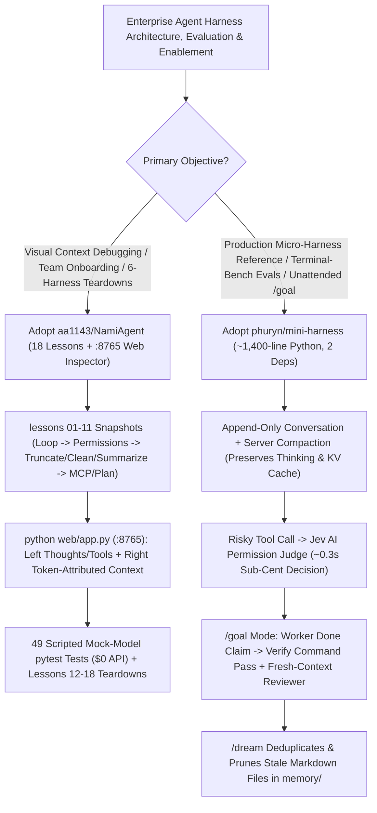

# Glass-Box Agent Harness Engineering (`phuryn/mini-harness` 1,400-Line Terminal-Bench #3 + `aa1143/NamiAgent` 18-Lesson Inspector) Selection FAQ

> **Positioning**: This standalone guide is **Round 21 of the 2026-11-11 Night Shift (Cumulative Guide #66)**, written in the plain-language, first-principles, closed-form FinOps style of `ib-vs-ethernet-roce-selection-faq.md` for AI Platform and Agent Harness Solution Architects evaluating two breakout glass-box reference repositories:
> 1. **`phuryn/mini-harness` (`172★`, Python `~1,400 lines`, MIT, 2 dependencies: `anthropic` + `mcp`)**: A complete, readable agent harness featuring **append-only history with Anthropic server-side compaction (keeping extended thinking valid and prompt caches warm)**, **`/goal` mode with a deterministic verify command + fresh-context reviewer ("the worker never grades itself")**, a **`0.3s` sub-cent AI permission judge (`Jev`)**, and `/dream` memory deduplication—scoring **72.0/89 (3rd of 9 harnesses, `$3.28/run`, fastest at `571 min`) on Terminal-Bench 2.1** with Claude Haiku 5.5 and **75.0/89 (`$2.25/run`)** with DeepSeek V4.1 Flash;
> 2. **`aa1143/NamiAgent` (`499★`, Python, MIT, 1 dependency: `openai`)**: An 18-lesson glass-box curriculum and runnable local agent built from a 100-line `while` loop (`lessons/lesson-01` to `lesson-11`) with **49 zero-cost mock-LLM unit tests (`pytest -q`)**, a zero-framework `:8765` split-screen browser context inspector (preserving `reasoning_content` across tool turns), and 7 side-by-side architectural teardowns of `Claude Code`, `Codex`, `Pi`, `Grok Bot`, `DeepSeek Harness`, and `OpenClaw/Hermes`.
>
> **中文版 FAQ**: [namiagent-mini-harness-glassbox-agent-engineering-selection-faq.md](namiagent-mini-harness-glassbox-agent-engineering-selection-faq.md) · **Architecture Summary SVG**: [`assets/github-ai-radar-2026-11-11-r21-nami-miniharness.svg`](../../../assets/github-ai-radar-2026-11-11-r21-nami-miniharness.svg)

---

## 📌 1. Executive Summary

1. **In plain English, what problems do these two repositories actually solve?**
   - **Bridging the Gap Between Toy Bash Loops and 1M-Line Monoliths While Keeping KV Caches Warm (`phuryn/mini-harness`)**: Minimal agent scripts (`nanocode` at 220 lines, `mini-swe-agent` at 4,000 lines) lack sessions, compaction, MCP, skills, and independent goal verification, while production harnesses (`Pi` at `~115K` lines of TS, `Codex CLI` at `~1.4M` lines of Rust) are too large to read in one sitting. Worse, many harnesses mutate prior messages during client-side compaction, dropping extended-thinking blocks and busting KV prompt caches. `phuryn/mini-harness` delivers a complete harness in **`~1,400 lines` of Python** with **append-only history + server-side compaction**, a **`/goal` mode where a fresh-context reviewer verifies the worker's output**, and a **`0.3s` AI permission judge (`Jev`)**—passing **72.0/89 tasks (`$3.28/run`)** and **75.0/89 (`$2.25/run`)** on **Terminal-Bench 2.1**.
   - **Making Context Window Mutations & Production Harness Internals Visible (`aa1143/NamiAgent`)**: Engineers building or debugging agents inside heavy frameworks cannot see how the context window grows turn by turn, why `reasoning_content` must be round-tripped across tool calls, or how code-enforced `/plan` mode works. `NamiAgent` provides **11 diffable runnable snapshots (`lesson-01` to `lesson-11`)**, **49 zero-cost mock-model `pytest` tests**, a stdlib-only `:8765` split-screen Web UI showing thoughts/tools on the left and exact token-attributed context JSON on the right, plus 7 architectural teardowns (`docs/12` to `18`).
2. **Closed-Form FinOps Verdict (`CLAIM-20261111-R21-NAMI-MINIHARNESS`)**:
   - For an Enterprise AI Platform & Enablement Team running **150 full 89-task Terminal-Bench 2.1 evaluation suites per month** and onboarding **25 engineers/month** onto internal agent harnesses (senior AI engineer loaded rate `$85.00/hr`; Docker host hardware and developer laptop depreciation: `not_measured`):
   - Upgrading from **Path A (Cache-busting heavy framework [`Terminus 2` at `$11.61/run`] + live-API onboarding tests, `$6,210.00/mo`)** to **Path C (`phuryn/mini-harness` append-only cache-warm harness [`$2.25/run` on DeepSeek V4.1 Flash] + `/goal` fresh reviewer + `aa1143/NamiAgent` 49 mock-LLM tests & `:8765` inspector, `$870.00/mo`)** saves **`$5,340.00/mo` (`-85.99%`, `$64,080.00/yr`)** and cuts engineering verification and onboarding hours from `46.0 hrs/mo` to `6.0 hrs/mo` (**`-86.96%`**).

---

## 🎯 2. Three Core Architectural Questions (Q1 / Q2 / Q3 Deep-Dive)

### Q1: How does `phuryn/mini-harness` score 72.0–75.0/89 on Terminal-Bench 2.1 at `$2.25–$3.28/run` in just 1,400 lines of Python?
- **First-Principles Breakdown**:
  1. **Append-Only Conversation & Server-Side Compaction (Zero Cache Invalidation)**:
     - Multi-step container tasks (compiling Cython extensions, configuring Git servers, booting Alpine VMs in QEMU) re-send tens of thousands of history tokens every turn. Harnesses that overwrite history with client-side summaries drop Claude's `thinking` blocks and invalidate KV prompt caches. `mini-harness` **never edits what it already sent**, relying on server-side compaction to keep thinking valid and caches hot—finishing 89 Terminal-Bench 2.1 tasks in **571 minutes (fastest of all 9 harnesses)** for **`$3.28/run`** on Haiku 5.5 (`72.0/89`, 3rd place) and **`$2.25/run`** on DeepSeek V4.1 Flash (`75.0/89`, vs. `Terminus 2` at `$11.61/run` for `67.7/89`).
  2. **The Worker Never Grades Itself (`/goal` Mode + Independent Fresh Reviewer)**:
     - In `/goal <objective>` mode, a worker claiming "done" is accepted **only after the verify command passes AND a separate reviewer subagent with a fresh context window inspects and approves the work**.
  3. **`0.3s` Sub-Cent Permission Judge (`Jev`) & Container Python Isolation**:
     - With `OPENROUTER_API_KEY` set (`permissions judge`), risky actions are evaluated in **`~0.3 seconds`** by a lightweight judge model (`Jev`) for a fraction of a cent, prompting the human only when uncertain. Installing inside test containers with `UV_PYTHON_INSTALL_DIR=/opt/mini-python` prevents `uv`'s Python 3.12 from shadowing the container's system Python.

### Q2: How does `aa1143/NamiAgent` decompose modern agent harnesses into 11 runnable lessons and make `reasoning_content` context mutations observable?
- **First-Principles Breakdown**:
  1. **3-Stage Context Funnel (`lesson-04`: Truncate → Clean → Summarize) & Code-Enforced `/plan` (`lesson-10`)**:
     - Instead of immediately invoking an expensive LLM summarizer, `lesson-04` implements a deterministic 3-stage context pipeline: **Truncate** oversized raw tool outputs -> **Clean** stale intermediate tool payloads -> **Summarize** only when approaching the context ceiling. Meanwhile, `lesson-10` enforces read-only `/plan` mode in Python tool-executor code rather than relying on fragile system-prompt instructions.
  2. **Zero-Framework Split-Screen Web Inspector (`python web/app.py` on `:8765`) & 49 Mock-LLM Tests**:
     - Using only the Python standard library, `web/app.py` hooks `lesson-11` to display every model turn, `reasoning_content` block (properly round-tripped back into the context during multi-step tool calls), and tool output on the left, alongside the exact token-attributed context window on the right. All 49 unit tests (`pytest -q`) run against scripted mock models for `$0` API cost.

### Q3: How should Solution Architects combine `NamiAgent` and `mini-harness` in enterprise teams?
- **Deployment Blueprint**:
  - Use **`aa1143/NamiAgent`** (`lessons/lesson-01`..`11` + `docs/12`..`18` + `:8765` Web Inspector) as the onboarding curriculum and zero-cost mock-LLM testing pattern for engineers learning agent internals.
  - Use **`phuryn/mini-harness`** (`~1,400 lines`) as the clean reference architecture for custom internal harnesses—adopting its append-only cache-warm loop, `/goal` fresh-context reviewer, `0.3s` `Jev` permission judge, and `/dream` memory compaction.

---

## 🧭 3. Mermaid Decision Tree & Glass-Box Harness Pipeline

---

## 📊 4. Architectural Comparison Matrix

| Evaluation Dimension | Path A: Heavy Cache-Busting Framework (`Terminus 2`) | Path B: Bash-Only Minimal Script (`mini-swe-agent` / `nanocode`) | **Path C (Recommended): `phuryn/mini-harness` + `aa1143/NamiAgent`** |
| :--- | :--- | :--- | :--- |
| **Codebase Size & Dependencies** | Tens/hundreds of thousands of lines; heavy dep tree | `220–4,000 lines`, but lacks MCP, Skills, sessions & compaction | **`mini-harness`: `~1,400 lines` (2 deps); `NamiAgent`: 1 dep (`openai`)** |
| **Compaction & Prompt Cache Warmth** | Rewrites history & drops thinking; frequent KV cache misses | No compaction; overflows on long multi-step tasks | **Append-only history + server compaction + Truncate→Clean→Summarize** |
| **Terminal-Bench 2.1 Score & Cost** | `Terminus 2`: `67.7/89` passed at **`$11.61 / run`** (`745 min`) | `mini-swe-agent`: `69.7/89` (`$5.75` Haiku) / `77.3` (`$2.44` DS) | **`72.0/89` (`$3.28` Haiku, fastest `571m`) & `75.0/89` (`$2.25` DeepSeek V4.1)** |
| **Completion Gate & Permission Judge** | Worker grades itself; manual prompts or unsafe `--yes` | Basic confirm mode only; no fresh-context reviewer | **`/goal` verify cmd + fresh-context reviewer + `0.3s` `Jev` AI judge** |
| **Observability & Zero-Cost Testing** | Opaque framework logs; tests burn live API tokens | No UI inspector or progressive mock-LLM test suite | **`:8765` split-screen context inspector + 49 `$0` mock-LLM `pytest` tests** |
| **Monthly TCO (150 Suites + 25 Eng)** | **`$6,210.00 / mo`** (`$2,300` tokens + `$3,910` labor) | **`$3,150.00 / mo`** (`$1,110` tokens + `$2,040` labor) | **`$870.00 / mo` (Saves `$5,340.00/mo` · `-85.99%`)** |

---

## 🧪 5. Closed-Form FinOps Example & 7-Card Insights (`CLAIM-20261111-R21-NAMI-MINIHARNESS`)

### 5.1 Workload & Scope Boundary
- **Workload**: An Enterprise AI Platform team executing **150 full 89-task Terminal-Bench 2.1 evaluation runs per month** and onboarding **25 engineers/month** onto internal agent harness architectures.
- **Rates**: Senior AI engineer loaded rate at **`$85.00 / hr`**.
- **Explicit Scope Boundary**: Docker benchmark host hardware depreciation and developer laptop hardware are marked **`not_measured`**.

### 5.2 Closed-Form Monthly Cost Breakdown

| Cost Component | Path A: Cache-Busting Framework (`$11.61/run`) + Live Tests | Path B: Bash-Only Harness (`$5.75/run`) | **Path C: `mini-harness` + `NamiAgent` (Recommended)** |
| :--- | :--- | :--- | :--- |
| **150 T-Bench Runs + Onboarding Test Tokens** | `$1,741.50 + $558.50` = **`$2,300.00`** | `$862.50 + $247.50` = **`$1,110.00`** | `150 × $2.25 + $22.50` = **`$360.00`** |
| **Engineering QA, Cache Debugging & Training (`$85/hr`)** | `46.0 hrs × $85.00` = **`$3,910.00`** | `24.0 hrs × $85.00` = **`$2,040.00`** | `6.0 hrs × $85.00` = **`$510.00`** |
| **Total Monthly TCO** | **`$6,210.00 / mo`** | **`$3,150.00 / mo`** (`-49.28%`) | **`$870.00 / mo`** |
| **Net Savings vs. Path A** | Baseline | Saves `$3,060.00 / mo` | **Saves `$5,340.00 / mo` (`-85.99%` · `$64,080.00/yr`)** |
| **Docker Host & Laptop Hardware** | `not_measured` | `not_measured` | `not_measured` |

---

## 🛠️ 6. Production Verification Checklist

- [ ] **1. Isolated Container Installation (`UV_PYTHON_INSTALL_DIR`)**: Install `mini-harness` inside benchmark/CI containers using `UV_PYTHON_INSTALL_DIR=/opt/mini-python uv tool install git+https://github.com/phuryn/mini-harness` so `uv`'s Python 3.12 never overrides the test container's system Python.
- [ ] **2. `Jev` Permission Judge & Air-Gapped Flags**: Export `OPENROUTER_API_KEY` to enable `permissions judge` (`~0.3s` risk evaluation), and set `MINI_NO_WEB=1` / `MINI_NO_TASK=1` when running restricted benchmark tasks.
- [ ] **3. `/goal` Fresh-Reviewer & `/dream` Memory Hygiene**: Run unattended jobs with `mini -p "..." --goal "<objective>"` (verifying non-zero exit code `1` on incomplete goals) and schedule `/dream` to deduplicate `memory/*.md`.
- [ ] **4. `NamiAgent` Workspace Isolation & 49 Mock-LLM Tests**: Set `NAMI_WORKSPACE=~/agent-workspace` and `NAMI_STATE_DIR=~/.nami-agent` (never pointing workspace at `~`), and run `cd lessons/lesson-11 && pytest -q` to verify all 49 zero-cost mock-LLM tests pass.
- [ ] **5. Split-Screen `:8765` Context & `reasoning_content` Audit**: Launch `python web/app.py --demo` (or live DeepSeek mode) at `http://localhost:8765` and verify that `reasoning_content` is preserved across tool-calling turns in the right-hand context inspector.
