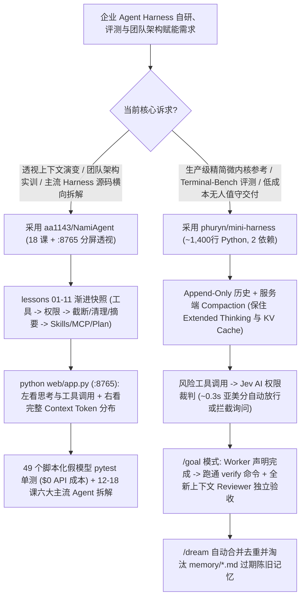

# 白盒 Agent Harness 工程解构（`phuryn/mini-harness` 1,400 行 Terminal-Bench 季军 + `aa1143/NamiAgent` 18 讲逐格透视）选型 FAQ

> **文档定位**：本文是 **2026-11-11 夜班多轮深潜 Round 21（累计第 66 篇独立选型专题）**，严格对标 `ib-vs-ethernet-roce-selection-faq.md` 的「通俗大白话 + 第一性原理 + 可核算定量算例」标杆文风，为需要从零自研或深度定制企业内部 Coding Agent Harness 的解决方案架构师拆解今日两款现象级“白盒（Glass-Box）Agent 架构标杆”：
> 1. **`phuryn/mini-harness`（`172★`，Python `~1,400 行`，MIT，仅 `anthropic` 与 `mcp` 两个依赖）**：一顿饭功夫即可通读完毕的全功能生产级微内核 Harness——支持只追加（Append-Only）历史与服务端上下文压缩（保持 Extended Thinking 签名有效与 KV Cache 常温）、`/goal` 独立新上下文审查员（**Worker 绝不自己给自己判卷**）、**`0.3 秒` 亚美分 AI 权限裁判（`Jev`）** 与 `/dream` 记忆去重，在 **Terminal-Bench 2.1（89 个 Docker 真机任务）** 中以 **`72.0/89`（Haiku 5.5，`$3.28/run`，全场最短 `571 分钟`）** 与 **`75.0/89`（DeepSeek V4.1 Flash，`$2.25/run`）** 斩获全场前四；
> 2. **`aa1143/NamiAgent`（`499★`，Python，MIT，仅依赖 `openai` 单个包）**：从 100 行最小 `while` 循环起步的 **11 课可运行代码快照（含 49 个免 API Key 假模型单测）+ 7 篇主流 Agent 深度源码拆解（Claude Code / Codex / Pi / Grok Bot / DeepSeek Harness / OpenClaw & Hermes）**，自带零 Web 框架的 `:8765` 左右分屏上下文透视器（精准展示 `reasoning_content` 跨工具调用回传与三阶段上下文管理）。
>
> **English Companion**: [namiagent-mini-harness-glassbox-agent-engineering-selection-faq.en.md](namiagent-mini-harness-glassbox-agent-engineering-selection-faq.en.md) · **架构总结图**: [`assets/github-ai-radar-2026-11-11-r21-nami-miniharness.svg`](../../../assets/github-ai-radar-2026-11-11-r21-nami-miniharness.svg)

---

## 📌 一、核心结论速览（Executive Summary）

1. **先用大白话讲透这两个项目到底解决了什么痛点？**
   - **自研 Agent Harness 的“玩具脚本缺能力 vs. 百万行巨石看不懂、改历史导致缓存雪崩”痛点（`phuryn/mini-harness` 解决的问题）**：市面上的开源 Agent 要么是只有 200 行、只能调 `bash` 的玩具（`nanocode` / `mini-swe-agent`，没有会话恢复、没有 MCP/Skills、没有目标验收），要么是 `Pi`（`11.5 万行 TS` / 22 个依赖）或 `Codex CLI`（`140 万行 Rust` / 77 个 Crate）这样的庞然大物。更致命的是，很多自研框架在做上下文压缩（Compaction）时会直接篡改已发送的历史消息，导致 Claude 的 `thinking` 签名失效、Prompt Cache 瞬间全部作废，单次基准测试账单暴涨 3～5 倍！`phuryn/mini-harness` 用 **约 1,400 行可读性极高的 Python** 实现了全套现代能力：严格保持对话 **Append-Only（只追加不改写）** 并对接服务端压缩、在 `/goal` 模式下强制执行 **`verify` 命令 + 全新上下文独立 Reviewer 双重签收（The worker never grades itself）**，并用 **`0.3 秒` 响应的小模型权限裁判 `Jev`** 替代烦人的弹窗确认。
   - **团队学习与调优 Agent 上下文的“黑盒框架盲人摸象与测试烧钱痛点”（`aa1143/NamiAgent` 解决的问题）**：新手直接套用重量级 Agent 框架，往往连“每一轮对话后上下文到底长了多少 Token、DeepSeek 的 `reasoning_content` 在带工具调用时为什么必须原样塞回上下文、代码级强制只读 `/plan` 模式怎么写”都一头雾水。`NamiAgent` 把 Agent 拆成 `lesson-01` 到 `lesson-11` 共 11 个可独立运行、可相互 `diff` 的代码快照（从最小循环一路长出权限分级、截断→清理→摘要三阶上下文、Skills、Telegram 审批、定时心跳、MCP、子 Agent、只读计划与长期记忆），配套 **49 个基于脚本化假模型的零成本 `pytest` 单元测试**、`:8765` 左右分屏上下文透视网页端，以及第 12～18 课对 `Claude Code`、`Codex`、`Pi`、`Grok Bot`、`DeepSeek Harness`、`OpenClaw/Hermes` 的横向架构总对照表！
2. **闭式 FinOps 核算结论（`CLAIM-20261111-R21-NAMI-MINIHARNESS`）**：
   - 在 **企业 AI 平台团队每月运行 150 轮 Terminal-Bench 2.1（89 任务）全量回归评测 + 培训赋能 25 名研发工程师掌握内部 Agent Harness** 基准下（高级 AI 工程师全包时薪 `$85.00/hr`；底层 Docker 宿主机硬件与办公笔记本折旧：`not_measured`）：
   - 从 **Path A（破坏缓存的重型黑盒框架 [`Terminus 2` `$11.61/run`] + 真模型消耗 API Key 跑教学单测，`$6,210.00/月`）** 升级至 **Path C（`phuryn/mini-harness` 缓存常温暖启动架构 [`$2.25/run` DeepSeek V4.1 Flash] + `/goal` 独立复核 + `aa1143/NamiAgent` 49 个零成本假模型测试与分屏透视器，`$870.00/月`）**，每月净省 **`$5,340.00/月`（降幅 `-85.99%`，年化节省 `$64,080.00/年`）**，工程排障与培训辅导工时从 `46.0 小时/月` 降至 `6.0 小时/月`（**节省 `86.96%`**）。

---

## 🎯 二、三大灵魂拷问（Q1 / Q2 / Q3 Deep-Dive）

### Q1：为什么 `phuryn/mini-harness` 仅凭 1,400 行 Python 就能在 Terminal-Bench 2.1（89 个硬核容器任务）上打赢或持平上百万行代码的商业/开源 Harness，且单轮成本仅需 `$2.25～$3.28`？
- **第一性原理拆解**：
  1. **Append-Only 对话不变量与服务端 Compaction（保住 Prompt Cache 与 Thinking 签名）**：
     - 在长链路终端任务（如在 Docker 里编译 Cython 扩展或拉起 QEMU Alpine 虚拟机）中，90% 以上的输入 Token 都是前序历史。如果 Harness 在中途裁剪或改写历史消息（如 `Pi` 或 `Claude Code` 自建客户端摘要丢弃 `thinking` 块），每一轮都会击穿 KV Cache 并丢失推理状态。`mini-harness` 坚持**绝不修改已发送内容（Never edits what it already sent）**，直接利用服务端 Compaction 保持缓存命中率，因此在 Haiku 5.5 上仅耗时 **571 分钟（全场最快）**、花费 **`$3.28/run`** 即通过 **72.0/89 题（第 3 名）**；在 DeepSeek V4.1 Flash 上仅花 **`$2.25/run`** 即通过 **75.0/89 题**（而重型框架 `Terminus 2` 花费 `$11.61/run` 却仅通过 `67.7` 题）。
  2. **The Worker Never Grades Itself（`/goal` 模式的双闸门验收）**：
     - 普通 Agent 常在测试还没全绿时就幻觉宣布“任务完成”。在 `mini` 的 `/goal` 模式下，Worker 声称完成时必须先跑通确定性 `verify` 命令，紧接着系统会拉起一个**拥有全新干净上下文（Fresh Context）的 Reviewer 子智能体**独立复核代码改动，任何一关不过都自动打回继续迭代。
  3. **`0.3 秒` AI 权限裁判 `Jev` 与容器 Python 隔离（`UV_PYTHON_INSTALL_DIR`）**：
     - 开启 `permissions judge`（配置 `OPENROUTER_API_KEY`）后，高风险命令先由轻量裁判模型 `Jev` 在 **`~0.3 秒`** 内以微厘级成本判定是否安全，仅在存疑时才打扰人类；在测试容器内安装时通过 `UV_PYTHON_INSTALL_DIR=/opt/mini-python` 避免 `uv` 下载的 Python 3.12 抢占被测项目原本依赖的系统 Python。

### Q2：`aa1143/NamiAgent` 是如何把复杂的现代 Agent 拆解成 11 个可递进对比的最小原语，并解决思考模型（`reasoning_content`）上下文可视化难题的？
- **第一性原理拆解**：
  1. **三阶渐进式上下文管理（`lesson-04`：截断 → 清理 → 摘要）与代码级强制只读 `/plan`（`lesson-10`）**：
     - 很多开发者一上来就做全文 LLM 摘要，既慢又贵。`NamiAgent` 第 4 课展示了工业级分层漏斗：先对超大工具输出做确定性**截断（Truncate）** → 再对过期的旧工具大段返回做结构化**清理（Clean）** → 最后才在逼近窗口上限时触发**摘要（Summarize）**；第 10 课则展示了**不能靠提示词祈祷模型不写文件，而必须在工具执行器代码层强制拦截写操作**的真·只读 `/plan` 模式。
  2. **DeepSeek `reasoning_content` 跨工具轮次回传与 `:8765` 左右分屏透视**：
     - 使用 DeepSeek 思考模式并触发连续工具调用时，当前 Turn 内的 `reasoning_content` 必须原封不动放回上下文再发给 API。`python web/app.py` 仅用 Python 标准库（零第三方 Web 框架）钩住 `lesson-11` 的 3 个接口，在浏览器左栏实时流式展示思考过程与工具调用，右栏按角色色块与 Token 估算展示当次发给大模型的完整 Context JSON。

### Q3：架构师在设计企业内部 Agent 规范与评测基建时，如何组合复用这两个仓库？
- **落地方案**：
  - 将 **`aa1143/NamiAgent`** 的第 1～11 课（及 49 个免 Key 假模型测试）作为团队新人的**必修实训沙盒**，并用第 12～18 课的对照表统一团队对 `Claude Code`、`Codex`、`Pi`、`DeepSeek Harness`、`OpenClaw/Hermes` 的架构认知；
  - 将 **`phuryn/mini-harness`** 的 1,400 行源码作为企业自研垂直领域 Agent 的**黄金参考骨架（Reference Architecture）**，直接复用其 Append-Only 缓存保温、`UV_PYTHON_INSTALL_DIR` 容器无污染安装、`/goal` 独立新上下文复核与 `/dream` 记忆整理机制。

---

## 🧭 三、Mermaid 选型决策树与白盒 Harness 运转闭环

---

## 📊 四、同类方案核心能力对比矩阵（Comparison Matrix）

| 评估维度 | Path A：重型黑盒框架（如 `Terminus 2` + 真模型测训） | Path B：极简 Bash 脚本（`mini-swe-agent` / `nanocode`） | **Path C（推荐标杆）：`phuryn/mini-harness` + `aa1143/NamiAgent`** |
| :--- | :--- | :--- | :--- |
| **代码体量与第三方依赖** | 数万至百万行代码，数十个重型依赖包 | `220～4,000 行`，但缺 MCP、Skills、会话恢复与压缩 | **`mini-harness` 仅 `~1,400 行` (2 依赖)；`NamiAgent` 仅依赖 `openai`** |
| **上下文压缩与缓存命中率** | 客户端重写历史丢弃 `thinking`，导致 KV Cache 频繁失效 | 无上下文压缩，长任务直接触发 Context Overflow | **Append-Only 历史 + 服务端 Compaction + 三阶「截断→清理→摘要」** |
| **Terminal-Bench 2.1 实测表现** | `Terminus 2`: `67.7/89` 通过，单轮高达 **`$11.61`** | `mini-swe-agent`: `69.7/89` (`$5.75` Haiku) / `77.3` (`$2.44` DS) | **`72.0/89` (`$3.28` Haiku, 最快 571m) & `75.0/89` (`$2.25` DeepSeek V4.1)** |
| **防幻觉完成验收与权限裁判** | Worker 自报完成即退出；权限靠人工狂按回车或全开 | 仅支持简单 Confirm 模式，无独立 Reviewer 子智能体 | **`/goal` 强制 `verify` + 新上下文 Reviewer 复核 + `0.3s` `Jev` AI 裁判** |
| **可观测性与零成本测试** | 黑盒日志极难排查 Context 污染；单测需烧真实 API Key | 无可视化界面，无递进快照与假模型单测 | **`:8765` 左右分屏 Context 透视器 + 49 个免 Key 假模型 `pytest` 单测** |
| **月度总拥有成本（150 轮评测+实训）** | **`$6,210.00 / 月`**（Token `$2,300` + 人工 `$3,910`） | **`$3,150.00 / 月`**（Token `$1,110` + 人工 `$2,040`） | **`$870.00 / 月`（净省 `$5,340.00/月`，降幅 `-85.99%`）** |

---

## 🧪 五、闭式定量 FinOps 算例与 7-Card 评测洞察（`CLAIM-20261111-R21-NAMI-MINIHARNESS`）

### 5.1 基准假设与边界声明
- **评测负载**：企业 AI 平台团队每月执行 **150 轮 Terminal-Bench 2.1（89 任务）基准评测**，并每月对 **25 名研发工程师**开展内部 Agent Harness 架构实训与单测回归。
- **单价基准**：高级 AI 工程师全包时薪 **`$85.00 / hr`**。
- **显式边界声明（Scope Boundary）**：Docker 评测宿主机固定硬件折旧及参训工程师办公电脑资产标记为 **`not_measured`**。

### 5.2 三路径闭式成本核算表

| 成本构成项 | Path A：重型缓存在线失效框架（`$11.61/run`） | Path B：仅 Bash 极简框架（`$5.75/run`） | **Path C：`mini-harness` + `NamiAgent`（推荐）** |
| :--- | :--- | :--- | :--- |
| **150 轮 T-Bench 评测与实训单测 Token** | `$1,741.50 + $558.50` = **`$2,300.00`** | `$862.50 + $247.50` = **`$1,110.00`** | `150 × $2.25 + $22.50` = **`$360.00`** |
| **缓存排障、假阳性复核与培训工时（`$85/hr`）** | `46.0 hrs × $85.00` = **`$3,910.00`** | `24.0 hrs × $85.00` = **`$2,040.00`** | `6.0 hrs × $85.00` = **`$510.00`** |
| **月度总成本（Monthly Total）** | **`$6,210.00 / 月`** | **`$3,150.00 / 月`**（`-49.28%`） | **`$870.00 / 月`** |
| **相对 Path A 净节省（Savings）** | 基准线（Baseline） | 节省 `$3,060.00 / 月` | **净省 `$5,340.00 / 月`（`-85.99%` · 年省 `$64,080.00`）** |
| **Docker 宿主机与办公电脑折旧** | `not_measured` | `not_measured` | `not_measured` |

---

## 🛠️ 六、生产级落地核验 Checklist（SA Actionable Verification）

- [ ] **1. 容器环境无污染安装 `mini-harness`**：在评测容器或 CI 节点中务必设置 `UV_PYTHON_INSTALL_DIR=/opt/mini-python uv tool install git+https://github.com/phuryn/mini-harness`，防止 `uv` 自动拉取的 Python 3.12 覆盖被测项目的系统 Python。
- [ ] **2. `Jev` AI 权限裁判与无外网隔离门禁**：配置 `OPENROUTER_API_KEY` 激活 `permissions judge`（`~0.3s` 自动风险判定），在对离线合规要求极高的评测任务中设置 `MINI_NO_WEB=1` 与 `MINI_NO_TASK=1`。
- [ ] **3. `/goal` 独立复核与 `/dream` 记忆瘦身验证**：启动无人值守任务时使用 `mini -p "..." --goal "<objective>"`，验证退出码（未达标必返回 `exit code 1`）并定期运行 `/dream` 合并清理 `memory/` 下的重复 Markdown 记忆。
- [ ] **4. `NamiAgent` 49 项免 Key 单测与工作区隔离**：设置 `export NAMI_WORKSPACE=~/agent-workspace` 与 `export NAMI_STATE_DIR=~/.nami-agent`（严禁指向用户主目录 `~`），运行 `cd lessons/lesson-11 && pytest -q` 确认 49 个假模型测试 100% 通过。
- [ ] **5. `:8765` 分屏透视器审查 `reasoning_content`**：运行 `python web/app.py --demo` 或连接真实 DeepSeek 模型访问 `http://localhost:8765`，核验工具调用回合中 `reasoning_content` 是否完整保留并回传至右侧 Context 面板。
