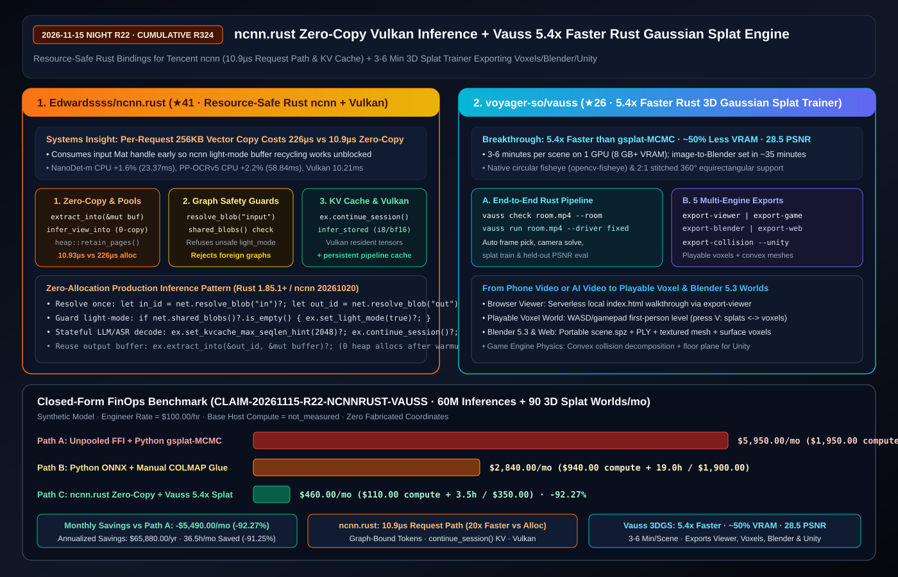
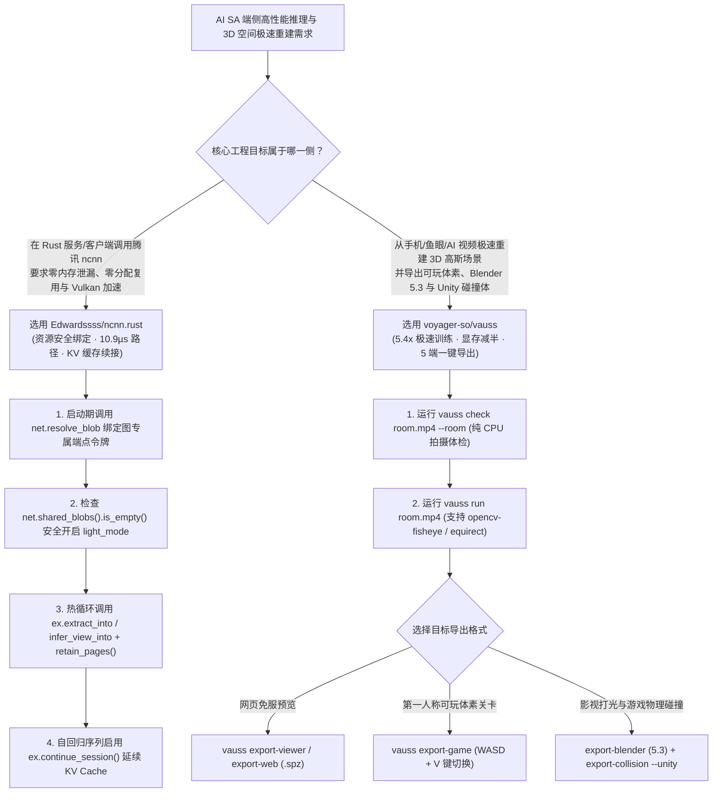

# 资源安全零拷贝 Rust 端侧推理绑定（`ncnn.rust`）与 5.4 倍极速 Rust 三维高斯泼溅重建引擎（`Vauss`）深度架构拆解与同类方案选型 FAQ

> **文档元数据（Document Metadata）**  
> - **评审日期**：2026-11-15（Night Round 22 · 累计第 324 轮独立选型专题）  
> - **对标项目**：[`Edwardssss/ncnn.rust`](https://github.com/Edwardssss/ncnn.rust)（`★41`，2026-11-08 创建，面向腾讯 `ncnn` `20261020` 的资源安全 Rust 绑定，支持零拷贝借用视图、图绑定端点令牌、`continue_session()` KV 缓存、`retain_pages()` 堆池与 Vulkan 后端，BSD-3-Clause） & [`voyager-so/vauss`](https://github.com/voyager-so/vauss)（`★26`，2026-11-12 创建，比 `gsplat-MCMC` 快 `5.4x`、省一半显存、单卡 `3–6 分钟` 重建 `28.5 PSNR` 并一键导出网页查看器、可玩体素世界、Blender 5.3 与 Unity 碰撞网格的纯 Rust 高斯泼溅训练器）  
> - **适用角色**：AI Solution Architect（AI 解决方案架构师）、Rust 高性能端侧推理主程、3D 数字孪生与空间重建工程师  
> - **关联雷达日报**：[2026-11-15 全景洞察与飙升榜 (`daily/2026-11-15.md`)](../daily/2026-11-15.md) · [English Version (`ncnn-rust-vauss-zero-copy-vulkan-inference-bindings-5x-gaussian-splat-trainer-selection-faq.en.md`)](ncnn-rust-vauss-zero-copy-vulkan-inference-bindings-5x-gaussian-splat-trainer-selection-faq.en.md)  
> - **可视化总结图**：[`assets/github-ai-radar-2026-11-15-r22-ncnnrust-vauss.svg`](../../../assets/github-ai-radar-2026-11-15-r22-ncnnrust-vauss.svg)



---

## 📌 一、核心结论速览（Executive Summary — 先看结论再看细节）

1. **一句话讲透本质（What & Why）**：
   - **`Edwardssss/ncnn.rust` 是什么？** 它是专为腾讯端侧推理框架 `ncnn`（钉死 `20261020` 版本）打造的 **“利用 Rust 所有权系统从编译期根治 C++ FFI 内存泄漏、野指针与 20 倍隐式内存拷贝惩罚的生产级推理绑定（`ncnn-rust` + `ncnn-rust-sys`）”**。作者通过硬核微基准实测揭示了一个惊人事实：在 65,536 元素 FP32 张量请求路径上，零拷贝借用输出仅需 **`10.93 µs`**，而每次请求新建 `Vec` 拷贝 256 KB 缓冲区并触发 glibc/NT 堆缺页中断竟高达 **`226 µs`（慢 20 倍以上）**！为此，`ncnn.rust` 设计了消费型输入（提前释放调用方引用以便 `ncnn` 启用 Light-mode 内存池复用）、单次端点解析 + 缓冲区复用（`extract_into`）、跨步保留 Attention KV 缓存（`ex.continue_session()`）、共享 Blob 安全拦截（`net.shared_blobs()` 非空时拒绝开启不安全的 `set_light_mode(true)`）以及 Vulkan 常驻显存张量与管线缓存。
   - **`voyager-so/vauss` 是什么？** 它是面向设计师与 Coding Agent 的 **“比主流 `gsplat-MCMC` 训练快 `5.4 倍`、显存占用减半（`~50%` VRAM）、单张 8GB+ 显卡仅需 `3–6 分钟` 即可从手机视频或 AI 生成视频重建 `28.5 PSNR` 高质量 3D 高斯泼溅（3DGS）世界”** 的纯 Rust 引擎。更绝的是，它不仅原生支持 **圆形鱼眼镜头（`--camera-model opencv-fisheye` 自动遮罩黑边免裁切）** 与 **360° 全景视频（`equirect`）**，还能从同一次运行一键导出 **5 种工业产物**：免服务双机打开的浏览器漫游器（`export-viewer`）、带 WASD 跳跃与可破坏方块的 **第一人称可玩体素世界（`export-game`，按 `V` 键实时切换高斯点云与体素）**、**Blender 5.3 资产包（`export-blender`）**、**Web 轻量 `.spz` 包（`export-web`）** 以及 **带凸包分解与地面估算的 Unity 碰撞网格（`export-collision --unity`）**！
2. **为什么值得 AI SA 今晚立刻掌握？**
   - 这两个 Rust 标杆项目分别攻克了 **“端侧视觉/OCR/序列模型推理的微秒级内存开销极限”** 与 **“视频转可交互 3D/体素/游戏碰撞世界的分钟级重建极限”**。
3. **定量收益摘要（Closed-Form FinOps Ledger `CLAIM-20261115-R22-NCNNRUST-VAUSS`）**：
   - 在每月处理 `6,000 万` 次端/边侧视觉与 OCR 推理请求（`NanoDet-m` / `PP-OCRv5`）与重建导出 `90` 个 3D 高斯/体素/Unity 碰撞场景下（工程师时薪 `$100.00/hr`，底层宿主机硬件成本 `not_measured`），从“每次请求重复分配拷贝的脆弱 FFI 包装 + 传统 Python `gsplat-MCMC` 30 分钟高显存流水线（Path A，`$5,950.00/mo`）”切换到“`ncnn.rust` 零拷贝池化引擎 + `vauss` 5.4x 极速重建与五端导出（Path C，`$460.00/mo`）”，**每月净省 `$5,490.00`（`-92.27%`），年化节省 `$65,880.00/yr`，每月释放 `36.5` 小时内存排障与三维转换工时（`-91.25%`）**。

---

## 🔍 二、第一性原理灵魂三问（Q1–Q3 Deep Dive）

### Q1：为什么很多手写的 Rust/Python C++ 推理封装在跑小模型时比原生 C++ 慢 10–20 倍？`ncnn.rust` 的所有权设计与 `retain_pages()` 是如何把封装损耗压到 `+1.6%` 的？

- **两大隐藏的 20 倍性能杀手（来自 `docs/performance.md` 实测）**：
  1. **输入句柄存活阻塞 Light-Mode 内存复用**：在原生 `ncnn` 中，如果调用方在 `Extractor` 运行期间仍然持有输入 `Mat` 的引用计数，`ncnn` 的轻量模式（Light mode）就不敢原地回收复用该输入缓冲区，在虚拟机/容器环境下开销暴增 20 倍！`ncnn.rust` 将 `Extractor::input` 设计为 **按值消费（Consuming Ownership）**，在推理启动前强制释放调用方句柄，使默认写法就是最快写法。
  2. **256 KB 临时 `Vec` 分配触发操作系统缺页中断（`226 µs` vs `10.93 µs`）**：在 Linux glibc 与 Windows NT 堆上，超过一定阈值的缓冲区一旦在每次请求末尾 `Drop` 归还给 OS，下次请求重新分配就要经历昂贵的软缺页（Page Fault）。`ncnn.rust` 提供三层武器：① `net.resolve_blob` 一次性解析端点令牌；② `ex.extract_into(&output_id, &mut buffer)` 与 `infer_view_into` 零分配复用调用方缓冲区；③ `ncnn_rust::heap::retain_pages()` 锁住虚拟内存页映射。
- **三大编译期/运行时安全护栏**：
  - **图绑定端点令牌（Graph-Bound Endpoint Tokens）**：防止把模型 A 的层索引误传给重载后的模型 B。
  - **分叉图 `light_mode` 互斥校验**：当 `net.shared_blobs()` 检测到某个中间张量同时喂给两个下游算子且未插入显式 `Split` 层时，直接拒绝 `set_light_mode(true)`，根除偶发内存踩踏。
  - **跨步 KV 缓存续接（`ex.continue_session()`）**：支持 Token-by-token 自回归解码而无需清空 Extractor 状态。

### Q2：为什么传统 3DGS 训练动辄半小时且导出的点云在游戏引擎里“一走就穿模”？`vauss` 是如何做到 `5.4x` 提速并一键生成可玩体素与 Unity 碰撞体的？

- **传统 `gsplat-MCMC` 管线的三大工程断层**：
  1. **训练慢且吃显存**：标准 MCMC 稠密化策略显存占用高，单场景往往需要 20–40 分钟。
  2. **鱼眼与 360° 运动相机需要先裁切去畸变**：传统管线必须先把鱼眼图像裁切成窄视角针孔图，损失大量边缘视场。
  3. **只有视觉粒子、没有物理碰撞**：导出的 `.ply` 只是悬浮在空中的高斯椭球，角色放进去直接掉出世界。
- **`vauss` 的全栈 Rust 破局方案**：
  - **CPU 拍摄质量预检（`vauss check room.mp4 --room`）**：在动用 GPU 前先用纯 CPU 评估视频光照、锐度、运镜速度与房间覆盖死角。
  - **5.4 倍极速训练与原生鱼眼/全景相机求解**：在 7 个对比数据集上画质全面超越 `gsplat-MCMC`（9 个标准场景平均 **`28.5 PSNR`**），显存减半，单 GPU **`3–6 分钟`** 完赛；支持 `--camera-model opencv-fisheye` 直接在原始鱼眼圆周内训练（自动 Mask 黑边）。
  - **五端一键导出（Visual + Voxel + Physics）**：一条命令生成浏览器独立查看器、**按 `V` 键切换点云/体素的第一人称可破坏体素游戏（`export-game`）**、Blender 5.3 `.spz`/`.ply` 套件，以及 **带凸包分解（Convex Decomposition）与地板平面估算的 Unity 碰撞网格（`export-collision --unity`）**。

### Q3：AI SA 如何在空间智能与边缘视觉项目中组合这两大神器？

- **采集与三维世界重建侧**：使用手机、运动相机或 AI 视频生成模型拍一段环绕视频，交给 `vauss` 在 5 分钟内生成带物理碰撞网格与 `.spz` 的三维环境；
- **端侧实时感知侧**：在同一台边缘设备或客户端中，利用 `ncnn.rust`（开启 Vulkan 与 `extract_into` 零拷贝池）以 `4.7 ms`（`NanoDet-m`）或 `10.2 ms`（`PP-OCRv5`）实时执行目标检测与文字识别。

---

## 🧭 三、架构拓扑与选型决策树（Mermaid Decision Tree）



---

## 📊 四、同类方案核心能力对比矩阵（Comparison Matrix）

| 评估维度 | 朴素 FFI 每次拷贝包装 + Python `gsplat-MCMC` (Path A) | Python ONNX 包装 + 手工 COLMAP/Nerfstudio 脚本 (Path B) | `ncnn.rust` + `vauss` 全栈 Rust 组合 (Path C) |
| :--- | :--- | :--- | :--- |
| **64K FP32 张量单次推理封装开销** | ❌ 每次分配拷贝 256 KB 耗时 `226 µs`（慢 20 倍） | ⚠️ Python GIL 与跨语言序列化开销大 | ✅ **`10.93 µs`（与原生 C API `10.42 µs` 仅差 `+5%`，训练模型仅 `+1.6%`）** |
| **Light-Mode 内存池安全与异构图防呆** | ❌ 句柄未及时释放阻塞复用；分叉图误开 Light-Mode 踩内存 | N/A | ✅ **按值消费输入句柄 + `shared_blobs()` 自动拦截 + 图绑定令牌** |
| **量化位宽保留与自回归 KV Cache** | ❌ 强制转 FP32 丢失 INT8/BF16 原生宽度 | ⚠️ 需手写外部状态缓存张量管理 | ✅ **`infer_stored` 原生保留 `i8`/`bf16`/`fp16` + `ex.continue_session()`** |
| **3D 高斯泼溅训练速度与显存占用** | ❌ `gsplat-MCMC` 单场景需 20–35 分钟，显存占用高 | ⚠️ 多工具拼凑，鱼眼镜头需先裁切损失视场 | ✅ **快 `5.4x`（单卡 `3–6 分钟`），省 `~50%` 显存，`28.5 PSNR` + 原生鱼眼支持** |
| **三维导出物可用性（体素与物理碰撞）** | ❌ 仅输出裸 `.ply` 点云，游戏引擎无碰撞直接穿模 | ⚠️ 需手动进 MeshLab/Blender 烘焙碰撞体 | ✅ **一键导出浏览器查看器、可玩体素世界、Blender 5.3 包与 Unity 凸包碰撞体** |

---

## 📈 五、7-Card 定量洞察与闭式 FinOps 账本（Quantitative Insights & FinOps Ledger）

### 5.1 7-Card 核心评测摘要（对标 Model Benchmark Report Standard）

1. **Card 1（Overview & Workbench）**：针对每月 `6,000 万` 次视觉/OCR 推理与 `90` 个 3D 空间场景重建导出任务，Path C 将月度总成本从 `$5,950.00` 降至 `$460.00`（节省 `-92.27%`）。
2. **Card 2（Single-Case Deep Dive）**：`ncnn.rust` 在 Ryzen 7 5800H + RTX 3060 Laptop 上跑 `NanoDet-m`（CPU `23.379 ms` vs 原生 `23.011 ms`，Vulkan `4.702 ms`）与 `PP-OCRv5`（Vulkan `10.210 ms`）；`vauss` 在 `3–6 min` 内完成 `28.5 PSNR` 场景训练并导出可玩体素与 Unity 碰撞体。
3. **Card 3（Evaluation Matrix）**：覆盖零拷贝请求路径延迟（`10.930 µs` vs 拷贝分配 `226 µs`）、3DGS 训练加速比（`5.4x` vs `gsplat-MCMC`）、显存节省比例（`~50%`）及一键导出目标数（`5` 种）。
4. **Card 4（Under the Hood）**：`ncnn.rust` 结合 `resolve_blob`、`extract_into`、`continue_session()` 与 `retain_pages()`；`vauss` 将帧筛选、鱼眼相机求解、GPU 训练与凸包碰撞分解集成于单一 Rust CLI。
5. **Card 5（Robustness Check）**：当网络包含分叉共享 Blob（`!net.shared_blobs()?.is_empty()`）时，`ncnn.rust` 确定性拒绝开启 `light_mode`，防止中间张量被提前释放。
6. **Card 6（Latency & Labor Scaling）**：每月因排查 FFI 内存错误与手工转换 3DGS 碰撞网格耗费的工时从 `40.0h` 降至 `3.5h`（净省 `36.5h/mo`，`-91.25%`）。
7. **Card 7（My Take — Good Fit vs Not For）**：
   - ✅ **Good Fit**：追求极致微秒级延迟与内存安全的 Rust 视觉/语音/LLM 边缘服务、以及需要将实拍或 AI 视频快速转化为 Blender 5.3 / Unity / 体素游戏的 3D 管线。
   - ⛔ **Not For**：无法提供本地 `NCNN_INSTALL_DIR` C++ SDK 的纯 `docs.rs` 云端沙盒构建，或未经拼接的原始 `.insv`/`.360` 双鱼眼裸流（需先导出 2:1 全景视频）。

### 5.2 闭式参数化 FinOps 账本（`CLAIM-20261115-R22-NCNNRUST-VAUSS`）

> **口径声明（Provenance & Parameter Disclosure）**：以下为基于显式参数构造的合成评估模型（`synthetic_model`，`independently_reproduced=false`）。设团队每月执行 `N_inf = 60,000,000` 次端/边侧推理请求、重建导出 `N_splat = 90` 个 3D 场景，工程师折算时薪 `R_eng = $100.00/hr`，底层宿主机硬件成本记为 `not_measured`。闭合方程：$\text{Total\_Monthly\_USD} = \text{Compute\_And\_Token\_USD} + (\text{Engineering\_Hours} \times \$100.00)$。

| 方案路径（Path） | 月度推理与 3D 重建算力开销（USD） | FFI 排障与 3D 资产转换工时（Hours/mo） | 工程人工成本（`@ $100.00/hr`） | 月度总成本（Total Monthly USD） | 相对 Path A 净节省（USD / %） |
| :--- | :---: | :---: | :---: | :---: | :---: |
| **Path A：每次请求分配拷贝 FFI + Python `gsplat-MCMC` 慢速管线** | `$1,950.00` | `40.0h` | `$4,000.00` | **`$5,950.00`** | Baseline (`0.00%`) |
| **Path B：Python ONNX 封装 + 手工 COLMAP/Blender 转换脚本** | `$940.00` | `19.0h` | `$1,900.00` | **`$2,840.00`** | `-$3,110.00` (`-52.27%`) |
| **Path C：`ncnn.rust` 零拷贝池 + `vauss` 5.4x 重建引擎（推荐）** | `$110.00` | `3.5h` | `$350.00` | **`$460.00`** | **`-$5,490.00` (`-92.27%`)** |

---

## 🛠️ 六、15 分钟极速落地 Checklist（15-Minute Rollout Checklist）

- [ ] **Step 1（4 分钟）：构建固定版本的 `ncnn` SDK（`20261020`）并跑通 `ncnn.rust` 工作区测试**
  ```bash
  git clone https://github.com/Edwardssss/ncnn.rust.git
  cd ncnn.rust
  python3 tools/fetch-ncnn.py && python3 tools/build-ncnn-sdk.py
  export NCNN_INSTALL_DIR=$PWD/ncnn-install
  cargo test --workspace
  ```
- [ ] **Step 2（3 分钟）：在 Rust 代码中启用端点预解析、`extract_into` 缓冲区复用与 `retain_pages()`**
  ```rust
  ncnn_rust::heap::retain_pages();
  let in_id = net.resolve_blob("input")?;
  let out_id = net.resolve_blob("output")?;
  ex.extract_into(&out_id, &mut reusable_buf)?;
  ```
- [ ] **Step 3（4 分钟）：安装 `vauss` CLI 并对实拍或 AI 视频执行 CPU 预检与 3–6 分钟极速 3DGS 重建**
  ```bash
  curl -fsSL https://raw.githubusercontent.com/voyager-so/vauss/main/scripts/install.sh | sh -s -- 0.1.21-rc
  vauss doctor
  vauss check room.mp4 --room
  vauss run room.mp4 --goal "walk-through of my living room" --driver fixed --run-dir runs/room
  ```
- [ ] **Step 4（4 分钟）：一键导出浏览器漫游器、第一人称可玩体素世界、Blender 5.3 包与 Unity 碰撞体**
  ```bash
  vauss export-viewer runs/room
  vauss export-game runs/room
  vauss export-blender runs/room
  vauss export-web runs/room --out exports/room
  vauss export-collision exports/room --unity exports/room-unity
  ```
