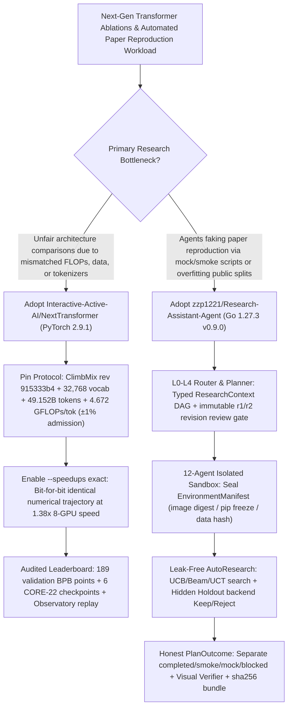

# Compute-Matched (`±1%` FLOPs) Next-Gen Transformer Benchmark (`Interactive-Active-AI/NextTransformer`) & 12-Agent Hidden-Holdout AutoResearch System (`zzp1221/Research-Assistant-Agent`) Selection FAQ

> **Positioning**: This standalone guide is **Round 36 of the 2026-11-11 Night Shift (Cumulative Guide #81)**, written in the plain-language, first-principles, closed-form FinOps style of `ib-vs-ethernet-roce-selection-faq.md` for Foundation Model Architects and Automated Scientific Research (`AutoResearch`) Leads evaluating two fast-rising open-source repositories:
> 1. **`Interactive-Active-AI/NextTransformer` (`404★`, Python / PyTorch 2.9.1, MIT)**: The first open-source framework, observatory, and autonomous agent research platform (`Arena v2`) that trains 7 architecture families across 38 runs / 36 model cards (including **`AttnRes-Canon`** discovered by Claude Opus) on the exact same `49.152B` `ClimbMix` tokens at **`4.672 GFLOPs/token` matched within `±1%` at admission (`±2%` audited over the run)**, with **`1.38x` bit-for-bit exact fused kernel speedups (`--speedups exact`)** contributed by `ResearchBoost-Agent`;
> 2. **`zzp1221/Research-Assistant-Agent` (`195★`, Go 1.27.3 + React + MyGo Windows Desktop / Docker Compose, v0.9.0)**: A **12-agent scientific execution system** (`Librarian`, `Benchmark`, `Research Coding`, `AutoResearch`, `Ablation ToT`, `Paper Debug`, `Visual Verifier`, etc.) featuring `L0–L4` complexity routing, immutable `r1/r2` DAG revisions, isolated Go sandboxes sealing `EnvironmentManifest` (`pip freeze` + image digest + data SHA-256), **UCB/Beam/UCT AutoResearch gated by hidden holdout sets**, and a **Claim-by-Claim Evidence Graph** whose `PlanOutcome` strictly separates `completed / partial / smoke / mock / blocked / failed / needs_review`.
>
> **中文版 FAQ**: [nexttransformer-research-assistant-agent-compute-matched-autoresearch-selection-faq.md](nexttransformer-research-assistant-agent-compute-matched-autoresearch-selection-faq.md) · **Architecture Summary SVG**: [`assets/github-ai-radar-2026-11-11-r36-nexttransformer-research-agent.svg`](../../../assets/github-ai-radar-2026-11-11-r36-nexttransformer-research-agent.svg)

---

## 📌 1. Executive Summary

1. **In plain English, what problems do these two repositories actually solve?**
   - **Ending Apples-to-Oranges Architecture Comparisons (`Interactive-Active-AI/NextTransformer`)**: When papers propose new sparse (`NSA`, `MoBA`, `DSA`), linear (`GDN`, `KDA`, `GLA`, `RetNet`), looped (`Huginn`, `Ouro`, `MoR`), or residual-stream (`AttnRes`, `HC`, `mHC`) Transformers, they rarely share the same tokenizer, sample order, or actual training FLOPs per token. `NextTransformer` pins a single `ClimbMix` dataset revision (`915333b4...`), a `32,768`-token tokenizer, `2,048`-token context, global sample order, and `49.152B` tokens (`46,875` updates), enforcing **`4.672 GFLOPs/token` within `±1%` at admission and `±2%` over the full run** while evaluating validation BPB at 189 points and full `CORE-22` at 6 checkpoints—and allowing AI agents to discover winning architectures like **`AttnRes-Canon`** under the exact same rules.
   - **Ending "Mock/Smoke" Paper Reproduction Hallucinations (`zzp1221/Research-Assistant-Agent`)**: General-purpose coding agents often claim a paper is "reproduced" after running a synthetic mock script or overfitting to a public validation split. `Research-Assistant-Agent` compiles goals into an immutable revision-controlled DAG (`r1/r2...`), routes nodes across **12 specialized agents**, executes code inside an isolated Go sandbox that seals an `EnvironmentManifest`, gates `AutoResearch` `Keep/Reject` patches with **UCB / Top-K Beam / UCT search + hidden-holdout re-evaluation**, and refuses to mark `smoke`, `mock`, or visually failed runs as `completed`.
2. **Closed-Form FinOps Verdict (`CLAIM-20261111-R36-NEXTTRANSFORMER-RESEARCHAGENT`)**:
   - For a 12-person Foundation Model & Automated Research Lab executing **12 architecture pretraining ablations (`49.152B` tokens on 8-GPU nodes) and 40 paper-reproduction / AutoResearch runs per month** (senior ML research engineer loaded rate `$90.00/hr`; `200B–400B` multi-node cluster leases and conference publication fees: `not_measured`):
   - Moving from **Path A (Uncontrolled FLOPs ablation reruns + unverified single-agent scripts producing mock/smoke claims, `$7,030.00/mo`)** to **Path C (`NextTransformer` `±1%` compute-matched protocol & `1.38x` exact fused kernels + `Research-Assistant-Agent` 12-agent hidden-holdout AutoResearch & claim-evidence graph, `$920.00/mo`)** saves **`$6,110.00/mo` (`-86.91%`, `$73,320.00/yr`)** and reduces manual FLOPs calibration and reproduction audit labor from `52.0 hrs/mo` to `6.0 hrs/mo` (**`-88.46%`**).

---

## 🎯 2. Three Core Architectural Questions (Q1 / Q2 / Q3 Deep-Dive)

### Q1: How does `Interactive-Active-AI/NextTransformer` enforce `4.672 GFLOPs/token ±1%` across 7 architecture families and achieve `1.38x` bit-for-bit exact speedups?
- **First-Principles Breakdown**:
  1. **The Compute-Matched Contract**:
     - Every model trains on pinned `karpathy/climbmix-400b-shuffle` (`915333b4...`), one `32,768` tokenizer, `2,048` context, one global sample order, `seed 42`, and `49.152B` input tokens (`46,875 × 1,048,576`). Total forward, backward, auxiliary, and optimizer compute is fixed at **`4.672 GFLOPs per input token` (`±1%` at admission, `±2%` audited across the run)**—treating parameter count, memory, and wall-clock speed as measured outcomes rather than hidden advantages.
  2. **36 Model Cards Across 7 Families & Opus-Discovered `AttnRes-Canon`**:
     - Covers `Baseline` (`Dense`), `Residual` (`Standard`, `AttnRes`, `HC`, `mHC`, `AttnRes-Canon`), `Looped` (`UT-ACT`, `Huginn`, `Ouro`, `DeepLoop`, `MoR`, `LoopFormer`, `Circle Loop`), `Sparse` (`DSA`, `QSA`, `NSA`, `MoBA`), `Linear` (`DeltaNet`, `GLA`, `KDA`, `RetNet`, `GDN`), `Hybrid` (`GDN–MHA`, `GDN–SWA`, `DeltaNet–MHA`, `KDA–MLA-NoPE`, `MoBA–MHA`), and `Others` (`GQA`, `MLA-QK`, `Gated Attention`), plus `NextTransformer-V` (`8,192`-context frozen SigLIP2 multimodal track).
  3. **`ResearchBoost-Agent` `1.38x` Bit-for-Bit Exact Fused Shell (`--speedups exact`)**:
     - Contributed via PR `#26`, `--speedups exact` fuses the shared model shell while reproducing the default numerical trajectory **bit for bit**, accelerating `dense_full` by **`1.38x`** on an 8-GPU node.

### Q2: How does `zzp1221/Research-Assistant-Agent` prevent mock reproduction claims, validation-set leakage, and unverified charts?
- **First-Principles Breakdown**:
  1. **`L0–L4` Complexity Routing, Immutable `r1/r2` DAGs & 12 Specialized Agents**:
     - Compiles research goals into a typed `ResearchContext` + `InputBindings` DAG with optimistic-locked revisions (`base_revision`), routing nodes to `Librarian`, `Benchmark`, `Research Coding`, `AutoResearch`, `Ablation ToT`, `Paper Debug`, and `Visual Verifier`.
  2. **Hidden-Holdout `AutoResearch` with UCB / Top-K Beam / UCT Search**:
     - Freezes the `ResearchSpec` and restricts code/parameter patches to allowed files; executes trials in an isolated Go sandbox (`Docker / Native / VM / Remote`) and evaluates `Keep/Reject` decisions against a **backend-recomputed hidden holdout split**.
  3. **Honest `PlanOutcome` Semantics & Claim-Evidence Export**:
     - Explicitly separates `completed`, `partial`, `smoke`, `mock`, `blocked`, `failed`, and `needs_review`, binds every paper claim to verifiable artifacts in a rubric graph, runs multimodal `Visual Verifier` gates on figures, and exports `manifest.json` + `checksums.sha256` + `EnvironmentManifest`.

### Q3: How should AI Research Teams pair `NextTransformer` with `Research-Assistant-Agent`?
- **Combined Architecture**:
  - Use **`Research-Assistant-Agent`** as the **multi-agent experiment orchestrator, Paper Wiki, and claim-evidence governance plane**, and plug **`NextTransformer`** in as the **standardized `4.672 GFLOPs/token ±1%` pretraining and `CORE-22` benchmark substrate** for every architecture candidate proposed by `AutoResearch` or `Ablation ToT`.

---

## 🧭 3. Mermaid Decision Tree & Compute-Matched AutoResearch Pipeline

---

## 📊 4. Architectural Comparison Matrix

| Evaluation Dimension | Path A: Ad-Hoc Paper Scripts + Unverified Single Agent | Path B: Standard Trainer + Generic Notebook Agent | **Path C (Recommended): `NextTransformer` + `Research-Assistant-Agent`** |
| :--- | :--- | :--- | :--- |
| **Cross-Architecture Compute Fairness** | Mismatched tokenizers, data order, and FLOPs/token | Matches parameter count only; ignores actual kernel FLOPs | **`4.672 GFLOPs/token ±1%` admission & `±2%` run audit across 36 model cards** |
| **Training Speedup & Bitwise Reproducibility** | Custom Triton hacks drift numerically from baseline | Mixed-precision flags alter training curves | **`--speedups exact` reproduces default run bit-for-bit at `1.38x` 8-GPU speed** |
| **AutoResearch Search & Holdout Protection** | Agent hill-climbs directly on validation split (leakage) | Simple grid search without automated rollback | **Frozen `ResearchSpec` + UCB/Beam/UCT search + hidden holdout recomputation** |
| **Outcome Honesty & Claim Provenance** | Silent fallback to mock data reported as `completed` | Raw console logs without chart verification or claim rubric | **Explicit `completed/smoke/mock/blocked` + `Visual Verifier` + claim-evidence graph** |
| **Monthly TCO (12 Ablations + 40 Repros)** | **`$7,030.00 / mo`** (`$2,350` wasted compute + `$4,680` labor) | **`$3,640.00 / mo`** (`$1,120` compute + `$2,520` labor) | **`$920.00 / mo` (Saves `$6,110.00/mo` · `-86.91%`)** |

---

## 🧪 5. Closed-Form FinOps Example & 7-Card Insights (`CLAIM-20261111-R36-NEXTTRANSFORMER-RESEARCHAGENT`)

### 5.1 Workload & Scope Boundary
- **Workload**: A 12-person Foundation Model & AutoResearch Lab executing **12 `49.152B`-token architecture pretraining ablations** and **40 paper-reproduction / hyperparameter AutoResearch cycles per month**.
- **Rates**: Senior ML research engineer loaded rate at **`$90.00 / hr`**.
- **Explicit Scope Boundary**: Long-horizon `200B–400B` multi-node cluster hardware leases and academic conference publication fees are marked **`not_measured`**.

### 5.2 Closed-Form Monthly Cost Breakdown

| Cost Component | Path A: Drifted FLOPs + Unverified Agent Scripts | Path B: Basic Trainer + Single-Agent Notebook | **Path C: `NextTransformer` + `Research-Assistant-Agent` (Recommended)** |
| :--- | :--- | :--- | :--- |
| **Wasted Ablation Rerun Compute & Agent Token Spend** | **`$2,350.00`** | **`$1,120.00`** | **`$380.00`** (`±1%` admission gate + `1.38x` exact kernels + UCB pruning) |
| **FLOPs Calibration, Repro Debugging & Audit (`$90/hr`)** | `52.0 hrs × $90.00` = **`$4,680.00`** | `28.0 hrs × $90.00` = **`$2,520.00`** | `6.0 hrs × $90.00` = **`$540.00`** |
| **Total Monthly TCO** | **`$7,030.00 / mo`** | **`$3,640.00 / mo`** (`-48.22%`) | **`$920.00 / mo`** |
| **Net Savings vs. Path A** | Baseline | Saves `$3,390.00 / mo` | **Saves `$6,110.00 / mo` (`-86.91%` · `$73,320.00/yr`)** |
| **200B+ Multi-Node Cluster Leases & Conference Fees** | `not_measured` | `not_measured` | `not_measured` |

---

## 🛠️ 6. Production Verification Checklist

- [ ] **1. Pin `ClimbMix` Dataset & Hash-Locked Linear Kernels**: Run `uv sync --frozen --extra gpu --extra upstream` and `uv pip install --no-deps --require-hashes -r requirements/linear.txt`, and download `karpathy/climbmix-400b-shuffle` at revision `915333b4f8b8684f39aeaafea600fea6f43fb703`.
- [ ] **2. Enforce `4.672 GFLOPs/token ±1%` Admission & `--speedups exact`**: Calibrate every new architecture plugin to within `±1%` theoretical FLOPs before launching `--formal` runs, enable `--speedups exact` for bit-for-bit `1.38x` acceleration, and set `export FLA_DISABLE_BACKEND_DISPATCH=1` for multi-node linear/hybrid runs.
- [ ] **3. Sandbox `confirm_important` Policy & `EnvironmentManifest` Sealing**: Keep `Research-Assistant-Agent` on `confirm_important` runtime approval and verify that every sandbox run records image digests, `pip freeze`, and dataset hashes in `EnvironmentManifest`.
- [ ] **4. Hidden-Holdout `AutoResearch` & Honest `PlanOutcome` Gate**: Require hidden-holdout backend recomputation for `Keep/Reject` decisions and block any report with `PlanOutcome` in `{smoke, mock, partial, failed}` or `Visual Verifier = fail` from being published as `completed`.
- [ ] **5. Reproducible `checksums.sha256` & Claim-Evidence Archive**: Export `manifest.json` + `checksums.sha256` + `provenance/*` after each paper reproduction run and verify claim-to-artifact coverage in the `PaperPage` Wiki.
