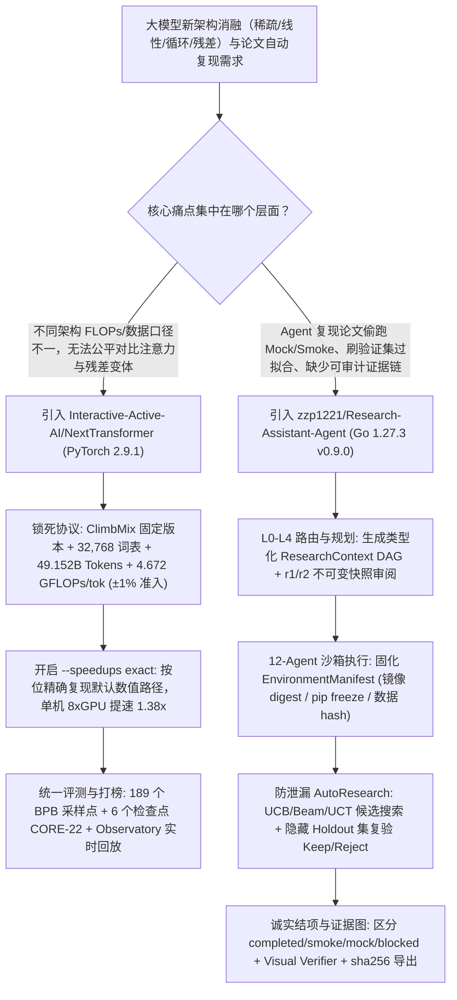

# 等算力（±1% FLOPs）下一代 Transformer 评测擂台（`Interactive-Active-AI/NextTransformer`）与 12-Agent 论文复现及隐藏集自动科研系统（`zzp1221/Research-Assistant-Agent`）深度选型 FAQ

> **文档定位**：本专题是 **2026-11-11 夜班第 36 轮（累计第 81 篇）独立六段式选型指南**，严格对标 `ib-vs-ethernet-roce-selection-faq.md` 的通俗第一性原理与闭式 FinOps 核算规范，面向大模型基础研究架构师与自动化科研（AutoResearch）平台负责人，深度拆解今日在下一代注意力架构统一基准与多智能体科研执行赛道爆发的两大新锐开源仓：
> 1. **`Interactive-Active-AI/NextTransformer`（`404★`，Python / PyTorch 2.9.1，MIT）**：开源界首个严格执行**“等数据、等 Token（`49.152B`）、等算力（`4.672 GFLOPs/token`，准入误差 `±1%`、全程审计 `±2%`）”**协议的下一代 Transformer 统一训练框架、交互式观测台（Observatory）与 Agent 自动架构研发擂台（`Arena v2`），已跑完 38 轮训练并开放 7 大架构家族 36 张模型卡（含由 Claude Opus 自主发现的 **`AttnRes-Canon`**，以及 `ResearchBoost-Agent` PR `#26` 贡献的按位精确 **`1.38x` 融合算子加速 `--speedups exact`**）；
> 2. **`zzp1221/Research-Assistant-Agent`（`195★`，Go 1.27.3 + React + MyGo Windows 桌面客户端 / Docker Compose，v0.9.0）**：把自然语言研究目标转化为可审计 DAG 执行闭环的 **12 角色专业 Agent 科研系统**——内置 `L0–L4` 复杂度路由、不可变计划快照（`r1/r2...`）、独立 Go 沙箱（固化镜像 digest、`pip freeze`、数据 SHA-256）、**带隐藏测试集（Hidden Holdout）防过拟合的 UCB/Beam/UCT 自动科研（AutoResearch）循环**，以及严格区分 `completed / partial / smoke / mock / blocked / failed / needs_review` 的**逐主张证据图（Claim-Evidence Graph）**。
>
> **English Version**: [nexttransformer-research-assistant-agent-compute-matched-autoresearch-selection-faq.en.md](nexttransformer-research-assistant-agent-compute-matched-autoresearch-selection-faq.en.md) · **架构总结图**: [`assets/github-ai-radar-2026-11-11-r36-nexttransformer-research-agent.svg`](../../../assets/github-ai-radar-2026-11-11-r36-nexttransformer-research-agent.svg)

---

## 📌 一、核心结论速览（Executive Summary）

1. **一句话大白话讲透这两个项目到底解决了什么痛点？**
   - **终结“新架构论文各吹各的、算力与数据口径不对齐”的伪消融（`Interactive-Active-AI/NextTransformer`）**：过去对比稠密注意力（GQA/MLA）、稀疏注意力（NSA/MoBA/DSA）、线性注意力（GDN/KDA/GLA/RetNet）、循环深度（Huginn/Ouro/MoR）与残差变体（AttnRes/HC/mHC）时，不同论文用的数据集、词表、甚至每 Token 实际消耗的 FLOPs 都不一样，根本分不清到底是架构更好还是偷加了算力。`NextTransformer` 锁定了同一份 `ClimbMix` 数据集修订版、同一个 `32,768` 词表、`2,048` 上下文、固定全局样本顺序与 `49.152B` 输入 Token，强制所有模型在准入时满足 **`4.672 GFLOPs/token ±1%`**（全周期审计 `±2%`），并在 189 个验证集 BPB 采样点与 6 个检查点的 `CORE-22` 基准上同台竞技；更支持让 AI Agent 直接按同样规则搜索新架构（如 Opus 自主发现的 **`AttnRes-Canon`**）！
   - **终结“AI 科研助手跑通一个 Mock 冒烟脚本就谎称复现了论文”的学术幻觉（`zzp1221/Research-Assistant-Agent`）**：让通用 Agent 复现论文或跑消融实验时，Agent 常在装不上依赖或缺 GPU 时静默改用假数据（mock）或跑几步 smoke test 就汇报“复现成功”。`Research-Assistant-Agent` 通过 Go 1.27 后端调度 **12 个专业 Agent**（`Librarian`、`Benchmark`、`Research Coding`、`AutoResearch`、`Ablation ToT`、`Paper Debug`、`Visual Verifier` 等），在隔离 Go 沙箱中真实执行并生成带 `checksums.sha256` 的 `EnvironmentManifest`；其预算受限 `AutoResearch` 在修改超参或补丁后，用 **UCB / Top-K Beam / UCT 树搜索 + 隐藏 Holdout 集复验**决定 `Keep/Reject`，并在最终 `PlanOutcome` 中严禁把 `smoke` 或 `mock` 标成 `completed`！
2. **闭式 FinOps 投资回报结论（`CLAIM-20261111-R36-NEXTTRANSFORMER-RESEARCHAGENT`）**：
   - 以 12 人大模型架构与自动化科研实验室每月执行 **12 轮 `49.152B` Token 架构预训练消融（单机 8×GPU）** 与 **40 次论文复现 / 超参自动搜索任务** 为基准（高级算法研发工程师含税费率 `$90.00/hr`；`200B–400B` 超大规模集群长租费用与外部学术会议投稿版面费：`not_measured`）：
   - 从 **Path A（非对齐 FLOPs 自写训练脚本重跑浪费 + 单 Agent 冒烟/Mock 脚本手工核验，月均 `$7,030.00`）** 升级至 **Path C（`NextTransformer` `±1%` 等算力协议与 `1.38x` 按位精确融合加速 + `Research-Assistant-Agent` 12-Agent 隐藏集自动科研与证据图，月均 `$920.00`）**，每月净省 **`$6,110.00/mo`（降幅 `-86.91%`，年省 `$73,320.00/yr`）**，并将算法工程师对齐算力口径与排障论文环境的工时从 `52.0 hrs/mo` 压缩至 `6.0 hrs/mo`（节省 **`-88.46%`**）。

---

## 🎯 二、三大灵魂拷问（Q1 / Q2 / Q3 深度原理解析）

### Q1：`Interactive-Active-AI/NextTransformer` 是如何用 `4.672 GFLOPs/token ±1%` 铁律把 7 大家族 36 种架构放在同一根起跑线上，并让 AI Agent 自主发现 `AttnRes-Canon` 的？
- **第一性原理拆解**：
  1. **五维完全锁死的等算力契约（The Compute-Matched Protocol）**：
     - **数据与顺序锁死**：固定 `karpathy/climbmix-400b-shuffle` 指定修订号（`915333b4...`）、统一 `32,768` 词表、`2,048` 上下文长度、全局唯一样本顺序与 `seed 42`。
     - **预算与算力锁死**：总计 `49.152B` 输入 Token（`46,875` 步 × `1,048,576` tokens/步）；把前向、反向、辅助损失与优化器开销全部计入，严格要求 **`4.672 GFLOPs / input token`**，立项准入偏差不得超过 **`±1%`**，完整跑完偏差不得超过 **`±2%`**。参数量、显存占用和墙钟速度都是该算力预算下的**结果变量（outcomes）而非受控掩护**。
  2. **7 大架构家族同台竞技与 `ResearchBoost-Agent` `1.38x` 按位精确加速**：
     - 已涵盖 `Baseline`（Dense）、`Residual`（Standard Residual / AttnRes / HC / mHC / **Opus 发现的 `AttnRes-Canon`**）、`Looped`（UT-ACT / Huginn / Ouro / DeepLoop / MoR / LoopFormer / Circle Loop）、`Sparse`（DSA / QSA / NSA / MoBA）、`Linear`（DeltaNet / GLA / KDA / RetNet / GDN）、`Hybrid`（GDN–MHA / GDN–SWA / DeltaNet–MHA / KDA–MLA-NoPE / MoBA–MHA）及 `Others`（GQA / MLA-QK / Gated Attention）。
     - 社区 `DAGroup-PKU/ResearchBoost-Agent`（PR `#26`）为其共享外壳贡献了 `--speedups exact` 融合算子：在**按位 100% 复现默认数值路径（bit-for-bit exact）**的前提下，单机 8 卡训练 `dense_full` 提速 **`1.38x`**！
  3. **多模态扩展 `NextTransformer-V` 与 `Arena v2` Agent 科研体操房**：
     - `@Enderfga` 发起的 `NextTransformer-V` 在 `8,192` 上下文交错图文（冻结 SigLIP2 视觉 Token）上延续了完全一致的 `±1%` 等算力协议；即将发布的 `Arena v2` 则直接向 Agent 开放 MCP 工具、计量算力与自演进实验轨迹。

### Q2：`zzp1221/Research-Assistant-Agent` 为什么能根治 AI 科研助手的“伪复现、测试集泄漏与虚假结项”三大顽疾？
- **第一性原理拆解**：
  1. **`L0–L4` 复杂度路由 + 不可变 DAG 快照（`r1/r2`）+ 12 专业 Agent 矩阵**：
     - 简单请求走 `L0/L1` 快路径，复杂科研任务走 `L3/L4` 骨架 + Agent Planner（带一次结构化自动修复），生成带类型化 `ResearchContext` 与 `InputBindings` 的 DAG，并在人工审阅门（乐观锁 `base_revision`）通过后，按节点路由给 `Librarian`、`Benchmark`、`Research Coding`、`AutoResearch`、`Ablation ToT`、`Paper Debug`、`Visual Verifier` 等 12 个专职角色。
  2. **带隐藏测试集（Hidden Holdout）的分层搜索 `AutoResearch`**：
     - 冻结 `ResearchSpec` 与评价契约后，Agent 只能在受限文件范围内生成补丁或参数候选，采用**受限穷举、路线 UCB、Top-K Beam 与 UCT 参数树（含 Virtual visit）**在真实 Go 沙箱（Docker/Native/VM）中跑实验；每次 `Keep/Reject` 决策与退化回滚都强制经过**后端隐藏标签 / 隐藏 Holdout 集重算**，杜绝模型针对验证集刷分过拟合。
  3. **诚实状态机（`PlanOutcome`）+ 逐主张证据图（Claim-Evidence Rubric）+ 多模态视觉门禁**：
     - 严禁把“节点跑完”等同于科研成功：`PlanOutcome` 显式区分 `completed`、`partial`、`smoke`、`mock`、`blocked`、`failed` 与 `needs_review`；`Visual Verifier` 对生成的图表做多模态视觉判定（`pass / fail / inconclusive`）；最终导出含 `manifest.json`、`checksums.sha256`、`EnvironmentManifest` 与 `PaperPage` Wiki 的完整证据包。

### Q3：AI 架构师如何把 `NextTransformer` 与 `Research-Assistant-Agent` 组合成团队级“自动驾驶实验室”？
- **黄金组合落地范式**：
  - 将 **`Research-Assistant-Agent`** 作为上层**多智能体实验编排、文献 Paper Wiki、受控沙箱与证据审计控制面**（桌面端 `ResearchAssistant.exe` 或团队 Docker Compose 服务端）；
  - 将 **`Interactive-Active-AI/NextTransformer`** 作为底层**标准化的 `4.672 GFLOPs/token ±1%` 架构消融与评测底座**——让 `AutoResearch` 与 `Ablation ToT` Agent 提交的每一个注意力/残差改写插件，都必须通过 `NextTransformer` 的 `--formal` 等算力准入审计与 `CORE-22` 检查点评测！

---

## 🧭 三、Mermaid 选型决策树与等算力自动科研流水线

---

## 📊 四、同类方案核心能力对比矩阵（Selection Matrix）

| 评估维度 | Path A：各论文自写训练脚本 + 通用单 Agent 跑实验 | Path B：通用训练框架 + 普通 Notebook Agent | **Path C（推荐）：`NextTransformer` + `Research-Assistant-Agent`** |
| :--- | :--- | :--- | :--- |
| **跨架构算力公平性（FLOPs Parity）** | 词表、数据顺序、每 Token FLOPs 各不相同，结论不可比 | 仅对齐参数量，忽略线性/稀疏算子前反向实际 FLOPs 差异 | **`4.672 GFLOPs/token ±1%` 准入与 `±2%` 全程审计 + 36 模型卡同源对比** |
| **训练吞吐加速与数值一致性** | 手工魔改 Triton 算子易引入隐蔽精度漂移 | 开启常规混合精度优化后无法按位对齐基线曲线 | **`--speedups exact` 按位 100% 复现默认路径且单机 8 卡提速 `1.38x`** |
| **自动科研搜索与防泄漏机制** | Agent 直接在验证集上反复试错，严重过拟合 | 简单网格搜索，无隐藏集复验与退化自动回滚 | **冻结 `ResearchSpec` + UCB/Beam/UCT 树搜索 + 隐藏 Holdout 后端重算** |
| **结果诚实度与证据链可审计性** | 装不上环境就静默生成 Mock 数据冒充 `completed` | 仅保存终端日志，缺图表视觉门禁与逐主张证据绑定 | **显式区分 `completed/smoke/mock/blocked` + `Visual Verifier` + 逐主张证据图** |
| **月度总拥有成本（12 消融 + 40 复现）** | **`$7,030.00 / mo`**（`$2,350` 算力浪费 + `$4,680` 人工） | **`$3,640.00 / mo`**（`$1,120` 算力 + `$2,520` 人工） | **`$920.00 / mo`（净省 `$6,110.00/mo` · `-86.91%`）** |

---

## 🧪 五、定量 FinOps 算例与 7-Card 洞察（`CLAIM-20261111-R36-NEXTTRANSFORMER-RESEARCHAGENT`）

### 5.1 测算基准与显式边界（Scope & Boundaries）
- **场景设定**：12 人基础模型与自动科研实验室，每月运行 **12 轮 `49.152B` Token 级新架构预训练对比**与 **40 项论文复现 / 超参自动搜索任务**。
- **费率假设**：高级算法研发工程师全包时薪 **`$90.00 / hr`**。
- **显式边界声明（Explicit Not-Measured Boundary）**：`200B–400B` 超大规模多节点集群长租硬件折旧与外部学术会议注册/版面费标记为 **`not_measured`**，本表核算消融重跑算力损耗、Agent Token 消耗与工程师审计排障工时。

### 5.2 三路径月度成本闭式对照表

| 成本分项 | Path A：非对齐自写训练 + 无门禁单 Agent | Path B：常规训练脚本 + 普通 Notebook Agent | **Path C：`NextTransformer` + `Research-Assistant-Agent`（推荐）** |
| :--- | :--- | :--- | :--- |
| **无效消融重跑算力损耗与 Agent API 开销** | **`$2,350.00`**（口径漂移重跑 + 盲目试错） | **`$1,120.00`** | **`$380.00`**（`±1%` 准入拦截 + `1.38x` 精确加速 + UCB 剪枝） |
| **算力口径校准、环境复现与防泄漏审计工时（`$90/hr`）** | `52.0 hrs × $90.00` = **`$4,680.00`** | `28.0 hrs × $90.00` = **`$2,520.00`** | `6.0 hrs × $90.00` = **`$540.00`** |
| **月度总成本（Monthly TCO）** | **`$7,030.00 / mo`** | **`$3,640.00 / mo`**（`-48.22%`） | **`$920.00 / mo`** |
| **相对 Path A 净节省** | 基准线（Baseline） | 净省 `$3,390.00 / mo` | **净省 `$6,110.00 / mo`（`-86.91%` · 年省 `$73,320.00/yr`）** |
| **200B+ 集群硬件长租与会议版面费** | `not_measured` | `not_measured` | `not_measured` |

---

## 🛠️ 六、生产级落地核验 Checklist

- [ ] **1. `NextTransformer` 数据与算子哈希锁定**：通过 `uv sync --frozen --extra gpu --extra upstream` 与 `uv pip install --no-deps --require-hashes -r requirements/linear.txt` 固定线性注意力内核版本，并拉取修订号为 `915333b4f8b8684f39aeaafea600fea6f43fb703` 的 `karpathy/climbmix-400b-shuffle` 数据集。
- [ ] **2. `4.672 GFLOPs/token ±1%` 准入与 `--speedups exact` 开启**：新增架构插件在启动 `--formal` 训练前必须通过 `±1%` 理论 FLOPs 准入校准；在单机 8 卡或多机 `accelerate` 训练中开启 `--speedups exact`（并在线性/混合架构多机训练时设置 `export FLA_DISABLE_BACKEND_DISPATCH=1`）。
- [ ] **3. `Research-Assistant-Agent` 沙箱审批与断网基线**：保持默认的 `confirm_important` 运行时审批策略（镜像拉取、依赖安装、数据/模型下载、GPU 与外网访问前必须确认），并核验每次运行产出的 `EnvironmentManifest`（镜像 digest、`pip freeze`、数据 hash）。
- [ ] **4. 隐藏 Holdout 复验与 `PlanOutcome` 诚实门禁**：在 `AutoResearch` 任务中启用隐藏 Holdout 后端重算，并配置 CI 门禁拦截任何状态为 `smoke`、`mock`、`partial` 或 `Visual Verifier = fail` 却试图归档为完成态的实验报告。
- [ ] **5. 逐主张证据包（`checksums.sha256`）归档**：每次论文复现结项时导出完整证据包（`manifest.json` + `checksums.sha256` + `environment/*` + `provenance/*`），并在 `PaperPage` Wiki 中检查逐主张证据覆盖率。
