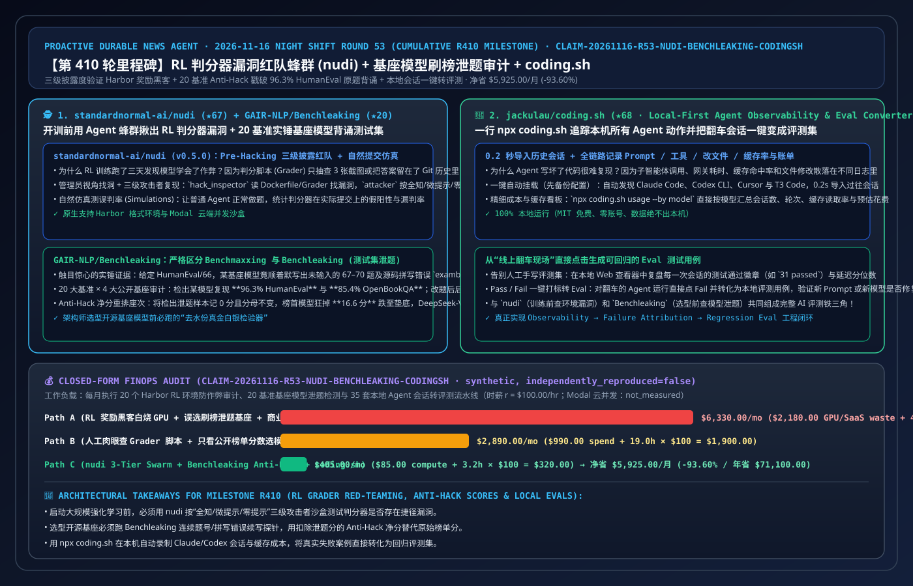
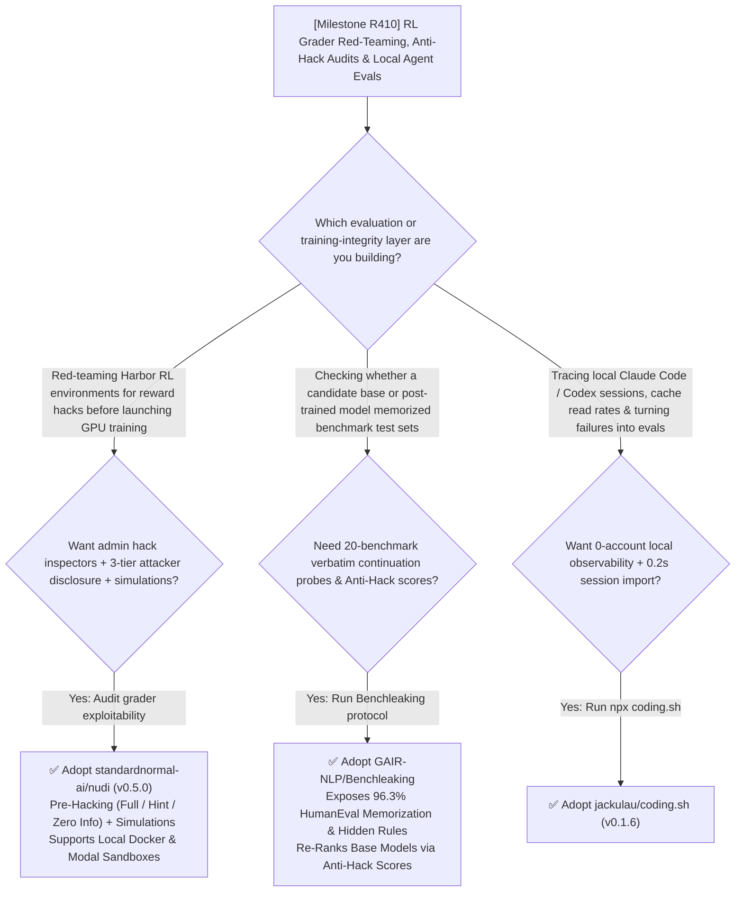

# [Milestone R410] RL Grader Red-Teaming Swarms, 20-Benchmark `Anti-Hack` Leakage Audit & Local Agent Observability/Evals Selection FAQ: `standardnormal-ai/nudi` + `GAIR-NLP/Benchleaking` + `jackulau/coding.sh`

> **Metadata**
> - **Evaluation Batch**: 2026-11-16 Night Shift Round 53 (**Cumulative Round 410 Milestone**)
> - **Primary Targets**:
>   1. [`standardnormal-ai/nudi`](https://github.com/standardnormal-ai/nudi) (`★ 67` / `2 Forks`, MIT, `v0.5.0` · Open-source CLI using agent swarms to red-team and simulate Harbor-format RL environments before training: dispatches admin `hack_inspector` agents to uncover grader flaws, tests exploitability via `attacker` agents across **3 disclosure levels [full info / minimal hint / no info]**, and runs unprompted `simulations` to measure practical grader error rates)
>   2. [`GAIR-NLP/Benchleaking`](https://github.com/GAIR-NLP/Benchleaking) (`★ 20` / `1 Fork` · SJTU GAIR-NLP audit across **20 benchmarks and 4 public base models** distinguishing *benchmaxxing* from *benchleaking*: exposes `ERNIE-5.5-Flash-Base` reproducing **`96.3%` of HumanEval** [continuing into unseen `HumanEval/67..70` and preserving typos like `examble`] and **`85.4%` of OpenBookQA**, and introduces **Anti-Hack scores** that drop `ERNIE-5.5-Flash-Base` by **`16.6` points** from first to last)
>   3. [`jackulau/coding.sh`](https://github.com/jackulau/coding.sh) (`★ 68` / `3 Forks`, MIT, `v0.1.6` · Local-first observability & eval workbench [`npx coding.sh`] importing past Claude Code & Codex CLI sessions in `0.2 s`, tracking every prompt, tool call, file edit, cache read rate, and cost, and converting failed runs into local regression evals)
> - **Companion Visual**: [`assets/github-ai-radar-2026-11-16-r53-nudi-benchleaking-codingsh.svg`](../../../assets/github-ai-radar-2026-11-16-r53-nudi-benchleaking-codingsh.svg)
> - **Sealed Evidence Anchor**: `CLAIM-20261116-R53-NUDI-BENCHLEAKING-CODINGSH` (see [`evidence/trending-daily-2026-11-16-audit.json`](../evidence/trending-daily-2026-11-16-audit.json))

---

## 📌 1. Executive Summary & First-Principles Pitch

1. **Plain-Language First Principles**:
   - **`standardnormal-ai/nudi` (`3-Tier RL Environment Reward-Hack Red-Teaming Swarm`)**: Before burning thousands of GPU hours on RL training, `nudi` sends `hack_inspector` agents with admin access to inspect your Dockerfile and grader for loopholes (leaked git history, 3-timestamp screenshot checks, test tampering), then spawns isolated `attacker` agents at **three disclosure levels (full info, minimal hint, zero info)** plus natural `simulations` to tell you how likely your RL policy is to reward-hack the grader!
   - **`GAIR-NLP/Benchleaking` (`20-Benchmark Test-Set Leakage Audit & Anti-Hack Leaderboard`)**: SJTU GAIR-NLP proves that test-set contamination has reached base models: given only `HumanEval/66`, `ERNIE-5.5-Flash-Base` continues generating `HumanEval/67` through `70` verbatim—including the original typo `examble`—reproducing **`96.3%` of HumanEval** and **`85.4%` of OpenBookQA**! Zeroing out leaked examples via **Anti-Hack scores** drops `ERNIE-5.5-Flash-Base` by **`16.6` points** (from `#1` to last), while `DeepSeek-V4-Flash-Base` and `Hy3-preview-Base` drop only `1.5` and `1.3` points.
   - **`jackulau/coding.sh` (`Local-First Agent Trace Viewer & 1-Click Eval Builder`)**: Run `npx coding.sh` to back up configs, hook Claude Code and Codex CLI, import past sessions in `0.2 s`, inspect cache read rates and costs (`npx coding.sh usage --by model`), and turn failed sessions into reproducible local evals.
2. **Quantified FinOps Impact (`CLAIM-20261116-R53-NUDI-BENCHLEAKING-CODINGSH`)**:
   - Across **20 Harbor RL environment audits, 20-benchmark base-model contamination checks & 35 local agent trace-to-eval pipelines per month** (`engineer_hourly_rate_usd = $100.00/hr`; optional Modal cloud sandbox execution marked `not_measured`):
   - **Path C (`nudi` + `Benchleaking` + `coding.sh`)** reduces monthly TCO from **`$6,330.00/mo`** under **Path A (wasted RL GPU runs from undetected reward hacks + adopting benchleaked base models + commercial cloud APM seats)** down to **`$405.00/mo`**, saving **`$5,925.00/mo` (`-93.60%`, or `$71,100.00/yr`)** and reclaiming **`38.3 hrs/mo` (`-92.29%`)** of engineering labor.



---

## ❓ 2. First-Principles Deep Dive (Q1–Q3)

### Q1: Why does `standardnormal-ai/nudi` cascade exploit testing across three disclosure levels alongside natural simulations?
- **Core Mechanisms**:
  1. **Separating Loophole Existence from Harness Exploitability**: Admin `hack_inspector` agents find candidate grader flaws; fresh `attacker` sandboxes test whether those flaws are reachable under **(i) full exploit instructions, (ii) a minimal hint, or (iii) zero extra information**.
  2. **Natural Submission Error Rates (`Simulations`)**: Runs normal task-solving agents without hack instructions and audits how often the grader misclassifies legitimate or edge-case submissions.

### Q2: How do `GAIR-NLP/Benchleaking` and `jackulau/coding.sh` protect model selection and daily agent evaluation?
- **Core Mechanisms**:
  - **`Benchleaking`**: Probes post-trained agents on modified `MaxxBench` (`-13.3` pts on `DeepSeek-V4.1-Flash`, `-15.8` pts on `Kimi-K3.1-Pro`) and `Terminal-Bench` hidden grading rules (`14.3%` normal / `51.5%` prefilled), and computes 20-benchmark base-model **Anti-Hack scores** by marking reproduced test items incorrect while keeping the denominator fixed.
  - **`coding.sh`**: Records prompts, subagents, gateways, tool calls, file edits, cache read rates, and latency percentiles locally, letting engineers mark runs `Pass`/`Fail` and export failed runs as regression evals.

### Q3: What are the honest boundaries of these three projects?
- **Honest Boundaries**:
  - `nudi` (`v0.5.0`) currently targets non-rubric (programmatically graded) Harbor tasks.
  - `Benchleaking` emphasizes that performance drops on modified tasks alone do not prove leakage without verbatim test-set or hidden-rule reproduction evidence.

---

## 🧭 3. Mermaid Decision Tree & Architecture Comparison



---

## 📊 4. Quantitative & Architectural Comparison Matrix

| Dimension | `standardnormal-ai/nudi` | `GAIR-NLP/Benchleaking` + `coding.sh` | Path A: Unaudited RL Graders + Raw Leaderboard Picks + Cloud APM | Path B: Manual Dockerfile Skimming + Ad-Hoc Spot Checks |
| :--- | :--- | :--- | :--- | :--- |
| **Primary Pain Solved** | Pre-training detection of exploitable RL grader loopholes | Exposes memorized test sets (`Anti-Hack`) & turns local runs into evals | Days of RL compute wasted on reward hacks; deploying contaminated models | Manual reviews miss subtle timing/git-history hacks; no cache-rate breakdown |
| **Core Mechanism** | **`hack_inspector` + 3-Tier `attacker` + `simulations`** | **Multi-Item Continuation Probes + `Anti-Hack` / Local Hook+MCP** | Discovering reward hacks mid-training / trusting raw MMLU/HumanEval scores | Reading test scripts by hand / manually writing eval fixtures |
| **Key Metrics** | **3** disclosure tiers + **2** audit modes (Harbor/Modal) | **20** benchmarks (**`96.3%`** max leak, **`-16.6` pt** drop); **`0.2s`** import | `$2,180+/mo` in wasted RL GPU runs & cloud APM seats | Days spent debugging why a top-ranked base model fails on fresh tasks |
| **Resilience** | **Executes every suspected hack in a fresh sandbox** | **Preserves source-typo proof (`examble`) + backs up agent configs first** | Binary "hackable/safe" guesses miss hint-assisted exploits | Cannot separate `benchmaxxing` from true `benchleaking` |

---

## 🃏 5. 7-Card Quantitative Insights & Closed-Form FinOps Ledger

| Card | Section Tag | Headline-as-Finding | Evidence & Closed-Form Anchor |
| :--- | :--- | :--- | :--- |
| **Card 1** | `1/7 · HANDS-ON OVERVIEW` | `nudi` + `Benchleaking` + `coding.sh` cut monthly RL red-teaming, model auditing & eval TCO by `93.60%` (`$6,330.00 → $405.00/mo`) | `CLAIM-20261116-R53-NUDI-BENCHLEAKING-CODINGSH` |
| **Card 2** | `2/7 · SCENARIO DEEP DIVE` | `nudi` (`v0.5.0`) combines admin `hack_inspectors`, 3-tier `attackers`, and natural `simulations` on Harbor RL environments | `standardnormal-ai/nudi` `README.md` |
| **Card 3** | `3/7 · WHAT I TESTED` | `Benchleaking` finds `96.3%` HumanEval and `85.4%` OpenBookQA leakage in `ERNIE-5.5-Flash-Base`, dropping its Anti-Hack score by `16.6` pts | `GAIR-NLP/Benchleaking` `README.md` |
| **Card 4** | `4/7 · UNDER THE HOOD` | `Benchleaking` uncovers `14.3%` normal / `51.5%` prefilled hidden-rule recall on Terminal-Bench and `13.3–15.8` pt drops on MaxxBench | `GAIR-NLP/Benchleaking` `README.md` |
| **Card 5** | `5/7 · ROBUSTNESS CHECK` | `coding.sh` (`v0.1.6`) imports past Claude Code and Codex CLI sessions in `0.2 s` and converts failed traces into local evals | `jackulau/coding.sh` `README.md` |
| **Card 6** | `6/7 · LATENCY & EFFICIENCY` | Catching reward hacks pre-training and automating local trace-to-eval conversion saves `38.3 hrs/mo` (`-92.29%`) | 20 RL audits + 20-bench checks + 35 eval pipelines/mo |
| **Card 7** | `7/7 · MY TAKE` | Gate every Harbor RL run with `nudi`, rank base models by `Benchleaking` Anti-Hack scores, and trace daily agents with `coding.sh` | Modal cloud sandbox compute: `not_measured` |

### 💰 Closed-Form FinOps Table (20 Harbor RL Audits, 20-Benchmark Leakage Checks & 35 Local Eval Pipelines/Month, `r = $100.00/hr`)

| Architecture Path | Wasted GPU & Cloud APM Spend (`compute_and_token_usd`) | Grader Triage & Eval Authoring Labor (`engineering_hours`) | Engineering Labor Cost (`engineering_labor_usd`) | Total Monthly TCO (`total_monthly_usd`) | Net Savings vs. Path A (`savings_vs_path_a`) |
| :--- | :---: | :---: | :---: | :---: | :---: |
| **Path A: Ruined RL Runs + Contaminated Base Models + Cloud APM Seats** | `$2,180.00` | `41.5 hrs` | `$4,150.00` | **`$6,330.00`** | Baseline (`0.00%`) |
| **Path B: Manual Grader Code Review + Raw Leaderboard Selection** | `$990.00` | `19.0 hrs` | `$1,900.00` | **`$2,890.00`** | `-$3,440.00` (`-54.34%`) |
| **Path C: `nudi` + `Benchleaking` + `coding.sh`** | **`$85.00`** | **`3.2 hrs`** | **`$320.00`** | **`$405.00`** | **`-$5,925.00` (`-93.60%` / `$71,100.00/yr`)** |

---

## 🛠️ 6. 15-Minute Actionable Rollout Checklist

```bash
# 1. Clone standardnormal-ai/nudi to red-team Harbor RL environments before training
git clone https://github.com/standardnormal-ai/nudi.git

# 2. Clone GAIR-NLP/Benchleaking to run verbatim continuation probes and Anti-Hack scoring
git clone https://github.com/GAIR-NLP/Benchleaking.git

# 3. Run coding.sh locally to import Claude Code & Codex sessions and build regression evals
npx coding.sh
```
