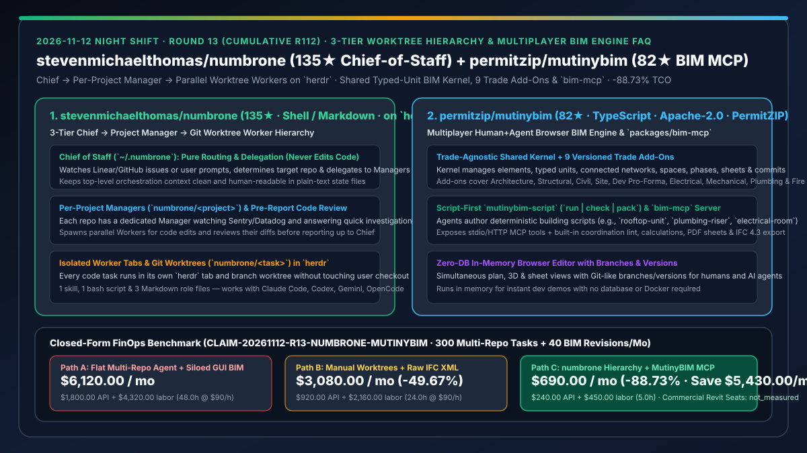
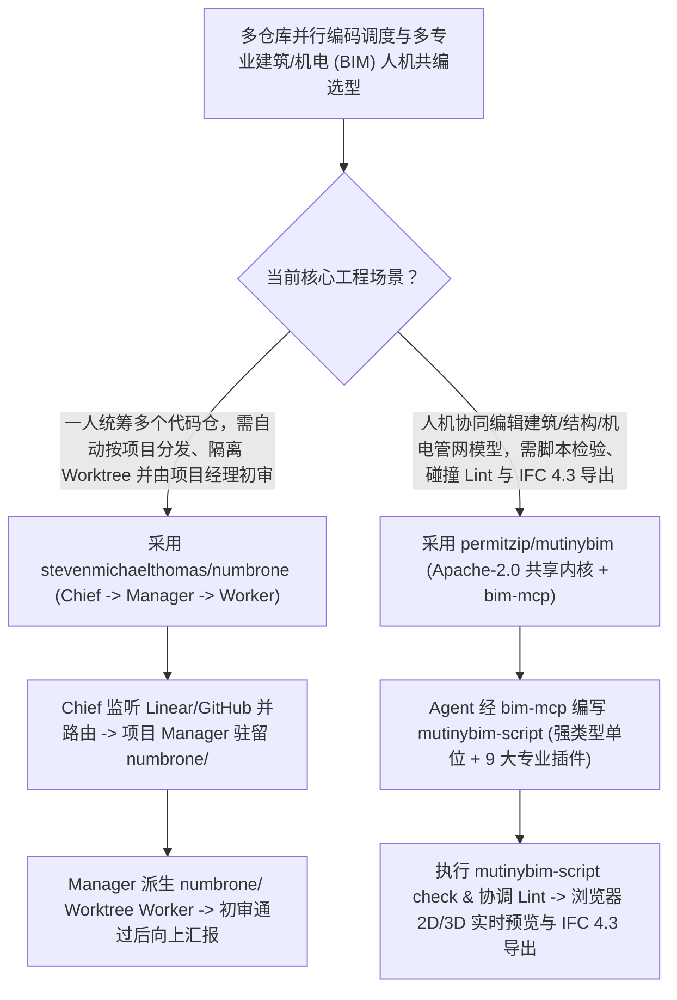

# 三层幕僚长-项目经理-Worktree 编码智能体架构（`stevenmichaelthomas/numbrone`）与人机同编建筑信息模型引擎（`permitzip/mutinybim` `bim-mcp`）深度选型 FAQ

> **文档定位**：本专题是 **2026-11-12 夜班第 13 轮（累计第 112 篇）独立六段式选型指南**，严格对标 `ib-vs-ethernet-roce-selection-faq.md` 的通俗第一性原理与闭式 FinOps 核算规范，面向多仓库研发编排负责人与工程建设（AEC / 工业数字孪生 BIM）解决方案架构师，深度拆解今日在三级智能体组织架构与脚本优先人机共编 BIM 引擎赛道突起的两大开源标杆：
> 1. **`stevenmichaelthomas/numbrone`（`135★`，Shell / Markdown，运行于 `herdr` 之上）**：仅用 **1 个 Skill、1 个 Bash 脚本与 3 个 Markdown 角色文件**构建的 Coding Agent “幕僚长（Chief of Staff）”三层架构——**`Chief`（幕僚长：只做跨项目路由与进度汇总，绝不亲手写代码）→ `Managers`（每项目一位经理 `numbrone/<project>`：监控 Sentry/Datadog、直接回答小问题、派生 Worker 并在向上汇报前审查代码）→ `Workers`（每任务一个独立 `herdr` 标签页与 `numbrone/<task>` Git Worktree 分支）**，所有状态以纯文本文件透明存储！
> 2. **`permitzip/mutinybim`（`82★`，TypeScript，Apache-2.0，PermitZIP 生产自用开源引擎）**：专为**多人与多 AI 智能体同时编辑同一座建筑模型**设计的浏览器端 BIM 引擎——采用**“与专业解耦的共享内核（强类型单位、空间、阶段、连接管网、图纸与 Commit）+ 9 大专业插件（建筑、结构、土木、场地、开发测算、电气、暖通、给排水与消防）”**架构，配套 **`mutinybim-script` (`run | check | pack`)**、**`packages/bim-mcp` 工具服务器**、跨专业碰撞检查（Coordination Lint）与 **IFC 4.3 / PDF 图纸导出**！
>
> **English Version**: [numbrone-mutinybim-chief-manager-worktree-hierarchy-multiplayer-bim-mcp-selection-faq.en.md](numbrone-mutinybim-chief-manager-worktree-hierarchy-multiplayer-bim-mcp-selection-faq.en.md) · **关联日报**: [`daily/2026-11-12.md`](../daily/2026-11-12.md) · **架构总结图**: [`assets/github-ai-radar-2026-11-12-r13-numbrone-mutinybim.svg`](../../../assets/github-ai-radar-2026-11-12-r13-numbrone-mutinybim.svg)

---

## 📌 一、核心结论速览（Executive Summary）

1. **一句话大白话讲透这两个项目到底解决了什么痛点？**
   - **终结“手里同时管着前端、后端、基础设施五六个仓库，每次来个需求都要自己去判断该进哪个目录开哪个 Agent、或者单层主从 Agent 缺乏项目级把关人直接把烂代码往上交”的痛点（`stevenmichaelthomas/numbrone`）**：很多开发者一人维护多个微服务仓库。`numbrone` 在 `herdr` 多会话终端上建立了清晰的**三级指挥链（Chief → Manager → Worker）**：① 你只跟 **Chief（幕僚长）** 用大白话提需求（或让它监听 Linear/GitHub Issues），它绝不写代码，只负责判断属于哪个项目并派给对应的项目经理；② 每个项目常驻一位 **Manager（`numbrone/<project>`）**，小问题和日志排查（Sentry/Datadog）它自己秒回，需要改代码就派生 **Worker**；③ 每个 Worker 在独立的 `herdr` 标签页与 `numbrone/<task>` Git Worktree 中并行施工，写完后必须先由熟悉该项目上下文的 Manager 审查通过，再向 Chief 和你汇报！
   - **终结“传统建筑/机电 BIM 软件（如 Revit）是单机重型桌面黑盒，AI Agent 既没法通过脚本批量布置屋顶空调管网与配电间，也没法在提交前自动跑跨专业管线碰撞 Lint 和导出 IFC 4.3”的痛点（`permitzip/mutinybim`）**：在工业厂房、数据中心与建筑设计中，建筑、结构、暖通（MEP）、电气、给排水和消防往往各自画图最后撞成一团。`MutinyBIM` 把底层内核做成一个懂“元素、强类型物理单位、连接网络、空间与 Git 式分支提交（Commits）”的纯内核，9 大工种全部通过版本化插件契约挂载，并提供 **`packages/bim-mcp`（MCP Server）与 `mutinybim-script`**——让 Claude / Cursor 直接编写确定性脚本生成整套屋顶机组风管（`rooftop-unit`）、给排水立管（`plumbing-riser`）或配电室（`electrical-room`），即时跑通跨专业协调 Lint 并导出 IFC 4.3 与 PDF 施工图！
2. **闭式 FinOps 投资回报结论（`CLAIM-20261112-R13-NUMBRONE-MUTINYBIM`）**：
   - 以 **14 人跨仓库研发与工程数字孪生（AEC/BIM）自动化团队每月分发执行 `300 个` 多仓库代码任务、并完成 `40 次` 多专业建筑/机电模型脚本化协同修订** 为基准（高级架构与自动化工程师全包时薪 `$90.00/hr`；商业 Autodesk Revit 席位年费与云端 CI Runner 账单：`not_measured`）：
   - 从 **Path A（扁平单 Agent 跨仓乱改引发冲突返工 + 人工在传统 GUI 软件里逐根画管线修碰撞，月均 `$6,120.00`）** 升级至 **Path C（`numbrone` 三级幕僚长-项目经理 Worktree 编排 + `MutinyBIM` 脚本优先 `bim-mcp` 与自动协调 Lint，月均 `$690.00`）**，每月净省 **`$5,430.00/mo`（降幅 `-88.73%`，年省 `$65,160.00/yr`）**，并将跨仓上下文切换与多专业碰撞返工工时从 `48.0 hrs/mo` 压缩至 `5.0 hrs/mo`（节省 **`-89.58%`**）。

---

## 🎯 二、三大灵魂拷问（Q1 / Q2 / Q3 深度原理解析）

### Q1：`stevenmichaelthomas/numbrone` 为什么要把智能体拆成「Chief → Manager → Worker」三层，而不是让顶层 Agent 直接派生 Worker？
- **第一性原理拆解**：
  1. **项目级长驻上下文沉淀在 Manager 层（Per-Project Context Locality）**：
     - 如果让顶层 Chief 直接管理 5 个仓库的 20 个 Worker，Chief 的上下文会被不同语言、不同构建命令的碎片撑爆。在 `numbrone` 中，Chief 保持极度轻量（只管跨项目路由与全局台账 `~/.numbrone`）；而每个项目的 `Manager` 常驻在该项目的 `herdr` 工作区（`numbrone/<project>`）内，天然熟悉该仓库的架构规范与 Sentry/Datadog 监控源，能先替人类挡掉不合格的 Worker 代码。
  2. **极简纯文本状态与跨 Harness 兼容**：
     - 整个系统仅由 1 个 Skill、1 个 Bash 脚本与 3 份 Markdown 角色说明构成，所有任务状态均为可直接用编辑器查看修改的纯文本文件，无缝支持 Claude Code、Codex、Gemini 与 OpenCode。

### Q2：`permitzip/mutinybim` 是如何通过“无专业偏见的共享内核 + 9 大插件 + `bim-mcp` 脚本运行器”实现人机共编建筑模型的？
- **第一性原理拆解**：
  1. **内核与专业工种彻底解耦（Shared Kernel + Versioned Trade Add-Ons）**：
     - 内核本身根本不知道什么是“风管（Duct）”“配电盘（Panel）”或“横梁（Beam）”，它只管理通用的几何实体、强类型物理单位（Typed Units）、公式、连通管网、空间、工程阶段、图纸与版本提交（Commits）；建筑、结构、土木、开发投资测算（Pro Forma）、电气、暖通、给排水与消防全部作为受契约测试约束的插件挂载。
  2. **Script-First（`mutinybim-script`）与 `packages/bim-mcp`**：
     - 相比让 AI 在 3D 视口里盲点鼠标，让 AI 编写受强类型单位与协调 Lint（Coordination Lint）约束的脚本效率高出数个数量级。通过 `bim-mcp`（支持 stdio 与 HTTP），Agent 可直接运行并校验 `rooftop-unit`、`plumbing-riser` 等完整工程脚本，实时同步至浏览器 2D/3D/图纸视图并导出 IFC 4.3。

### Q3：AI 架构师如何将这两个项目的设计模式应用于复杂工程交付？
- **黄金组合落地范式**：
  - 在多模块工程项目中使用 **`numbrone`** 建立 Chief → 分系统 Manager → 隔离 Worktree Worker 的三级研发流水线；
  - 在涉及建筑、机房机电（MEP）或工业设施数字孪生的项目中使用 **`permitzip/mutinybim` (`bim-mcp`)**，让各专业 Agent 分工编写强类型建模脚本并在共享内核上自动完成碰撞 Lint 与版本合并！

---

## 🧭 三、Mermaid 选型决策树与「三级研发幕僚 + 多专业脚本化 BIM」架构图

---

## 📊 四、同类方案核心能力对比矩阵（Selection Matrix）

| 评估维度 | Path A：单层扁平 Agent 跨仓乱改 + 传统单机 GUI BIM | Path B：手工切 Worktree + 裸写 IFC XML | **Path C（推荐）：`numbrone` + `MutinyBIM`** |
| :--- | :--- | :--- | :--- |
| **多仓库路由与中间层代码把关** | 顶层上下文混杂所有仓库细节，无项目级自动初审 | 需人工在多个终端窗口间来回切换派活 | **Chief 纯路由 + 每项目专属 Manager 初审 + Worker Worktree 隔离** |
| **编排器复杂度与状态可解释性** | 重型数据库黑盒，卡死后难以手动干预 | 无统一全局进度视图 | **1 Skill + 1 Bash + 3 Markdown，纯文本状态在 `herdr` 中全程可视** |
| **建筑/机电模型（BIM）Agent 友好度** | 闭源桌面软件，AI 无法脚本化构建跨专业连通管网 | 裸写几万行 IFC 文本极易出现坐标与单位错乱 | **强类型单位共享内核 + 9 大专业插件 + `bim-mcp` 脚本直接运行校验** |
| **跨专业协同与标准交付导出** | 各专业文件分离，事后人工合模才发现管线打架 | 无几何与管网连通性校验 | **内置 Coordination Lint + Git 式分支合并 + 原生导出 PDF 图纸与 IFC 4.3** |
| **月度总拥有成本（300 任务 + 40 模型修订）** | **`$6,120.00 / mo`**（`$1,800` API + `$4,320` 工时） | **`$3,080.00 / mo`**（`$920` API + `$2,160` 工时） | **`$690.00 / mo`（净省 `$5,430.00/mo` · `-88.73%`）** |

---

## 🧪 五、定量 FinOps 算例与 7-Card 洞察（`CLAIM-20261112-R13-NUMBRONE-MUTINYBIM`）

### 5.1 测算基准与显式边界（Scope & Boundaries）
- **场景设定**：14 人跨仓库研发与工程数字孪生（AEC/BIM）团队，每月分发执行 **300 个跨多仓库编码任务**，并完成 **40 次多专业建筑/机电管网模型协同修订**。
- **费率假设**：高级架构与自动化工程师全包时薪 **`$90.00 / hr`**。
- **显式边界声明（Explicit Not-Measured Boundary）**：商业 Autodesk Revit / Navisworks 席位年费与云端 CI 构建集群账单标记为 **`not_measured`**，本表严格核算多 Agent 编排/建模 Token 消耗以及因跨仓上下文污染、分支踩踏与多专业管线碰撞返工耗费的工程工时。

### 5.2 三路径月度成本闭式对照表

| 成本分项 | Path A：扁平跨仓 Agent + 传统手工 GUI 建模 | Path B：手动切分支 + 裸写 IFC 文本 | **Path C：`numbrone` + `MutinyBIM`（推荐）** |
| :--- | :--- | :--- | :--- |
| **月度多仓库调度与 BIM 脚本生成 API 支出** | **`$1,800.00`** | **`$920.00`** | **`$240.00`**（Manager 局部上下文收敛 + 简洁 `mutinybim-script` 生成） |
| **跨仓冲突修复、人工合模与管线碰撞返工工时（`$90/hr`）** | `48.0 hrs × $90.00` = **`$4,320.00`** | `24.0 hrs × $90.00` = **`$2,160.00`** | `5.0 hrs × $90.00` = **`$450.00`** |
| **月度总成本（Monthly TCO）** | **`$6,120.00 / mo`** | **`$3,080.00 / mo`**（`-49.67%`） | **`$690.00 / mo`** |
| **相对 Path A 净节省** | 基准线（Baseline） | 净省 `$3,040.00 / mo` | **净省 `$5,430.00 / mo`（`-88.73%` · 年省 `$65,160.00/yr`）** |
| **商业 Revit 席位与云端 CI 集群费** | `not_measured` | `not_measured` | `not_measured` |

---

## 🛠️ 六、生产级落地核验 Checklist

- [ ] **1. `numbrone` 三级目录与 `herdr` 工作区初始化**：安装 `herdr` 与 `numbrone` Skill，配置 `~/.numbrone` 路由表，验证 Chief 将需求精准分发至 `numbrone/<project>` Manager。
- [ ] **2. Worker 独立 Git Worktree 隔离与 Manager 初审验证**：派发 2 个并发代码修改任务，确认各自在 `numbrone/<task>` 分支 Worktree 中运行且不污染本地主检出目录。
- [ ] **3. `MutinyBIM` 内存开发服与四大示例脚本运行**：克隆仓库并运行 `npm run example -- rooftop-unit`（及 `plumbing-riser`、`electrical-room`），在无数据库/无 Docker 条件下验证 2D/3D/图纸三视图同步。
- [ ] **4. `packages/bim-mcp` 挂载与 IFC 4.3 导出核验**：将 `bim-mcp` 接入 Claude / Cursor，让 Agent 编写一段机电管网脚本并通过 `mutinybim-script check` 协调 Lint 后导出 IFC 4.3 文件。
