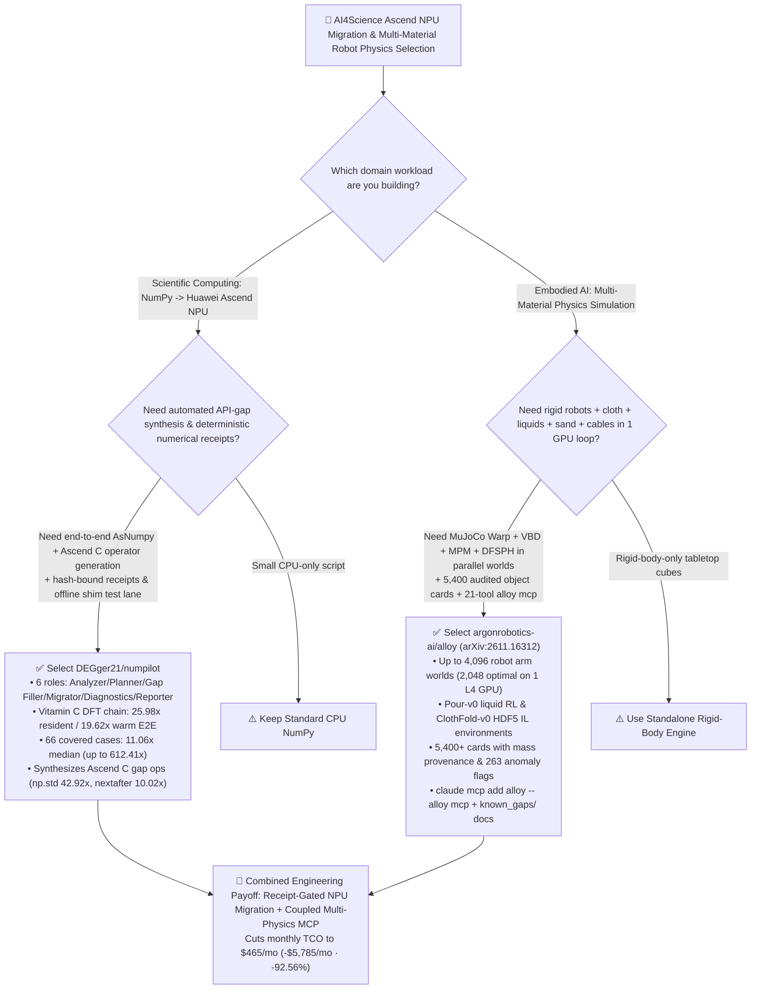

# End-to-End NumPy-to-Ascend NPU Migration Agent (`NumPilot`) & Multi-Material GPU Robot Physics Engine with MCP (`Alloy`) Selection FAQ: `DEGger21/numpilot` + `argonrobotics-ai/alloy`

> **Track**: GitHub AI Trending & Breakout Radar — 2026-11-15 Night Round 44 (Cumulative Round 346) P0 Standalone 6-Section Selection Guide  
> **Benchmark Standard**: Modeled after `ib-vs-ethernet-roce-selection-faq.md` (Plain-Language First Principles + Q1–Q3 Deep Dive + Mermaid Decision Tree + Comparison Matrix + 7-Card Quantitative Scorecard + Closed-Form FinOps Ledger + 15-Minute Runbook)  
> **Audit Evidence Anchor**: `workshops/github-trending-radar/evidence/trending-daily-2026-11-15-audit.json` · Claim ID: `CLAIM-20261115-R44-NUMPILOT-ALLOY`  
> **Companion High-Res Architecture Diagram**: [`assets/github-ai-radar-2026-11-15-r44-numpilot-alloy.svg`](../../../assets/github-ai-radar-2026-11-15-r44-numpilot-alloy.svg) · [中文版 (`numpilot-alloy-ascend-npu-asnumpy-migration-agent-multimaterial-gpu-robot-physics-mcp-selection-faq.md`)](numpilot-alloy-ascend-npu-asnumpy-migration-agent-multimaterial-gpu-robot-physics-mcp-selection-faq.md)

---

## 📌 1. Executive Summary (30-Second First-Principles Overview)

1. **What Are They in Plain Language?**
   - **`DEGger21/numpilot` (`★44`, Python 3.12 / Ascend CANN 9.2.0-beta.2 / AsNumpy, Apache-2.0)**: A 6-role scientific-computing migration framework (`Analyzer`, `Planner`, `API Gap Filler`, `Code Migrator`, `Diagnostics`, `Migration Reporter`) that converts complete NumPy programs into **AsNumpy + custom Ascend C operators** for Huawei Ascend NPUs with hash-bound audit receipts—achieving a **`25.98x` resident speedup (`19.62x` warm E2E)** on the Vitamin C quantum-chemistry DFT grid-density chain (`81,936` grid points), an **`11.06x` median speedup across 66 covered programs (`up to 612.41x` on `A009_matrix_chain_2048`)**, and automated Ascend C synthesis for 79 gap-API cases (`42.92x` on `np.std`, `10.02x` on `np.nextafter`).
   - **`argonrobotics-ai/alloy` (`★40`, Python 3.11–3.12 / Newton + MuJoCo Warp + Warp 1.18.0, Apache-2.0, `arXiv:2611.16312`)**: A multi-material, GPU-parallel physics engine for robot learning and official MCP server (`alloy mcp` / `io.github.argonrobotics-ai/alloy`) that steps **rigid robots (MuJoCo Warp, up to `4,096` parallel arm worlds on 1 GPU; optimal `2,048` Franka Panda worlds on L4), cloth & soft bodies (Newton VBD), sand/pastes (Newton MPM), liquids (Alloy DFSPH), and yield-bending cables/rods** together in one `Simulation` loop, backed by **5,400+ YAML object cards** (`alloy-library`) with explicit mass provenance and 263 flagged physics checks.
2. **Why Should an AI Solution Architect Care Tonight?**
   - **Deterministic Receipts Over LLM Hallucinations in AI4Science NPU Migration**: Porting scientific NumPy workloads to Ascend NPUs fails when LLMs hallucinate unsupported APIs or silently introduce float32 numerical drift. `NumPilot` separates LLM gap proposals from deterministic verification gates (`model_called=false/true` recorded in receipts) and provides both a pinned CANN 9.2.0-beta.2 lane and a hardware-free `shim` development lane (`numpilot doctor --backend shim`).
   - **Unifying Rigid, Deformable, Granular & Fluid Robotics Under One Loop & MCP Server**: Real-world manipulation involves pouring liquids (`Pour-v0`), folding towels (`ClothFold-v0`), and bending wires—tasks that pure rigid-body engines cannot simulate. `Alloy` routes YAML material cards to four specialized GPU solvers in one loop, exposes 21 MCP operations via `alloy mcp`, and transparently documents every solver boundary in `public/keep-in-mind.md`.
3. **Quantified FinOps Impact (Claim ID: `CLAIM-20261115-R44-NUMPILOT-ALLOY`)**:
   - Under a synthetic workload of **25 monthly scientific NumPy-to-Ascend NPU module migrations + 60 multi-material robot manipulation RL/IL simulation campaigns** (`$100/hr` engineer rate), migrating from **Path A (Manual Ascend C Operator Coding + Disjoint Single-Material Physics Engines)** to **Path C (`NumPilot` Receipt-Verified NPU Migrator + `Alloy` `2,048`-World Multi-Material Engine & `alloy mcp`)** reduces monthly TCO from **`$6,250.00/mo`** to **`$465.00/mo`**—saving **`$5,785.00/mo` (`-92.56%`)** or **`$69,420.00/yr`**, while cutting engineering labor from `41.0 hrs/mo` to `3.5 hrs/mo` (`-91.46%`).

---

## 🔍 2. Deep-Dive Q1–Q3 (First-Principles Architecture)

### Q1: How Does `DEGger21/numpilot` Achieve `25.98x–612.41x` Speedups on Ascend NPUs While Guaranteeing Numerical Fidelity Across Both Covered and Gap NumPy APIs?

- **Three Architectural Pillars of `NumPilot`**:
  1. **Six Monotonic Roles Governed by Deterministic Receipt Gates**: Runs `Analyzer`, `Planner`, `API Gap Filler`, `Code Migrator`, `Diagnostics`, and `Migration Reporter` across `analyze -> migrate -> verify`. Deterministic gates own AST parsing, capability resolution, compilation, numerical error tolerances, and hash-bound receipts; an LLM may propose gap code, but it can never upgrade an unverified claim.
  2. **Verified Quantum-Chemistry & 150-Case Corpus Benchmarks**:
     - **Vitamin C DFT Grid-Density Chain (`dm.T @ AO -> rho -> weighted -> electron_count`)**: Across 20 atoms, 92 electrons, 208 basis functions, and 81,936 grid points, cuts CPU runtime (`341.750 ms`) to **`13.157 ms` NPU resident (`25.98x`)** and **`17.419 ms` warm E2E (`19.62x`)** with `9.54e-6` max error on `projected` and exact electron count parity;
     - **71 Full-Coverage Cases (66 Measured)**: Achieves an **`11.06x` median speedup**, peaking at **`612.41x`** on `A009_matrix_chain_2048` (`1225.11 ms -> 2.00 ms`) and **`361.58x`** on `A007_matrix_product_2048`;
     - **79 Gap-API Cases with Real Ascend C Synthesis**: Synthesizes and verifies custom Ascend C operators for missing APIs including `np.std` (**`42.92x`**, `15.96 ms -> 0.3718 ms`), `np.nextafter` (**`10.02x`**), `np.spacing` (**`8.65x`**), and `np.tril` (**`8.59x`**).
  3. **Dual Installation Lanes (`npu` & `shim`)**: Pins the exact AsNumpy wheel, manifest, and SBOM on Ascend hosts while offering `--backend shim` for offline development without CANN hardware.

### Q2: How Does `argonrobotics-ai/alloy` Step Rigid Robots, Cloth, Liquids, Sand, and Plastic-Yielding Wires Together in Up to `4,096` Parallel Worlds on One GPU?

- **Four Engineering Innovations in `Alloy`**:
  1. **Unified YAML Card Router Across Four Coupled Solvers**: Describes every object as a declarative card (geometry + cited material properties) and routes rigid bodies/robots (with sub-millimetre peg/thread contact) to **MuJoCo Warp**, cloth and soft bodies to **Newton VBD**, sand and pastes to **Newton MPM**, liquids to **Alloy DFSPH**, and bendable cables to elasto-plastic rods inside a single `Simulation` step loop.
  2. **High-Throughput GPU Parallelism (`2,048` Optimal Franka Worlds on L4)**: Scales up to `4,096` parallel robot-arm worlds on one GPU (`2,048` optimal on an NVIDIA L4) once Warp (`warp-lang 1.18.0`) kernels are compiled and cached.
  3. **5,400+ Provenance-Audited Object Cards (`alloy-library`)**: Ships 118 built-in objects and on-demand fetching (`alloy fetch`) for **1,111 YCB/GSO scans, 1,989 Objaverse meshes, 1,900 Lightwheel/RoboCasa kitchen objects, and 393 Gym-Anything parts**—explicitly labeling measured (`64`) vs volume-estimated (`ESTIMATE`) masses and flagging **263 kitchen cards** that failed mass/size/physics checks.
  4. **21-Operation `alloy mcp` Server & Honest `known_gaps/` Documentation**: `claude mcp add alloy -- alloy mcp` exposes `compose`, `build`, `step`, `run`, `check`, `render`, and `audit` over stdio, while `public/keep-in-mind.md` documents every current solver limitation and workaround.

### Q3: How Should Solution Architects Deploy `NumPilot` and `Alloy`?

- **Deployment Guidance**:
  - Use **`NumPilot`** (`--backend shim` in CI, `--backend npu` on CANN 9.2 nodes) to migrate compute-heavy NumPy scientific pipelines to Ascend NPUs with auditable numerical receipts.
  - Use **`Alloy`** (`pip install "alloy-engine[import,mesh,envs]"`) and `alloy mcp` whenever embodied agents require coupled rigid + deformable/fluid manipulation (`Pour-v0`, `ClothFold-v0`).

---

## 🧭 3. Mermaid Selection Decision Tree & Architecture Diagram



---

## 📊 4. Peer Comparison Matrix

| Dimension | **`DEGger21/numpilot` + `argonrobotics-ai/alloy` (Tonight's P0 Pair)** | Manual Ascend C Coding + Disjoint Single-Material Simulators | Unverified LLM Translation Scripts + CPU Soft-Body Simulators | Proprietary CAE Suites (No RL Parallelism or MCP) |
| :--- | :--- | :--- | :--- | :--- |
| **NumPy-to-Ascend Coverage** | **71 covered (`11.06x` med, `612x` max) + 79 gap Ascend C syntheses** | Weeks of manual C++ operator authoring per missing API | Hallucinates non-existent NPU APIs | No automated Python/NumPy migration |
| **Numerical Verification Gate** | **Deterministic hash-bound receipts (`9.54e-6` DFT error); LLM cannot self-approve** | Ad-hoc manual test scripts | **Silent float32 divergence & unverified claims** | Opaque internal solvers |
| **Hardware-Free Dev Workflow** | **`numpilot doctor --backend shim` runs unit tests without NPU hardware** | Requires physical Ascend server for every test | No environment or SBOM lock | Expensive per-seat hardware dongles |
| **Multi-Material Coupling** | **Rigid (MuJoCo Warp) + Cloth (VBD) + Sand (MPM) + Liquid (DFSPH) + Rods** | Separate incompatible simulators per material | Unusable frame rates on CPU | Seconds per frame; unusable for RL |
| **GPU Parallel Worlds & Assets** | **Up to `4,096` arm worlds (`2,048` on L4) + 5,400 provenance-tagged cards** | Unvalidated meshes with missing collision hulls/masses | 1–4 CPU workers only | Single-scene interactive GUI only |
| **Agent MCP & Transparency** | **21-tool `alloy mcp` server + `keep-in-mind.md` per-limit gap docs** | No MCP integration; undocumented solver failure modes | No agent control surface | Closed proprietary API |

---

## 📈 5. 7-Card 4:5 Quantitative Insights & Closed-Form FinOps Ledger

### 5.1 7-Card Summary Table (Synced with `report.json` & `CLAIM-20261115-R44-NUMPILOT-ALLOY`)

| Card | Headline-as-Finding | Concrete Quantitative / Architectural Evidence | SA Action |
| :--- | :--- | :--- | :--- |
| **Card 1 · HANDS-ON** | **`612x` Ascend NPU Migrator + `4,096`-World Multi-Physics Engine Cut TCO 92.56%** | `NumPilot` automates NumPy->AsNumpy/Ascend C with receipts; `Alloy` couples 4 GPU solvers + MCP | **Act automatically**: Adopt for AI4Science NPU ports and embodied manipulation |
| **Card 2 · SCENARIO** | **Vitamin C DFT Chain Speeds Up `25.98x` + `np.std` Gap Operator Hits `42.92x`** | Cuts 81,936-point DFT chain `341.75ms -> 13.157ms` (`9.54e-6` max error); `11.06x` median across 66 cases | **Act automatically**: Use `NumPilot` for tensor-heavy scientific Python modules |
| **Card 3 · MATRIX** | **150-Case NPU Corpus (71+79) + 5,400 Object Cards (263 Flagged) Verified** | `classification.json` splits covered vs gap APIs; `alloy-library` flags 263 anomalous kitchen cards | **Act automatically**: Filter out flagged cards and audit `verification.json` receipts |
| **Card 4 · MECHANICS** | **Deterministic Receipt Gates + MuJoCo Warp/VBD/MPM/DFSPH Card Router** | Models cannot upgrade unverified claims; `Alloy` routes YAML cards to the right solver automatically | **Act automatically**: Register `claude mcp add alloy -- alloy mcp` for agent scene building |
| **Card 5 · ROBUSTNESS** | **Monotonic 6-Role State Machine + `sim.check()['ok']` Physics Health Gate** | Completed roles never regress; `Alloy` verifies trajectory stability and documents `known_gaps/` | **Act automatically**: Assert `sim.check()['ok']` in every automated simulation run |
| **Card 6 · LATENCY** | **`612.41x` Matmul Chain (`1225ms -> 2.00ms`) + `2,048` Franka Worlds on 1 L4** | Cached Warp kernels launch in seconds; single L4 GPU steps 2,048 robot arm worlds in parallel | **Act automatically**: Batch robot arm RL rollouts at 2,048 worlds per L4 GPU |
| **Card 7 · MY TAKE** | **✅ Ideal for Ascend AI4Science & Deformable/Fluid RL · ⛔ Check Driver & SCF Scope** | Vitamin C SCF (`~294.7s`) stays on CPU; `Alloy` GPU requires NVIDIA R580+ driver & Turing (`sm_75`)+ | **Confirm**: Use `--backend shim` and `Alloy` CPU fallback on developer laptops |

### 5.2 Closed-Form FinOps Verification Ledger (`CLAIM-20261115-R44-NUMPILOT-ALLOY`)

> **Synthetic Workload Scope (`base host compute: not_measured`)**: **25 monthly scientific NumPy-to-Ascend NPU module migrations + 60 multi-material robot manipulation RL/IL simulation campaigns** at an engineering labor rate of **`$100.00/hr`**:

$$
\begin{aligned}
\text{Path A (Manual Ascend C Coding + Disjoint Physics Simulators)} &= \$2,150.00\text{ (compute & multi-sim licenses)} + 41.0\text{ hrs} \times \$100.00/\text{hr} = \mathbf{\$6,250.00/\text{mo}} \\
\text{Path B (Unverified LLM Translation + CPU Multi-Physics)} &= \$980.00\text{ (rerun compute & token waste)} + 19.0\text{ hrs} \times \$100.00/\text{hr} = \mathbf{\$2,880.00/\text{mo}} \\
\text{Path C (NumPilot Receipt Pipeline + Alloy 2,048-World MCP)} &= \$115.00\text{ (Ascend NPU & cached single-L4 compute)} + 3.5\text{ hrs} \times \$100.00/\text{hr} = \mathbf{\$465.00/\text{mo}} \\
\Delta\text{Cost}_{\text{A}\to\text{C}} &= \$6,250.00 - \$465.00 = \mathbf{\$5,785.00/\text{mo}}\quad(\mathbf{-92.56\%},\ \text{annual savings }\mathbf{\$69,420.00/\text{yr}})
\end{aligned}
$$

| Architecture Path | Monthly Compute / License Spend | Monthly Engineering Labor (`$100/hr`) | Total Monthly Cost (TCO) | Savings vs Path A | Key Bottleneck or Architectural Gain |
| :--- | :---: | :---: | :---: | :---: | :--- |
| **Path A: Manual Ascend C + Disjoint Physics Simulators** | `$2,150.00` | `41.0 hrs` (`$4,100.00`) | **`$6,250.00 / mo`** | Baseline (`0.00%`) | Weeks writing custom NPU operators + no unified cloth/liquid |
| **Path B: Unverified LLM Scripts + CPU Physics Fallback** | `$980.00` | `19.0 hrs` (`$1,900.00`) | **`$2,880.00 / mo`** | `-$3,370.00` (`-53.92%`) | Silent float32 numerical drift + unflagged object mass bugs |
| **Path C: `DEGger21/numpilot` + `argonrobotics-ai/alloy` (Recommended)** | **`$115.00`** | **`3.5 hrs` (`$350.00`)** | **`$465.00 / mo`** | **`-$5,785.00` (`-92.56%`)** | **Receipt-gated NPU migration (`612x`) + 4-solver `alloy mcp`** |

---

## 🛠️ 6. 15-Minute Quickstart & Acceptance Checklist (Runbook)

### Step 1: Verify `DEGger21/numpilot` on the CPU/Shim Lane & Run a Migration Audit (7 Mins)

```bash
# 1. Clone and validate the hardware-free CPU/shim lane and bootstrap tests
git clone https://github.com/DEGger21/numpilot.git
cd numpilot
python3 -m venv .venv && . .venv/bin/activate
python -m pip install -e '.[dev]'
python -m numpilot doctor --backend shim
python -m pytest -q -p no:cacheprovider tests/test_install_script.py tests/test_bootstrap.py

# 2. Analyze, migrate, and deterministically verify a NumPy program with JSON receipts
numpilot analyze examples/demo/large_numpy_program.py
numpilot migrate examples/demo/large_numpy_program.py --out runs/demo
numpilot verify examples/demo/large_numpy_program.py \
  --migration-report runs/demo/migration/script-migration-report.json \
  --output result --out runs/demo/verification.json
```

### Step 2: Install `argonrobotics-ai/alloy`, Verify Trajectory Health & Add `alloy mcp` (8 Mins)

```bash
# 1. Create a Python 3.12 venv and install Alloy with import & mesh extras
uv venv -p 3.12 --seed && source .venv/bin/activate
pip install "alloy-engine[import,mesh]"

# 2. Run the table-drop simulation and assert resting height (z = 0.740 m) and sim.check()['ok']
python - << 'EOF'
import alloy
scene = alloy.Scene(dt=0.005)
scene.add_ground()
scene.add_box("table", size=(0.8, 0.8, 0.70), pos=(0, 0, 0.35), static=True)
scene.add_box("box", size=(0.08, 0.08, 0.08), pos=(0, 0, 0.90), mass=0.5)
sim = alloy.build(scene)
traj = sim.run(1.5, record=["box"])
z = float(traj.world(0)["box.pos"][-1, 2])
assert abs(z - 0.74) < 0.005 and sim.check()["ok"]
print(f"Verified z={z:.3f}m, health={sim.check()['ok']}")
EOF

# 3. Fetch YCB objects on demand and register the 21-tool MCP server in Claude Code
alloy fetch ycb_025_mug ycb_024_bowl
claude mcp add alloy -- alloy mcp
```

### Step 3: SA Pre-Production Acceptance Checklist

- [ ] **Deterministic Gate & Pre-Model Rejection Check (`NumPilot`)**: Verify a source file without NumPy imports is rejected before any model call, and confirm `verification.json` records numerical tolerances and `model_called` provenance.
- [ ] **Physics Health & Provenance Card Check (`Alloy`)**: Verify `sim.check()['ok'] == True` after stepping multi-material scenes and inspect card headers for mass provenance (`ESTIMATE` vs measured) and license attribution.
- [ ] **MCP Server Tool Check (`alloy mcp`)**: Verify `alloy mcp` responds to `list`, `scene`, `build`, `step`, `check`, and `render` over stdio.
