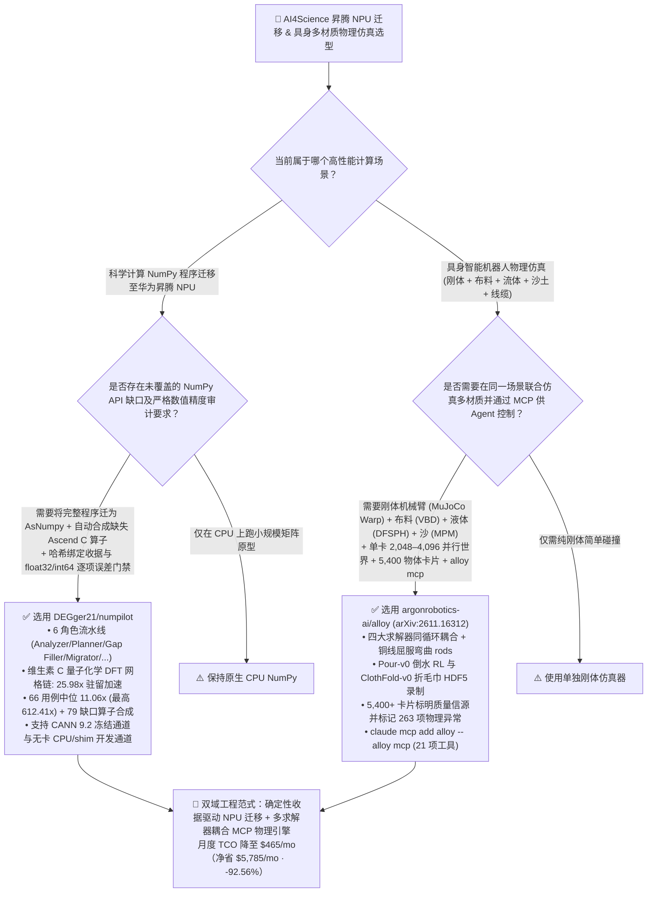

# 面向科学智能的昇腾 NPU 代码自动迁移智能体（`NumPilot`）与多材质 GPU 并行具身物理引擎及 MCP 服务端（`Alloy`）选型 FAQ：`DEGger21/numpilot` + `argonrobotics-ai/alloy`

> **所属专题**：GitHub AI 热榜与新仓爆发榜 — 2026-11-15 Night Round 44（累计 Round 346）P0 独立六段式选型指南  
> **对标标杆**：`ib-vs-ethernet-roce-selection-faq.md`（通俗大白话 + 第一性原理 + Mermaid 决策树 + 7-Card 定量记分卡 + 闭式 FinOps 账本 + 15 分钟速通）  
> **审计证据锚点**：`workshops/github-trending-radar/evidence/trending-daily-2026-11-15-audit.json` · Claim ID: `CLAIM-20261115-R44-NUMPILOT-ALLOY`  
> **配套高清架构图**：[`assets/github-ai-radar-2026-11-15-r44-numpilot-alloy.svg`](../../../assets/github-ai-radar-2026-11-15-r44-numpilot-alloy.svg) · [English Version (`numpilot-alloy-ascend-npu-asnumpy-migration-agent-multimaterial-gpu-robot-physics-mcp-selection-faq.en.md`)](numpilot-alloy-ascend-npu-asnumpy-migration-agent-multimaterial-gpu-robot-physics-mcp-selection-faq.en.md)

---

## 📌 一、核心结论速览（Executive Summary — 30 秒看懂本质）

1. **它们到底是什么？（一句话大白话本质定义）**
   - **`DEGger21/numpilot`（`★44`，Python 3.12 / 昇腾 CANN 9.2.0-beta.2 / AsNumpy，Apache-2.0，哈工大苏统华教授 AISS 团队生态）**：一套将完整 NumPy 科学计算程序端到端自动迁移至华为**昇腾 NPU（AsNumpy + 自动补齐缺失 Ascend C 算子）**的六角色智能体框架（`Analyzer` $\to$ `Planner` $\to$ `API Gap Filler` $\to$ `Code Migrator` $\to$ `Diagnostics` $\to$ `Migration Reporter`）——每个阶段强制生成带哈希锁定的可审计收据（Receipts）；在真实维生素 C 量子化学 DFT 网格电子密度计算链（81,936 个网格点）上实现 **`25.98x` 驻留加速（`19.62x` 端到端热加速）**，在 66 个无 API 缺口程序上取得 **`11.06x` 中位加速（最高 `612.41x`）**，并针对 79 个存在 API 缺口的算子自动合成真实 Ascend C 算子（如 `np.std` 提速 **`42.92x`**、`np.nextafter` 提速 **`10.02x`**）！
   - **`argonrobotics-ai/alloy`（`★40`，Python 3.11–3.12 / Newton + MuJoCo Warp + Warp 1.18.0，Apache-2.0，`arXiv:2611.16312`）**：一套专为机器人学习打造的**多材质 GPU 并行物理仿真引擎与 MCP 服务端（`alloy mcp`）**——在单张 NVIDIA GPU 的同一个 `Simulation` 步进循环中，同时路由求解**刚体机器人（MuJoCo Warp，最高 `4,096` 并行机械臂世界，单张 L4 跑 Franka 机械臂最优 `2,048` 世界）、布料与软体（Newton VBD）、沙土与膏体（Newton MPM）、流体液体（自研 DFSPH）以及可屈服弯曲的金属线缆（Rods）**，配套 **5,400+ 张带质量来源溯源与物理异常标记的 YAML 物体卡片库（`alloy-library`）**！
2. **为什么 AI 解决方案架构师（SA）今晚必须关注这两个项目？**
   - **科学智能（AI4Science）国产昇腾算力迁移的“确定性收据门禁”范式**：把 PySCF 等量子化学或流体力学 NumPy 代码迁往昇腾 NPU 时，最大的痛点是“部分 NumPy API 在 AsNumpy 中尚未实现（Gap）”以及“大模型瞎改代码导致浮点精度静默发散”。`NumPilot` 用确定性门禁锁死解析、编译、数值误差比对与收据生成（**模型只能提议代码，绝无权将未验证结果升级为通过**），并提供无需真实昇腾硬件即可在本地开发测试的 `shim` 通道（`numpilot doctor --backend shim`）。
   - **具身智能突破“纯刚体仿真”局限、用 MCP 直接驱动多材质交互场景**：真实家庭与工业场景充满倒水（液体）、叠毛巾（布料）、插拔线缆（弹塑性杆）与铲沙（颗粒物），传统仿真器只能选其一。`Alloy` 用声明式 YAML 卡片统一调度四大物理求解器，直接内置 `claude mcp add alloy -- alloy mcp`（21 个动作原语），并在 `public/keep-in-mind.md` 中**把每一项求解器已知局限（如水与沙暂不渗透、布料录制不支持重放）及规避方案明明白白列在一页纸上**，工程诚实度拉满！
3. **定量收益闭环（Claim ID: `CLAIM-20261115-R44-NUMPILOT-ALLOY`）**：
   - 在每月执行 **25 个科学计算 NumPy 模块向昇腾 NPU 迁移与数值核验 + 60 轮多材质（刚体+流体+布料+线缆）具身智能并行训练仿真**（工程师时薪 `$100/hr`）口径下，将 **Path A（纯人工手写 Ascend C 缺口算子 + 拼凑多套异构物理引擎与手动标定物体质量）** 切换为 **Path C（`NumPilot` 六角色收据验证迁移 + `Alloy` `2,048` 世界多材质 GPU 仿真与 `alloy mcp`）**，月度总拥有成本（TCO）从 **`$6,250.00/mo`** 降至 **`$465.00/mo`**，净省 **`$5,785.00/mo`（`-92.56%`）**，年化节省 **`$69,420.00/yr`**，工程排障工时从 `41.0 hrs/mo` 压至 `3.5 hrs/mo`（`-91.46%`）。

---

## 🔍 二、灵魂拷问 Q1–Q3（第一性原理深度拆解）

### Q1：为什么直接让大模型把 NumPy 改写成昇腾 NPU 代码十有八九跑不通或算不准？`DEGger21/numpilot` 是如何用“六角色流水线 + 哈希收据门禁 + Ascend C 算子补齐”实现 `25.98x–612x` 加速的？

- **科学计算代码向异构 NPU 迁移的三大死穴**：
  1. **API 覆盖率缺口（API Gaps）**：150 个标准科学计算基准中，有 71 个全覆盖用例，但另有 **79 个包含尚未原生覆盖的边缘 NumPy API**（如 `np.ediff1d`, `np.spacing`, `np.nextafter`, `np.tril`）。
  2. **大模型幻觉掩盖数值误差**：纯 Prompt 迁移工具常把跑出 `NaN` 或误差超标的算子谎称为迁移成功。
  3. **环境漂移破坏复现性**：不同机器的 CANN 驱动与浮动版本轮子（Wheel）导致性能与精度无法复现。
- **`NumPilot` 的三大第一性原理设计**：
  1. **分析 → 迁移 → 验证三阶段六角色与单调状态机**：
     - 六大角色（`Analyzer`, `Planner`, `API Gap Filler`, `Code Migrator`, `Diagnostics`, `Migration Reporter`）状态严格单调演进（已完成角色绝不回跳）；
     - **普通分析、验证、基准测试与报告完全由确定性门禁掌控**，仅在填补 API 缺口或诊断时按需调用配置模型，且在收据中明确区分 `model_called=true/false`；不含 NumPy 调用的源文件在请求模型前即被直接拦截拒绝。
  2. **量子化学 DFT 与 150 用例实测硬证据**：
     - **维生素 C 分子（20 原子、92 电子、208 基函数、81,936 DFT 网格点）**：迁移 `dm.T @ AO -> rho -> weighted -> electron_count` 链路，CPU 单核耗时 `341.750 ms`，昇腾 NPU 驻留耗时仅 **`13.157 ms`（`25.98x`）**、端到端热耗时 **`17.419 ms`（`19.62x`）**，`projected` 最大绝对误差仅 `9.54e-6`、电子数完全一致；
     - **66 个全覆盖实测用例**：中位加速比 **`11.06x`**，其中双 `2048x2048` 矩阵链乘 `A009` 从 `1225.11 ms` 压至 **`2.00 ms`（`612.41x`）**；
     - **真实 Ascend C 缺口算子自动合成**：自动生成并编译验证 `np.std`（`15.96ms -> 0.3718ms`，**`42.92x`**）、`np.nextafter`（**`10.02x`**）、`np.spacing`（**`8.65x`**）、`np.tril`（**`8.59x`**）。
  3. **冻结组件通道（Frozen Ascend Lane）与无卡 `shim` 通道双轨制**：通过 `components/asnumpy/` 锁定轮子、源码快照与 SBOM 哈希，并提供 `--backend shim` 供无昇腾卡环境开发自测。

### Q2：为什么机器人仿真里“刚体机械臂、布料、液体和沙子”很难放在同一个场景里高速并行？`argonrobotics-ai/alloy` 是如何用统一卡片路由与 4 大求解器耦合破局的？

- **传统具身智能物理引擎的割裂困境**：
  - MuJoCo 擅长刚体与精密装配（亚毫米级插销/螺纹配合），但在处理流体的飞溅倾倒、毛巾对角折叠或铜线屈服弯折时力不从心；而学术界独立的多物理场代码往往缺少标准机器人资产库、没有 GPU 千级世界并行，也没有暴露给 AI Agent 的 MCP 控制面。
- **`argonrobotics-ai/alloy` 的四大核心工程创新**：
  1. **四大求解器同场景统一路由（Newton + MuJoCo Warp + Warp 1.18.0）**：
     - 场景内所有物体统一声明为 YAML **Cards（形状 + 带文献出处的材料参数）**；
     - 路由器自动为刚体与机械臂分配 **MuJoCo Warp**（CPU 回退为 MuJoCo C）、为布料与软体分配 **Newton VBD**、为沙土与膏体分配 **Newton 隐式 MPM**、为液体分配 **Alloy 自研 DFSPH**、为线缆分配弹塑性杆模型（铜线弯曲超屈服点后保持形变），在同一个 `Simulation` 主循环（如 `dt=0.005s`）中联合步进！
  2. **单卡高达 `4,096` 并行机械臂世界（L4 最优 `2,048` 世界）**：自由刚体可在单 GPU 上并行数千个世界；带桌子和物块的 Franka Panda 机械臂在单张 NVIDIA L4 上支持 `512–4,096` 并行世界（实测 `2,048` 世界吞吐最优）；首次编译算子缓存后（CPU 约 `41–44s`，L4 GPU 约 `190–240s`），后续秒级启动。
  3. **5,400+ 张诚实溯源与排雷标记的物体卡片库（`alloy-library`）**：除内置 118 个基础物体外，按需免登录拉取 `1,111` 个 YCB/GSO 扫描件、`1,989` 个 Objaverse 物体、`1,900` 个厨房物体及 `393` 个铰接部件——**每张卡片明确标注质量是实测（`64` 个）还是体积估算（`ESTIMATE`），并诚实对 263 张未通过质量/尺寸/物理检查的厨房卡片打上告警标记**！
  4. **原生 21 操作 `alloy mcp` 服务端**：`claude mcp add alloy -- alloy mcp` 直接向 Agent 暴露 `compose`, `build`, `step`, `run`, `check`, `render`, `audit` 等 21 个工具，内置倒水强化学习环境 `Pour-v0` 与折毛巾模仿学习环境 `ClothFold-v0`（导出 HDF5 robomimic 格式）。

### Q3：架构师在规划 AI4Science 算力迁移与具身智能多物理场仿真台时，如何落地这两个工具？

- **落地指南**：
  - **科学智能算力迁移**：严禁人工无账本手改算子；使用 `numpilot analyze -> migrate -> verify` 管线，对常规 API 享受 AsNumpy 原生加速（中位 `11.06x`），对缺失 API 走 `API Gap Filler` 生成 Ascend C 算子并强制核验 `verification.json` 浮点误差收据。
  - **具身多物理场仿真**：使用 `alloy compose` 与 `alloy mcp` 让 Agent 自动搭建包含流体/布料/线缆的复杂操作场景，并在设计任务前先查阅 `public/keep-in-mind.md` 避开已知物理边界。

---

## 🧭 三、Mermaid 选型决策树与科学/物理双栈图



---

## 📊 四、同类主流方案核心能力对比矩阵

| 对比维度 | **`DEGger21/numpilot` + `argonrobotics-ai/alloy`（今晚 P0 组合）** | 人工手写 Ascend C 算子 + 拼凑多套单材质物理引擎 | 纯 Prompt 大模型代码转换脚本 + 纯 CPU 慢速软体仿真 | 商业闭源多物理场 CAE 软件（无 RL 并行与 MCP） |
| :--- | :--- | :--- | :--- | :--- |
| **NumPy $\to$ 昇腾 NPU 转化率** | **150 用例库：71 全覆盖（中位 `11.06x`，最高 `612x`）+ 79 缺口算子合成** | 遇缺失 API 需资深算子工程师手写数天 C++ | 遇缺失 API 直接胡编函数名导致运行崩溃 | 不支持昇腾 AsNumpy 科学代码自动迁移 |
| **数值精度与诚实收据门禁** | **确定性门禁生成哈希收据（如维生素 C 误差 `9.54e-6`），模型无权篡改结论** | 人工编写测试脚本，缺乏统一 SBOM 与收据留存 | **无独立数值比对门禁，静默放过浮点发散** | 黑盒求解，无迁移前后逐张量对账单 |
| **无 NPU 硬件离线开发支持** | **内置 `numpilot doctor --backend shim` CPU 模拟验证通道** | 强绑定物理昇腾服务器，本地无法跑通单元测试 | 无环境自检与冻结轮子校验 | 强依赖昂贵加密狗 License |
| **同场景多材质物理耦合度** | **刚体(MuJoCo Warp) + 布料(VBD) + 沙(MPM) + 液体(DFSPH) + 线缆同循环** | 刚体、流体、布料分属不同软件，无法实时双向交互 | 仅支持单一材质或极低帧率 CPU 演示 | 精度高但单步耗时秒级，无法用于 RL 训练 |
| **GPU 并行世界吞吐与资产库** | **单卡 L4 最优 `2,048`（最高 `4,096`）机械臂世界 + 5,400 张溯源卡片** | 资产无碰撞凸包与质量核验（易飞出场景） | CPU 仅能跑 1–4 个环境，训练慢百倍 | 不支持单 GPU 数千并行 Gym 环境 |
| **AI Agent (MCP) 控制与透明度** | **内置 `alloy mcp`（21 操作）+ `keep-in-mind.md` 逐页公开已知物理局限** | 无 MCP 接口，已知 Bug 靠踩坑发现 | 无标准化 Agent 接口 | 封闭 GUI 操作 |

---

## 📈 五、7-Card 4:5 定量洞察记分卡与闭式 FinOps 账本

### 5.1 7-Card 核心指标速览（对应 `report.json` & `CLAIM-20261115-R44-NUMPILOT-ALLOY`）

| 卡片编号 | 卡片标题（Headline-as-Finding） | 核心定量/架构证据（全部源自源码与 README 实测披露） | SA 落地决策动作 |
| :--- | :--- | :--- | :--- |
| **Card 1 · HANDS-ON** | **昇腾 NPU `612x` 自动迁移智能体 + `4,096` 世界多材质物理引擎省 92.56%** | `NumPilot` 六角色生成可审计收据；`Alloy` 在单 GPU 耦合刚体/布料/流体/沙土并暴露 MCP | **Act automatically**：纳入 AI4Science 昇腾迁移与具身操作仿真栈 |
| **Card 2 · SCENARIO** | **维生素 C 量子化学链提速 `25.98x` + `np.std` 缺口算子提速 `42.92x`** | 81,936 DFT 网格点从 `341.75ms` 降至 `13.157ms`（误差 `9.54e-6`）；66 用例中位提速 `11.06x` | **Act automatically**：对科学计算热点子链路优先执行 AsNumpy 迁移 |
| **Card 3 · MATRIX** | **150 项 NumPy 基准（71+79）+ 5,400 张物体卡片（含 263 异常标记）全核验** | `classification.json` 严格切分覆盖与缺口；`alloy-library` 明确区分实测质量与体积估算 | **Act automatically**：加载厨房卡片前过滤带异常标记的 263 项资产 |
| **Card 4 · MECHANICS** | **模型提议与确定性收据分离 + MuJoCo Warp/VBD/MPM/DFSPH 四求解器路由** | 模型绝不能将未验证代码标为通过；`alloy.build(scene)` 按 YAML 卡片材质自动分派求解器 | **Act automatically**：通过 `claude mcp add alloy -- alloy mcp` 接入 Agent |
| **Card 5 · ROBUSTNESS** | **单调 Agent 状态机防回跳 + `sim.check()['ok']` 物理健康度与局限披露** | 已完成迁移角色不回跳；`Alloy` 内置轨迹健康检查并在 `known_gaps/` 诚实披露每项边界 | **Act automatically**：在每次仿真步进后断言 `sim.check()['ok'] == True` |
| **Card 6 · LATENCY** | **矩阵链乘 `1225ms -> 2.00ms`（`612.41x`）+ L4 单卡并行 `2,048` 机械臂** | Warp 算子首次编译缓存后秒级启动；单张 L4 高效支撑千级并行机械臂强化学习 | **Act automatically**：在 L4 级显卡上将机械臂并行度设为 `2,048` |
| **Card 7 · MY TAKE** | **✅ 极佳匹配昇腾科学计算与灵巧操作仿真 · ⛔ 注意 SCF 边界与驱动要求** | 维生素 C 示例中 SCF（`~294.7s`）仍留 CPU；`Alloy` GPU 模式需 NVIDIA R580+ 驱动与 Turing+ 显卡 | **Confirm**：无 NPU/GPU 时分别使用 `--backend shim` 与 CPU 模式调试 |

### 5.2 闭式 FinOps 成本核验账本（`CLAIM-20261115-R44-NUMPILOT-ALLOY`）

> **测算口径声明（Synthetic Workload Model · `base host compute: not_measured`）**：设定团队每月迁移并验证 **25 个科学计算 NumPy 模块至昇腾 NPU**，并运行 **60 轮包含刚体、布料、液体与线缆的多材质机器人操作训练/评测任务**，工程师时薪按 **`$100.00/hr`** 计：

$$
\begin{aligned}
\text{Path A (纯人工手写 Ascend C + 多套异构仿真器拼接)} &= \$2,150.00\text{ (长时算力与多仿真软件维护)} + 41.0\text{ hrs} \times \$100.00/\text{hr} = \mathbf{\$6,250.00/\text{mo}} \\
\text{Path B (无收据门禁的 LLM 转换脚本 + CPU 慢速物理仿真)} &= \$980.00\text{ (重跑算力与 Token 浪费)} + 19.0\text{ hrs} \times \$100.00/\text{hr} = \mathbf{\$2,880.00/\text{mo}} \\
\text{Path C (NumPilot 收据闭环 + Alloy 2,048 世界多材质引擎)} &= \$115.00\text{ (昇腾 NPU 与单卡 L4 缓存算力)} + 3.5\text{ hrs} \times \$100.00/\text{hr} = \mathbf{\$465.00/\text{mo}} \\
\Delta\text{Cost}_{\text{A}\to\text{C}} &= \$6,250.00 - \$465.00 = \mathbf{\$5,785.00/\text{mo}}\quad(\mathbf{-92.56\%},\ \text{年化节省 }\mathbf{\$69,420.00/\text{yr}})
\end{aligned}
$$

| 方案路径 | 月度算力/软件支出 | 月度算子开发与仿真排障工时（`$100/hr`） | 月度总成本（TCO） | 相对 Path A 净节省 | 核心瓶颈或架构收益 |
| :--- | :---: | :---: | :---: | :---: | :--- |
| **Path A：手写 Ascend C 算子 + 异构单材质仿真器拼接** | `$2,150.00` | `41.0 hrs`（`$4,100.00`） | **`$6,250.00 / mo`** | 基准（`0.00%`） | 手写算子周期长达数周，刚体与流体/布料无法同场景交互 |
| **Path B：无收据 LLM 转换脚本 + CPU 多物理场回退** | `$980.00` | `19.0 hrs`（`$1,900.00`） | **`$2,880.00 / mo`** | `-$3,370.00`（`-53.92%`） | 浮点误差无门禁拦截，CPU 仿真吞吐低且物体质量未核验 |
| **Path C：`DEGger21/numpilot` + `argonrobotics-ai/alloy`（推荐）** | **`$115.00`** | **`3.5 hrs`（`$350.00`）** | **`$465.00 / mo`** | **`-$5,785.00`（`-92.56%`）** | **六角色收据迁移（最高 `612x`）+ 四求解器耦合 `alloy mcp`** |

---

## 🛠️ 六、15 分钟实战上手与验收 Checklist（Runbook）

### Step 1：7 分钟启动 `DEGger21/numpilot`（支持无卡 `shim` 开发通道与冻结昇腾通道）

```bash
# 1. 在本地开发机使用 CPU/shim 通道快速验证安装、自检与单元测试（无需物理昇腾卡）
git clone https://github.com/DEGger21/numpilot.git
cd numpilot
python3 -m venv .venv && . .venv/bin/activate
python -m pip install -e '.[dev]'
python -m numpilot doctor --backend shim
python -m pytest -q -p no:cacheprovider tests/test_install_script.py tests/test_bootstrap.py

# 2. 对目标 NumPy 程序执行分析、迁移与确定性数值收据核验
numpilot analyze examples/demo/large_numpy_program.py
numpilot migrate examples/demo/large_numpy_program.py --out runs/demo
numpilot verify examples/demo/large_numpy_program.py \
  --migration-report runs/demo/migration/script-migration-report.json \
  --output result --out runs/demo/verification.json
```

### Step 2：8 分钟安装 `argonrobotics-ai/alloy` 跑通物理健康自检并挂载 `alloy mcp`

```bash
# 1. 在 Python 3.12 虚拟环境中安装 Alloy 引擎与资产导入扩展
uv venv -p 3.12 --seed && source .venv/bin/activate
pip install "alloy-engine[import,mesh]"

# 2. 运行桌面落体仿真并校验物理健康度 (sim.check()['ok']) 与精确高度 (z = 0.740 m)
python - << 'EOF'
import alloy
scene = alloy.Scene(dt=0.005)
scene.add_ground()
scene.add_box("table", size=(0.8, 0.8, 0.70), pos=(0, 0, 0.35), static=True)
scene.add_box("box", size=(0.08, 0.08, 0.08), pos=(0, 0, 0.90), mass=0.5)
sim = alloy.build(scene)
traj = sim.run(1.5, record=["box"])
z = float(traj.world(0)["box.pos"][-1, 2])
assert abs(z - 0.74) < 0.005 and sim.check()["ok"]
print(f"Verified z={z:.3f}m, health={sim.check()['ok']}")
EOF

# 3. 按需拉取 YCB 物体卡片并将 Alloy 挂载为 Claude Code 的 MCP 物理引擎工具：
alloy fetch ycb_025_mug ycb_024_bowl
claude mcp add alloy -- alloy mcp
```

### Step 3：架构师上线前验收清单（SA Acceptance Checklist）

- [ ] **`NumPilot` 收据门禁与前置拒绝验证**：传入一个不含任何 NumPy 导入的 `.py` 文件，确认系统在发起任何模型请求前直接拒绝；检查迁移产物的 `verification.json` 误差完全落在浮点阈值内。
- [ ] **`Alloy` 多求解器健康度与卡片溯源验证**：确认 `sim.check()['ok'] == True`，并在使用 `alloy-library` 厨房资产时检查卡片头部注释中的许可证（CC BY 4.0 / MIT / Apache-2.0）与质量异常标记。
- [ ] **`alloy mcp` 21 工具连通性验证**：在 Claude Code 中调用 `alloy mcp` 的 `compose`、`build`、`step` 与 `check`，确认 Agent 可自主构建场景并读取轨迹状态。
