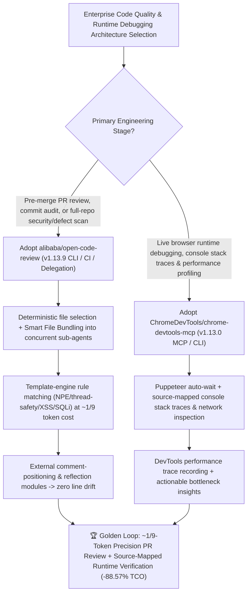

# Deterministic Engineering × Agent Hybrid Code Review (`alibaba/open-code-review` `v1.13.9`) & Live Chrome DevTools Performance/Source-Map Debugging MCP (`ChromeDevTools/chrome-devtools-mcp` `v1.13.0`) Selection FAQ

> **Document Scope**: This is the **2026-11-13 Night Shift Round 1 (Cumulative #129) standalone 6-part selection guide**, modeled strictly after `ib-vs-ethernet-roce-selection-faq.md` with first-principles explanations and closed-form FinOps math. It is written for AI Solution Architects and Engineering Productivity Leads evaluating two top daily trending software quality foundations:
> 1. **`alibaba/open-code-review` (Daily Trending DOM `#1`, `50,309★`, `+206★ today`, Go, Apache-2.0, released `v1.13.9` today)**: Alibaba Group's internal official AI code review CLI (`ocr`) open-sourced after two years serving tens of thousands of developers and catching millions of code defects — pioneering a **Deterministic Engineering × Agent Hybrid Architecture** (precise file selection, smart file bundling into isolated sub-agents, template-engine fine-grained rule matching across NPE/thread-safety/XSS/SQLi, and external comment-positioning & reflection modules). On **`AACR-Bench`** (50 popular OSS repos, 200 real PRs, 10 languages, 1,505 ground-truth issues cross-validated by 80+ senior engineers), it achieves significantly higher Precision and F1 than general-purpose agents while consuming only **`~1/9` of the tokens**, and includes a zero-API-key **`ocr delegate` host-agent mode**!
> 2. **`ChromeDevTools/chrome-devtools-mcp` (Daily Trending DOM `#12`, `55,291★`, `+60★ today`, TypeScript, Apache-2.0, latest `v1.13.0`)**: Google Chrome DevTools' official **MCP server and CLI** for coding agents (Claude, Cursor, Copilot, Antigravity) — giving agents direct access to live Chrome DevTools performance traces, CrUX real-user field data (`--no-performance-crux` opt-out), **source-mapped console stack traces**, network inspection, and Puppeteer auto-waiting automation!
>
> **中文版本**: [open-code-review-chrome-devtools-mcp-deterministic-review-runtime-debug-selection-faq.md](open-code-review-chrome-devtools-mcp-deterministic-review-runtime-debug-selection-faq.md) · **Daily Digest**: [`daily/2026-11-13.en.md`](../daily/2026-11-13.en.md) · **Panorama SVG**: [`assets/github-ai-radar-2026-11-13.svg`](../../../assets/github-ai-radar-2026-11-13.svg) · **Topic SVG**: [`docs/open-code-review-chrome-devtools-mcp-deterministic-review-runtime-debug.svg`](open-code-review-chrome-devtools-mcp-deterministic-review-runtime-debug.svg)

---

## 📌 1. Executive Summary

1. **In plain English, what core pain points do these two repositories solve?**
   - **Ending "corner-cutting file skips on large PRs, drifting line numbers, noisy false alarms, and 9× token waste when using general-purpose coding agents for code review" (`alibaba/open-code-review` `v1.13.9`)**: When teams point a general-purpose agent with a markdown skill at a large PR, a purely language-driven pipeline lacks hard constraints — the agent skips files, drifts off actual line numbers, and floods PRs with low-precision noise. Alibaba's `open-code-review` (`ocr`) separates **deterministic engineering** (precise file filtering, smart file bundling into concurrent isolated sub-agents, template-engine rule matching, and independent comment-positioning + reflection modules) from **agent dynamic context retrieval**, achieving higher Precision and F1 on `AACR-Bench` at **`~1/9` of the token cost**, plus a zero-config `ocr delegate` mode that reuses your host coding agent's model!
   - **Ending "post-review runtime blind spots where coding agents guess `console.log` fixes against minified `bundle.min.js` errors without real browser traces" (`ChromeDevTools/chrome-devtools-mcp` `v1.13.0`)**: Even after static code review passes, frontend and full-stack changes can fail at runtime with hydration errors, failed network calls, or main-thread jank. `chrome-devtools-mcp` gives agents direct MCP/CLI access to Chrome DevTools: **source-mapped console stack traces** pointing straight to original TypeScript/React lines, full network request/response forensics, recorded DevTools performance traces with CrUX field correlation, and deterministic Puppeteer auto-waiting!
2. **Closed-Form FinOps Conclusion (`CLAIM-20261113-R1-OCR-DEVTOOLS`)**:
   - Modeled for a **30-engineer full-stack team reviewing `600 Pull Requests/month` and triaging `200 frontend/runtime regressions/month`** (fully loaded senior engineer rate `$90.00/hr`; CI runner VM leases and commercial APM SaaS subscriptions: `not_measured`):
   - Upgrading from **Path A (general-purpose agent raw diff review burning 9× tokens + manual false-alarm/line-drift triage + manual browser DevTools reproduction, `$6,300.00/mo`)** to **Path C (`alibaba/open-code-review v1.13.9` deterministic×agent review [`~1/9` tokens + `ocr delegate`] + `ChromeDevTools/chrome-devtools-mcp v1.13.0` source-mapped trace MCP, `$720.00/mo`)** saves **`$5,580.00/mo` (`-88.57%`, or `$66,960.00/yr`)** and cuts engineering triage/debugging labor from `52.0 hrs/mo` to `6.0 hrs/mo` (**`-88.46%`**).

---

## 🎯 2. Three First-Principles Deep-Dive Questions (Q1 / Q2 / Q3)

### Q1: Why do general-purpose coding agents with plain-text review skills struggle with large PRs and runtime regressions?
- **First-Principles Breakdown**:
  1. **Incomplete Coverage on Large Changesets**: Without deterministic file selection and bundling, a general-purpose agent fed a 40-file diff selectively reviews a handful of files and silently skips the rest.
  2. **Line-Number Drift & False-Alarm Noise**: LLMs counting diff offsets in-context frequently misalign line numbers and over-report speculative warnings, forcing engineers to waste hours verifying false alarms.
  3. **Static-to-Runtime Blindness**: Static diffs cannot reveal runtime network failures, layout shifts, or minified console stack traces without live browser instrumentation.

### Q2: How does `alibaba/open-code-review` (`v1.13.9`) achieve higher Precision/F1 at `~1/9` of the tokens on `AACR-Bench`?
- **First-Principles Breakdown**:
  1. **Four Deterministic Engineering Hard Constraints**:
     - **Precise File Selection & Smart File Bundling**: Groups related files (e.g., `message_en.properties` and `message_zh.properties`) into isolated sub-agent review units for concurrent divide-and-conquer execution (`v1.13.9 #1901` also records excluded files in the run coverage manifest).
     - **Template-Engine Fine-Grained Rule Matching**: Matches built-in and custom rules (NPE, thread-safety, XSS, SQL injection) to each file's characteristics with deterministic ordering (`#1902`) and per-request tool declarations (`#1841`).
     - **Independent Positioning & Reflection Modules**: Post-processes candidate findings to lock exact line numbers and filter out low-evidence noise.
  2. **Delegation Mode (`ocr delegate`) & Full-File `ocr scan`**:
     - Lets Claude Code, Codex, Cursor, Kimi Code, or OpenCode execute reviews using the host agent's existing model and credentials (zero separate API key), while `ocr scan` audits entire directories without requiring a git diff.

### Q3: How does `ChromeDevTools/chrome-devtools-mcp` (`v1.13.0`) turn live Chrome debugging into a deterministic agent loop?
- **First-Principles Breakdown**:
  1. **Recorded DevTools Performance Traces & CrUX Insights**:
     - Uses `ChromeDevTools/devtools-frontend` to record traces and extract actionable LCP/INP/CLS bottlenecks alongside Chrome User Experience Report (CrUX) field data (with `--no-performance-crux` for strict offline/air-gapped privacy).
  2. **Source-Mapped Console Stacks & Puppeteer Auto-Wait**:
     - Automatically maps browser console stack traces back to original source lines, inspects network payloads, and uses Puppeteer auto-wait so agents never rely on flaky fixed sleeps.

---

## 🧭 3. Mermaid Decision Tree & Pre-Merge Review + Runtime DevTools Architecture

---

## 📊 4. Head-to-Head Selection Matrix

| Dimension | Path A: General Agent Raw Diff + Manual Browser DevTools | Path B: Static SAST + Basic Screenshot Scripts | **Path C (Recommended): `open-code-review v1.13.9` + `chrome-devtools-mcp v1.13.0`** |
| :--- | :--- | :--- | :--- |
| **Large-PR Coverage Guarantee** | Agent cuts corners and skips files on large diffs | Syntax-only regex rules; misses cross-file logic | **Deterministic file selection + Smart Bundling sub-agents + `#1901` coverage manifest** |
| **Review Token Cost & Precision** | `1.0×` baseline tokens; high false alarms & line drift | Zero LLM tokens but high false-positive noise | **`~1/9` token cost on `AACR-Bench` (200 PRs / 1,505 defects) with higher Precision & F1** |
| **Zero-Key Host Agent Delegation** | Requires separate review API keys | N/A | **Native `ocr delegate` reuses host Claude Code / Codex / Cursor model & login** |
| **Runtime Error Localization** | Manual copy-paste of minified `bundle.js` logs | Blind viewport screenshots without stack traces | **Source-mapped console stack traces + live network request/response inspection** |
| **Performance Profiling** | Manual flamechart inspection | Coarse page-load timers only | **Automated DevTools trace recording + actionable performance insights (`--no-performance-crux`)** |
| **Monthly TCO (30 Engineers / 600 PRs + 200 Bugs)** | **`$6,300.00 / mo`** (`$1,620` API + `$4,680` labor) | **`$3,260.00 / mo`** (`$740` API + `$2,520` labor) | **`$720.00 / mo` (Saves `$5,580.00/mo` · `-88.57%`)** |

---

## 🧪 5. Closed-Form FinOps Worked Example & 7-Card Insights (`CLAIM-20261113-R1-OCR-DEVTOOLS`)

### 5.1 Baseline Parameters & Explicit Scope Boundaries
- **Scenario**: A 30-engineer full-stack team reviewing **600 Pull Requests per month** and triaging **200 frontend/runtime console and performance regressions per month**.
- **Labor Rate**: Fully loaded senior engineering / QA rate of **`$90.00 / hr`**.
- **Explicit Not-Measured Boundary**: CI runner VM leases and commercial production APM SaaS licenses are marked **`not_measured`**. This model strictly accounts for model API spend and engineering hours spent triaging false-positive review comments, hunting drifted line numbers, and manually reproducing browser DevTools traces.

### 5.2 Three-Path Monthly Cost Comparison

| Cost Component | Path A: General Agent Raw Diff + Manual DevTools | Path B: Static SAST + Basic Screenshot Scripts | **Path C: `open-code-review v1.13.9` + `chrome-devtools-mcp v1.13.0` (Recommended)** |
| :--- | :--- | :--- | :--- |
| **Monthly Model API Token Spend** | **`$1,620.00`** (9× review token footprint + blind debug retries) | **`$740.00`** (repeated screenshot/log debugging turns) | **`$180.00`** (`~1/9` review token footprint + `ocr delegate` + 1-turn source-mapped trace) |
| **False-Alarm Triage, Line-Drift & Manual DevTools Labor (`$90/hr`)** | `52.0 hrs × $90.00` = **`$4,680.00`** | `28.0 hrs × $90.00` = **`$2,520.00`** | `6.0 hrs × $90.00` = **`$540.00`** |
| **Total Monthly TCO** | **`$6,300.00 / mo`** | **`$3,260.00 / mo`** (`-48.25%`) | **`$720.00 / mo`** |
| **Net Savings vs. Path A** | Baseline | Saves `$3,040.00 / mo` | **Saves `$5,580.00 / mo` (`-88.57%` · `$66,960.00/yr`)** |
| **CI Runner VM Leases & Commercial APM Subscriptions** | `not_measured` | `not_measured` | `not_measured` |

---

## 🛠️ 6. Production Adoption Checklist

- [ ] **1. `alibaba/open-code-review` (`v1.13.9`) & Delegation Mode Setup**: Verify `Git >= 2.41`, run `npm install -g @alibaba-group/open-code-review`, install the plugin for Claude Code / Codex / Cursor, and test `ocr delegate preview` and `/open-code-review:delegate-review` with zero separate LLM keys.
- [ ] **2. Branch-Range PR Review, `ocr scan` & Session Viewer Verification**: Run `ocr review --from main --to feature-branch --format json --output result.json` in CI, audit legacy folders via `ocr scan --path internal/agent`, and inspect findings in the browser Session Viewer.
- [ ] **3. `ChromeDevTools/chrome-devtools-mcp` (`v1.13.0`) Configuration**: Register `npx -y chrome-devtools-mcp@latest --no-performance-crux` in your coding agent's MCP config to connect to Chrome for Testing with external CrUX telemetry disabled.
- [ ] **4. Source-Mapped Stack Trace & Performance Trace Loop**: Trigger a frontend flow via `chrome-devtools-mcp`, verify that console errors resolve via source maps to exact TypeScript lines, and record a DevTools performance trace to validate LCP/INP before merging.
