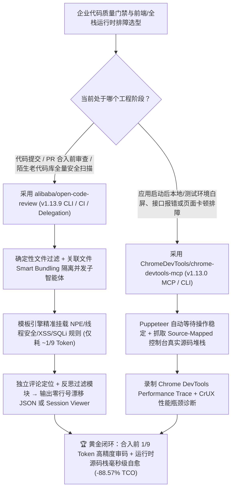

# 确定性工程×Agent 混合代码审查（`alibaba/open-code-review` `v1.13.9`）与运行态 Chrome DevTools 性能/源码栈调试 MCP（`ChromeDevTools/chrome-devtools-mcp` `v1.13.0`）深度选型 FAQ

> **文档定位**：本专题是 **2026-11-13 夜班第 1 轮（累计第 129 篇）独立六段式选型指南**，严格对标 `ib-vs-ethernet-roce-selection-faq.md` 的通俗第一性原理与闭式 FinOps 核算规范，面向研发效能负责人与 AI Solution Architect，深度拆解今日在 GitHub Daily Trending 主日榜领跑的两大工程质量底座：
> 1. **`alibaba/open-code-review`（主日榜 DOM `#1`，`50,309★`，今日新增 `+206★ today`，Go，Apache-2.0，今日发布 `v1.13.9`）**：阿里巴巴集团内部服役两年、服务数万开发者并拦截数百万代码缺陷的官方 AI 代码审查助手开源版（CLI 命令 `ocr`）——首创**「确定性工程硬约束 × Agent 动态工具调用」混合架构**（精确文件过滤、关联文件智能打包 `Smart Bundling`、模板引擎细粒度规则匹配、独立行号定位与评论反思模块），在 **50 个开源名仓、200 个真实 PR、10 种语言、80+ 资深专家交叉标注 1,505 个真实缺陷的 `AACR-Bench`** 上，以**仅相当于通用 Agent（如 Claude Code）`~1/9` 的 Token 消耗**取得了显著更高的 Precision 与 F1，并内置免独立 API Key 的 **`ocr delegate` 宿主委派模式**！
> 2. **`ChromeDevTools/chrome-devtools-mcp`（主日榜 DOM `#12`，`55,291★`，今日新增 `+60★ today`，TypeScript，Apache-2.0，最新版 `v1.13.0`）**：Google Chrome DevTools 官方出品的面向 Coding Agent（Claude、Cursor、Copilot、Antigravity）的 **MCP Server 与 CLI 双栖工具**——让智能体直接调用原生 Chrome DevTools 录制性能 Trace 并提取 LCP/INP/CLS 瓶颈洞察、关联 Google CrUX 真实用户体验数据（支持 `--no-performance-crux` 关停）、读取带 **Source-Map 源码映射的控制台报错堆栈**与网络请求载荷，并通过 Puppeteer 自动等待动作稳定！
>
> **English Version**: [open-code-review-chrome-devtools-mcp-deterministic-review-runtime-debug-selection-faq.en.md](open-code-review-chrome-devtools-mcp-deterministic-review-runtime-debug-selection-faq.en.md) · **关联日报**: [`daily/2026-11-13.md`](../daily/2026-11-13.md) · **全景架构图**: [`assets/github-ai-radar-2026-11-13.svg`](../../../assets/github-ai-radar-2026-11-13.svg) · **专题架构图**: [`docs/open-code-review-chrome-devtools-mcp-deterministic-review-runtime-debug.svg`](open-code-review-chrome-devtools-mcp-deterministic-review-runtime-debug.svg)

---

## 📌 一、核心结论速览（Executive Summary）

1. **一句话大白话讲透这两个项目到底解决了什么痛点？**
   - **终结“直接拿通用 Coding Agent 审大 PR 时偷懒漏审文件、报错行号到处乱飘、提示词稍微改一点质量就剧烈抖动，而且单次 PR 审查烧掉天价 Token”的痛点（`alibaba/open-code-review` `v1.13.9`）**：为什么很多团队直接给 Claude Code 挂个文本 Skill 审代码效果不好？因为纯自然语言驱动没有工程硬约束——遇到几十个文件的大 PR，大模型会自动“偷懒挑几个文件看看”；报出来的 Bug 行号经常对不上源码；还会报出一堆让人疲于应付的假阳性噪音。阿里开源的 `open-code-review` (`ocr`) 把**确定性工程管线**和**动态 Agent** 分工解耦：先由 Go 确定性管线完成精确文件筛选、把关联文件（如 `message_en.properties` 和 `message_zh.properties`）打包成独立子智能体上下文、按文件特征通过模板引擎精准挂载规则（支持 NPE、线程安全、XSS、SQL 注入等内置规则库），再交给搭载专用工具集的 Agent 深入查上下文，最后经过**独立的评论行号定位模块（Comment-Positioning）与反思过滤模块（Comment-Reflection）**输出精确到行的结果，在 `AACR-Bench` 上**只花通用 Agent `~1/9` 的 Token 就拿到更高的准确率（Precision）和 F1**！
   - **终结“静态审完代码跑起来还是白屏或卡顿，AI 只能盲猜 `console.log` 或对着压缩后的 `bundle.min.js:1:48291` 乱改一气”的痛点（`ChromeDevTools/chrome-devtools-mcp` `v1.13.0`）**：代码静态看着没毛病，浏览器一跑就报跨域、水合失败或首屏阻塞。普通截图工具只能看到页面白了，却看不到底层网络请求和源码行号。Google 官方的 `chrome-devtools-mcp` 直接把完整 Chrome DevTools 暴露给 Agent：一键抓取 **带 Source-Map 还原的真实 TypeScript/React 源码报错栈**、完整网络请求头与响应体、甚至直接录制 DevTools Performance Trace 并结合 CrUX 真机数据给出性能修复建议！
2. **闭式 FinOps 投资回报结论（`CLAIM-20261113-R1-OCR-DEVTOOLS`）**：
   - 以 **30 人全栈研发团队每月审查 `600 个 Pull Request` 并排查 `200 次前端/运行时性能与控制台回归故障`** 为基准（资深研发与 QA 工程师全包时薪 `$90.00/hr`；CI 构建节点租赁与商业 APM SaaS 订阅费：`not_measured`）：
   - 从 **Path A（通用 Agent 裸扫全量 Diff 消耗 9 倍 Token + 研发人工排查假阳性/行号漂移 + 手工打开浏览器 DevTools 复现贴日志，月均 `$6,300.00`）** 升级至 **Path C（`alibaba/open-code-review v1.13.9` 确定性×Agent 混合审码 [`~1/9` Token + `ocr delegate`] + `ChromeDevTools/chrome-devtools-mcp v1.13.0` 源码栈与 Trace 自动取证，月均 `$720.00`）**，每月净省 **`$5,580.00/mo`（降幅 `-88.57%`，年省 `$66,960.00/yr`）**，并将人工甄别假阳性与手工抓包复现工时从 `52.0 hrs/mo` 压缩至 `6.0 hrs/mo`（节省 **`-88.46%`**）。

---

## 🎯 二、三大灵魂拷问（Q1 / Q2 / Q3 深度原理解析）

### Q1：为什么直接用通用 Coding Agent（配纯文本 Skill）做企业级代码审查和前端排障，会陷入“高 Token、低信噪比、漏审加乱猜”的泥潭？
- **第一性原理拆解**：
  1. **纯语言驱动缺乏覆盖率硬约束（Incomplete Coverage & Corner-Cutting）**：当一个 PR 涉及 40 个文件时，把整个 `git diff` 塞给单个通用 Agent，模型受注意力衰减影响会只挑前几个文件细看，漏掉深层并发或边界缺陷（为此 `ocr v1.13.9` 甚至在 `#1901` 专门把被过滤排除的文件也写入运行覆盖率清单 `manifest` 中备查）。
  2. **缺乏独立行号定位与反思门禁（Position Drift & False-Alarm Fatigue）**：大模型心算 Diff 行号极易发生偏移（Position Drift），且宁可多报 10 条风格鸡毛蒜皮也不愿少报，导致研发人员花在“核对行号 + 驳回假告警”上的时间远超修 Bug 本身。
  3. **静态审查与浏览器运行态割裂**：前端渲染卡顿、接口 403 或打包后报错，静态 Diff 里根本看不出端倪；没有 Source-Map 还原和 DevTools Performance Trace，Agent 只能在代码里盲目插满 `console.log` 反复重跑。

### Q2：`alibaba/open-code-review` (`v1.13.9`) 是如何靠“确定性工程 × Agent 混合架构”做到 `~1/9` Token 消耗却拥有更高 Precision/F1 的？
- **第一性原理拆解**：
  1. **四道确定性工程硬约束（Deterministic Guardrails）**：
     - **精确文件筛选 + 关联文件智能打包（Smart File Bundling）**：把高度关联的文件（例如多语言资源对、接口定义与实现类）打包为一个审查单元，每个单元启动拥有独立隔离上下文的子智能体并发审查，在大变更集下依然保持高稳定性。
     - **模板引擎细粒度规则匹配（Template-Engine Rule Matching）**：根据文件后缀与路径特征精确注入对应规则（内置 NPE、线程安全、XSS、SQL 注入等多语言规则库，`v1.13.9 #1902` 严格锁定规则表匹配顺序），从源头消除无关规则噪音。
     - **独立行号定位与评论反思模块（External Positioning & Reflection Modules）**：模型生成初步发现后，由独立的定位模块校准精确行号，并由反思模块剔除缺乏上下文证据的臆测告警。
  2. **双模式执行（OCR 直连 vs `ocr delegate` 零 Key 宿主委派）与全仓 `ocr scan`**：
     - 除配置独立模型运行 `ocr review` / `ocr scan`（支持无 Git 历史的整目录安全审计与 `--resume` 断点续审）外，还支持 **`Delegation Mode`（`ocr delegate preview/rule`）**：由 `ocr` 负责确定性文件筛选和规则解析，直接复用开发者现有的 Claude Code、Codex、Cursor、Kimi Code 或 OpenCode 宿主模型与登录态完成审查，无需额外配置 API Key！

### Q3：`ChromeDevTools/chrome-devtools-mcp` (`v1.13.0`) 是如何把浏览器黑盒变成 Agent 的透明实验室的？
- **第一性原理拆解**：
  1. **原生 DevTools Trace 录制与 CrUX 真机体验融合**：
     - 直接驱动 `devtools-frontend` 引擎录制浏览器运行 Trace，自动提炼可执行的渲染与脚本阻塞优化建议，并可结合 Chrome User Experience Report (CrUX) 对比实验室数据与真实用户分位值（注重隐私的内网环境可通过 `--no-performance-crux` 一键关闭外发）。
  2. **Source-Mapped 控制台堆栈 + 网络全链路取证 + Puppeteer 自动等待**：
     - 自动将控制台报错通过 Source-Map 映射回原始源码文件与行号，配合网络请求检查与 Puppeteer 动作自动等待（Auto-Wait），让 Agent 一次工具调用就能拿齐“哪行源码报错 + 哪个接口返回异常 + 哪段脚本阻塞主线程”的完整证据链。

---

## 🧭 三、Mermaid 选型决策树与「合入前确定性审码 + 运行时 DevTools 取证」闭环架构图

---

## 📊 四、同类方案核心能力对比矩阵（Selection Matrix）

| 评估维度 | Path A：通用 Coding Agent 裸扫 Diff + 手工开浏览器排障 | Path B：传统静态 SAST + 简易 Playwright 截图脚本 | **Path C（推荐）：`open-code-review v1.13.9` + `chrome-devtools-mcp v1.13.0`** |
| :--- | :--- | :--- | :--- |
| **大 PR 文件覆盖与防漏审机制** | 模型易偷懒挑文件看，无排除文件清单 | 仅扫死板正则语法，不懂跨文件业务逻辑 | **确定性文件筛选 + Smart Bundling 子智能体并发 + `#1901` 完整记录覆盖清单** |
| **单次审查 Token 消耗与信噪比** | 基准 `1.0×` Token，假阳性高且行号易漂移 | 无 LLM 成本但误报极多 | **`AACR-Bench` 实证仅需 `~1/9` Token，独立定位与反思模块保障高 Precision/F1** |
| **免额外 API Key 宿主委派** | 需单独给 CI/插件配 Key | 不适用 | **原生支持 `ocr delegate`，直接白嫖宿主 Claude Code/Codex/Cursor 登录态** |
| **浏览器运行态报错定位精度** | 人工复制压缩后的 `bundle.js` 报错给 AI 盲猜 | 仅能看到页面截图白屏，无源码行号 | **原生解析 Source-Map 堆栈直达源码行 + 完整 Network 请求检查** |
| **前端性能瓶颈（LCP/INP）分析** | 靠肉眼看火焰图 | 仅能测粗粒度页面加载耗时 | **调用 `devtools-frontend` 录制 Trace 提取可执行性能洞察 + CrUX 对照** |
| **月度总拥有成本（30 人 / 600 PR + 200 排障）** | **`$6,300.00 / mo`**（`$1,620` API + `$4,680` 工时） | **`$3,260.00 / mo`**（`$740` API + `$2,520` 工时） | **`$720.00 / mo`（净省 `$5,580.00/mo` · `-88.57%`）** |

---

## 🧪 五、定量 FinOps 算例与 7-Card 洞察（`CLAIM-20261113-R1-OCR-DEVTOOLS`）

### 5.1 测算基准与显式边界（Scope & Boundaries）
- **场景设定**：30 人全栈研发团队，每月累计审查 **600 个 Pull Request** 并排查 **200 次前端/全栈运行时控制台报错与性能回归**。
- **费率假设**：资深研发与 QA 工程师全包时薪 **`$90.00 / hr`**。
- **显式边界声明（Explicit Not-Measured Boundary）**：企业自建 CI Runner 虚拟机租赁费与商业级线上 APM 监控 SaaS 订阅费标记为 **`not_measured`**，本算例严格聚焦于模型 API Token 消耗以及工程师花在“核对漂移行号、甄别假阳性评论、手工打开浏览器抓包贴日志”上的损耗工时。

### 5.2 三路径月度成本闭式对照表

| 成本分项 | Path A：通用 Agent 裸扫 Diff + 手工 DevTools 抓包 | Path B：传统 SAST + 基础截图脚本 | **Path C：`open-code-review v1.13.9` + `chrome-devtools-mcp v1.13.0`（推荐）** |
| :--- | :--- | :--- | :--- |
| **月度模型 API Token 净支出** | **`$1,620.00`**（全量未打包 Diff 消耗 9× Token + 多轮盲猜重试） | **`$740.00`**（仅在排障阶段反复喂截图与日志） | **`$180.00`**（`~1/9` 审码 Token 消耗 + `ocr delegate` 复用 + 单轮精准源码栈取证） |
| **假阳性甄别、行号核对与浏览器手工复现工时（`$90/hr`）** | `52.0 hrs × $90.00` = **`$4,680.00`** | `28.0 hrs × $90.00` = **`$2,520.00`** | `6.0 hrs × $90.00` = **`$540.00`** |
| **月度总成本（Monthly TCO）** | **`$6,300.00 / mo`** | **`$3,260.00 / mo`**（`-48.25%`） | **`$720.00 / mo`** |
| **相对 Path A 净节省** | 基准线（Baseline） | 净省 `$3,040.00 / mo` | **净省 `$5,580.00 / mo`（`-88.57%` · 年省 `$66,960.00/yr`）** |
| **CI Runner 节点租赁与商业 APM 订阅费** | `not_measured` | `not_measured` | `not_measured` |

---

## 🛠️ 六、生产级落地核验 Checklist

- [ ] **1. `alibaba/open-code-review` (`v1.13.9`) 安装与免 Key 委派模式验证**：要求本地 `Git >= 2.41`，执行 `npm install -g @alibaba-group/open-code-review`，在 Claude Code / Codex / Cursor 中安装插件并运行 `ocr delegate preview` 与 `/open-code-review:delegate-review`，验证无需单独配置 API Key 即可完成关联文件智能打包与规则匹配。
- [ ] **2. 增量 PR 审查、无 Diff 全量扫描与 Session Viewer 闭环**：在主干合并前执行 `ocr review --from main --to feature-branch --format json --output result.json`，对历史遗留模块执行 `ocr scan --path internal/agent`，并通过内置浏览器 Session Viewer 回放审查会话、标记已修复或忽略项。
- [ ] **3. `ChromeDevTools/chrome-devtools-mcp` (`v1.13.0`) 接入与隐私护栏配置**：在 Agent 的 MCP 配置中加入 `npx -y chrome-devtools-mcp@latest --no-performance-crux`（内网环境显式关闭向 Google CrUX 发送 Trace URL），验证连接本地 Chrome for Testing 实例。
- [ ] **4. Source-Map 控制台报错与 Performance Trace 自动化验证**：触发一次前端页面交互，让 Agent 通过 `chrome-devtools-mcp` 自动等待动作完成、拉取经过 Source-Map 映射的原始 TypeScript 报错行号及录制首屏渲染 Trace，形成“静态审码 + 运行时实证”双保险。
