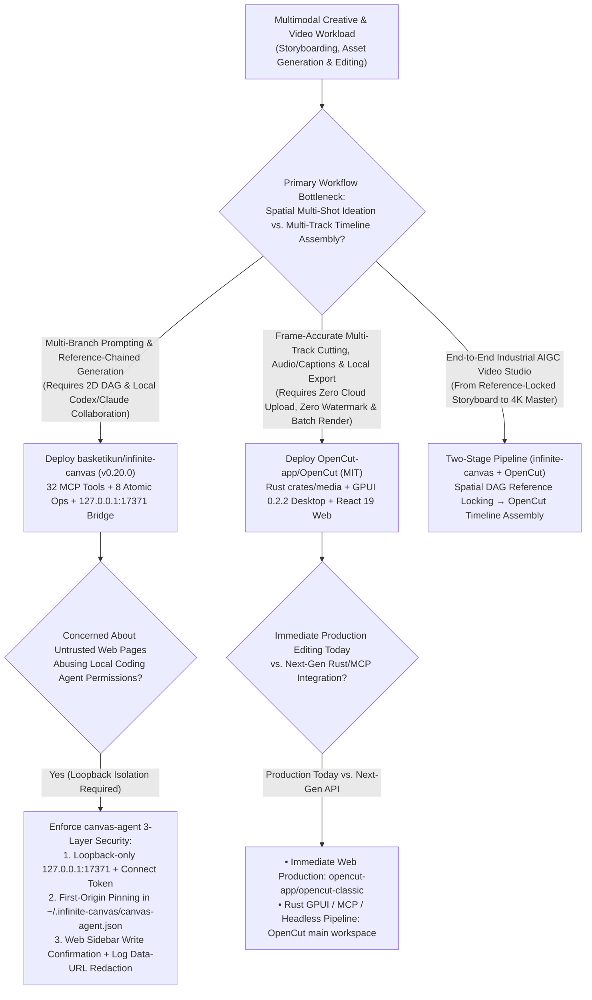
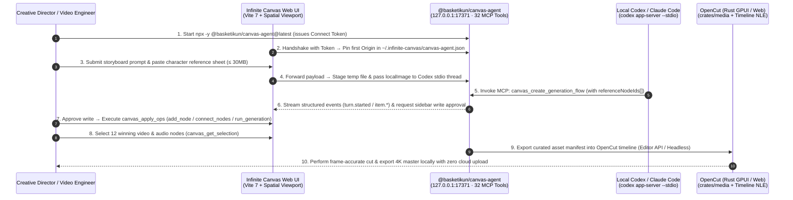

# Spatial Infinite-Canvas Multimodal Orchestration & Local-First NLE Video Editing Selection FAQ: `basketikun/infinite-canvas` + `OpenCut-app/OpenCut` vs. Linear Chat Prompting & Cloud Video SaaS

> **Document Scope**: A first-principles architecture and FinOps selection guide for AI Solution Architects, AIGC Creative Workflow Engineers, and Digital Media Platform Leads. Focusing on two standout multimodal creative repositories from the `2026-11-09` GitHub AI Radar — **`basketikun/infinite-canvas`** (`v0.20.0` / `@basketikun/canvas-agent v0.6.0`, Track B Breakout New Repo **#B11**, **625 Stars** on search snapshot / **10,114 Stars** live API, **`125 Stars/day`** lifecycle velocity, `stars_today = not_measured`) and **`OpenCut-app/OpenCut`** (`MIT`, Track A Velocity Leader **#V16**, measured **`+158 Stars today`**, **48,799 Stars** on trending snapshot / **97,912 Stars** live API) — this guide dissects how pairing a **32-Tool MCP Spatial Canvas DAG (Divergent Ideation)** with a **Rust GPUI / Web Local Multi-Track Timeline NLE (Convergent Assembly)** eliminates linear chat re-prompting bloat and cloud video SaaS lock-in.
>
> **Navigation**: [中文版 (`opencut-infinite-canvas-video-spatial-selection-faq.md`)](./opencut-infinite-canvas-video-spatial-selection-faq.md) · [2026-11-09 Daily Radar](../daily/2026-11-09.en.md) · [Back to Radar Index](../README.en.md)

---

## 📌 1. Executive Summary

1. **First-Principles Definition**:
   - **`basketikun/infinite-canvas` (`v0.20.0` + `@basketikun/canvas-agent v0.6.0`, TypeScript + Vite 7 + React Router 7, MIT)** is an open-source spatial infinite-canvas workbench engineered for **divergent multimodal exploration and reference-chained asset generation (Spatial DAG Ideation)**. Through its local loopback bridge (`@basketikun/canvas-agent` on `127.0.0.1:17371`), it exposes **32 strongly-typed MCP tools (`toolNames`)** and **8 discriminated-union atomic canvas operations (`canvasOpSchema`)**, enabling local coding agents (`codex app-server --stdio` and Claude Code) to programmatically create, connect, and trigger 5 node types (`"image" | "text" | "config" | "video" | "audio"`) with explicit `referenceNodeIds` lineage.
   - **`OpenCut-app/OpenCut` (Rust 2024 + GPUI `0.2.2` + React 19.2, MIT)** is the flagship open-source **local-first CapCut alternative** (`~97.9K` live stars). Currently executing a ground-up unified rewrite sharing a Rust media core (`crates/media`) across a native GPU desktop client (`apps/desktop` built on `gpui = "0.2.2"`) and web editor (`apps/web` built on Vite 8 + React 19.2), it introduces a **Plugin-First Architecture, Editor API, built-in MCP Server for AI agents, Headless Mode for automated batch rendering, and an In-Editor Scripting Tab** — keeping 4K/60fps raw footage 100% local with zero watermarks or cloud export taxes.
2. **Core Architectural Insight (Why "Linear Chat Threads + Cloud Video SaaS" Breaks at Production Scale)**:
   - **Failure Mode #1 (Forcing 2D Reference DAGs into 1D Linear Chat Causes Character Drift & Base64 Re-Upload Storms)**: When producing a 12-shot product video, Shot #5 must simultaneously reference Shot #1's character turnaround sheet and Shot #3's lighting rig. In a 1D chat thread, creators repeatedly re-upload base64 images and re-describe scene context across an average of `3.5 turns/shot` (`28K` input tokens/turn), suffering a **40% wasted regeneration rate** from style/character drift. `infinite-canvas` binds `referenceNodeIds` explicitly via `connect_nodes` and `canvas_create_generation_flow`, compressing orchestration to **1 compact JSON turn (`8K` input tokens)** and reducing wasted regenerations to **8%**.
   - **Failure Mode #2 (Cloud NLE Bandwidth Bottlenecks, Privacy Exposure & Per-Seat/Export Rent)**: Commercial cloud video editors force teams to upload gigabytes of unannounced product footage to vendor servers while charging both monthly seat fees (`$24/seat/mo`) and cloud export credits, with zero local headless scriptability. `OpenCut` decodes and composites locally (`crates/media` + GPUI/Web) with headless automation and zero SaaS fees.
3. **30-Second Selection Rule**:
   - Choose **`basketikun/infinite-canvas`** for **storyboard ideation, multi-reference character/style locking (`referenceNodeIds`), multi-branch prompt A/B testing, and spatial multimodal DAG layout**.
   - Choose **`OpenCut-app/OpenCut`** for **multi-track frame-accurate NLE cutting, audio ducking, caption alignment, confidential local media assembly, and headless batch rendering**.
   - Combine **Both (`infinite-canvas` Divergent DAG + `OpenCut` Convergent NLE)** for an industrial AIGC video studio: generate and curate reference-locked shots on the canvas via 32 MCP tools (`canvas_get_selection`), then hand off approved local assets into `OpenCut` for automated timeline assembly.

---

## 🎯 2. Architect's First-Principles Deep Dive (Q1 / Q2 / Q3)

### Q1: How does `@basketikun/canvas-agent` (`v0.6.0`) turn a 2D infinite canvas into a deterministic data structure that Coding Agents can manipulate without pixel-guessing?

Naive whiteboard agents take full-screen screenshots and ask a VLM to guess `(x, y)` pixel coordinates — burning massive vision tokens and misplacing elements. `basketikun/infinite-canvas` (`canvas-agent/src/canvas/schemas.ts`) replaces pixel-guessing with **State-Tree Introspection + Zod Discriminated-Union Atomic Operations**:

1. **Five Typed Node Primitives & Four Generation Modes (`schemas.ts`)**:
   - Enforces `nodeTypeSchema = z.enum(["image", "text", "config", "video", "audio"])`, `generationModeSchema = z.enum(["text", "image", "video", "audio"])`, and camera state `viewportSchema = z.object({ x, y, k })`.
2. **8 Composable Atomic Operations (`canvasOpSchema`) & 32 MCP Tools (`toolNames`)**:
   - `canvas_apply_ops` validates a discriminated union over 8 operation types: `add_node`, `update_node`, `delete_node`, `delete_connections`, `connect_nodes` (`fromNodeId -> toNodeId`), `set_viewport`, `select_nodes`, and `run_generation`.
   - Exposes **32 granular MCP tools** spanning state inspection (`canvas_get_state`, `canvas_get_selection`, `canvas_export_snapshot`), DAG workflow construction (`canvas_create_image_prompt_flow`, `canvas_create_generation_flow` with `referenceNodeIds: string[]`), and asset management (`prompts_search`, `assets_list`, `assets_add`).
3. **Loopback `127.0.0.1:17371` Origin-Pinning & Two-Stage HITL Approval**:
   - Binds strictly to `127.0.0.1:17371`. Upon the first valid `Connect token` handshake, it locks the web page's `Origin` inside `~/.infinite-canvas/canvas-agent.json` (`origins`), blocking cross-origin hijacking.
   - Communicates with `@openai/codex` (`0.146.0`) via `codex app-server --stdio` (staging pasted images up to `30MB` as local files via `localImage`), automatically redacts tokens and image Data URLs from `~/.infinite-canvas/logs/canvas-agent-YYYY-MM-DD.log`, and requires explicit web-sidebar user confirmation before executing canvas write operations.

### Q2: Why is `OpenCut-app/OpenCut` rewriting its pure-web editor (`opencut-classic`) around a unified Rust `crates/media` + `gpui = "0.2.2"` architecture?

While scaling toward 100K GitHub stars, browser-only video editing hit hard architectural ceilings that motivated the ground-up rewrite in `Cargo.toml` and `apps/desktop`:

1. **Breaking Browser Heap Limits & Hardware Decode Bottlenecks**: Multi-track 4K compositing inside a browser tab is constrained by per-tab WASM/JS memory limits and inconsistent WebCodecs support. Moving the media engine into Rust (`crates/media`) allows `apps/desktop` (`gpui = "0.2.2"`) to drive native GPU shaders and OS hardware decoders directly while sharing core logic with `apps/web` (React 19.2 + Vite 8).
2. **Upgrading from a Manual GUI to an Agent-Programmable Video Engine**: The new architecture elevates four programmable surfaces to first-class primitives:
   - **Editor API & Plugin-First Architecture** for deterministic timeline manipulation;
   - **Built-in MCP Server (for AI Agents)** so coding/creative agents can inspect and edit timelines directly;
   - **Headless Mode** for CI/CD and batch rendering without spinning up a GUI;
   - **In-Editor Scripting Tab** for programmatic multi-track batch transformations.

### Q3: How should an AI Solution Architect chain `basketikun/infinite-canvas` and `OpenCut-app/OpenCut` into an end-to-end video production pipeline?

Use the **Divergent Spatial DAG → Convergent Timeline NLE** handoff pattern:

1. **Stage 1 (Divergent Spatial Ideation in `infinite-canvas`)**: Use `canvas_create_generation_flow` with `referenceNodeIds` to branch character sheets, lighting references, and 12 candidate video/audio nodes on the 2D canvas.
2. **Stage 2 (Curated Selection Export via `canvas_get_selection`)**: The creative director selects the winning take for each of the 12 shots on the canvas; the agent calls `canvas_get_selection` and `assets_list` to export an ordered manifest of approved local files.
3. **Stage 3 (Convergent Timeline Assembly in `OpenCut`)**: Feed the approved asset manifest into `OpenCut` via its Editor API / Headless pipeline for multi-track timeline placement, caption syncing, and local 4K export.

---

## 🧭 3. Mermaid Decision Tree & End-to-End Architecture Sequence

### 3.1 Multimodal Visual & Video Workbench Decision Tree

### 3.2 End-to-End Sequence (`infinite-canvas` 32-Tool MCP Bridge + `OpenCut` Local NLE)

---

## 📊 4. Comparison Matrix Across Multimodal & Video Workflows

| Dimension | `basketikun/infinite-canvas` (`v0.20.0`) | `OpenCut-app/OpenCut` (`MIT`) | 1D Linear Chat Interface (ChatGPT / Claude Web Threads) | Commercial Cloud Video SaaS (Cloud CapCut / Runway Web NLE) |
| :--- | :--- | :--- | :--- | :--- |
| **Core Data Model** | **2D Spatial Infinite-Canvas DAG (5 node types + `referenceNodeIds` edges)** | **Multi-Track Non-Linear Timeline NLE (Rust `crates/media` + GPUI / React 19)** | 1D append-only message stream (context decays rapidly over turns) | Proprietary cloud timeline tied to vendor storage & credits |
| **AI Agent / MCP Integration** | **32 Typed MCP Tools + 8 Atomic Ops**, native `codex app-server --stdio` & Claude CLI | Building **native MCP Server + Editor API + Headless Mode + Scripting Tab** | Cannot programmatically drive external spatial canvases or local NLEs | Closed black box; no local MCP or headless batch rendering |
| **Cross-Shot Consistency** | **High**: Explicit `connect_nodes` reuse of character/config nodes (`8%` waste) | Focuses on temporal assembly, audio ducking & frame-accurate editing | **Low**: Frequent style/character drift across turns (`~40%` waste) | Single-shot generation without spatial branch comparison |
| **Privacy & Local Security** | `127.0.0.1:17371` loopback + **First-Origin Pinning** + log redaction | **100% Local Media Processing**; raw 4K footage never leaves the machine | Uploads all reference assets into cloud chat history | Requires uploading gigabytes of raw footage to vendor cloud |
| **Seat & Export Economics** | **MIT Open Source (`$0` license)**; BYO OpenAI-compatible endpoints | **MIT Open Source (`$0` seats, `$0` export tax, zero watermarks)** | Per-seat subscription + heavy multi-turn vision token overhead | `$20–$35/seat/mo` + cloud render/export minute overages |

---

## 🧪 5. Closed-Form FinOps Worked Example & 7-Card Insights

### 5.1 Monthly AIGC Video Studio Cost Model (`synthetic (independently_reproduced=false)`)

> **Provenance Notice**: This closed-form calculation is a synthetic architectural model (`synthetic (independently_reproduced=false)`) comparing **Path A (1D Linear Chat Re-Prompting + Commercial Cloud Video SaaS & Manual Alignment)** against **Path B (`basketikun/infinite-canvas` 32-Tool MCP Spatial DAG + Local `OpenCut-app/OpenCut` NLE Pipeline)**. Base generative video/image model API inference bills for the `720` accepted shots and local workstation GPU depreciation are explicitly marked `not_measured`.

**Workload Parameters**:
- **Monthly Production Volume**: An 8-person creative marketing studio produces **`60` multi-scene product videos/month**, each comprising `12` multimodal shots = **`720` accepted shot orchestrations** and **`60` multi-track timeline exports/month**.
- **Pricing & Labor Rates**: Orchestration LLM priced at **`$2.50 / 1M` input tokens** and **`$10.00 / 1M` output tokens**; each wasted regeneration caused by character/style drift costs **`$0.25 / run`** in wasted multimodal generation credits; video engineer labor is valued at **`$60.00 / hour`**.

| Cost Component | Path A: 1D Linear Chat + Cloud Video SaaS | Path B: `infinite-canvas` Spatial DAG + Local `OpenCut` | Governing Engineering Mechanism |
| :--- | :--- | :--- | :--- |
| **1. Multimodal Orchestration Token Cost (720 shots/mo)** | **$226.80 / mo** (`3.5 turns/shot` = `2,520 turns` × `[28K in + 2K out]` = `$0.090/turn`) | **$21.60 / mo** (`1.0 turn/shot` = `720 turns` × `[8K in + 1K out]` = `$0.030/turn`) | `canvas_apply_ops` sends compact JSON diffs + `referenceNodeIds` instead of re-uploading base64 images (**-90.5%** token cost) |
| **2. Wasted Drift Regenerations (`@$0.25/run`)** | **$72.00 / mo** (`40.0%` drift waste = `288` wasted runs × `$0.25`) | **$14.50 / mo** (`8.0%` drift waste = `58` wasted runs × `$0.25`) | Explicit `connect_nodes` reference chaining locks character & style consistency across shots |
| **3. Cloud NLE SaaS Seats (8) & Cloud Export Credits (60 videos)** | **$402.00 / mo** (`8 seats × $24.00` = `$192.00` + `60 videos × $3.50` export = `$210.00`) | **$0.00 / mo** (MIT local deployment; `$0` seats & `$0` cloud export fees) | `OpenCut` decodes and renders locally on desktop (GPUI) or browser with zero SaaS rent |
| **4. Asset Transfer & Timeline Alignment Labor (`@$60/hr`)** | **$1,800.00 / mo** (`30 min/video` manual download/re-upload/sync × `60` = **`30.0 hours/mo`**) | **$360.00 / mo** (MCP selection export + auto rough-cut, `6 min/video` = **`6.0 hours/mo`**) | `canvas_get_selection` structured handoff + `OpenCut` assembly saves **`24.0 hours/mo` (-80.0% labor)** |
| **5. Base Generative API for 720 Accepted Shots & Local GPU Depreciation** | `not_measured` | `not_measured` | Base model generation bills for accepted shots and hardware amortization are decoupled and never fabricated |
| **Total Modeled Monthly Cost** | **$2,500.80 / mo** | **$396.10 / mo** | **Net Savings: `$2,104.70 / mo` (`-84.16%` cost reduction, `6.31x` cost efficiency)** |

### 5.2 Key Security & Architectural Invariants

- **First-Origin Pinning Invariant**: Once `@basketikun/canvas-agent` (`127.0.0.1:17371`) accepts a valid `Connect token`, it persists the connecting browser `Origin` in `~/.infinite-canvas/canvas-agent.json` and rejects requests from any other origin until explicitly cleared.
- **Zod Discriminated-Union Mutation Gate**: Every canvas mutation must pass `canvasOpSchema` (`z.discriminatedUnion("type", ...)`), preventing hallucinated node properties from corrupting the spatial state tree.

---

## 🛠️ 6. Actionable Production Checklist

- [ ] **1. Verify Loopback Binding & Origin Pinning**: After starting `npx -y @basketikun/canvas-agent@latest`, verify it listens exclusively on `127.0.0.1:17371` and inspect `~/.infinite-canvas/canvas-agent.json` to confirm only trusted local/internal origins are pinned.
- [ ] **2. Mount and Unmount the 32-Tool MCP Server On Demand**: Because `infinite-canvas` registers **32 MCP tools** (`toolNames`), unload it outside visual sessions via `codex mcp remove infinite-canvas` to preserve context budget, and mount it via `codex mcp add infinite-canvas -- npx -y @basketikun/canvas-agent@latest mcp` during storyboard workflows.
- [ ] **3. Enforce Sidebar Write Confirmation & Log Redaction**: Keep web-sidebar human confirmation enabled for `canvas_apply_ops` mutations and verify `~/.infinite-canvas/logs/canvas-agent-YYYY-MM-DD.log` automatically masks `Connect token` and image `Data URL` payloads.
- [ ] **4. Align `OpenCut` Branch Selection to Deployment Horizon**: Deploy `opencut-app/opencut-classic` for immediate browser editing today; track the main repository (`proto use` + `moon run desktop:dev / web:dev`) to integrate Rust `crates/media`, `gpui = "0.2.2"` desktop rendering, MCP Server, and Headless batch export.
- [ ] **5. Standardize the `canvas_get_selection` → `OpenCut` Handoff**: Require storyboard flows to bind `referenceNodeIds` via `canvas_create_generation_flow` and export approved shot manifests via `canvas_get_selection` / `canvas_export_snapshot` before timeline assembly.
