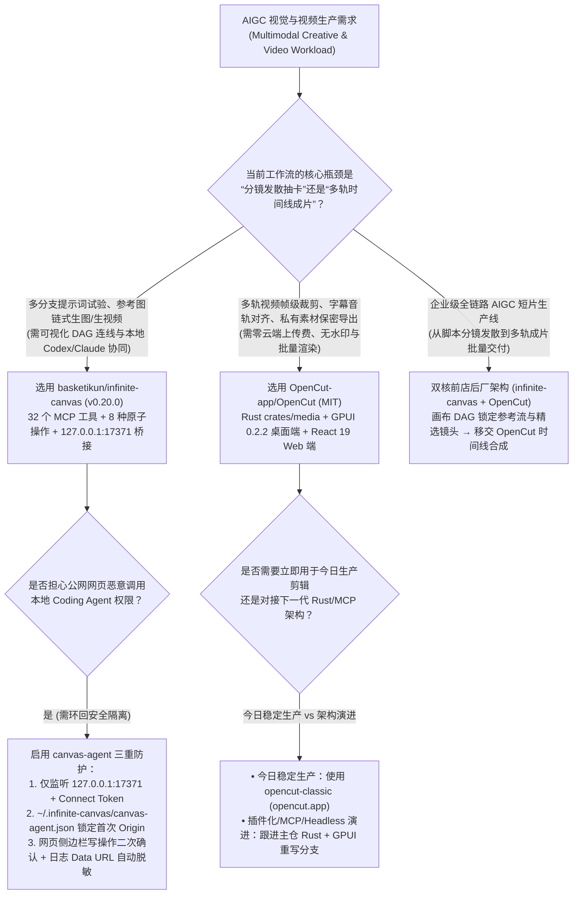
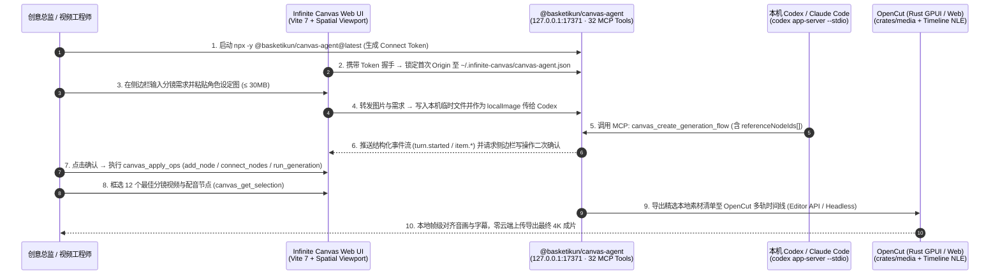

# 空间无限画布多模态编排与本地优先非线性视频剪辑选型 FAQ：`basketikun/infinite-canvas` + `OpenCut-app/OpenCut` vs 线性对话框抽卡与商业云剪辑 SaaS

> **文档定位**：面向 AI Solution Architect（AI 解决方案架构师）、AIGC 视觉工作流架构师与数字内容工程团队的第一性原理选型指南。聚焦 `2026-11-09` GitHub AI 热榜与新仓爆发榜同日登榜的两大多模态创作基础设施——**`basketikun/infinite-canvas`**（`v0.20.0` / `@basketikun/canvas-agent v0.6.0`，Track B 新仓黑马榜 **#B11**，搜索快照 **625 Stars** / 实时 API **10,114 Stars**，建仓日均 **`125 Stars/day`**，`stars_today = not_measured`）与 **`OpenCut-app/OpenCut`**（`MIT`，Track A 单日飙升榜 **#V16**，今日实测 **`+158 Stars today`**，榜单快照 **48,799 Stars** / 实时 API **97,912 Stars**），深度拆解如何用 **“32 工具 MCP 空间画布有向无环图（Spatial DAG）发散创想 + Rust GPUI / Web 本地多轨时间线（NLE）收敛合成”** 终结线性聊天框反复传图抽卡与云剪辑 SaaS 锁死。
>
> **阅读导航**：[English Version (`opencut-infinite-canvas-video-spatial-selection-faq.en.md`)](./opencut-infinite-canvas-video-spatial-selection-faq.en.md) · [2026-11-09 全景日报](../daily/2026-11-09.md) · [返回雷达首页](../README.md)

---

## 📌 1. 核心结论速览（Executive Summary）

1. **一句话本质定义**：
   - **`basketikun/infinite-canvas`（`v0.20.0` + `@basketikun/canvas-agent v0.6.0`，TypeScript + Vite 7 + React Router 7，MIT）** 是专为**多模态 AI 视觉发散探索与参考图链式编排（Divergent Spatial DAG Ideation）**打造的开源无限画布工作台。它通过运行在本机环回地址 `127.0.0.1:17371` 的 `@basketikun/canvas-agent` 将画布状态暴露为 **32 个强类型 MCP 工具（`toolNames`）** 与 **8 种原子级画布操作（`canvasOpSchema`）**，支持本机 Codex（`codex app-server --stdio`）和 Claude Code 直接在二维空间中创建文本、图片、配置、视频、音频五类节点（`nodeTypeSchema`）并连线传递 `referenceNodeIds` 参考图上下文。
   - **`OpenCut-app/OpenCut`（Rust 2024 + GPUI `0.2.2` + React 19.2，MIT）** 是开源界星标最高（近 9.8 万星）的 **CapCut（剪映）本地优先开源替代方案**。当前正在推进底层 Rust 核心重写（共享 `crates/media` 媒体引擎、桌面端 `apps/desktop` 基于 `gpui = "0.2.2"`、Web 端基于 Vite 8 + React 19.2），原生规划了 **Editor API、插件优先架构（Plugin-First Architecture）、面向 AI Agent 的 MCP Server、无头批量渲染模式（Headless Mode）以及编辑器内置脚本页（Scripting Tab）**，实现 4K/60fps 原始素材 100% 本地帧级剪辑与零水印导出。
2. **核心架构洞察（为什么“线性聊天框 + 商业云剪辑 SaaS”在批量 AIGC 视频生产中全面崩盘？）**：
   - **痛点一（二维参考关系塞进一维聊天流导致“角色崩坏与上下文重传风暴”）**：制作一部 12 镜头产品短片时，第 5 镜头需要同时引用第 1 镜头的“主角三视图节点”和第 3 镜头的“赛博霓虹光影节点”。在一维线性对话框中，创作者被迫在多轮对话里反复重新上传 Base64 大图、重述背景描述，平均每个镜头要来回折腾 `3.5 轮`（单轮 `28K` 输入 Tokens），且因缺乏显式 `referenceNodeIds` 锁定，废片重抽率高达 **40%**。`infinite-canvas` 用空间 DAG 连线（`connect_nodes` + `canvas_create_generation_flow`）将单镜头编排压缩至 **1 轮紧凑 JSON 调用（`8K` 输入 Tokens）**，将废片率压降至 **8%**。
   - **痛点二（云端剪辑 SaaS 的素材上传带宽瓶颈、隐私泄露与导出税）**：商业云剪辑软件要求将数 GB 原始视频与未公开产品母片上传至云端服务器，不仅按席位（`$24/seat/mo`）和云导出分钟数重复收费，且无法被本地 Coding Agent 通过无头脚本批量驱动。`OpenCut` 将媒体解码与合成留在本地（Rust `crates/media` + GPUI/Web），配合 Headless 模式与 MCP 接口实现零云端上传费与自动化粗剪合成。
3. **30 秒选型口诀**：
   - 处于**分镜构思、多角色一致性参考图锁定、多分支 Prompt A/B 对比、图文音视频节点混排阶段** → 选 **`basketikun/infinite-canvas`**。
   - 处于**多轨时间线帧级精剪、字幕对齐、音轨闪避（Audio Ducking）、私有素材本地保密合成与批量无头渲染阶段** → 选 **`OpenCut-app/OpenCut`**。
   - 搭建**企业级 AIGC 短片工业化流水线** → **前店后厂组合（`infinite-canvas` 发散定稿 + `OpenCut` 收敛成片）**：在 `infinite-canvas` 中通过 32 个 MCP 工具完成 12 镜头参考流生成与人工筛选，选中节点（`canvas_get_selection`）直接移交本地 `OpenCut` 时间线完成自动化合成。

---

## 🎯 2. 架构师灵魂拷问（Q1 / Q2 / Q3 First-Principles Deep Dive）

### Q1：`basketikun/infinite-canvas` 的 `@basketikun/canvas-agent` (`v0.6.0`) 是如何把二维画布抽象成 Coding Agent 可精准操控的确定性数据结构的？

很多团队尝试让大模型“操作白板”，往往直接截一张高分辨率全屏图喂给多模态大模型让它猜像素坐标，结果既费 Token 又经常算错位置。`basketikun/infinite-canvas` 在 `canvas-agent/src/canvas/schemas.ts` 中采用了一套极其干净的 **“状态树自省 + 判别联合原子操作（Discriminated-Union Atomic Ops）”** 协议：

1. **五类标准节点与四种生成模态（`schemas.ts`）**：
   - 严格定义节点类型枚举 `nodeTypeSchema = z.enum(["image", "text", "config", "video", "audio"])` 与生成模式 `generationModeSchema = z.enum(["text", "image", "video", "audio"])`，画布视口由三元组 `viewportSchema = z.object({ x, y, k })`（平移坐标与缩放倍率 `k`）精确描述。
2. **8 种可组合原子操作（`canvasOpSchema`）与 32 个 MCP 工具（`toolNames`）**：
   - `canvas_apply_ops` 接收由 Zod 校验的 8 类判别联合操作：`add_node`、`update_node`、`delete_node`、`delete_connections`、`connect_nodes`（显式绑定 `fromNodeId -> toNodeId`）、`set_viewport`、`select_nodes` 与 `run_generation`。
   - 同时向上层暴露 **32 个细粒度 MCP 工具**，包括状态查询（`canvas_get_state`、`canvas_get_selection`、`canvas_export_snapshot`）、工作流构建（`canvas_create_image_prompt_flow`、`canvas_create_generation_flow` 支持显式传入 `referenceNodeIds: string[]` 数组）以及资产沉淀（`prompts_search`、`assets_list`、`assets_add`）。
3. **本机 `127.0.0.1:17371` 环回安全隔离与二次确认机制**：
   - `canvas-agent` 默认仅绑定 `127.0.0.1:17371`，首次通过一次性 `Connect token` 握手后，会将前端页面的 `Origin` 持久化锁定至 `~/.infinite-canvas/canvas-agent.json` 的 `origins` 白名单中，拒绝任何跨站页面冒用本机 Agent。
   - 通过官方 `@openai/codex`（`0.146.0`）的 `codex app-server --stdio` 复用长连接线程（单次请求体上限 `30MB`，自动将上传图片转存为本机临时文件并通过 `localImage` 传入），同时在日志 `~/.infinite-canvas/logs/canvas-agent-YYYY-MM-DD.log` 中自动脱敏 Token 与图片 Data URL，且所有画布写操作在真正落盘前均由网页侧边栏弹窗二次确认。

### Q2：`OpenCut-app/OpenCut` 为什么要从纯 Web 版本（`opencut-classic`）发起基于 Rust `crates/media` + `gpui = "0.2.2"` 的跨端底层重写？

在 `OpenCut` 积累近 10 万 Star 的过程中，纯浏览器视频剪辑暴露出三个物理上限，这也是其 `Cargo.toml` 与 `README.md` 明确转向 **Rust Core + GPUI Desktop + Web 统一架构** 的根本原因：

1. **突破浏览器沙盒的内存墙与硬件编解码瓶颈**：纯 Web 端在处理多条 4K 视频轨叠加与复杂转场时，受限于浏览器 Tab 堆内存上限与 WebCodecs 跨浏览器兼容性差异。通过将核心媒体管线抽象为 Rust 工作区下的 `crates/media`，桌面端（`apps/desktop`，基于 `gpui = "0.2.2"` 原生 GPU 渲染）可直接调用系统底层硬件编解码器与零拷贝纹理，Web 端（`apps/web`，React 19.2 + Vite 8）则复用同一套核心逻辑。
2. **从“纯人工拖拽软件”升级为“可编程、Agent 可驱动的视频引擎”**：新版 `OpenCut` 将以下四大可编程能力列为一等公民：
   - **Editor API & Plugin-First Architecture**：所有轨道裁剪、滤镜与字幕均为标准 API 调用；
   - **内置 MCP Server（for AI Agents）**：允许外部 AI Agent 直接读取时间线结构、插入片段或调整剪辑点；
   - **Headless Mode（无头模式）**：支持在 CI/CD 或本地脚本中免 UI 批量渲染成片；
   - **In-Editor Scripting Tab**：允许工程师在编辑器内直接编写脚本批量处理百条轨道。

### Q3：如何把 `basketikun/infinite-canvas` 与 `OpenCut-app/OpenCut` 串联成一条高确定性的企业级 AIGC 视频生产流水线？

两者的协同切中了多模态内容工程的核心规律：**“空间画布负责非线性发散（Spatial DAG for Exploration），时间线负责线性收敛（Timeline NLE for Assembly）”**：

1. **阶段一（空间发散与参考图锁定 — `infinite-canvas`）**：编导与 Agent 在无限画布中通过 `canvas_create_generation_flow` 建立角色设定卡、场景参考图与分镜视频节点，利用 `referenceNodeIds` 连线保证 12 个分镜的视觉风格与人物面部高度一致。
2. **阶段二（人工精选与资产导出 — `canvas_get_selection` + `assets_add`）**：编导在画布上框选每一镜最终胜出的最佳视频/配音节点，调用 `canvas_get_selection` 与 `assets_list` 导出带镜头序号与元数据的精选资产清单。
3. **阶段三（时间线自动粗剪与帧级精修 — `OpenCut`）**：通过 `OpenCut` 的 Editor API / MCP Server 或 Headless 脚本将精选分镜按时间轴顺序装入多轨时间线，自动叠加旁白音轨与字幕轨，最后由剪辑师在 GPUI/Web 界面中做 6 分钟帧级微调即可直接本地导出成片。

---

## 🧭 3. Mermaid 选型决策树与端到端协同架构图（Decision Tree & Architecture Flow）

### 3.1 多模态视觉与视频工作台选型决策树

### 3.2 `infinite-canvas` 空间 DAG + `OpenCut` 本地时间线端到端时序图

---

## 📊 4. 同类多模态与视频创作方案对比矩阵（Comparison Matrix）

| 评估维度 | `basketikun/infinite-canvas` (`v0.20.0`) | `OpenCut-app/OpenCut` (`MIT`) | 传统一维线性聊天框（ChatGPT / Claude Web 直接抽卡） | 商业云剪辑 SaaS（CapCut 商业云 / Runway 云时间线） |
| :--- | :--- | :--- | :--- | :--- |
| **核心交互与数据结构** | **二维无限画布空间 DAG（5 类节点 + `referenceNodeIds` 连线）** | **多轨非线性时间线 NLE（Rust `crates/media` + GPUI / React 19）** | 一维时间流消息列表（上下文随对话拉长迅速腐烂） | 闭源云端时间线（强绑定专有云存储与订阅积分） |
| **AI Agent / MCP 集成度** | **原生 32 个 MCP 工具 + 8 种原子操作**，直连本机 Codex/Claude | 正在构建 **内置 MCP Server + Editor API + Headless 模式 + 脚本页** | 无法直接编程操控外部画布或本地媒体时间线 | 闭源黑盒，不支持本地 MCP 或无头自动化批处理 |
| **多镜头角色/风格一致性** | **极高**：通过 `connect_nodes` 显式复用同一个参考图与配置节点 | 专注于成片时间轴剪辑与音画同步，不负责前端生图抽卡 | **极低**：跨多轮对话极易遗忘早期设定，废片率高达 `~40%` | 依赖单次生成，缺乏跨分支节点树对比能力 |
| **数据隐私与本地安全** | `127.0.0.1:17371` 环回监听 + **首次 Origin 锁定** + 日志自动脱敏 | **原始视频 100% 本地处理**，无需上传未公开商业母片 | 所有参考图与提示词全量上传至云端会话历史 | 必须将数 GB 原始视频上传至厂商云盘 |
| **软件订阅与导出成本** | **MIT 开源免费**（按需接入自有 OpenAI 兼容渠道） | **MIT 开源免费**（`$0` 席位费、`$0` 云导出税、零强制水印） | 需按席位订阅 Plus/Team 或消耗高额多轮上下文 Token | `$20–$35/席位/月` + 高清云渲染分钟数额外计费 |

---

## 🧪 5. 定量 FinOps 算例与 7-Card 评测洞察（Closed-Form Quantitative Model）

### 5.1 封闭式月度 AIGC 短片生产成本算例（`synthetic (independently_reproduced=false)`）

> **口径声明**：本算例为合成架构基准模型（`synthetic (independently_reproduced=false)`），用于量化对比 **Path A（传统一维线性聊天框多轮重传抽卡 + 商业云剪辑 SaaS 订阅与人工对齐）** 与 **Path B（`basketikun/infinite-canvas` 32 工具 MCP 空间 DAG + `OpenCut-app/OpenCut` 本地多轨合成流水线）**。被采纳的 `720` 个正式镜头底层生图/生视频模型 API 基础推理费与本地工作站 GPU 硬件折旧均显式标记为 `not_measured`。

**基准工作负载设定**：
- **月度交付规模**：一个 8 人创意与产品营销团队每月制作 **`60` 支多镜头产品短片**，每支短片包含 `12` 个多模态分镜资产节点，每月共 **`720` 次正式分镜资产编排** 与 **`60` 次多轨时间线成片导出**。
- **单价与工时设定**：编排大模型按输入 **`$2.50 / 1M Tokens`**、输出 **`$10.00 / 1M Tokens`** 计；每次因角色/风格漂移导致的废片重抽（Wasted Regeneration）平均额外消耗 **`$0.25 / 次`** 多模态推理费；视频工程师/剪辑师综合时薪按 **`$60.00 / 小时`** 计。

| 成本分项 | Path A：线性聊天框抽卡 + 商业云剪辑 SaaS | Path B：`infinite-canvas` 空间 DAG + 本地 `OpenCut` | 核心工程机制差异说明 |
| :--- | :--- | :--- | :--- |
| **1. 多模态编排上下文 Token 成本（720 个分镜/月）** | **$226.80 / 月** （平均 `3.5 轮/分镜` = `2,520 轮` × `[28K 输入 + 2K 输出]` = `$0.090/轮`） | **$21.60 / 月** （`1.0 轮/分镜` = `720 轮` × `[8K 输入 + 1K 输出]` = `$0.030/轮`） | `canvas_apply_ops` 传递紧凑 JSON 节点增量与 `referenceNodeIds`，无需每轮重传 Base64 大图（省 **90.5%** 编排 Token） |
| **2. 角色/风格漂移废片重抽浪费（Wasted Regenerations）** | **$72.00 / 月** （`40.0%` 废片率 = `288` 次重抽 × `$0.25/次`） | **$14.50 / 月** （`8.0%` 废片率 = `58` 次重抽 × `$0.25/次`） | 空间画布显式连线锁定参考图与配置节点（`connect_nodes`），大幅降低跨镜头崩坏 |
| **3. 云剪辑 SaaS 席位与云渲染导出税（8 席位，60 支成片）** | **$402.00 / 月** （`8 席位 × $24.00` = `$192.00` + `60 支 × $3.50` 云导出费 = `$210.00`） | **$0.00 / 月** （MIT 本地开源部署，零席位费、零云导出附加费） | `OpenCut` 在本地桌面（GPUI）或浏览器完成解码合成，彻底免除 SaaS 订阅与云渲染税 |
| **4. 素材搬运与时间线人工对齐工时成本（@$60/hr）** | **$1,800.00 / 月** （每支 `30 分钟` 手工下载/重传/对齐 × `60 支` = **`30.0 小时/月`**） | **$360.00 / 月** （MCP 精选导出 + 自动粗剪，每支仅需 `6 分钟` 微调 = **`6.0 小时/月`**） | `canvas_get_selection` 结构化导出配合 `OpenCut` 自动化装配，每月净省 **`24.0 小时`（-80.0% 工时）** |
| **5. 720 个采纳镜头底层生视频 API 与本地 GPU 折旧** | `not_measured` | `not_measured` | 正式采纳镜头的底层视频模型算力与硬件折旧与编排层解耦，严禁捏造或归零 |
| **月度可建模总成本（Modeled Total）** | **$2,500.80 / 月** | **$396.10 / 月** | **月度净节省 `$2,104.70`（总成本直降 `-84.16%`，成本效率提升 `6.31x`）** |

### 5.2 关键安全与架构不变量（Key Invariants）

- **首次 Origin 锁定不变量（Origin-Pinning Invariant）**：`@basketikun/canvas-agent` 在首次收到合法 `Connect token` 后，立即将该请求的网页 `Origin` 写入 `~/.infinite-canvas/canvas-agent.json`；此后任何其他域名（即使嗅探到端口号 `17371`）均无法复用该本地 Agent，阻断跨站脚本借道操控本机 `codex` / `claude` CLI。
- **判别联合模式校验不变量（Zod Discriminated-Union Validation）**：所有通过 MCP 进入画布的修改指令必须通过 `canvasOpSchema` 的 `z.discriminatedUnion("type", ...)` 严格校验，杜绝大模型编造非法 DOM 属性破坏画布状态树。

---

## 🛠️ 6. 生产落地核验清单（Actionable Production Checklist）

- [ ] **1. 校验 `@basketikun/canvas-agent` 环回绑定与 Origin 白名单**：启动 `npx -y @basketikun/canvas-agent@latest` 后，确认服务仅监听 `127.0.0.1:17371`，并检查 `~/.infinite-canvas/canvas-agent.json` 中的 `origins` 字段仅包含受信任的本地或私有部署画布域名。
- [ ] **2. 按需挂载与卸载 `infinite-canvas` MCP 工具集**：由于 `toolNames` 包含 **32 个 MCP 工具**，在非视觉创作会话中建议执行 `codex mcp remove infinite-canvas` 释放上下文预算；仅在画布创作时通过 `codex mcp add infinite-canvas -- npx -y @basketikun/canvas-agent@latest mcp` 按需加载。
- [ ] **3. 开启侧边栏写操作二次确认与日志脱敏核验**：在团队共用环境下，保持网页侧边栏对 `canvas_apply_ops` 的人工二次确认开启，并核验 `~/.infinite-canvas/logs/canvas-agent-YYYY-MM-DD.log` 已自动隐藏 `Connect token` 与图片 Base64 `Data URL`。
- [ ] **4. 明确 `OpenCut` 生产分支与重写分支选型边界**：今日立即投产的 Web 剪辑需求优先部署稳定版 `opencut-app/opencut-classic`；需要对接 Rust `crates/media`、`gpui = "0.2.2"` 原生桌面端、MCP Server 与 Headless 批量渲染的研发团队，使用 `proto use` + `moon run desktop:dev / web:dev` 跟进主仓架构。
- [ ] **5. 建立“画布 DAG 参考流 → 时间线收敛”标准交接规范**：强制要求分镜生成阶段使用 `canvas_create_generation_flow` 显式绑定 `referenceNodeIds` 锁定主角与光影节点，定稿后通过 `canvas_get_selection` 与 ` canvas_export_snapshot` 导出结构化清单再进入 `OpenCut` 时间线精剪。
