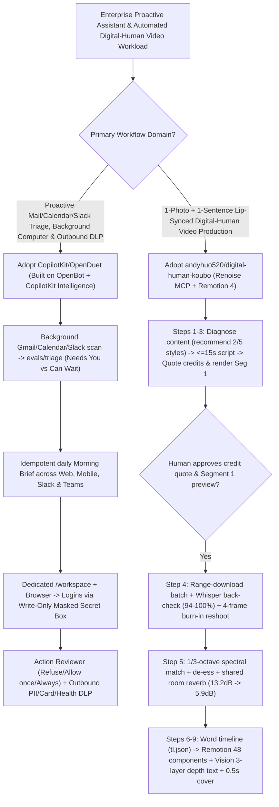

# Proactive HITL Agent Workbenches (`CopilotKit/OpenDuet` Masked Secrets & Outbound DLP) & Digital-Human Video Production Pipelines (`andyhuo520/digital-human-koubo`) Selection FAQ

> **Positioning**: This standalone guide is **Round 28 of the 2026-11-11 Night Shift (Cumulative Guide #73)**, written in the plain-language, first-principles, closed-form FinOps style of `ib-vs-ethernet-roce-selection-faq.md` for Enterprise Proactive Agent and Generative Video Solution Architects evaluating two high-velocity (`~2,000★`) repositories:
> 1. **`CopilotKit/OpenDuet` (`2,037★`, TypeScript, MIT, built on `CopilotKit/OpenBot`)**: A self-hosted proactive agent across Web, Mobile, Slack, and Microsoft Teams where each agent runs on its own isolated computer (`/workspace` + browser + shell), delivers an idempotent daily **Morning Brief** with evaluated email/calendar triage (`evals/triage`), isolates credentials via an **encrypted write-only masked secret box**, and enforces **Refuse / Allow once / Always allow** action approval plus **outbound sensitive-data (DLP) scanning**;
> 2. **`andyhuo520/digital-human-koubo` (`1,935★`, TypeScript/Python + Remotion 4 + Renoise MCP, MIT)**: An end-to-end Agent Skill that turns one photo and one sentence into a creator-grade talking-head video via a **pre-batch Cost Gate & Segment-1 approval**, **Whisper back-check (`94–100%` across 6 languages) + 4-frame burned-in subtitle rejection**, **1/3-octave spectral matching and shared room reverb (reducing sibilance spread from `13.2 dB` to `5.9 dB`)**, and **48 Remotion packaging components with macOS Vision 3-layer depth text**.
>
> **中文版 FAQ**: [openduet-digital-human-koubo-proactive-agent-video-mcp-selection-faq.md](openduet-digital-human-koubo-proactive-agent-video-mcp-selection-faq.md) · **Architecture Summary SVG**: [`assets/github-ai-radar-2026-11-11-r28-openduet-koubo.svg`](../../../assets/github-ai-radar-2026-11-11-r28-openduet-koubo.svg)

---

## 📌 1. Executive Summary

1. **In plain English, what problems do these two repositories actually solve?**
   - **Replacing Passive Prompt Boxes, Plaintext Chat Passwords & Outbound Data Leaks (`CopilotKit/OpenDuet`)**: Traditional AI assistants do nothing until prompted, expose plaintext passwords in chat transcripts when logging into external sites, and risk leaking credit card numbers or private health details in automated replies. Built on `CopilotKit/OpenBot` and `CopilotKit Intelligence`, `OpenDuet` gives each agent a dedicated background computer (`/workspace`, browser, shell), triages Gmail/Calendar/Slack into **"What needs you"** vs. **"What can wait"** (`evals/triage`) in a daily **Morning Brief**, routes site logins through a **write-only masked secret box** (passwords never enter the LLM conversation), and gates every outbound message, payment, signature, or delete behind **Refuse / Allow once / Always allow** and an **outbound DLP scanner**.
   - **Eliminating Multi-Clip Voice Jumps (`13.2 dB`), Burned-In Subtitle Defects & Flat Talking Heads (`andyhuo520/digital-human-koubo`)**: Generating a 3-minute digital-human video from twenty 15-second AI clips (`Grok Video 1.5` / `Wan 3.0`) usually fails because every clip has different room acoustics and harsh sibilance (`13.2 dB` spread), video models randomly burn garbled subtitles into the pixels, and raw talking heads lack dynamic creator packaging. `digital-human-koubo` enforces a 10-stage pipeline: it quotes exact credits (`segments · seconds · credits · balance`) and renders **Segment 1 for human sign-off** before batching, runs **Whisper transcription (`94–100%`) + 4-frame visual inspection** to auto-reshoot burned-in subtitle defects, applies **1/3-octave spectral matching + de-essing + shared small-room reverb + `-14/-16 LUFS` normalization** (compressing sibilance spread from `13.2 dB` to **`5.9 dB`**), and renders **5 editing styles + 48 creator-grade Remotion components + macOS Vision 3-layer depth text** with a spliced `0.5s` first-frame cover.
2. **Closed-Form FinOps Verdict (`CLAIM-20261111-R28-OPENDUET-KOUBO`)**:
   - For a Growth, Executive Operations & Creator Marketing Team running **25 proactive assistant seats** and producing **60 multi-segment digital-human product/course videos per month** (senior growth/media engineer loaded rate `$85.00/hr`; external ad-spend media buying budgets and studio lighting hardware: `not_measured`):
   - Upgrading from **Path A (Commercial SaaS avatar seats + manual After Effects packaging, manual multi-clip audio EQ & manual inbox triage, `$6,620.00/mo`)** to **Path C (Self-hosted `CopilotKit/OpenDuet` + `digital-human-koubo` Segment-1 cost gate, 1/3-octave voice unification & Remotion 48-component skill, `$970.00/mo`)** saves **`$5,650.00/mo` (`-85.35%`, `$67,800.00/yr`)** and cuts production and triage labor from `52.0 hrs/mo` to `6.0 hrs/mo` (**`-88.46%`**).

---

## 🎯 2. Three Core Architectural Questions (Q1 / Q2 / Q3 Deep-Dive)

### Q1: How does `andyhuo520/digital-human-koubo` make 30 independently generated AI video clips sound like a single studio recording (`13.2 dB -> 5.9 dB`) while catching hallucinated burned-in subtitles?
- **First-Principles Breakdown**:
  1. **Acoustic Voice Unification (`13.2 dB → 5.9 dB` Sibilance Spread)**:
     - Independent diffusion video generations exhibit wide variance in 4–10 kHz sibilance and synthetic room reflections. Stage 5 applies **1/3-octave spectral matching** to align each clip's frequency response to the reference take, runs **dynamic de-essing**, convolves all clips through **one shared small-room reverb**, and normalizes loudness to **`-14 / -16 LUFS`**.
  2. **Pre-Batch Cost Gate, Segment-1 Check & Dual Automated QA (Whisper + 4-Frame Inspection)**:
     - Scripts are segmented into `≤15s` chunks (`~5.4 Chinese chars/s`). Before spending batch credits on `Renoise MCP` (`Grok Video 1.5` / `Wan 3.0`), the agent quotes `segments · seconds · credits · balance` (e.g., `482 credits` for a 27s ad) and renders **only Segment 1** for user approval.
     - After CDN-safe range-downloading, every segment undergoes **Whisper back-checking (`94–100%` accuracy across EN, JA, KO, FR, ES, AR)** and **4-frame visual inspection** to automatically detect and re-shoot clips where Grok burned unwanted subtitles into the picture.
  3. **macOS Vision 3-Layer Depth Compositing & 48 Frame-Measured Remotion Components**:
     - Uses macOS Vision person segmentation to separate the presenter into a transparent foreground layer, placing giant price/headline typography between the background and the presenter, alongside 48 packaging components reverse-engineered frame-by-frame from 25 top creator videos (MrBeast, MKBHD, Vox, MediaStorm, He Tongxue) and a `0.5s` first-frame thumbnail cover.

### Q2: How does `CopilotKit/OpenDuet` (and `OpenBot`) enforce credential isolation, ordered message queuing, and outbound DLP?
- **First-Principles Breakdown**:
  1. **Write-Only Masked Secret Box**:
     - When an agent's dedicated browser encounters a login screen, the user types the password into an encrypted write-only box that injects the credential directly into the target site without ever exposing the password to the LLM conversation or transcript.
  2. **Policy Reviewer (`Refuse / Allow once / Always allow`) & Outbound Sensitive-Data DLP**:
     - Every state-changing action (sending emails/messages, payments, document signing, deletions) is checked against policy, scanned for sensitive outbound data (card numbers, health records), and paused for human confirmation. User messages sent while an action is executing queue deterministically and are answered once the current step finishes.

### Q3: How should Solution Architects customize and combine `OpenDuet` and `digital-human-koubo`?
- **Deployment Blueprint**:
  - Customize `openbot/examples/openduet` (or enable **Settings → Skin → OpenDuet** inside `CopilotKit/OpenBot` for multi-user sign-in, per-Bot RBAC, and audit trails) as your team's proactive command center across Web, Mobile, Slack, and Teams.
  - Install `skills/digital-human-koubo` and `skills/finance-explainer` into `~/.claude/skills/` or `~/.codex/skills/` with browser-authenticated `Renoise MCP` (`https://renoise.ai/api/public/mcp`) to automate multi-language product explainers and executive video briefings.

---

## 🧭 3. Mermaid Decision Tree & Proactive Agent + Digital-Human Pipeline

---

## 📊 4. Architectural Comparison Matrix

| Evaluation Dimension | Path A: Commercial SaaS Avatars + Manual AE/Inbox Ops | Path B: Raw Video Gen API (No QA or Voice Unification) | **Path C (Recommended): `OpenDuet` + `digital-human-koubo`** |
| :--- | :--- | :--- | :--- |
| **Proactivity & Multi-Channel Sync** | Passive chat box; manual daily inbox and calendar sorting | Unstructured cron scripts; no evaluated triage or Make gallery | **Daily idempotent Morning Brief (`evals/triage`) + Web/Mobile/Slack/Teams** |
| **Password Privacy & Outbound DLP** | Passwords pasted into chat logs; no outbound PII/card filter | Shared browser cookies without outbound message review | **Write-only masked secret box + outbound DLP + 3-choice approval gate** |
| **Multi-Clip Audio & Visual QA** | Manual DAW EQ/de-essing across clips; manual re-renders | `13.2 dB` sibilance jumps; burned-in subtitle defects slip through | **1/3-octave spectral match (`13.2→5.9 dB`) + Whisper & 4-frame auto-reshoot** |
| **Creator Packaging & Cost Control** | Manual After Effects rotoscoping and motion graphics | Flat talking head; full-batch credit burn before quality check | **Segment-1 Cost Gate + 48 Remotion components + Vision 3-layer depth text** |
| **Monthly TCO (25 Seats + 60 Videos)** | **`$6,620.00 / mo`** (`$2,200` SaaS/re-rolls + `$4,420` labor) | **`$3,430.00 / mo`** (`$1,050` credits + `$2,380` labor) | **`$970.00 / mo` (Saves `$5,650.00/mo` · `-85.35%`)** |

---

## 🧪 5. Closed-Form FinOps Example & 7-Card Insights (`CLAIM-20261111-R28-OPENDUET-KOUBO`)

### 5.1 Workload & Scope Boundary
- **Workload**: A Growth & Executive Operations team running **25 proactive assistant seats** and producing **60 multi-segment (2–5 minute) digital-human explainer/marketing videos per month**.
- **Rates**: Senior growth/media engineer loaded rate at **`$85.00 / hr`**.
- **Explicit Scope Boundary**: External paid-media advertising budgets and physical studio lighting equipment are marked **`not_measured`**.

### 5.2 Closed-Form Monthly Cost Breakdown

| Cost Component | Path A: Commercial SaaS Avatars + Manual AE/Audio Ops | Path B: Raw Video Gen API (No Cost Gate or Voice Match) | **Path C: `OpenDuet` + `digital-human-koubo` (Recommended)** |
| :--- | :--- | :--- | :--- |
| **Video Credits / SaaS & Self-Hosted Infra** | **`$2,200.00`** | **`$1,050.00`** | `$270.00 + $190.00` = **`$460.00`** |
| **Audio EQ, AE Packaging & Inbox Triage (`$85/hr`)** | `52.0 hrs × $85.00` = **`$4,420.00`** | `28.0 hrs × $85.00` = **`$2,380.00`** | `6.0 hrs × $85.00` = **`$510.00`** |
| **Total Monthly TCO** | **`$6,620.00 / mo`** | **`$3,430.00 / mo`** (`-48.19%`) | **`$970.00 / mo`** |
| **Net Savings vs. Path A** | Baseline | Saves `$3,190.00 / mo` | **Saves `$5,650.00 / mo` (`-85.35%` · `$67,800.00/yr`)** |
| **Ad-Spend Media Buying & Studio Hardware** | `not_measured` | `not_measured` | `not_measured` |

---

## 🛠️ 6. Production Verification Checklist

- [ ] **1. `OpenDuet` / `OpenBot` Onboarding & Setup Checklist**: Run `npx --yes copilotkit@latest login` and `project select` (`CPK_INTELLIGENCE_API_KEY`), verify all dependencies report **Ready** under **Settings → Setup**, and use `OpenBot` with the `OpenDuet` skin when team-wide sign-in, per-Bot RBAC, and audit logs are required.
- [ ] **2. Masked Secret Box & Outbound DLP Verification**: Confirm all external logins use the write-only masked secret box and test the outbound DLP scanner + `Refuse / Allow once` gate against simulated credit-card/PII strings.
- [ ] **3. `digital-human-koubo` Skill & Renoise OAuth Connection**: Copy `skills/digital-human-koubo` and `skills/finance-explainer` into `~/.claude/skills/` or `~/.codex/skills/`, authenticate `https://renoise.ai/api/public/mcp` via browser OAuth (zero plaintext API keys), and verify local `ffmpeg` and `whisper` binaries.
- [ ] **4. Pre-Batch Cost Gate & Segment-1 Sign-Off**: Require the agent to report `segments · seconds · credits · balance` and render Segment 1 for human inspection before batching remaining segments, followed by automated Whisper (`94–100%`) and 4-frame burned-in subtitle checks.
- [ ] **5. 1/3-Octave Spectral Unification, `-14/-16 LUFS` & AI Disclosure Label**: Verify sibilance spread is compressed (`≤6 dB`), inspect mid-transition frames and the `0.5s` first-frame cover, and preserve the visible AI digital-human disclosure label (`"内容由 AI 数字人演绎"`) on all published videos.
