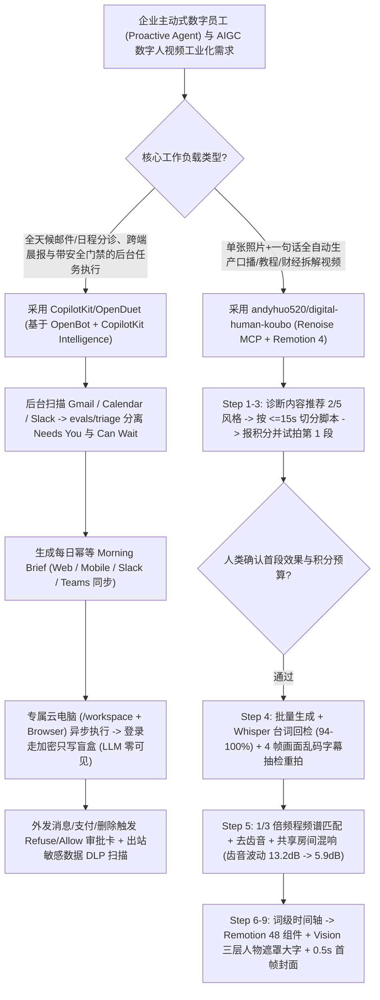

# 主动式人机协同工作台（`CopilotKit/OpenDuet` 密码盲盒与外发 DLP）与工业级数字人口播流水线（`andyhuo520/digital-human-koubo`）选型 FAQ

> **文档定位**：本文是 **2026-11-11 夜班多轮深潜 Round 28（累计第 73 篇独立选型专题）**，严格对标 `ib-vs-ethernet-roce-selection-faq.md` 的「通俗大白话 + 第一性原理 + 可核算定量算例」标杆文风，为企业数字员工（Proactive Agent）与 AIGC 视频工业化生产架构师深度拆解今日两款接近 2,000★ 的明星开源工程：
> 1. **`CopilotKit/OpenDuet`（`2,037★`，TypeScript，MIT，基于 `CopilotKit/OpenBot` 构建）**：跨 Web、手机、Slack 与 Microsoft Teams 的自托管主动式 Agent——每个 Agent 拥有独立的专属云电脑（`/workspace` + 独立浏览器 + Shell），每天主动生成**幂等晨报（Morning Brief）**与邮件/日程轻重缓急分诊（`evals/triage`），并首创**写完即加密的密码盲盒（模型永不可见密码明文）**与**外发消息敏感信息（卡号/健康隐私）DLP 拦截门禁**；
> 2. **`andyhuo520/digital-human-koubo`（`1,935★`，TypeScript/Python + Remotion 4 + Renoise MCP，MIT）**：“一张照片 + 一句话 = 影视级数字人口播成片”——内置 **预算报价与首段试拍确认门禁（Cost Gate）**、**Whisper 语音回检（6 语种 94–100% 准确率）+ 4 帧画面残余字幕抽检自动重拍**、**1/3 倍频程频谱匹配与同房间混响声学统一（齿音离散度从 `13.2 dB` 压至 `5.9 dB`）**，以及拆解自 25 条顶级博主视频的 **48 个 Remotion 包装组件与 macOS Vision 人物前景遮罩三层景深大字**。
>
> **English Companion**: [openduet-digital-human-koubo-proactive-agent-video-mcp-selection-faq.en.md](openduet-digital-human-koubo-proactive-agent-video-mcp-selection-faq.en.md) · **架构总结图**: [`assets/github-ai-radar-2026-11-11-r28-openduet-koubo.svg`](../../../assets/github-ai-radar-2026-11-11-r28-openduet-koubo.svg)

---

## 📌 一、核心结论速览（Executive Summary）

1. **先用大白话讲透这两个项目到底解决了什么痛点？**
   - **传统 AI 助手“不推不动、在聊天框里明文输密码裸奔、回邮件不小心把银行卡号或病历发出去”的痛点（`CopilotKit/OpenDuet` 解决的问题）**：普通聊天机器人你不问它，它永远呆在原地；而当你让后台 Agent 帮你处理 Gmail 邮件、跑网页任务时，一旦遇到登录框把密码发进对话框，密码就会永久留在 LLM 上下文和日志里；更怕它自动回复外部客户时把内部敏感数字漏出去。`OpenDuet`（现已作为官方皮肤合入企业级底座 `CopilotKit/OpenBot`）给每个 Agent 配了一台独立云电脑：每天早上你一打开手机或 Teams，它已经用经过 `evals/triage` 验证的分类器把邮件和日程分成了 **“What needs you（需你拍板）”** 和 **“What can wait（可暂缓）”**；网站需要登录时弹出**只写加密盲盒（密码直达目标站点，绝不进入 Agent 会话上下文）**；所有外发消息、支付、签署和删除动作都必须经过策略审查器（`Refuse` / `Allow once` / `Always allow`）与**出站敏感数据（DLP）检查**！
   - **AI 数字人口播视频“多段拼接声音忽远忽近像在不同房间、大模型乱烧画面硬字幕、缺少顶级 UP 主高级包装”的痛点（`andyhuo520/digital-human-koubo` 解决的问题）**：现在用 `Grok Video 1.5` 或 `Wan 3.0` 生成单段 10～15 秒的对口型视频很容易，但要做一条 3 分钟的完整教程或带货视频（拆成 20～30 段分别生成），拼起来根本没法看：① 每段的音色、齿音和房间混响都不一样，听起来像 30 个不同的人在不同卫生间里录的；② 视频模型经常擅自在画面底部生成乱码硬字幕，一不注意就整批报废烧光积分；③ 干巴巴的人像说话没有何同学/影视飓风/MrBeast 那种人物背后立体大字和动态数据卡片。`digital-human-koubo` 通过 **10 步全自动工业管线**彻底治本：**先报积分账单并只生成第 1 段供你确认（Cost Gate）** → 批量生成后用 **Whisper 逐段核对台词 + 抽 4 帧检测乱码硬字幕自动重拍** → 用 **1/3 倍频程频谱对齐 + 去齿音（De-essing）+ 统一小房间混响 + `-14/-16 LUFS` 响度标准化**把齿音波动从 `13.2 dB` 压到 **`5.9 dB`** → 最后调用 **Remotion 4 的 5 大风格模板、48 个顶级 UP 主包装组件与 macOS Vision 三层人物前景遮罩**一键渲染带首帧封面的成片！
2. **闭式 FinOps 核算结论（`CLAIM-20261111-R28-OPENDUET-KOUBO`）**：
   - 在 **企业增长与高管运营团队部署 25 个主动式数字助理席位 + 每月批量生产 60 条多段式精品数字人课程/营销口播视频** 基准下（高级增长/多媒体工程师全包时薪 `$85.00/hr`；外部商业广告投放买量费与实体摄影棚灯具采购：`not_measured`）：
   - 从 **Path A（按年高价采购商业 SaaS 数字人 + 人工在 AE/剪映里逐段修音轨齿音、手做包装与人工分拣邮件，`$6,620.00/月`）** 升级至 **Path C（自托管 `CopilotKit/OpenDuet` 主动助理 + `digital-human-koubo` 首段确认门禁、声学统一与 Remotion 48 组件自动化，`$970.00/月`）**，每月净省 **`$5,650.00/月`（降幅 `-85.35%`，年化节省 `$67,800.00/年`）**，音视频后期返工与日常信息分拣工时从 `52.0 小时/月` 降至 `6.0 小时/月`（**节省 `88.46%`**）。

---

## 🎯 二、三大灵魂拷问（Q1 / Q2 / Q3 Deep-Dive）

### Q1：`andyhuo520/digital-human-koubo` 是如何把 30 段独立生成的 AI 视频修成“同一个录音棚一气呵成”的声音，并自动拦截大模型废片的？
- **第一性原理拆解**：
  1. **声学统一管线（Voice Unification：齿音离散度 `13.2 dB → 5.9 dB`）**：
     - 扩散音视频模型每次采样生成的音频在高频段（4–10 kHz 齿音区）和空间早期反射上具有随机性，直接硬切拼接会有刺耳的音色跳变。管线第 5 步依次执行：**1/3 倍频程频谱匹配（1/3-Octave Spectral Matching）**将所有切片频响曲线向基准段对齐 → **动态去齿音（De-essing）**压制高频毛刺 → **叠加同一个小型房间脉冲混响（Shared Small-Room Reverb）**赋予统一空间感 → **`-14 / -16 LUFS` 广播级响度归一化**。
  2. **双层废片质检（Whisper 回检 + 4 帧画面硬字幕抽检）与首段预算门禁（Cost Gate）**：
     - 在调用 `Renoise MCP`（驱动 `Grok Video 1.5` / `Wan 3.0`，按 `≤15 秒`、约 `5.4 中文字/秒` 切分脚本）前，Agent 必须先列出 `分段数 · 总秒数 · 预计消耗积分 · 账户余额`（如 27 秒带货短片耗费 `482 Renoise credits`），获得用户 `"yes"` 后**仅先生成第 1 段供检验**；
     - 批量生成并完成 CDN 安全分片下载（Range-Download）后，自动跑 **Whisper 语音识别（6 国语言实测一致率 `94–100%`）** 比对原稿，同时从每段抽取 **4 帧画面**检查是否被模型误烧入画面字幕，发现异常自动触发单段重拍！
  3. **macOS Vision 人物前景抠像与 48 个帧级复刻 Remotion 组件**：
     - 利用 macOS 原生 Vision 框架做人物分割导出透明通道视频，在 Remotion 中构建 **「背景层 → 巨型价格/标题大字层 → 数字人前景层」** 三层景深合成，并将首帧 `0.5 秒` 自动焊入 `16:9 / 9:16 / 3:4` 封面。

### Q2：`CopilotKit/OpenDuet`（及底座 `OpenBot`）是如何解决主动式 Agent 的“密码隔离、防打断排队与出站 DLP 防泄漏”的？
- **第一性原理拆解**：
  1. **只写加密密码盒（Write-Only Masked Secret Box）**：
     - 当独立云电脑中的浏览器遇到登录页时，前端弹出加密掩码输入框，用户输入的凭据加密存储并直接注入目标网页表单，**Agent 读取的对话流与 LLM Prompt 中永远不会出现密码明文**。
  2. **动作级策略审查器 + 出站敏感信息拦截（Outbound DLP）**：
     - 任何对外发信、付款、签名或删除动作都会被 Reviewer 拦截，展示精确收件人与正文并等待人类选择 **Refuse / Allow once / Always allow**；同时出站检查器会自动扫描外发文本是否包含信用卡号、健康隐私等敏感信息；当 Agent 正在执行长耗时任务时，用户新发的消息会自动进入有序队列，待当前动作安全落地后立即按序响应。

### Q3：架构师如何在企业内部定制和组合部署 `OpenDuet` 与 `digital-human-koubo`？
- **落地指南**：
  - **定制企业自有数字员工工作台**：所有决定 `OpenDuet` 品牌、Bot 角色、频道、模型与技能的定义全部收敛在单一目录 `openbot/examples/openduet` 下；若需企业级多租户登录、按 Bot 细粒度权限与完整审计日志，直接部署 `CopilotKit/OpenBot` 并在 **Settings → Skin → OpenDuet** 中切换皮肤；
  - **挂载数字人视频生产流水线**：将 `skills/digital-human-koubo` 与 `skills/finance-explainer` 拷入 `~/.claude/skills/` 或 `~/.codex/skills/`，连接 `https://renoise.ai/api/public/mcp`（浏览器 OAuth 登录，零 API Key 落地），即可让 `OpenDuet` / `Claude Code` / `Codex` 从每日行业简报自动生成多语种数字人解读视频！

---

## 🧭 三、Mermaid 选型决策树与主动助理+数字人工业管线

---

## 📊 四、同类方案核心能力对比矩阵（Comparison Matrix）

| 评估维度 | Path A：传统 SaaS 数字人 + 手工 AE/剪映与人工分拣 | Path B：裸调视频生成模型（无首段门禁与声学统一） | **Path C（推荐标杆）：`OpenDuet` + `digital-human-koubo`** |
| :--- | :--- | :--- | :--- |
| **助理主动性与多端一致性** | 被动问答，需人工每天翻阅数百封邮件与群消息 | 简单定时脚本，无 `evals/triage` 评估与跨端状态同步 | **每日幂等 Morning Brief + 主动分诊 + 独立后台云电脑** |
| **密码隐私保护与外发安全** | 在聊天框直接粘贴账号密码，极易通过日志泄露 | 无出站 DLP 检查，自动发信易泄露卡号或内部隐私 | **加密只写密码盲盒（模型不可见）+ 外发 DLP 扫描 + 三档动作审批** |
| **多段视频声学一致性与防废片** | 需音频师手工逐段调 EQ，否则每 15 秒声音突变 | 直接拼接（齿音离散高达 `13.2 dB`），常混入乱码硬字幕废片 | **1/3 倍频程频谱对齐+共享混响（压至 `5.9 dB`）+ Whisper/4帧自动质检** |
| **视频包装工业化程度与成本门禁** | 需动效师在 AE 中手工抠像做人物背后大字与数据卡 | 干巴巴纯人像说话，一上来整批生成容易瞬间烧光积分 | **首段试拍确认门禁 + 48 个顶级博主 Remotion 组件 + Vision 三层遮罩** |
| **月度总拥有成本（25 席+60 条视频）** | **`$6,620.00 / 月`**（SaaS/废片 `$2,200` + 人工 `$4,420`） | **`$3,430.00 / 月`**（算力/积分 `$1,050` + 人工 `$2,380`） | **`$970.00 / 月`（净省 `$5,650.00/月`，降幅 `-85.35%`）** |

---

## 🧪 五、闭式定量 FinOps 算例与 7-Card 评测洞察（`CLAIM-20261111-R28-OPENDUET-KOUBO`）

### 5.1 基准假设与边界声明
- **评测负载**：企业增长与运营团队维护 **25 个主动式日常办公助理席位**，并每月生产 **60 条多段式（2～5 分钟）高质量数字人口播/教程/带货视频**。
- **单价基准**：高级增长/多媒体工程师全包时薪 **`$85.00 / hr`**。
- **显式边界声明（Scope Boundary）**：视频发布后的商业广告买量投放预算（Media Buying）及线下实体摄影棚灯具硬件标记为 **`not_measured`**。

### 5.2 三路径闭式成本核算表

| 成本构成项 | Path A：商业 SaaS 数字人 + 手工后期修音/包装 | Path B：裸调视频大模型（无首段门禁与声学统一） | **Path C：`OpenDuet` + `digital-human-koubo`（推荐）** |
| :--- | :--- | :--- | :--- |
| **视频生成积分 / SaaS 与自托管算力** | **`$2,200.00`** | **`$1,050.00`** | `$270.00 + $190.00` = **`$460.00`** |
| **音频对齐、AE 包装与信息分拣工时（`$85/hr`）** | `52.0 hrs × $85.00` = **`$4,420.00`** | `28.0 hrs × $85.00` = **`$2,380.00`** | `6.0 hrs × $85.00` = **`$510.00`** |
| **月度总成本（Monthly Total）** | **`$6,620.00 / 月`** | **`$3,430.00 / 月`**（`-48.19%`） | **`$970.00 / 月`** |
| **相对 Path A 净节省（Savings）** | 基准线（Baseline） | 节省 `$3,190.00 / 月` | **净省 `$5,650.00 / 月`（`-85.35%` · 年省 `$67,800.00`）** |
| **广告投放买量与实体影棚硬件** | `not_measured` | `not_measured` | `not_measured` |

---

## 🛠️ 六、生产级落地核验 Checklist（SA Actionable Verification）

- [ ] **1. `OpenDuet` / `OpenBot` 初始化与 Setup Checklist 核验**：运行 `npx --yes copilotkit@latest login` 与 `project select` 配置免费 Developer 级 `CPK_INTELLIGENCE_API_KEY`，在 **Settings → Setup** 中确认 Intelligence、Model Key、Gmail/Calendar 连接器全部显示为 **Ready**（多人团队生产环境推荐直接跑 `OpenBot` 并启用 `OpenDuet` 皮肤以获取完整 RBAC 与审计日志）。
- [ ] **2. 只写加密密码框与外发 DLP 门禁演练**：测试外部站点登录必须走 Masked Secret Box，并故意构造含模拟银行卡号的外发邮件草稿，验证出站 DLP 审查器与 `Refuse / Allow once` 审批卡成功拦截。
- [ ] **3. `digital-human-koubo` 双 Skill 安装与 Renoise OAuth 登录**：将 `skills/digital-human-koubo` 与 `skills/finance-explainer` 拷入 Agent 技能目录，通过浏览器 OAuth 连接 `https://renoise.ai/api/public/mcp`（无需落盘 API Key），并核验本机 `ffmpeg` 与 `whisper` 就绪。
- [ ] **4. 首段试拍门禁（Cost Gate）与 4 帧乱码字幕重拍核验**：批量生成前强制核对 Agent 输出的 `segments · seconds · credits · balance` 报价单，仅在验收第 1 段口型与画质后再放行全量批次，并检查 Whisper 回检（`94–100%`）与 4 帧硬字幕剔除日志。
- [ ] **5. 1/3 倍频程声学统一、`-14/-16 LUFS` 响度与 AI 演绎合规标识**：渲染导出前检查多段拼接处的齿音平滑度（目标离散度 `≤6 dB`）与转场中间帧，确认首帧 `0.5s` 封面已合成，并在成片显著位置保留 **「内容由 AI 数字人演绎」** 合规标识。
