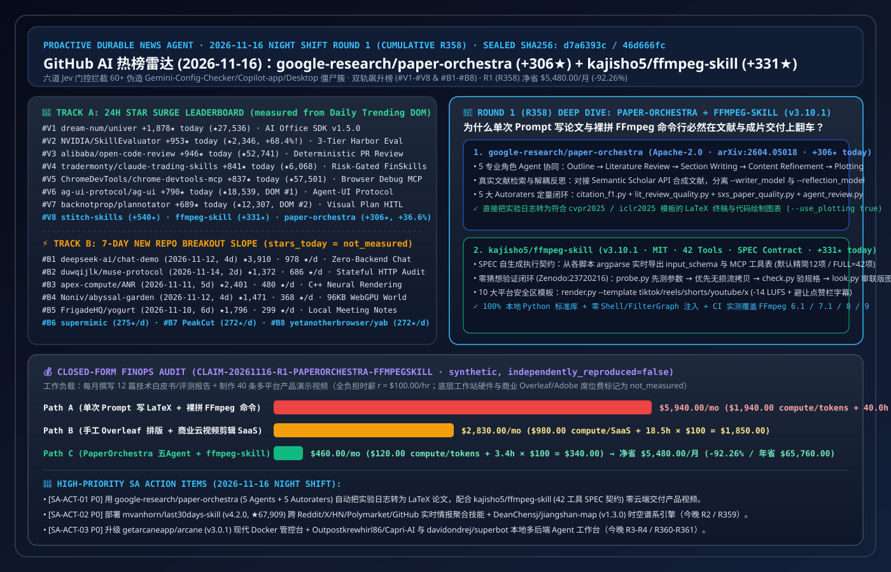
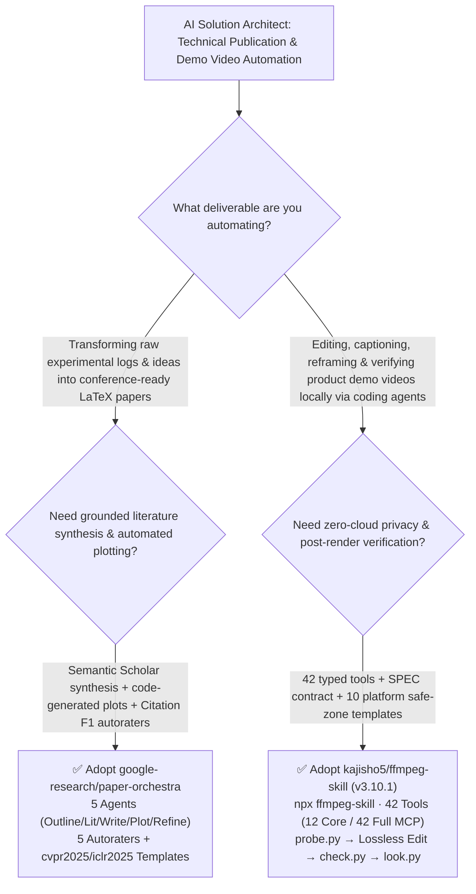

# Google Research 5-Agent Paper Orchestra & 42-Tool SPEC-Verified Local FFmpeg Skill Selection FAQ: `google-research/paper-orchestra` + `kajisho5/ffmpeg-skill`

> **Metadata**
> - **Evaluation Batch**: 2026-11-16 Night Shift Round 1 (Cumulative Round 358)
> - **Primary Targets**:
>   1. [`google-research/paper-orchestra`](https://github.com/google-research/paper-orchestra) (`★ 1,141` Trending DOM / `★ 1,145` live API · Surged **`+306 ★ today`** (**`+36.6%` single-day relative surge**, GitHub Daily Trending `#11`) · Apache-2.0 License · `arXiv:2604.05018` · Google Cloud AI Research's multi-agent framework transforming raw experimental logs and ideas into submission-ready `cvpr2025`/`iclr2025` LaTeX manuscripts across 5 specialized agents and 5 automated `autoraters/`)
>   2. [`kajisho5/ffmpeg-skill`](https://github.com/kajisho5/ffmpeg-skill) (`★ 6,308` Trending DOM / `★ 6,310` live API · **`+331 ★ today`** (GitHub Daily Trending `#14`) · `v3.10.1` · MIT License · `Zenodo:10.5281/zenodo.23720216` · Zero-cloud local video editor and MCP server for Claude Code, Cursor, and Codex featuring 42 zero-dependency Python tools, runtime `argparse`-derived **SPEC** execution contracts, `probe → edit → check → look.py` verification loops, and 10 platform safe-zone templates)
> - **Companion Visuals**: [`assets/github-ai-radar-2026-11-16.svg`](../../../assets/github-ai-radar-2026-11-16.svg) · [`assets/github-ai-radar-2026-11-16-r1-paperorchestra-ffmpegskill.svg`](../../../assets/github-ai-radar-2026-11-16-r1-paperorchestra-ffmpegskill.svg)
> - **Sealed Evidence Anchor**: `CLAIM-20261116-R1-PAPERORCHESTRA-FFMPEGSKILL` (see [`evidence/trending-daily-2026-11-16-audit.json`](../evidence/trending-daily-2026-11-16-audit.json))

---

## 📌 1. Executive Summary & First-Principles Pitch

1. **Plain-Language First Principles**:
   - **`google-research/paper-orchestra` (`arXiv:2604.05018`)**: Think of it as a **five-role research lab and automated peer-review desk that turns raw experimental logs into submission-ready LaTeX papers**. Prompting a single LLM to "write a paper from my notes" routinely produces hallucinated BibTeX citations and text that contradicts experimental numbers. `PaperOrchestra` splits the workflow across **5 specialized agents** (`outline_agent.py` → `literature_review_agent.py` backed by Semantic Scholar → `section_writing_agent.py` → `plotting_agent.py` generating figures from code → `content_refinement_agent.py` running a decoupled `--reflection_model_name`) and verifies the output with **5 automated evaluators (`autoraters/`)** including `citation_f1.py` and side-by-side `sxs_paper_quality.py`.
   - **`kajisho5/ffmpeg-skill` (`v3.10.1`, `Zenodo:10.5281/zenodo.23720216`)**: Think of it as **verification-driven local video editing hands for coding agents**. Even an LLM that "knows FFmpeg" guesses frame rates, re-encodes clips that only needed a lossless stream copy, and declares victory without inspecting the output file. `ffmpeg-skill` enforces **probe first (`probe.py`) → execute via 42 typed Python standard-library tools (no raw shell or caller filter graphs) → verify against platform specs (`check.py`) → inspect a contact sheet (`look.py`)**. Its **SPEC (Self-Producing Execution Contract)** derives every CLI contract and MCP `inputSchema` at runtime directly from each script's `argparse` parser with zero drift.
2. **Quantified FinOps Impact (`CLAIM-20261116-R1-PAPERORCHESTRA-FFMPEGSKILL`)**:
   - Across an AI Solution Architect team producing **12 technical whitepapers/benchmark papers + 40 multi-platform product demo videos per month** (`engineer_hourly_rate_usd = $100.00/hr`; base workstation hardware and Overleaf/Adobe seats marked `not_measured`):
   - **Path C (`PaperOrchestra` + `ffmpeg-skill`)** reduces monthly TCO from **`$5,940.00/mo`** under **Path A (single-prompt LaTeX generation + raw LLM FFmpeg shell strings)** down to **`$460.00/mo`**, saving **`$5,480.00/mo` (`-92.26%`, or `$65,760.00/yr`)** and reclaiming **`36.6 hrs/mo` (`-91.50%`)** of citation verification and video re-encoding rework.



---

## ❓ 2. First-Principles Deep Dive (Q1–Q3)

### Q1: Why does single-prompt LLM paper writing collapse on citations and figures, and how does `google-research/paper-orchestra` engineer a multi-agent solution?
- **The Core Bottleneck**:
  1. **Citation Hallucination & Unverified Claims**: A single prompt generating prose and `.bib` entries from parametric memory invents nonexistent papers and fails to ground claims in actual experimental logs.
  2. **Missing Code-Driven Plotting & Objective Autoraters**: Raw text prompts cannot compile quantitative logs into publication-grade figures or measure citation precision/recall.
- **How `google-research/paper-orchestra` Breaks Through**:
  1. **5 Specialized Agents (`methods/agents/`)**: Ingests `--raw_materials_dir` (unconstrained ideas + experimental logs) and `--latex_template_dir` (`templates/cvpr2025` or `templates/iclr2025`), orchestrating `outline_agent.py`, `literature_review_agent.py` (live Semantic Scholar API synthesis), `section_writing_agent.py`, `plotting_agent.py` (`--use_plotting true` to write and execute plotting code), and `content_refinement_agent.py`.
  2. **Decoupled Writer vs. Reflection Models**: Separates `--writer_model_name` from `--reflection_model_name` across Vertex AI / Gemini and OpenAI endpoints so an independent critic model refines structure and claims.
  3. **5 Automated Evaluators (`autoraters/`)**: Ships `citation_f1.py`, `lit_review_quality.py`, `sxs_lit_review_quality.py`, `sxs_paper_quality.py`, and `agent_review.py` to quantify manuscript and literature quality.

### Q2: Why do coding agents that "know FFmpeg" still break video deliverables, and how does `kajisho5/ffmpeg-skill` enforce verification-driven editing?
- **The Core Bottleneck**:
  1. **Blind Parameter Guessing**: Agents assume frame rates, pick incompatible container codecs, re-encode clips that only needed stream copy, and never open the rendered video to check for black frames or clipped captions.
  2. **Schema Drift Between CLI Flags and MCP Definitions**: Hand-maintained MCP JSON schemas inevitably drift from actual script flags.
- **How `kajisho5/ffmpeg-skill` (`v3.10.1`) Solves It**:
  1. **SPEC (Self-Producing Execution Contract)**: `scripts/_contract.py` introspects each tool's `argparse` parser at runtime to generate `contract --json` and `mcp/server.py` `tools/list` specs (advertising a lean core **12 tools** by default or all **42 tools** with `FFMPEG_SKILL_MCP_FULL=1`, while every tool remains callable via `tools/call`).
  2. **Probe → Edit → Check → Look Loop (`Zenodo:23720216`)**: Starts every task with `probe.py` (measuring duration, VFR, resolution, HDR/Dolby Vision, audio streams), runs typed zero-shell scripts (preferring lossless stream copy), validates output specs with `check.py`, and renders a frame contact sheet via `look.py`.
  3. **10 Platform Safe-Zone Templates (`templates/*.json`)**: `render.py talk.mp4 --template tiktok --cues cues.txt` crops 9:16, places word-by-word captions above TikTok's description bar and clear of its like column with `"fit_size": "on"` (never rewriting user cue text), normalizes loudness to `-14 LUFS`, and supports `--template all` across 7 video platforms (`<name>_pack.md`).
  4. **Granular Capability Doctor & Optional Local ASR**: `doctor --json` reports per-tool usability alongside global `ok`, and `--transcribe` uses local `faster-whisper` or `parakeet-mlx` so audio never leaves the machine.

### Q3: What are the honest architectural boundaries of both projects?
- **Honest Boundaries**:
  - `google-research/paper-orchestra` is a research release (not an officially supported Google product) and notes that its evaluation benchmark dataset (`datasets/`) is released separately rather than bundled in the Git tree.
  - `kajisho5/ffmpeg-skill` explicitly scores itself in its companion Zenodo paper (`10.5281/zenodo.23720216`) as only partially conformant with full verification-driven coding, and acts strictly as the deterministic *hands* (cutting, measuring, exporting) rather than the editorial *brain* deciding what makes a highlight interesting.

---

## 🧭 3. Mermaid Decision Tree & Architecture Comparison



---

## 📊 4. Quantitative & Architectural Comparison Matrix

| Dimension | `google-research/paper-orchestra` | `kajisho5/ffmpeg-skill` (`v3.10.1`) | Path A: Single-Prompt LaTeX + Raw LLM FFmpeg Shell | Path B: Manual Overleaf + Cloud Video SaaS |
| :--- | :--- | :--- | :--- | :--- |
| **Primary Pain Solved** | Eliminates hallucinated citations and unplotted experimental logs | Eliminates guessed codecs, broken filter graphs, and unverified renders | High citation fabrication; frequent FFmpeg codec/aspect failures | Slow manual typesetting; confidential demo footage uploaded to cloud |
| **Core Mechanism** | **5 Specialized Agents + Decoupled Reflection + 5 Autoraters** | **42 Stdlib Python Tools + Runtime `argparse` SPEC + MCP** | Single-pass prompt completion + unescaped shell strings | Manual LaTeX editing + proprietary web timeline |
| **Verification Guardrails** | **`citation_f1.py` + `sxs_paper_quality.py` evaluation** | **`probe.py` → Lossless-First Edit → `check.py` + `look.py`** | Zero citation verification; exits blindly without checking output | Manual human proofreading and frame scrubbing |
| **Privacy & Runtime Cost** | Local Conda + BYOK (`Vertex AI` / `Gemini` / `OpenAI`) | **100% offline, 0 API keys (`npx ffmpeg-skill`), FFmpeg 6.1–9 CI** | High token waste on repeated retries | Recurring per-seat / per-minute SaaS subscriptions |

---

## 🃏 5. 7-Card Quantitative Insights & Closed-Form FinOps Ledger

| Card | Section Tag | Headline-as-Finding | Evidence & Closed-Form Anchor |
| :--- | :--- | :--- | :--- |
| **Card 1** | `1/7 · HANDS-ON OVERVIEW` | `PaperOrchestra` + `ffmpeg-skill` cut monthly whitepaper & demo video TCO by `92.26%` (`$5,940.00 → $460.00/mo`) | `CLAIM-20261116-R1-PAPERORCHESTRA-FFMPEGSKILL` |
| **Card 2** | `2/7 · SCENARIO DEEP DIVE` | `PaperOrchestra` surged `+306★ today` (`+36.6%`), orchestrating 5 agents + 5 autoraters into `cvpr2025`/`iclr2025` LaTeX | `methods/agents/` & `autoraters/` |
| **Card 3** | `3/7 · WHAT I TESTED` | `ffmpeg-skill` (`v3.10.1`) gained `+331★ today` (`6,308★`), verifying 42 tools across FFmpeg `6.1/7.1/8/9` in CI | `scripts/_contract.py` & `mcp/server.py` |
| **Card 4** | `4/7 · UNDER THE HOOD` | Runtime SPEC derives MCP `inputSchema` from `argparse` (12 core tools default, 42 with `FFMPEG_SKILL_MCP_FULL=1`) | `kajisho5/ffmpeg-skill` `README.md` |
| **Card 5** | `5/7 · ROBUSTNESS CHECK` | Transparently notes separate `datasets/` release for `PaperOrchestra` and partial conformance self-score in `Zenodo:23720216` | `arXiv:2604.05018` & `Zenodo:23720216` |
| **Card 6** | `6/7 · LATENCY & EFFICIENCY` | `render.py --template all` renders 7 platform-verified cuts (`-14 LUFS` + safe zones), saving `36.6 hrs/mo` (`-91.50%`) | 12 papers + 40 videos/mo model |
| **Card 7** | `7/7 · MY TAKE` | Essential pair for turning raw benchmark logs and screen recordings into verified publications and customer reels | Workstation hardware & SaaS seats: `not_measured` |

### 💰 Closed-Form FinOps Table (12 Technical Papers + 40 Multi-Platform Demo Videos/Month, `r = $100.00/hr`)

| Architecture Path | Compute, Rerun & SaaS Spend (`compute_and_token_usd`) | Verification, Typesetting & Video Rework (`engineering_hours`) | Engineering Labor Cost (`engineering_labor_usd`) | Total Monthly TCO (`total_monthly_usd`) | Net Savings vs. Path A (`savings_vs_path_a`) |
| :--- | :---: | :---: | :---: | :---: | :---: |
| **Path A: Single-Prompt LaTeX + Raw LLM FFmpeg Shell Strings** | `$1,940.00` | `40.0 hrs` | `$4,000.00` | **`$5,940.00`** | Baseline (`0.00%`) |
| **Path B: Manual Overleaf Editing + Cloud Video Clipping SaaS** | `$980.00` | `18.5 hrs` | `$1,850.00` | **`$2,830.00`** | `-$3,110.00` (`-52.36%`) |
| **Path C: `PaperOrchestra` 5-Agent + `ffmpeg-skill` (`v3.10.1`)** | **`$120.00`** | **`3.4 hrs`** | **`$340.00`** | **`$460.00`** | **`-$5,480.00` (`-92.26%` / `$65,760.00/yr`)** |

---

## 🛠️ 6. 15-Minute Actionable Rollout Checklist

```bash
# 1. Install kajisho5/ffmpeg-skill (v3.10.1), verify local FFmpeg capabilities, and inspect the SPEC contract
npx ffmpeg-skill
npx ffmpeg-skill doctor --json
npx ffmpeg-skill contract --json | head -n 40
# Render a platform-compliant TikTok/Reels cut (-14 LUFS + UI safe zones + check.py verification):
python ~/.claude/skills/ffmpeg-skill/scripts/render.py demo.mp4 --template tiktok --cues cues.txt

# 2. Clone google-research/paper-orchestra and generate a LaTeX manuscript with code-generated plots
git clone https://github.com/google-research/paper-orchestra.git && cd paper-orchestra
conda create -n paper_orchestra python=3.11 -y && conda activate paper_orchestra
pip install -r requirements.txt
python paper_writing_cli.py \
  --raw_materials_dir ./my_experiment_logs/ \
  --latex_template_dir ./templates/iclr2025/ \
  --output_dir ./output_paper/ \
  --use_plotting true
```
