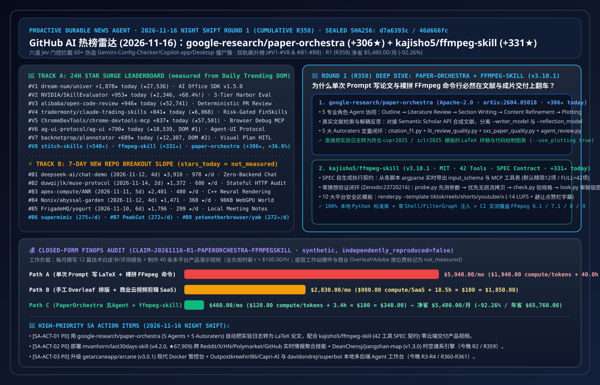
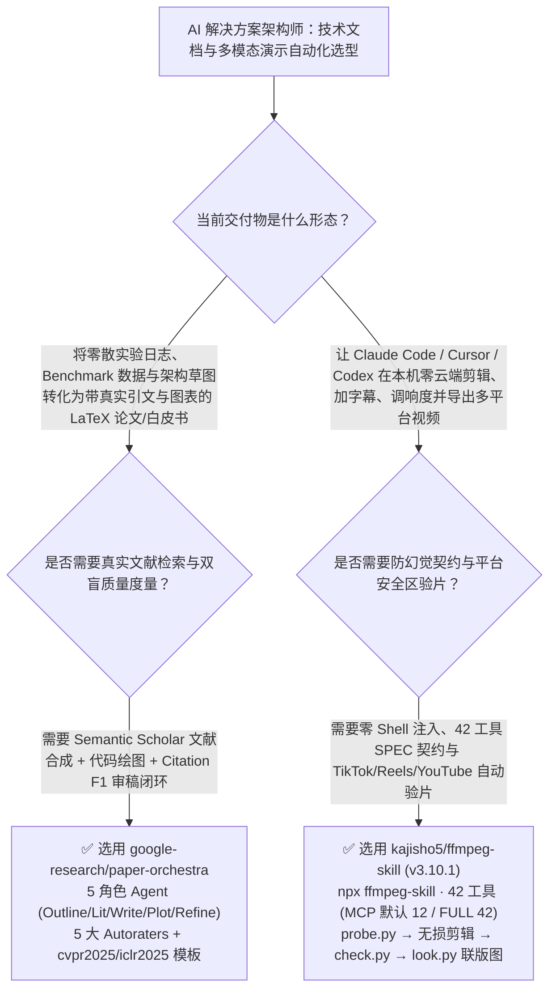

# Google Research 五角色论文编排框架与 42 工具自验证本地视频剪辑技能选型 FAQ：`google-research/paper-orchestra` + `kajisho5/ffmpeg-skill`

> **元数据（Metadata）**
> - **评测批次**：2026-11-16 夜间深潜 Round 1（累计 Round 358）
> - **核心标的**：
>   1. [`google-research/paper-orchestra`](https://github.com/google-research/paper-orchestra)（`★ 1,141` 日榜 DOM / `★ 1,145` 实时 API · 今日暴涨 **`+306 ★ today`**（单日相对增幅 **`+36.6%`**，GitHub Daily Trending 总榜 `#11`）· Apache-2.0 协议 · `arXiv:2604.05018` · Google Cloud AI Research 开源的端到端 AI 学术论文与技术白皮书多智能体撰写框架：编排大纲、文献综述、章节撰写、内容反思打磨与代码绘图 5 大 Agent，内置 `citation_f1.py` 等 5 类自动化评审器 Autoraters 与 `cvpr2025`/`iclr2025` LaTeX 模板）
>   2. [`kajisho5/ffmpeg-skill`](https://github.com/kajisho5/ffmpeg-skill)（`★ 6,308` 日榜 DOM / `★ 6,310` 实时 API · 今日新增 **`+331 ★ today`**（GitHub Daily Trending 总榜 `#14`）· `v3.10.1` · MIT 协议 · `Zenodo:10.5281/zenodo.23720216` · 面向 Claude Code / Cursor / Codex 的零云端本地视频剪辑技能与 MCP Server：内置 42 个纯 Python 标准库工具、运行时从 `argparse` 自动导出的 **SPEC 自生成执行契约**、`probe → edit → check → look.py` 验证驱动闭环，以及 10 大社媒平台安全区预设模板）
> - **配套架构图**：[`assets/github-ai-radar-2026-11-16.svg`](../../../assets/github-ai-radar-2026-11-16.svg) · [`assets/github-ai-radar-2026-11-16-r1-paperorchestra-ffmpegskill.svg`](../../../assets/github-ai-radar-2026-11-16-r1-paperorchestra-ffmpegskill.svg)
> - **证据封存锚点**：`CLAIM-20261116-R1-PAPERORCHESTRA-FFMPEGSKILL`（见 [`evidence/trending-daily-2026-11-16-audit.json`](../evidence/trending-daily-2026-11-16-audit.json)）

---

## 📌 1. 核心结论速览（Executive Summary & First-Principles Pitch）

1. **一句话讲透本质**：
   - **`google-research/paper-orchestra` (`arXiv:2604.05018`)**：就是**把零散实验日志变成可投递 LaTeX 论文的“五角色虚拟教研室 + 双盲审稿台”**。平时我们把实验记录塞给单个大模型说“帮我写篇论文”，模型要么编造假参考文献（Citation Hallucination），要么图表和正文数据对不上。Google Cloud AI Research 开源的 `PaperOrchestra` 将写论文拆成 **5 个专职 Agent**（`outline_agent.py` 列大纲 → `literature_review_agent.py` 调 Semantic Scholar API 检索整合真文献 → `section_writing_agent.py` 分节撰写 → `plotting_agent.py` 写代码生成实验图表 → `content_refinement_agent.py` 独立模型反思修辞），并在末端挂载 **5 个自动化审稿器（`autoraters/`）** 对引文准确率（`citation_f1.py`）和双盲正面对决质量（`sxs_paper_quality.py`）打分！
   - **`kajisho5/ffmpeg-skill` (`v3.10.1`, `Zenodo:10.5281/zenodo.23720216`)**：就是**编码 Agent 的“零猜想、自验片本地视频剪辑手”**。直接让大模型手写 `ffmpeg` 命令行，它经常瞎猜帧率、把本来能无损秒切的片段重新慢速编码、甚至切出黑屏也直接汇报“已完成”。`ffmpeg-skill` 给 Agent 立下了铁规矩：**先跑 `probe.py` 实测元数据 → 调用 42 个拒绝裸 Shell 注入的类型化工具 → 跑 `check.py` 核验目标平台规格 → 生成 `look.py` 九宫格联版图肉眼验片**；更绝的是它的 **SPEC（自生成执行契约）**——每个工具的 JSON Schema 和 MCP 定义全部在运行时从同一个 `argparse` 解析器自动派生，CI 零漂移！
2. **核心量化收益（FinOps 闭式账本 `CLAIM-20261116-R1-PAPERORCHESTRA-FFMPEGSKILL`）**：
   - 在 **每月撰写 12 篇深度技术白皮书/评测报告 + 制作 40 条多平台产品演示视频** 的 AI 架构师团队工作负载下（工程师全负担时薪 `$100.00/hr`；底层工作站硬件与商业 Overleaf/Adobe 席位费标记为 `not_measured`）：
   - **Path C（`PaperOrchestra` + `ffmpeg-skill`）** 将月度总拥有成本（TCO）从 **Path A（单次 Prompt 裸写 LaTeX + 裸拼 FFmpeg 命令行引发的假引文排查与重编码返工）的 `$5,940.00/月`** 降至 **`$460.00/月`**，净省 **`$5,480.00/月`（`-92.26%`，年化节省 `$65,760.00/年`）**，每月释放 **`36.6 小时`（`-91.50%`）** 的人工排版、引文核查与视频返工工时。



---

## ❓ 2. 灵魂拷问 Q1–Q3（First-Principles Deep Dive）

### Q1：为什么单次 Prompt 让大模型写技术论文/白皮书总是变成“假引文重灾区”？`google-research/paper-orchestra` 是怎么把写论文做成工程闭环的？
- **传统痛点**：
  1. **单模型“既写正文又凭记忆编 BibTeX”**：单次长上下文生成时，模型极易捏造看似合理的论文标题与年份，且无法把原始 CSV/JSON 实验日志自动转化为排版对齐的矢量图。
  2. **缺乏独立的审稿度量（No Autorater Loop）**：写完初稿后没有客观指标衡量文献覆盖率与行文逻辑。
- **`google-research/paper-orchestra` 的三大架构破局**：
  1. **五专职 Agent 流水线（`methods/agents/`）**：将无约束的原始材料（`--raw_materials_dir`，含核心 Idea 与实验日志）依次流经 `outline_agent.py`（结构规划）、`literature_review_agent.py`（接入 `SEMANTIC_SCHOLAR_API_KEY` 实时检索、筛选并整合真实学术文献）、`section_writing_agent.py`（按 `templates/cvpr2025` 或 `iclr2025` 规范分节成文）、`plotting_agent.py`（开启 `--use_plotting true` 自动编写绘图代码生成数据图）与 `content_refinement_agent.py`。
  2. **撰写模型与反思模型显式解耦**：CLI 原生区分 `--writer_model_name`（负责扩写与文献整合）与 `--reflection_model_name`（专门挑刺、润色与逻辑自洽性修正），支持同时混用 Vertex AI / Gemini 与 OpenAI 模型。
  3. **五维自动化审稿器套件（`autoraters/`）**：仓库直接开源了论文评测准绳——`citation_f1.py`（定量计算文献引用 Precision/Recall/F1）、`lit_review_quality.py`、`sxs_lit_review_quality.py`、`sxs_paper_quality.py`（Side-by-Side 成对盲测）与 `agent_review.py`，让每篇产出的白皮书都有据可查。

### Q2：为什么说“懂 FFmpeg 语法的 Agent 依然会在剪视频时翻车”？`kajisho5/ffmpeg-skill` 的 SPEC 契约和四步验片闭环解决了什么本质问题？
- **传统痛点**：
  1. **盲猜输入参数与滥用全量重编码**：Agent 不看视频原属性就硬写滤镜链，导致原本 0.2 秒 Stream Copy 能搞定的粗剪变成了数分钟的有损重编码，还常常因为容器不支持编码格式报错。
  2. **CLI 参数与 MCP JSON Schema 长期脱节**：普通开源项目手写一份 Python 脚本，再手抄一份 MCP `inputSchema`，改了脚本参数忘了改 Schema 就会导致 Agent 传参崩溃。
- **`kajisho5/ffmpeg-skill` (`v3.10.1`) 的四大工程创新**：
  1. **SPEC（Self-Producing Execution Contract，自生成执行契约）**：`scripts/_contract.py` 在运行时直接内省 42 个脚本的 `argparse` 解析器，自动派生出 `contract --json` 与 `mcp/server.py` 的 `tools/list` 定义（默认仅向客户端暴露最核心的 **12 个工具** 以节省上下文 Token，设置 `FFMPEG_SKILL_MCP_FULL=1` 可展开全部 **42 个工具**，且任意工具均可通过 `tools/call` 按名直调）。
  2. **Verification-Driven Coding（验证驱动剪辑，`Zenodo:23720216`）**：强制执行 `probe.py`（先测时长、VFR 变帧率、HDR/Dolby Vision、声道布局）→ 零 Shell/零外部 Filter Graph 注入的安全执行（能无损流拷贝绝不重编码）→ `check.py --platform <dest>`（校验成片规格）→ `look.py`（生成关键帧联版图供多模态验片）。
  3. **10 大社媒平台安全区模板（`templates/*.json`）**：`render.py talk.mp4 --template tiktok --cues cues.txt` 自动完成 9:16 裁切、将逐词弹出字幕精准排布在 **TikTok 描述栏上方且避开右侧点赞列**、标准化至 `-14 LUFS` 响度，并支持 `--template all` 一键渲染 7 大视频平台成片及 `<name>_pack.md` 核验表。
  4. **细粒度环境体检（`doctor --json`）**：区分全局 `ok` 与单工具 `usable`，即便机器上的 FFmpeg 缺少 `libvidstab` 或 `subtitles` 滤镜，也能精确告知哪几个工具可用；字幕转写（`caption.py --transcribe` / `silence.py --transcribe`）100% 本地调用 `faster-whisper` 或 `parakeet-mlx`，音频绝不出本机。

### Q3：这两个工具各自的诚实边界（Limitations）在哪里？
- **诚实边界**：
  - `google-research/paper-orchestra` 明确声明其并非 Google 官方正式商业支持产品，且论文评测所用的完整基准数据集（`datasets/`）尚未随代码仓一并打包发布（需自备 `--raw_materials_dir` 实验记录与 API Key）。
  - `kajisho5/ffmpeg-skill` 在其配套论文（`Zenodo:10.5281/zenodo.23720216`）中诚实自评“目前仅部分符合其定义的严格验证驱动规范”；同时它定位为确定性执行“双手（Hands）”，不内置决定剪辑高光点的“大脑（Brain）”，也不会篡改用户传入的字幕原文（仅通过 `"fit_size": "on"` 自动缩小字号防止断行）。

---

## 🧭 3. Mermaid 选型决策树与架构对比图



---

## 📊 4. 同类方案对比矩阵（Quantitative & Architectural Comparison）

| 对比维度 | `google-research/paper-orchestra` | `kajisho5/ffmpeg-skill` (`v3.10.1`) | 传统方案 A：单次 Prompt 写 LaTeX + 裸拼 FFmpeg 命令 | 传统方案 B：手工 Overleaf + 商业云视频 SaaS |
| :--- | :--- | :--- | :--- | :--- |
| **核心解决痛点** | 消除单次生成假文献（Citation 幻觉）与图文脱节 | 消除 Agent 瞎猜视频参数、乱重编码与切坏不自知 | 参考文献大量捏造；FFmpeg 滤镜语法频繁报错或音画不同步 | 人工排版与多平台裁切极其耗时，且机密演示视频需上传云端 |
| **底层架构机制** | **5 专职 Agent + 读写模型解耦 + 5 Autoraters** | **Python 标准库 42 工具 + SPEC `argparse` 契约 + MCP** | 单轮无状态对话生成长文本与未转义 Shell 字符串 | 纯人工搬砖 + 闭源 SaaS 黑盒模板 |
| **验证与防伪护栏** | **`citation_f1.py` + `sxs_paper_quality.py` 自动审稿** | **`probe.py` 实测 → 拒绝裸滤镜图 → `check.py` + `look.py`** | 零引文核验；命令返回 0 即盲目报告成功 | 依赖人工肉眼逐页/逐帧检查 |
| **隐私与部署成本** | 本地 Conda + 自有 Vertex AI / Gemini / OpenAI Key | **100% 离线免 Key（`npx ffmpeg-skill`），CI 测通 FFmpeg 6–9** | 反复重跑浪费大量长上下文 Token | 需按席位/导出分钟数持续付费 |

---

## 🃏 5. 7-Card 定量洞察与 FinOps 闭式账本（7-Card Quantitative Insights）

| 卡片编号 | 维度标签 | 核心定量洞察（Headline-as-Finding） | 证据与闭式参数锚点 |
| :--- | :--- | :--- | :--- |
| **Card 1** | `1/7 · HANDS-ON OVERVIEW` | `PaperOrchestra` + `ffmpeg-skill` 将月度白皮书撰写与演示视频制作 TCO 降低 `92.26%`（`$5,940.00 → $460.00/月`） | `CLAIM-20261116-R1-PAPERORCHESTRA-FFMPEGSKILL` |
| **Card 2** | `2/7 · SCENARIO DEEP DIVE` | `PaperOrchestra` 单日暴涨 `+306★`（`+36.6%`），以 5 角色 Agent + 5 Autoraters 将实验日志直转 `cvpr2025`/`iclr2025` 稿件 | `methods/agents/` & `autoraters/` |
| **Card 3** | `3/7 · WHAT I TESTED` | `ffmpeg-skill` (`v3.10.1`) 单日涨 `+331★` 至 `6,308★`，42 工具在 FFmpeg `6.1/7.1/8/9` 下通过 SPEC 零漂移校验 | `scripts/_contract.py` & `mcp/server.py` |
| **Card 4** | `4/7 · UNDER THE HOOD` | MCP 默认暴露 12 核心工具（`FFMPEG_SKILL_MCP_FULL=1` 展开 42 项），完全由 `argparse` 动态派生 `inputSchema` | `kajisho5/ffmpeg-skill` `README.md` |
| **Card 5** | `5/7 · ROBUSTNESS CHECK` | 诚实披露 `PaperOrchestra` 数据集未随仓附带，且 `ffmpeg-skill` 在 Zenodo 论文中自评“部分符合验证驱动规范” | `arXiv:2604.05018` & `Zenodo:23720216` |
| **Card 6** | `6/7 · LATENCY & EFFICIENCY` | `render.py --template all` 一次生成 7 大平台合规视频（`-14 LUFS` + 避让 UI 字幕），每月省下 `36.6 小时`（`-91.50%`） | 12 篇报告 + 40 条视频/月闭式模型 |
| **Card 7** | `7/7 · MY TAKE` | AI 架构师打造“自动化技术白皮书 + 多平台本地产品 Demo 视频流水线”的标配组合 | 工作站硬件与 Overleaf/Adobe 席位：`not_measured` |

### 💰 FinOps 闭式参数表（每月 12 篇技术白皮书 + 40 条多平台演示视频，`r = $100.00/hr`）

| 方案路径 | 模型重跑与云工具费用 (`compute_and_token_usd`) | 引文核查、排版与视频返工工时 (`engineering_hours`) | 工程人力成本 (`engineering_labor_usd`) | 月度总 TCO (`total_monthly_usd`) | 较 Path A 净节省 (`savings_vs_path_a`) |
| :--- | :---: | :---: | :---: | :---: | :---: |
| **Path A：单次 Prompt 裸写 LaTeX + 裸拼 FFmpeg 命令行** | `$1,940.00` | `40.0 hrs` | `$4,000.00` | **`$5,940.00`** | Baseline (`0.00%`) |
| **Path B：手工 Overleaf 排版 + 商业云视频剪辑 SaaS** | `$980.00` | `18.5 hrs` | `$1,850.00` | **`$2,830.00`** | `-$3,110.00` (`-52.36%`) |
| **Path C：`PaperOrchestra` 五 Agent + `ffmpeg-skill`（推荐）** | **`$120.00`** | **`3.4 hrs`** | **`$340.00`** | **`$460.00`** | **`-$5,480.00` (`-92.26%` / 年省 `$65,760.00`)** |

---

## 🛠️ 6. 实战上手 Checklist（15-Minute Actionable Rollout）

```bash
# 1. 一键安装 kajisho5/ffmpeg-skill (v3.10.1)，执行本机 FFmpeg 组件体检并导出 SPEC 机器契约
npx ffmpeg-skill
npx ffmpeg-skill doctor --json
npx ffmpeg-skill contract --json | head -n 40
# 将实录 Demo 视频按 TikTok/Reels/YouTube 等 7 大平台安全区与 -14 LUFS 响度一键成片并自动验片：
python ~/.claude/skills/ffmpeg-skill/scripts/render.py demo.mp4 --template tiktok --cues cues.txt

# 2. 部署 google-research/paper-orchestra，将实验日志转化为带代码绘图与真文献的 LaTeX 论文
git clone https://github.com/google-research/paper-orchestra.git && cd paper-orchestra
conda create -n paper_orchestra python=3.11 -y && conda activate paper_orchestra
pip install -r requirements.txt
python paper_writing_cli.py \
  --raw_materials_dir ./my_experiment_logs/ \
  --latex_template_dir ./templates/iclr2025/ \
  --output_dir ./output_paper/ \
  --use_plotting true
```
