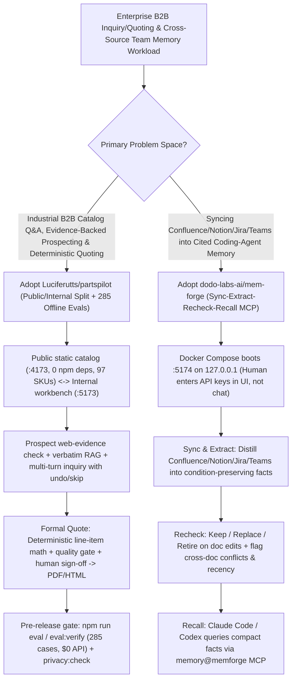

# Industrial B2B Evidence-Gated Workbench (`Luciferutts/partspilot` 285-Case Offline Eval) & Conflict-Aware Team Memory MCP (`dodo-labs-ai/mem-forge`) Selection FAQ

> **Positioning**: This standalone guide is **Round 32 of the 2026-11-11 Night Shift (Cumulative Guide #77)**, written in the plain-language, first-principles, closed-form FinOps style of `ib-vs-ethernet-roce-selection-faq.md` for B2B Enterprise AI and Engineering Knowledge Solution Architects evaluating two high-discipline repositories:
> 1. **`Luciferutts/partspilot` (`151★`, TypeScript/React/Vinext/Drizzle)**: An AI-assisted B2B manufacturing workbench (built over 97 real auto-part SKUs) enforcing a **strict air-gap between its zero-dependency public static catalog (`:4173`) and authenticated internal workbench (`:5173`)**, where **AI assists passage retrieval while pricing, fitment, MOQ, and lead times are governed strictly by deterministic code rules and human sign-off**, backed by a **285-case zero-API-cost reproducible evaluation suite (`npm run eval`)** and `npm run privacy:check`;
> 2. **`dodo-labs-ai/mem-forge` (`103★`, Python + Docker Compose, Apache-2.0)**: A cited, self-updating team memory layer for `Claude Code` and `Codex` that syncs Confluence, Notion, GitHub Docs/Pages, local folders, Jira, and Microsoft Teams via a **`Sync → Extract → Recheck → Recall`** pipeline—returning compact condition-preserving facts over MCP (zero full-document context bloat), **automatically retiring stale facts when docs change, and surfacing both facts with an explicit conflict/recency note when sources disagree**.
>
> **中文版 FAQ**: [partspilot-mem-forge-b2b-evidence-workbench-team-memory-selection-faq.md](partspilot-mem-forge-b2b-evidence-workbench-team-memory-selection-faq.md) · **Architecture Summary SVG**: [`assets/github-ai-radar-2026-11-11-r32-partspilot-memforge.svg`](../../../assets/github-ai-radar-2026-11-11-r32-partspilot-memforge.svg)

---

## 📌 1. Executive Summary

1. **In plain English, what problems do these two repositories actually solve?**
   - **Preventing Industrial B2B Bots from Hallucinating Prices/Fitment or Spamming Unverified Prospects (`Luciferutts/partspilot`)**: In B2B manufacturing (auto parts, industrial components), an LLM that invents part compatibility, guesses volume discounts, or auto-emails scraped prospects creates immediate commercial liability. `PartsPilot` separates its zero-dependency public catalog (`partspilot-public-catalog/` at `:4173`, displaying 97 verified models with explicit unknown-field disclosures and zero auto-emailing) from its internal workbench (`partspilot/` at `:5173`). AI is restricted to evidence-backed prospect research (filtering contradictions), verbatim-checked RAG Q&A, and multi-turn inquiry slot-filling (with user correction/withdrawal), while **formal multi-line quotations use deterministic math, quality gates, and mandatory human approval** before exporting versioned PDF/HTML quotes. Crucially, it ships a **285-case offline evaluation suite (`npm run eval` + `eval:verify`)** with paid batch evaluations disabled by default.
   - **Giving Coding Agents Your Team's Up-to-Date Brain Without Full-Document Context Bloat (`dodo-labs-ai/mem-forge`)**: When a coding agent investigates a bug (e.g., *"customer charged twice"*), it sees only the git repo and starts patching payment code—unaware that a Notion decision log and Jira support playbook already recorded that this is an expected pending card hold. Directly querying Confluence/Jira MCPs floods the agent's context with entire pages, while static `AGENTS.md` files rot as soon as docs change. `MemForge` syncs Confluence, Notion, GitHub, Jira, and Teams ahead of time, extracts **short condition-preserving facts with verbatim source links**, **rechecks and retires stale facts** whenever a source document changes, and **explicitly flags cross-document conflicts with recency metadata** over MCP.
2. **Closed-Form FinOps Verdict (`CLAIM-20261111-R32-PARTSPILOT-MEMFORGE`)**:
   - For a 20-person Industrial Manufacturing & Engineering Organization handling **1,500 B2B technical inquiry/quotation workflows** and **2,500 cross-repo/wiki coding agent ticket resolutions per month** (senior engineer loaded rate `$85.00/hr`; base ERP/Confluence/Jira seat licenses and physical part inventory: `not_measured`):
   - Upgrading from **Path A (Un-gated LLM quoting bot + coding agents ingesting raw Confluence/Jira pages and patching non-bugs, `$5,920.00/mo`)** to **Path C (`PartsPilot` rule-gated B2B workbench & 285-case offline eval + `MemForge` cited/conflict-aware team memory MCP, `$780.00/mo`)** saves **`$5,140.00/mo` (`-86.82%`, `$61,680.00/yr`)** and cuts engineering rework and quoting audit labor from `48.0 hrs/mo` to `6.0 hrs/mo` (**`-87.50%`**).

---

## 🎯 2. Three Core Architectural Questions (Q1 / Q2 / Q3 Deep-Dive)

### Q1: How does `Luciferutts/partspilot` draw a hard architectural boundary between AI comprehension and commercial commitment—and how does its 285-case offline evaluation work?
- **First-Principles Breakdown**:
  1. **Public/Internal Air-Gap & Deterministic Quoting Gate**:
     - The public site (`partspilot-public-catalog/`, Node stdlib only) surfaces verified manufacturer specs and explicitly flags unknown fields (never claiming real-time stock, MOQ, or lead time without verification).
     - Inside the internal workbench (`partspilot/`), prospect discovery retains web evidence and filters explicit contradictions; outreach drafts are never counted as "contacted"; and formal quotations run deterministic line-item calculations, quality gates, and human approval before PDF/HTML export.
  2. **285-Case Keyless Evaluation (`npm run eval` → `eval:verify`) & `npm run privacy:check`**:
     - Ships 285 frozen scenarios (`218` RAG/disposition, `24` synthetic prospecting, `38` multi-turn inquiry/memory handoff, and `5` outreach controls) plus a 20-question free rule baseline that executes with zero model API spend (`eval/results/`), while `npm run privacy:check` scans for accidentally staged keys, personal domains, or absolute host paths before Git commits.

### Q2: How does `dodo-labs-ai/mem-forge`'s `Sync → Extract → Recheck → Recall` loop prevent context-window bloat, stale rules, and silent wiki contradictions?
- **First-Principles Breakdown**:
  1. **Condition-Preserving Atomic Memories (Zero Full-Document Bloat)**:
     - During `Sync` and `Extract`, a generation model converts Confluence pages, Notion logs, GitHub docs, Jira tickets, and Teams threads into concise memories that preserve conditions and exceptions. MCP searches return only these compact facts—full source documents enter the agent's context only if explicitly requested.
  2. **Automated `Recheck` Retirement & Conflict Surfacing**:
     - Whenever a synced document is edited, `Recheck` re-evaluates every memory derived from it—keeping, replacing, or retiring facts that lost source backing.
     - New facts are compared against existing memories: if two documents disagree, `MemForge` returns **both** memories to the agent along with an explicit conflict and recency note, while retaining the verbatim passage snapshot behind every paraphrased citation.

### Q3: What security and deployment boundaries must Solution Architects enforce when running `PartsPilot` and `MemForge`?
1. **`PartsPilot` Deployment & Data Hygiene**:
   - Keep `partspilot/` and `partspilot-public-catalog/` as sibling directories; never expose the `:5173` development workbench directly to the public internet; and always run `npm run privacy:check` plus the offline Python tests (`infra/aws-reviews/tests` and `infra/mail-bridge/tests`) before pushing.
2. **`MemForge` Single-Machine Loopback Boundary**:
   - The open-source edition runs on `127.0.0.1` (`http://localhost:5174`) without multi-user authentication—never expose port `5174` on a public or untrusted network. When using `docs/agent-setup.md`, enter model API keys directly into the `:5174` Admin UI so credentials never pass through the agent's chat transcript.

---

## 🧭 3. Mermaid Decision Tree & B2B Workbench + Team Memory Pipeline

---

## 📊 4. Architectural Comparison Matrix

| Evaluation Dimension | Path A: Ungated LLM Quoting Bot + Raw Wiki MCP | Path B: Manual Spreadsheet Quoting + Static `AGENTS.md` | **Path C (Recommended): `PartsPilot` + `MemForge`** |
| :--- | :--- | :--- | :--- |
| **B2B Pricing/Fitment Safety** | LLM hallucinates fitment, MOQs, and discounts; auto-spams leads | Accurate but slow manual email back-and-forth | **AI retrieves evidence; deterministic math + human approval gates quotes** |
| **Evaluation Reproducibility & Privacy** | Paid live-API evals only; risks committing cached logs/keys | No automated regression benchmark | **285 frozen keyless eval cases (`eval:verify`) + `npm run privacy:check`** |
| **Agent Memory Context Footprint** | Dumps multi-page Confluence/Jira docs into context (`2k+ tokens`) | Low tokens, but misses Jira tickets and Teams decisions | **Returns compact cited facts with conditions; opens raw passage only on demand** |
| **Stale Rule Retirement & Conflicts** | Agent follows outdated wiki pages and patches non-bugs | Static `AGENTS.md` rots silently as docs evolve | **`Recheck` auto-retires unsupported facts & flags cross-doc conflicts** |
| **Monthly TCO (1.5k Quotes + 2.5k Tickets)** | **`$5,920.00 / mo`** (`$1,840` tokens/evals + `$4,080` labor) | **`$3,000.00 / mo`** (`$790` search + `$2,210` labor) | **`$780.00 / mo` (Saves `$5,140.00/mo` · `-86.82%`)** |

---

## 🧪 5. Closed-Form FinOps Example & 7-Card Insights (`CLAIM-20261111-R32-PARTSPILOT-MEMFORGE`)

### 5.1 Workload & Scope Boundary
- **Workload**: A 20-person manufacturing and engineering organization processing **1,500 B2B technical inquiries/quotations** and **2,500 coding-agent ticket resolutions per month**.
- **Rates**: Senior engineer / domain specialist loaded rate at **`$85.00 / hr`**.
- **Explicit Scope Boundary**: Baseline ERP, Confluence, and Jira seat subscriptions and physical part inventory are marked **`not_measured`**.

### 5.2 Closed-Form Monthly Cost Breakdown

| Cost Component | Path A: Ungated Quote Bot + Raw Wiki Context Bloat | Path B: Manual Quoting + Stale Static `AGENTS.md` | **Path C: `PartsPilot` + `MemForge` (Recommended)** |
| :--- | :--- | :--- | :--- |
| **Model Retrieval/Extraction & Eval Spend** | **`$1,840.00`** | **`$790.00`** | **`$270.00`** (Compact facts + 285-case `$0` offline eval) |
| **Quote Auditing, Patch Rollbacks & Maintenance (`$85/hr`)** | `48.0 hrs × $85.00` = **`$4,080.00`** | `26.0 hrs × $85.00` = **`$2,210.00`** | `6.0 hrs × $85.00` = **`$510.00`** |
| **Total Monthly TCO** | **`$5,920.00 / mo`** | **`$3,000.00 / mo`** (`-49.32%`) | **`$780.00 / mo`** |
| **Net Savings vs. Path A** | Baseline | Saves `$2,920.00 / mo` | **Saves `$5,140.00 / mo` (`-86.82%` · `$61,680.00/yr`)** |
| **Base ERP/Wiki Seats & Physical Inventory** | `not_measured` | `not_measured` | `not_measured` |

---

## 🛠️ 6. Production Verification Checklist

- [ ] **1. `PartsPilot` Sibling Layout & 285-Case Offline Verification**: Keep `partspilot/` and `partspilot-public-catalog/` adjacent, run `npm run catalog:build && npm run catalog:test`, and execute `npm test && npm run typecheck && npm run eval && npm run eval:verify` inside `partspilot/`.
- [ ] **2. Deterministic Quote Gate & Pre-Commit `privacy:check`**: Verify that multi-line quotes require deterministic calculation and human sign-off, and run `npm run privacy:check` plus the offline Python unit tests (`infra/aws-reviews/tests` and `infra/mail-bridge/tests`) before every Git commit.
- [ ] **3. `MemForge` Loopback Security & Keyless Agent Setup**: Start `docker compose up --build` bound strictly to `127.0.0.1:5174` and enter LLM/embedding API keys directly in the Admin UI (`Save and validate` → **Ready**).
- [ ] **4. Automated Source Sync & `Recheck` Conflict Drill**: Connect Confluence, Notion, GitHub, Jira, and Teams with **Sync automatically** enabled, and verify that conflicting statements across two documents surface together with recency notes.
- [ ] **5. Verbatim Passage Confirmation on Consequential Changes**: Instruct coding agents (`memory@memforge` plugin in Claude Code / Codex) to cite every memory relied upon and open the stored verbatim source passage before modifying billing, auth, or schema code.
