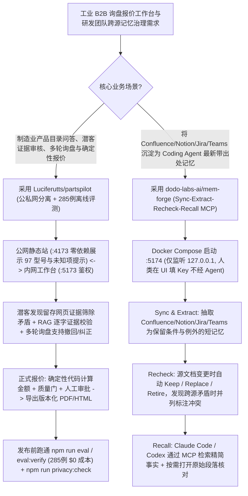

# 工业制造 B2B 证据门控工作台（`Luciferutts/partspilot` 285 例离线评测）与跨源冲突感知团队记忆层（`dodo-labs-ai/mem-forge`）选型 FAQ

> **文档定位**：本文是 **2026-11-11 夜班多轮深潜 Round 32（累计第 77 篇独立选型专题）**，严格对标 `ib-vs-ethernet-roce-selection-faq.md` 的「通俗大白话 + 第一性原理 + 可核算定量算例」标杆文风，为传统制造业数字化转型（B2B 询盘/报价 AI 工作台）与研发团队知识记忆架构师深度拆解今日两款高严谨度工程标杆：
> 1. **`Luciferutts/partspilot`（`151★`，TypeScript/React/Vinext/Drizzle）**：面向中小制造企业（以两家汽配厂 97 个真实型号为基准）的 AI 业务工作台——严格执行**公网静态产品目录（`:4173` 零第三方依赖）与内网鉴权工作台（`:5173`）物理隔离**，坚持 **“AI 只负责理解与选段，价格、适配、起订量（MOQ）与交期 100% 由确定性规则及人工审批控制”**，并随包附带 **285 例零 API 成本可复现分层评测集（`npm run eval`）** 与上传前隐私扫描门禁（`npm run privacy:check`）；
> 2. **`dodo-labs-ai/mem-forge`（`103★`，Python + Docker Compose，Apache-2.0）**：为 Claude Code 与 Codex 打造的团队级跨源记忆层——预先同步 Confluence、Notion、GitHub 文档、Jira 工单与 Microsoft Teams 聊天，通过 **「Sync → Extract → Recheck → Recall」** 四步闭环将长文档提炼为保留前提条件与例外规则的短事实（杜绝全文塞爆上下文），并在源文档更新时**自动淘汰过期事实、显式并列提示跨文档冲突与新旧时间戳**。
>
> **English Companion**: [partspilot-mem-forge-b2b-evidence-workbench-team-memory-selection-faq.en.md](partspilot-mem-forge-b2b-evidence-workbench-team-memory-selection-faq.en.md) · **架构总结图**: [`assets/github-ai-radar-2026-11-11-r32-partspilot-memforge.svg`](../../../assets/github-ai-radar-2026-11-11-r32-partspilot-memforge.svg)

---

## 📌 一、核心结论速览（Executive Summary）

1. **先用大白话讲透这两个项目到底解决了什么痛点？**
   - **传统制造业上 AI 客服/报价系统“大模型乱报配件价格和适配车型、未核实就自动群发垃圾开发信、评测靠拍脑袋编转化率”的痛点（`Luciferutts/partspilot` 解决的问题）**：汽配、五金、机械等 B2B 制造企业最怕 AI 自由发挥——一旦把不兼容的刹车片型号说成通用，或者把单价算错，直接就是赔钱毁商誉。`PartsPilot` 给所有工业 B2B AI 应用立下了一套极清醒的工程范式：① **公私网解耦**：公网目录（`partspilot-public-catalog`）做成纯 Node 标准库驱动的静态站，明确标注“未知信息”且绝不自动群发邮件；② **权责分明**：AI 只做多源潜客证据抽取（自动筛除前后矛盾信息）、逐字证据校验的 RAG 资料问答与多轮询盘意图收集；到了**正式报价（Quotation）环节，多行金额计算 100% 走确定性代码公式 + 质量门 + 人工审批签字**后才导出 PDF/HTML，且“开发草稿”绝不虚报计入“已联系客户”！③ **拒绝先射箭后画靶**：内置 **285 例冻结评测集**（218 个 RAG/处置、24 个拓客、38 个多轮交接、5 个触达控制），默认禁用付费批量跑分以防误烧钱，所有工程规则测试零 API Key 即可本地复现。
   - **研发团队新成员/Coding Agent 接手チケット“只看得到本地代码库、不知道 Notion/Jira 里早就定过业务特例而盲目改错代码”的痛点（`dodo-labs-ai/mem-forge` 解决的问题）**：比如客服提了个工单说“客户被扣了两次钱”，如果直接让 Claude Code 看代码，它马上就开始改支付接口；但如果它先查团队记忆，就会发现 Notion 决策日志和客服手册里早写明了“这不是 Bug，而是银行预授权挂起（Pending Card Hold）”。然而如果让 Agent 直接调 Confluence/Jira 搜索 MCP，动辄把几万字整篇 Wiki 塞进上下文；写成静态 `AGENTS.md` 又会在文档更新后迅速过期。`MemForge` 提前把 Confluence、Notion、Jira、Teams 抽成**带精确原文引用的短记忆（包含触发条件与例外情况）**；当源文档修改时，**`Recheck` 阶段会自动替换或退役（Retire）失效记忆，一旦发现两篇文档互相矛盾，会同时把两条事实及谁更新的注释一并交给 Agent**！
2. **闭式 FinOps 核算结论（`CLAIM-20261111-R32-PARTSPILOT-MEMFORGE`）**：
   - 在 **20 人制造业务与研发工程团队每月处理 1,500 次 B2B 技术询盘/报价核算 + 执行 2,500 次跨 Wiki/工单背景的 Agent 研发任务** 基准下（高级工程师全包时薪 `$85.00/hr`；企业 ERP/Confluence/Jira 基础席位与实体配件库存成本：`not_measured`）：
   - 从 **Path A（无门禁 AI 自动报价出事故 + Agent 每次生吞整篇 Confluence/Jira 原始文档且因漏看历史决议改错代码，`$5,920.00/月`）** 升级至 **Path C（`PartsPilot` 规则受控报价与 285 例离线评测 + `MemForge` 冲突感知短事实记忆 MCP，`$780.00/月`）**，每月净省 **`$5,140.00/月`（降幅 `-86.82%`，年化节省 `$61,680.00/年`）**，人工核查错报单价与回滚乌龙代码补丁的工时从 `48.0 小时/月` 降至 `6.0 小时/月`（**节省 `87.50%`**）。

---

## 🎯 二、三大灵魂拷问（Q1 / Q2 / Q3 Deep-Dive）

### Q1：`Luciferutts/partspilot` 是如何设计「AI 辅助理解 vs. 规则与人工控制商业承诺」的铁律边界的？它的 285 例分层评测与隐私扫描是怎么防踩坑的？
- **第一性原理拆解**：
  1. **商业承诺零幻觉边界（AI 选段 + 规则算钱 + 人工签发）**：
     - 在 97 个真实汽配型号目录中，凡是官网未明确标注的适配年款、MOQ 或交期，界面强制显示“未知信息提示”，严禁大模型脑补；
     - 在潜客发现与企业研究中，系统强制保存原始网页证据并筛除明确矛盾项；在多轮询盘中支持买家随时**纠正、撤回、跳过**字段及显式同意留资；进入正式报价单时，单价汇总、阶梯折扣与税费全部由确定性 TypeScript 代码计算，经质量门与人工审批后生成带版本号的 PDF/HTML。
  2. **285 例零成本离线评测（`npm run eval` → `eval:verify`）与付费批量锁**：
     - 许多开源项目把作者跑过的真实大模型缓存回执打包进仓库充当“测试通过”，换个环境就跑不通。`PartsPilot` 剥离了所有历史模型回执，提供 285 个冻结业务场景（218 RAG + 24 拓客 + 38 多轮交接 + 5 触达控制）与 20 题免费规则基线，**默认锁死付费批量评测开关**（需运行者在当前页面会话临时输入 Key 并逐次确认），且在 `git push` 前强制运行 `npm run privacy:check` 扫描残留凭据、本机绝对路径与客户隐私。

### Q2：`dodo-labs-ai/mem-forge` 的「Sync → Extract → Recheck → Recall」四步管线是如何解决团队记忆“上下文爆炸、文档过期失真与多源规则冲突”三大难题的？
- **第一性原理拆解**：
  1. **短事实提取与原文按需展开（零全文上下文污染）**：
     - 普通 RAG 在搜索时直接返回几千字的原始 Markdown/HTML 切片。`MemForge` 在后台 `Sync` 阶段即调用生成模型将 Confluence、Notion、GitHub Docs、Jira、Teams 转化为结构化短记忆（保留适用条件与异常分支）。Agent 通过 MCP 搜索时**返回结果不含冗长原文正文**，只有当 Agent 决定采纳某条事实并需要核对细节时，才按链接打开保存的原始段落快照（防止转述偏差）。
  2. **增量变更重检（`Recheck`：Keep / Replace / Retire）与跨文档冲突并列告警**：
     - 当 Confluence 或 Notion 上的某页架构规范被修改或删除后，下一次同步会自动触发 `Recheck`：不再有原文支撑的旧记忆会被立即标记为 **Retired（退役）**；
     - 当 Jira 工单里的临时决定与 Confluence 里的老规范发生冲突时，`MemForge` 不会替你武断删掉其中一个，而是**把两条冲突记忆同时返回给 Agent，并附上明确注释说明两者存在分歧及哪一条时间戳更新**！

### Q3：架构师在落地制造业 B2B 工作台与研发团队共享记忆时，必须注意哪些安全边界？
1. **`PartsPilot` 的公私网部署红线**：
   - `partspilot/`（`:5173`）是内部开发与业务工作台，切勿直接裸露在公网；对外展示应仅部署零第三方依赖的静态目录 `partspilot-public-catalog/`（并同步修改 `public-site-config.json` 中的入口域名），内部接单与云存储需完成 D1 数据库迁移与 R2 私有桶鉴权绑定。
2. **`MemForge` 开源单机版的监听边界與升级恢复点**：
   - 当前 Apache-2.0 开源版面向单机使用，管理台（`http://localhost:5174`）无内置账号登录且仅监听 `127.0.0.1`，**严禁直接将其端口暴露至公网或局域网**；另外由 Agent 自动执行 `docs/agent-setup.md` 安装时，API Key 由人类在 `:5174` 网页端填入，确保密钥永不经过 Agent 对话流。

---

## 🧭 三、Mermaid 选型决策树与 B2B 证据工作台 + 团队记忆架构

---

## 📊 四、同类方案核心能力对比矩阵（Comparison Matrix）

| 评估维度 | Path A：无门禁 AI 自动报价 + 直接搜原始 Wiki MCP | Path B：纯手工 Excel 报价 + 静态手写 `AGENTS.md` | **Path C（推荐标杆）：`PartsPilot` + `MemForge`** |
| :--- | :--- | :--- | :--- |
| **B2B 价格/适配准确性与防骚扰** | 模型自由编造配件价格与交期，未核实即自动群发邮件 | 准确但响应极慢，多轮询盘靠人工来回发邮件确认 | **AI 选段 + 确定性公式算价 + 人工签发；草稿绝不计为已联系** |
| **业务工作台可复现评测与隐私门禁** | 无标准评测集，每次跑测试狂烧真实模型 API 且易漏凭据 | 无自动化回归评测 | **285 例冻结离线评测（`eval` + `eval:verify`）+ `privacy:check`** |
| **研发 Agent 跨源记忆上下文开销** | 每次检索把整篇 Confluence/Jira 文档塞进上下文（数千 Token） | `AGENTS.md` 简短，但无法覆盖数千个历史工单与聊天决议 | **MCP 仅返回保留条件的精简短事实，按需才展开原始段落** |
| **过期文档淘汰与跨源冲突处理** | 旧 Wiki 与新工单混杂，Agent 经常按已作废规范改错代码 | 全靠人工想起来去改 `AGENTS.md`，90% 规则半年后即过期 | **`Recheck` 自动退役无源记忆 + 跨文档矛盾时显式并列提示冲突** |
| **月度总拥有成本（1,500 报价+2,500 工单）** | **`$5,920.00 / 月`**（Token/赔付 `$1,840` + 人工 `$4,080`） | **`$3,000.00 / 月`**（检索 `$790` + 人工 `$2,210`） | **`$780.00 / 月`（净省 `$5,140.00/月`，降幅 `-86.82%`）** |

---

## 🧪 五、闭式定量 FinOps 算例与 7-Card 评测洞察（`CLAIM-20261111-R32-PARTSPILOT-MEMFORGE`）

### 5.1 基准假设与边界声明
- **评测负载**：20 人制造业务与研发团队每月处理 **1,500 次 B2B 产品询盘与多行报价核算**，并由 Coding Agent 协同处理 **2,500 个涉及历史架构/工单规范的研发任务**。
- **单价基准**：高级工程师/业务专家全包时薪 **`$85.00 / hr`**。
- **显式边界声明（Scope Boundary）**：企业底层 ERP、Confluence、Jira 基础商业席位订阅及实体仓库零配件库存成本标记为 **`not_measured`**。

### 5.2 三路径闭式成本核算表

| 成本构成项 | Path A：无门禁报价 + 生吞原始 Wiki 改错代码 | Path B：手工报价 + 静态过期 `AGENTS.md` | **Path C：`PartsPilot` + `MemForge`（推荐）** |
| :--- | :--- | :--- | :--- |
| **模型检索/提取 Token 与评测 API 开销** | **`$1,840.00`** | **`$790.00`** | **`$270.00`**（短事实召回 + 285 例零成本离线评测） |
| **报价核查、乌龙补丁回滚与规则维护（`$85/hr`）** | `48.0 hrs × $85.00` = **`$4,080.00`** | `26.0 hrs × $85.00` = **`$2,210.00`** | `6.0 hrs × $85.00` = **`$510.00`** |
| **月度总成本（Monthly Total）** | **`$5,920.00 / 月`** | **`$3,000.00 / 月`**（`-49.32%`） | **`$780.00 / 月`** |
| **相对 Path A 净节省（Savings）** | 基准线（Baseline） | 节省 `$2,920.00 / 月` | **净省 `$5,140.00 / 月`（`-86.82%` · 年省 `$61,680.00`）** |
| **ERP/Wiki 基础席位与实体配件库存** | `not_measured` | `not_measured` | `not_measured` |

---

## 🛠️ 六、生产级落地核验 Checklist（SA Actionable Verification）

- [ ] **1. `PartsPilot` 公私网双目录相邻部署与离线评测**：保持 `partspilot/` 与 `partspilot-public-catalog/` 相邻目录结构，运行 `npm run catalog:build && npm run catalog:test` 以及内部工作台的 `npm test && npm run typecheck && npm run eval && npm run eval:verify` 确认 285 例场景全绿。
- [ ] **2. 报价确定性质量门与 `privacy:check` 预提交扫描**：核验正式报价导出前必经确定性金额计算与人工审批；在向任何自建 Git 仓库提交前强制运行 `npm run privacy:check` 及 `infra/aws-reviews/tests`、`infra/mail-bridge/tests` 离线单测。
- [ ] **3. `MemForge` 零密钥经手安装与 `127.0.0.1` 监听保护**：通过 `docker compose up --build` 启动 `http://localhost:5174`（严禁绑定公网 IP），由管理员直接在 Web UI 中配置生成模型与 Embedding 模型并确认状态为 **Ready**。
- [ ] **4. 多源自动同步与 `Recheck` 冲突标注演练**：接入 Confluence / Notion / Jira / GitHub 仓库后开启 **Sync automatically**，故意在两篇测试文档中写入冲突规则，验证 Agent 通过 `memory@memforge` 插件检索时收到双向冲突与新旧提示。
- [ ] **5. 关键决策原文快照复核纪律**：在系统提示词中要求 Coding Agent 在依赖任何 `MemForge` 记忆修改核心业务代码前，必须展示其引用来源并在涉及金额/权限时调用打开原文接口核对逐字快照。
