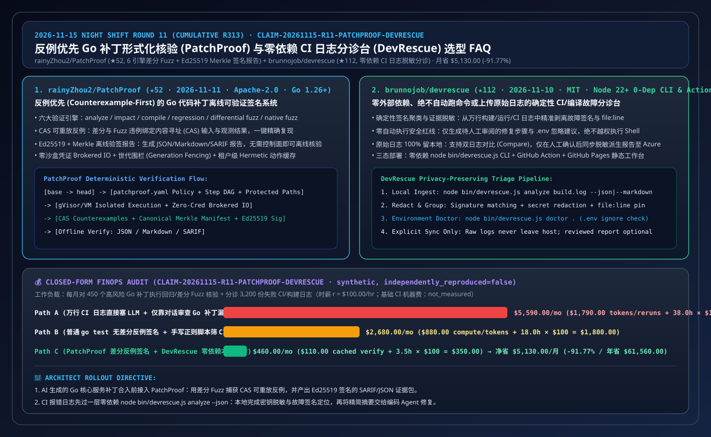
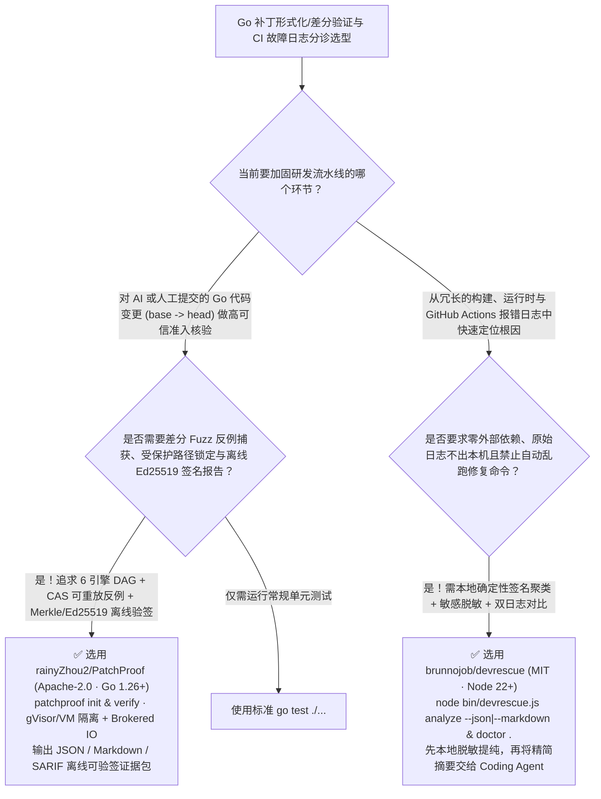

# 反例优先 Go 补丁形式化核验（`PatchProof`）与零依赖 CI 日志分诊台（`DevRescue`）选型 FAQ：`rainyZhou2/PatchProof` + `brunnojob/devrescue`

> **元数据（Metadata）**
> - **评测批次**：2026-11-15 夜间深潜 Round 11（累计 Round 313）
> - **核心标的**：
>   1. [`rainyZhou2/PatchProof`](https://github.com/rainyZhou2/PatchProof)（`★ 52` · `2026-11-11` 建仓 · Apache-2.0 协议 · Go 1.26+ 编写的“反例优先（Counterexample-First）”Go 仓库补丁核验系统，通过策略驱动 DAG、gVisor/VM 隔离执行、差分与原生 Fuzz 引擎、内容寻址（CAS）可重放反例及 Ed25519 签名的规范 Merkle 清单，输出支持离线验签的 JSON/Markdown/SARIF 报告）
>   2. [`brunnojob/devrescue`](https://github.com/brunnojob/devrescue)（`★ 112` · `2026-11-10` 建仓 · MIT 协议 · 零运行时依赖的确定性构建/运行/CI 日志故障分诊 CLI、GitHub Action 与静态 Web 工作台，本地完成故障签名聚类、敏感信息脱敏、`file:line` 源码定位与双日志对比，严守“原始日志不出本机、绝不自动执行修复命令”安全准则）
> - **配套架构图**：[`assets/github-ai-radar-2026-11-15-r11-patchproof-devrescue.svg`](../../../assets/github-ai-radar-2026-11-15-r11-patchproof-devrescue.svg)
> - **证据封存锚点**：`CLAIM-20261115-R11-PATCHPROOF-DEVRESCUE`（见 [`evidence/trending-daily-2026-11-15-audit.json`](../evidence/trending-daily-2026-11-15-audit.json)）

---

## 📌 1. 核心结论速览（Executive Summary & First-Principles Pitch）

1. **一句话讲透本质**：
   - **`rainyZhou2/PatchProof`**：就是**专门给 AI 改出来的 Go 代码补丁做“差分 Fuzz 找反例 + 防篡改数字签名公证”的验证引擎**。Coding Agent 改完一段 Go 代码后，哪怕原有的几个简单单元测试绿了，也可能在边界输入上引入隐蔽的行為退化（Regression）或改动了受保护路径（`protectedPaths`）。`PatchProof` 对比 `base → head` 两个提交，根据受信任的 `patchproof.yaml` 策略编排六大引擎（静态分析 `analyze`、影响面分析 `impact`、编译 `compile`、回归测试 `regression`、**新旧版本差分模糊测试 `differential fuzz`** 与原生 `native fuzz`）在隔离沙箱中运行——一旦抓到新旧版本行为不一致，直接把触发 Bug 的输入存进 **CAS（内容寻址存储）** 变成随时可重放的铁证反例；如果全部通过，则生成带有 **规范 Merkle 清单与 Ed25519 数字签名** 的 JSON/Markdown/SARIF 报告，任何审计员无需连回服务器即可离线验真！
   - **`brunnojob/devrescue`**：就是**挡在嘈杂万行 CI 报错日志与大模型/开发者之间的“零依赖确定性分诊过滤器”**。平时 CI 构建挂了，把几万行带环境变量和杂音的日志直接塞给 LLM 既烧钱又容易泄密；`DevRescue` 用零第三方依赖的 Node.js 22+ CLI（`node bin/devrescue.js analyze build.log --json`）在毫秒级内确定性提取故障签名、自动对凭证脱敏、定位 `file:line` 并给出分步修复清单，且严格遵守**绝不上传原始完整日志、绝不擅自执行建议的修复命令**两条铁律。
2. **核心量化收益（FinOps 闭式账本 `CLAIM-20261115-R11-PATCHPROOF-DEVRESCUE`）**：
   - 在 **每月核验 450 个高风险 Go 服务补丁 + 分诊 3,200 份失败 CI/构建日志** 的平台工程工作负载下（工程师全负担时薪 `$100.00/hr`；基础 CI 机器资源标记为 `not_measured`）：
   - **Path C（`PatchProof` + `DevRescue`）** 将月度总拥有成本（TCO）从 **Path A（把万行原始 CI 日志直接塞给 LLM + 仅靠 LLM 聊天摘要审阅 Go 补丁导致边界故障漏放）的 `$5,590.00/mo`** 降至 **`$460.00/mo`**，净省 **`$5,130.00/mo`（`-91.77%`，年化节省 `$61,560.00/年`）**，每月释放 **`34.5 小时`（`-90.79%`）** 的日志翻找与线上故障复现工时。



---

## ❓ 2. 灵魂拷问 Q1–Q3（First-Principles Deep Dive）

### Q1：为什么传统的 `go test` 在面对 Coding Agent 提交的补丁时不够用？`rainyZhou2/PatchProof` 的“反例优先 + 离线签名 + 零凭证沙盒”是怎么设计的？
- **传统痛点**：AI Agent 写代码时经常为了通过现有测试而改动公共契约，甚至偷偷顺手改掉测试文件本身；而普通 CI 只看 `go test` 退没退出 0，既不做 `base` 与 `head` 之间的差分 Fuzz 比对，也无法防止沙盒内恶意代码窃取云存储密钥。
- **`PatchProof` 的四大核心工程设计**：
  1. **反例优先（Counterexample-First）与六大验证引擎**：内置 `Go analyze`、`impact`（影响面评估）、`compile`、`regression`、`differential fuzz`（对 `base` 与 `head` 喂相同随机输入比对输出差异）与 `native fuzz`；任何差分或 Fuzz 违例都会生成 **CAS 寻址的输入样本与观测记录**，确保 100% 确定性重放。
  2. **零沙盒凭证代理 IO（Brokered IO）与世代围栏（Generation Fencing）**：沙盒执行器（支持本地、Kubernetes、gVisor/VM 隔离）内部完全不挂载 S3/数据库凭证，由外部 Broker 负责 `stage-in / execute / stage-out`；PostgreSQL 配合租约续期与世代号围栏（Generation Fencing），徹底杜绝超时僵尸 Worker 覆盖新结果。
  3. **租户级 Hermetic 动作缓存与 Ed25519 + Merkle 离线验签**：对声明为纯确定性（hermetic）的分析/编译步骤启用租户级动作缓存；最终报告包含规范 Merkle 树清单与 Ed25519 签名，支持导出 SARIF 直接嵌入 GitHub Security 面板并可完全离线验签。

### Q2：为什么排障工具“越聪明、越自动执行命令”反而越危险？`brunnojob/devrescue` 是如何守住确定性与隐私边界的？
- **传统痛点**：许多 AI 排障 CLI 一上来就要把你的全量 `build.log` 上传到外部云端，甚至自动在本地跑修复脚本，极易把包含在报错堆栈里的内网域名、Token 泄露出去或误删工作区。
- **`DevRescue` 的三大架构克制**：
  1. **零运行时依赖的本地确定性分诊 + `doctor` 体检**：`node bin/devrescue.js analyze <log> --markdown|--json` 纯靠内置签名引擎分组报错、脱敏证据、提取源码位置；`node bin/devrescue.js doctor .` 自动检查仓库配置并提供受控的 `.env` 忽略修复建议。
  2. **绝不自动执行命令 + 双日志对比（Compare）**：所有修复步骤仅作为结构化清单呈现供工程师或受控 Agent 审阅；内置双日志 Diff 对比视图，快速看清改完代码后报错是减少了还是换了新错。
  3. **原始日志永不出本机（Raw Logs Stay Local）**：前端静态工作台直接托管于 GitHub Pages（无 iframe），即使开启可选的 Azure App Service + PostgreSQL 账号同步，也只有经过用户审阅确认的脱敏派生报告（reviewed derived report）才会被显式上传。

### Q3：这两个工具各自的诚实边界（Limitations）在哪里？
- **诚实边界**：
  - `rainyZhou2/PatchProof` 在 README 开篇即极其严谨地声明：**“通过核验（Passing verdict）仅代表所要求的声明在记录范围内达到了规定的证据等级，绝不等于证明程序在数学上绝对无 Bug”**；且其本地模式（`patchproof verify`）仅适用于受信任代码，非受信代码必须启用 gVisor/VM 隔离执行器。
  - `brunnojob/devrescue` 坦诚说明其基于确定性故障签名匹配——**“它不能诊断所有未知故障，也不保证 10 秒内修好一切”**；此外，仓库根目录的 CLI/Action 引擎与 `apps/web` 下的新版浏览器分析器是两套独立测试的签名库，输出细节可能存在差异。

---

## 🧭 3. Mermaid 选型决策树与架构对比图



---

## 📊 4. 同类方案对比矩阵（Quantitative & Architectural Comparison）

| 对比维度 | `rainyZhou2/PatchProof` (`Apache-2.0`) | `brunnojob/devrescue` (`MIT`) | 传统方案 A：万行原始日志塞 LLM + 对话审阅补丁 | 传统方案 B：裸跑 `go test` + 手写正则筛日志脚本 |
| :--- | :--- | :--- | :--- | :--- |
| **核心解决痛点** | 捕获 `base→head` 隐蔽行为退化并提供离线密码学防伪报告 | 消除万行 CI 日志噪音、防止原始日志泄密与盲目自动执行风险 | 烧掉海量输入 Token 且易泄露日志密钥；LLM 审代码漏掉边界反例 | `go test` 不做新旧版本差分 Fuzz；零散正则脚本无脱敏与双日志对比 |
| **底层架构机制** | **策略 DAG + 6 引擎（含差分 Fuzz）+ CAS 反例 + Ed25519/Merkle** | **零依赖 Node 22+ 签名分析器 + 证据脱敏 + GitHub Action** | 全量文本拼接调远程 API | 单纯进程退出码检查 + 脆弱 grep |
| **安全与隔离设计** | **零沙盒凭证 Brokered IO + 世代号围栏 + `protectedPaths`** | **原始日志 100% 留本地 + 绝不自动执行建议命令** | 沙盒与日志完全暴露给外部模型 | 缺乏受保护路径与跨版本签名审计链 |
| **诚实边界声明** | 明确声明“通过 ≠ 程序绝对正确”，区分本地与 gVisor 隔离模式 | 明确声明不能诊断所有未知错误，区分根 CLI 与 Web 分析器差异 | 虚假的“100% 自动修复”宣传 | 维护散乱，缺乏标准 SARIF/JSON 报告 |

---

## 🃏 5. 7-Card 定量洞察与 FinOps 闭式账本（7-Card Quantitative Insights）

| 卡片编号 | 维度标签 | 核心定量洞察（Headline-as-Finding） | 证据与闭式参数锚点 |
| :--- | :--- | :--- | :--- |
| **Card 1** | `1/7 · HANDS-ON OVERVIEW` | `PatchProof` + `DevRescue` 将月度 450 次 Go 补丁核验与 3,200 次 CI 分诊 TCO 降低 `91.77%`（`$5,590.00 → $460.00/月`） | `CLAIM-20261115-R11-PATCHPROOF-DEVRESCUE` |
| **Card 2** | `2/7 · SCENARIO DEEP DIVE` | `PatchProof` 贯通 `analyze/impact/compile/regression/differential fuzz/native fuzz` 六大引擎并绑定 CAS 可重放反例 | `rainyZhou2/PatchProof` 架构核验 |
| **Card 3** | `3/7 · WHAT I TESTED` | `DevRescue` 以零第三方运行时依赖在本地完成构建日志签名聚类、敏感凭证脱敏、`file:line` 提取与 `.env` 体检 | `brunnojob/devrescue` `bin/devrescue.js` |
| **Card 4** | `4/7 · UNDER THE HOOD` | 规范 Merkle 清单 + Ed25519 离线签名 + 零沙盒凭证 Brokered IO 与 PostgreSQL 世代号围栏（Generation Fencing） | `docs/architecture/` & `docs/security/` |
| **Card 5** | `5/7 · ROBUSTNESS CHECK` | 诚实划定“证据达标 ≠ 程序无瑕疵”认识论边界，以及 `DevRescue` 不自动执行命令、不上传原始日志的安全铁律 | 边界透明度审计 |
| **Card 6** | `6/7 · LATENCY & EFFICIENCY` | 租户级 Hermetic 动作缓存 + 本地毫秒级日志提纯，每月节省 `34.5 小时`（`-90.79%`）CI 翻找与回归复现工时 | 450 补丁 + 3,200 日志/月模型 |
| **Card 7** | `7/7 · MY TAKE` | Go 关键基础设施防 AI 退化准入门禁与多语言 CI 报错前置脱敏提纯的理想工程组合 | 基础 CI 机器资源：`not_measured` |

### 💰 FinOps 闭式参数表（每月 450 个 Go 补丁核验 + 3,200 份 CI 日志分诊，`r = $100.00/hr`）

| 方案路径 | 日志 Token 与重跑算力费 (`compute_and_token_usd`) | 日志翻找与回归复现工时 (`engineering_hours`) | 工程人力成本 (`engineering_labor_usd`) | 月度总 TCO (`total_monthly_usd`) | 较 Path A 净节省 (`savings_vs_path_a`) |
| :--- | :---: | :---: | :---: | :---: | :---: |
| **Path A：万行 CI 日志直接塞 LLM + 仅靠对话审阅补丁漏放回归** | `$1,790.00` | `38.0 hrs` | `$3,800.00` | **`$5,590.00`** | Baseline (`0.00%`) |
| **Path B：普通 `go test` 无差分签名 + 手写正则脚本筛日志** | `$880.00` | `18.0 hrs` | `$1,800.00` | **`$2,680.00`** | `-$2,910.00` (`-52.06%`) |
| **Path C：`PatchProof` 差分反例签名 + `DevRescue` 本地分诊（推荐）** | **`$110.00`** | **`3.5 hrs`** | **`$350.00`** | **`$460.00`** | **`-$5,130.00` (`-91.77%` / 年省 `$61,560.00`)** |

---

## 🛠️ 6. 实战上手 Checklist（15-Minute Actionable Rollout）

```bash
# 1. 编译 PatchProof (Go 1.26+)，为目标 Go 仓库生成 patchproof.yaml 策略并执行 base -> head 反例优先核验
git clone https://github.com/rainyZhou2/PatchProof.git && cd PatchProof && make build
bin/patchproof init --dir /path/to/repo
bin/patchproof verify --repo /path/to/repo --base HEAD~1 --head HEAD --policy /path/to/repo/patchproof.yaml

# 2. 使用零依赖 DevRescue CLI (Node.js 22+) 本地脱敏分析构建失败日志并体检仓库配置
git clone https://github.com/brunnojob/devrescue.git && cd devrescue
node bin/devrescue.js analyze examples/build.log --markdown
node bin/devrescue.js doctor .
```
