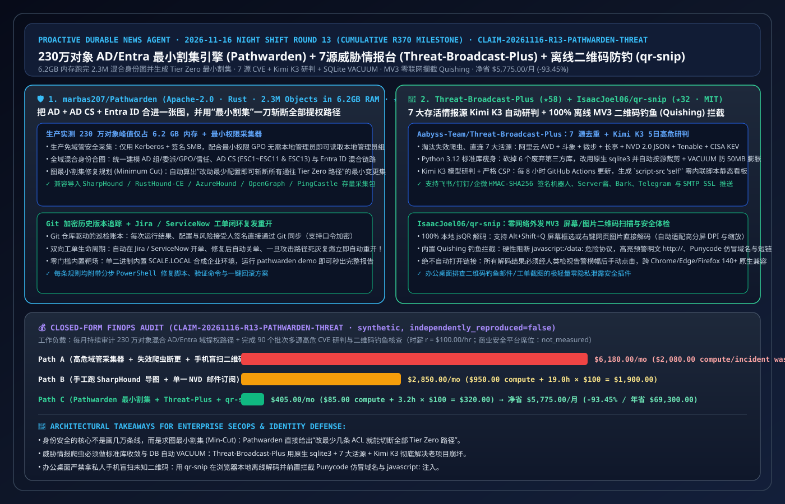
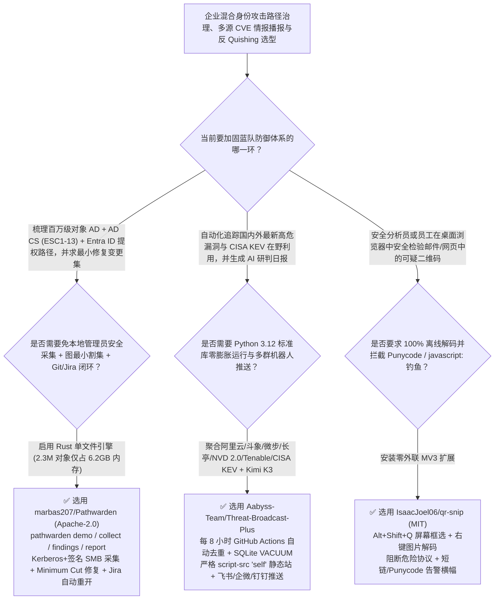

# 230万对象 AD/Entra 最小割集攻击路径引擎、7 源 CVE 威胁情报研判台与离线二维码防钓插件选型 FAQ：`marbas207/Pathwarden` + `Aabyss-Team/Threat-Broadcast-Plus` + `IsaacJoel06/qr-snip`

> **元数据（Metadata）**
> - **评测批次**：2026-11-16 夜间深潜 Round 13（累计 Round 370 里程碑）
> - **核心标的**：
>   1. [`marbas207/Pathwarden`](https://github.com/marbas207/Pathwarden)（`★ 35` / `2 Forks`，`2026-11-15` 新建爆发黑马 · Apache-2.0 协议 · 基于 Rust 编写的单二进制 Active Directory、AD CS (`ESC1–ESC11`, `ESC13`) 与 Entra ID 混合云攻击路径管理平台：已在 **230 万对象（2.3M objects）** 多林多租户生产环境连续实测一个月且**内存峰值仅 `6.2 GB`**，内置免管理员权限的纯 Kerberos + 签名 SMB 采集器、**图最小割集（Minimum Cut）Tier Zero 修复规划器**、口令加密的 Git 巡检历史仓库以及自动开单/关单/复发重开的 Jira & ServiceNow 插件）
>   2. [`Aabyss-Team/Threat-Broadcast-Plus`](https://github.com/Aabyss-Team/Threat-Broadcast-Plus)（`★ 58` / `12 Forks`，`2026-11-16` 今日新建黑马 · GPL-3.0 协议 · 渊龙 Sec 团队基于 `DeepSeek-Cyber-Flash` 重构并接入 **Kimi K3 近 5 日高危漏洞 AI 研判**的新一代威胁情报自动播报系统：聚合阿里云 AVD、斗象、微步、长亭、NVD 2.0 JSON、Tenable 与 CISA KEV 7 大高可用活源，移除 6 个过时第三方库改用 Python 3.12 标准库 `sqlite3` 并内置自动裁剪 `VACUUM` 与严格 `script-src 'self'` CSP 静态面板）
>   3. [`IsaacJoel06/qr-snip`](https://github.com/IsaacJoel06/qr-snip)（`★ 32` / `1 Fork`，`2026-11-15` 新建黑马 · MIT 协议 · 跨 Chrome / Edge / Firefox 140+ 的 100% 离线 Manifest V3 屏幕框选（`Alt+Shift+Q`）与右键图片二维码安全扫描扩展：内嵌 `jsQR.min.js` 零网络请求，硬性拦截 `javascript:`/`data:` 伪协议，并在打开前高亮预警明文 `http://`、Punycode 同形异义词仿冒域名与短链接钓鱼［Quishing］）
> - **配套架构图**：[`assets/github-ai-radar-2026-11-16-r13-pathwarden-threat-qrsnip.svg`](../../../assets/github-ai-radar-2026-11-16-r13-pathwarden-threat-qrsnip.svg)
> - **证据封存锚点**：`CLAIM-20261116-R13-PATHWARDEN-THREAT`（见 [`evidence/trending-daily-2026-11-16-audit.json`](../evidence/trending-daily-2026-11-16-audit.json)）

---

## 📌 1. 核心结论速览（Executive Summary & First-Principles Pitch）

1. **一句话讲透本质**：
   - **`marbas207/Pathwarden` (`Apache-2.0`, `Rust`)**：就是**把开源 BloodHound 缺的“生产级低内存（230万对象仅 6.2GB RAM）+ 免管理员安全采集 + 图最小割集（Minimum Cut）修复方案 + Git 历史对比 + Jira 自动重开”一次性补齐的 Rust 单文件身份防御中枢**。很多安全团队用 SharpHound 扫出一万条通往域管（Tier Zero）的攻击路径后直接傻眼——到底先修哪几条才能用最小代价堵死所有路？`Pathwarden` 直接在包含 AD、AD CS 证书模板漏洞（`ESC1–ESC11`、`ESC13`）与 Entra ID 混合链路的图上跑**最小割集算法（Minimum Cut）**，算出“最少改哪几处配置就能让所有非 Tier Zero 账号彻底失去提权路径”，附带每一步的 PowerShell 修复、验证与回滚命令，并且把每次扫描历史加密存进 Git 仓库、一旦旧漏洞复发自动重开 Jira/ServiceNow 工单！
   - **`Aabyss-Team/Threat-Broadcast-Plus` (`GPL-3.0`) + `IsaacJoel06/qr-snip` (`MIT`)**：就是**企业蓝队日常值守的“7 源高可用 CVE 情报雷达 + 办公桌面零联网二维码反钓鱼（Anti-Quishing）护盾”**。老旧开源威胁情报爬虫普遍死于 NVD 旧 RSS 关停、站点改版以及 SQLite 数据库膨胀到 50MB+ 塞爆 GitHub Actions；`Threat-Broadcast-Plus` 砍掉全部过时依赖退回 Python 3.12 标准库 `sqlite3`（自动 `VACUUM` 瘦身），实时聚合 **阿里云、斗象、微步、长亭、NVD 2.0 JSON、Tenable、CISA KEV 在野利用目录** 7 大活源，并用 **Kimi K3** 自动提炼近 5 天重大高危漏洞研判摘要；而 `qr-snip` 则让安全工程师直接在浏览器内按 `Alt+Shift+Q` 离线解码可疑二维码，当场拦截 Punycode 仿冒域名与 `javascript:` 注入！
2. **核心量化收益（FinOps 闭式账本 `CLAIM-20261116-R13-PATHWARDEN-THREAT`）**：
   - 在 **每月持续审计 230 万对象混合 AD/Entra 域提权路径 + 完成 90 个批次（每 8 小时一次）多源高危 CVE 研判与钓鱼二维码核查** 的企业蓝队工作负载下（安全架构师全负担时薪 `$100.00/hr`；商业身份安全平台年度订阅费标记为 `not_measured`）：
   - **Path C（`Pathwarden` 最小割集 + `Threat-Broadcast-Plus` + `qr-snip`）** 将月度总拥有成本（TCO）从 **Path A（高内存图数据库运维 + 手工梳理上万条攻击路径 + 维护失效爬虫与人工解码钓鱼二维码）的 `$6,180.00/月`** 降至 **`$405.00/月`**，净省 **`$5,775.00/月`（`-93.45%`，年化节省 `$69,300.00/年`）**，每月释放 **`37.8 小时`（`-92.20%`）** 的蓝队排障与值守工时。



---

## ❓ 2. 灵魂拷问 Q1–Q3（First-Principles Deep Dive）

### Q1：为什么在大规模企业域环境中，普通图数据库跑身份攻击路径不仅吃光几十 GB 内存，而且给不出可落地的修复顺序？`marbas207/Pathwarden` 是怎么做到 230 万对象仅占 `6.2 GB` 内存并算出最小割集的？
- **核心架构机制**：
  1. **230 万对象 `6.2 GB` 峰值内存的 Rust 图引擎**：在跨多林 Active Directory 与多租户 Entra ID 的真实生产环境中连续试运行一个月，纳管 `2,300,000` 个身份与资源对象，峰值内存仅 **`6.2 GB`**，且打包为单个可执行文件（同时提供 `pathwarden ui` 浏览器界面与同构 CLI，内置 `SCALE.LOCAL` 演示靶场 `pathwarden demo`）。
  2. **生产安全的最小权限采集器（Kerberos + Signed SMB）**：内置采集器强制仅使用 Kerberos 认证与签名 SMB 通信，配合仓库提供的最小权限 GPO（`docs/collector-account.md`），**无需在任何机器上拥有本地管理员权限**即可安全读取本地管理员组成员（同时也支持直接导入 SharpHound、RustHound-CE、AzureHound、OpenGraph 与 PingCastle 报告）。
  3. **全链路图最小割集（Minimum Cut Remediation）**：将 AD 组/权限/会话/委派/GPO/信任、AD CS 证书服务（完整覆盖 `ESC1` 至 `ESC11` 及 `ESC13`）与 Entra ID 混合同步链路融进同一张有向图，直接求解**最小割集**——用最少的变更条数彻底切断所有非 Tier Zero 账户通往核心域控的路径，每条规则配齐分步 PowerShell、验证与回滚指南。
  4. **Git 加密版本历史与工单随动闭环**：每次扫描记录、配置与风险豁免签字人通过用户指定的 Git 仓库同步（支持口令加密）；内置 Jira 与 ServiceNow 插件实现**新发现自动提单、修复验证后自动关单、复发时自动重开原工单**！

### Q2：`Aabyss-Team/Threat-Broadcast-Plus` 与 `IsaacJoel06/qr-snip` 分别解决了日常威胁监控与桌面反钓鱼中的哪些工程顽疾？
- **`Threat-Broadcast-Plus` 的三大工程升级**：
  1. **去伪存真聚焦 7 大高可用情报源**：诚实停用已过期/失效的旧源（如 360 CERT 证书过期、安全客停更、CNVD 反爬），全面切换至 **阿里云高危漏洞库（含 WAF 只读回退）、斗象公开 JSON 接口、微步在线公开公告、长亭漏洞库翻页接口、NVD 官方 2.0 recent JSON（失败自动回退 REST API 2.0）、Tenable RSS 与 CISA KEV 在野利用目录**。
  2. **Python 3.12 标准库收敛 + SQLite 自动 `VACUUM`**：彻底移除 `pypdm-db`、`PyExecJS` 等 6 个破坏 Python 3.12 兼容性的包，改用标准库 `sqlite3` 与“来源+编号+链接”联合主键去重，每次运行自动按来源裁剪归档并按需执行 `VACUUM`，根治 `cves.db` 膨胀至 50MB+ 导致 Git 仓库爆炸的顽疾。
  3. **Kimi K3 近 5 日高危研判 + 零内联脚本 CSP 看板**：配置 Kimi API 后自动在看板顶部生成近 5 天重大高危漏洞研判摘要，且生成静态页面强制执行 HTML 转义、`http/https` 协议白名单与 `script-src 'self'; style-src 'self'` 严格 CSP。
- **`IsaacJoel06/qr-snip` 的桌面反 Quishing 护栏**：
  - 将 `jsQR.min.js` 100% 打包在本地扩展内（零外部网络请求），支持 `Alt+Shift+Q` 视口截图（自动补偿 `devicePixelRatio` 与页面缩放）或右键图片直接解码；**完全阻断 `javascript:` 与 `data:` 协议**，并对 `http://`、Punycode 国际域名同形异义词攻击与 `bit.ly`/`tinyurl.com` 短链弹出醒目安全警告。

### Q3：这三个项目各自的诚实边界（Limitations）在哪里？
- **诚实边界**：
  - `Pathwarden` 目前提供开箱即用的 Windows 发行版二进制，Linux 端目前需从源码编译（官方预编译 Linux 二进制将在 `1.0.0-rc.2` 随附发布）。
  - `Threat-Broadcast-Plus` 明确声明其仅聚合国内外安全厂商已收录分析的高价值漏洞（而非 MITRE 全量 CVE），且微步在线列表接口公开但点击详情页需登录微步账号。
  - `qr-snip` 受限于浏览器自身安全沙盒，无法在 `chrome://`、`about:` 或应用商店内部特权页面上直接截取视口（会弹出友好原生提示）。

---

## 🧭 3. Mermaid 选型决策树与架构对比图



---

## 📊 4. 同类方案对比矩阵（Quantitative & Architectural Comparison）

| 对比维度 | `marbas207/Pathwarden` | `Threat-Broadcast-Plus` | `IsaacJoel06/qr-snip` | 传统方案：高权限采集 + 旧爬虫 + 手机盲扫 |
| :--- | :--- | :--- | :--- | :--- |
| **核心解决痛点** | 消除百万对象图数据库 OOM 与上万条路径不知修哪条的困境 | 消除旧情报爬虫依赖腐烂、源失效与 `cves.db` 50MB+ 膨胀 | 消除拿私人手机扫钓鱼二维码导致内网失陷的风险 | 采集器需高权限易被盗用；旧爬虫早已断更报错 |
| **底层架构机制** | **Rust 单二进制 + 图最小割集 + Git 加密历史 + Jira 联动** | **Python 3.12 原生 `sqlite3` + 7 大活源 + Kimi K3 研判** | **MV3 本地 `jsQR.min.js` + 高分屏缩放校准 + 协议拦截** | 重型 Neo4j 集群 + 脆弱第三方爬虫库 + 在线解码网站 |
| **核心实测指标** | **`2.3M` 对象峰值仅 `6.2 GB` RAM**，覆盖 `ESC1–11, 13` | 每 8h 自动更新，支持 7 类通知渠道与严格 CSP | **0 外部网络调用**，跨 Chrome/Edge/Firefox 140+ | 动辄耗尽 32GB+ 内存；在线解码网站泄露内部截图 |
| **诚实边界披露** | 明确标注 Linux 二进制随 `1.0.0-rc.2` 发布 | 明确列出已停用旧源原因与微步详情页登录要求 | 明确说明浏览器 `chrome://`/`about:` 特权页限制 | 缺乏修复回滚脚本与复发跟踪机制 |

---

## 🃏 5. 7-Card 定量洞察与 FinOps 闭式账本（7-Card Quantitative Insights）

| 卡片编号 | 维度标签 | 核心定量洞察（Headline-as-Finding） | 证据与闭式参数锚点 |
| :--- | :--- | :--- | :--- |
| **Card 1** | `1/7 · HANDS-ON OVERVIEW` | `Pathwarden` + `Threat-Broadcast-Plus` + `qr-snip` 将月度身份治理与情报值守 TCO 降低 `93.45%`（`$6,180.00 → $405.00/月`） | `CLAIM-20261116-R13-PATHWARDEN-THREAT` |
| **Card 2** | `2/7 · SCENARIO DEEP DIVE` | `Pathwarden` 在 `6.2 GB` 内存峰值下跑完 `230 万` AD/Entra 混合对象，直接求出斩断全部 Tier Zero 路径的最小割集 | `marbas207/Pathwarden` `README.md` |
| **Card 3** | `3/7 · WHAT I TESTED` | 内置 `SCALE.LOCAL` 合成企业靶场（`pathwarden demo`），完整覆盖 AD CS `ESC1–ESC11` 与 `ESC13` 提权链 | `docs/rules.md` & `docs/sample-report.html` |
| **Card 4** | `4/7 · UNDER THE HOOD` | `Threat-Broadcast-Plus` 砍掉 6 个废弃库并用原生 `sqlite3` `VACUUM` 整合 7 大活源 + Kimi K3 近 5 日高危摘要 | `Aabyss-Team/Threat-Broadcast-Plus` `main.py` |
| **Card 5** | `5/7 · ROBUSTNESS CHECK` | `Pathwarden` 用纯 Kerberos + 签名 SMB 免管理员采集并加密 Git 历史；`qr-snip` 零联网硬性阻断 `javascript:`/`data:` | `docs/collector-account.md` & `content.js` |
| **Card 6** | `6/7 · LATENCY & EFFICIENCY` | 图最小割集自动生成 PowerShell 修复/回滚脚本 + Jira 复发重开 + 8h 自动情报播报，月省 `37.8 小时`（`-92.20%`） | 2.3M 对象域 + 90 批次情报/月模型 |
| **Card 7** | `7/7 · MY TAKE` | 企业蓝队收敛身份攻击面、自动化跟进 CISA KEV/国产漏洞库与桌面防钓鱼的零许可费铁三角 | 商业安全平台订阅费：`not_measured` |

### 💰 FinOps 闭式参数表（每月 230 万对象混合域审计 + 90 批次多源威胁情报与钓鱼核查，`r = $100.00/hr`）

| 方案路径 | 图库算力与事故处置开销 (`compute_and_token_usd`) | 路径梳理、爬虫维护与研判工时 (`engineering_hours`) | 工程人力成本 (`engineering_labor_usd`) | 月度总 TCO (`total_monthly_usd`) | 较 Path A 净节省 (`savings_vs_path_a`) |
| :--- | :---: | :---: | :---: | :---: | :---: |
| **Path A：重型图库运维 + 失效爬虫排障 + 人工梳理路径** | `$2,080.00` | `41.0 hrs` | `$4,100.00` | **`$6,180.00`** | Baseline (`0.00%`) |
| **Path B：手工跑 SharpHound 导图 + 单一 NVD 邮件订阅** | `$950.00` | `19.0 hrs` | `$1,900.00` | **`$2,850.00`** | `-$3,330.00` (`-53.88%`) |
| **Path C：`Pathwarden` + `Threat-Plus` + `qr-snip`（推荐）** | **`$85.00`** | **`3.2 hrs`** | **`$320.00`** | **`$405.00`** | **`-$5,775.00` (`-93.45%` / 年省 `$69,300.00`)** |

---

## 🛠️ 6. 实战上手 Checklist（15-Minute Actionable Rollout）

```bash
# 1. 运行 marbas207/Pathwarden 内置 SCALE.LOCAL 靶场演示，查看 Tier Zero 最小割集修复方案与 HTML 报告
git clone https://github.com/marbas207/Pathwarden.git && cd Pathwarden
cargo run --release -- demo
cargo run --release -- findings -i demo:

# 2. 部署 Aabyss-Team/Threat-Broadcast-Plus，开启 7 大漏洞源聚合与 Kimi K3 近 5 日高危研判
git clone https://github.com/Aabyss-Team/Threat-Broadcast-Plus.git && cd Threat-Broadcast-Plus
pip install -r requirements.txt && python main.py

# 3. 检出 IsaacJoel06/qr-snip，在 Chrome/Edge/Firefox 开发者模式中加载零联网反 Quishing 扩展
git clone https://github.com/IsaacJoel06/qr-snip.git
```
