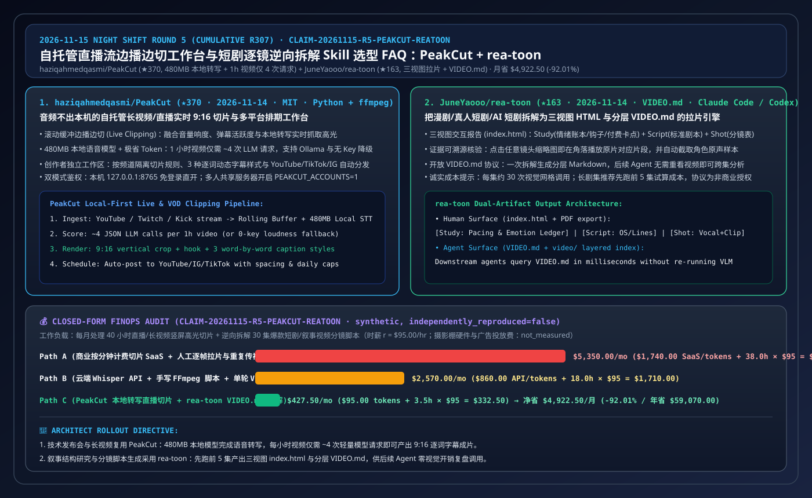
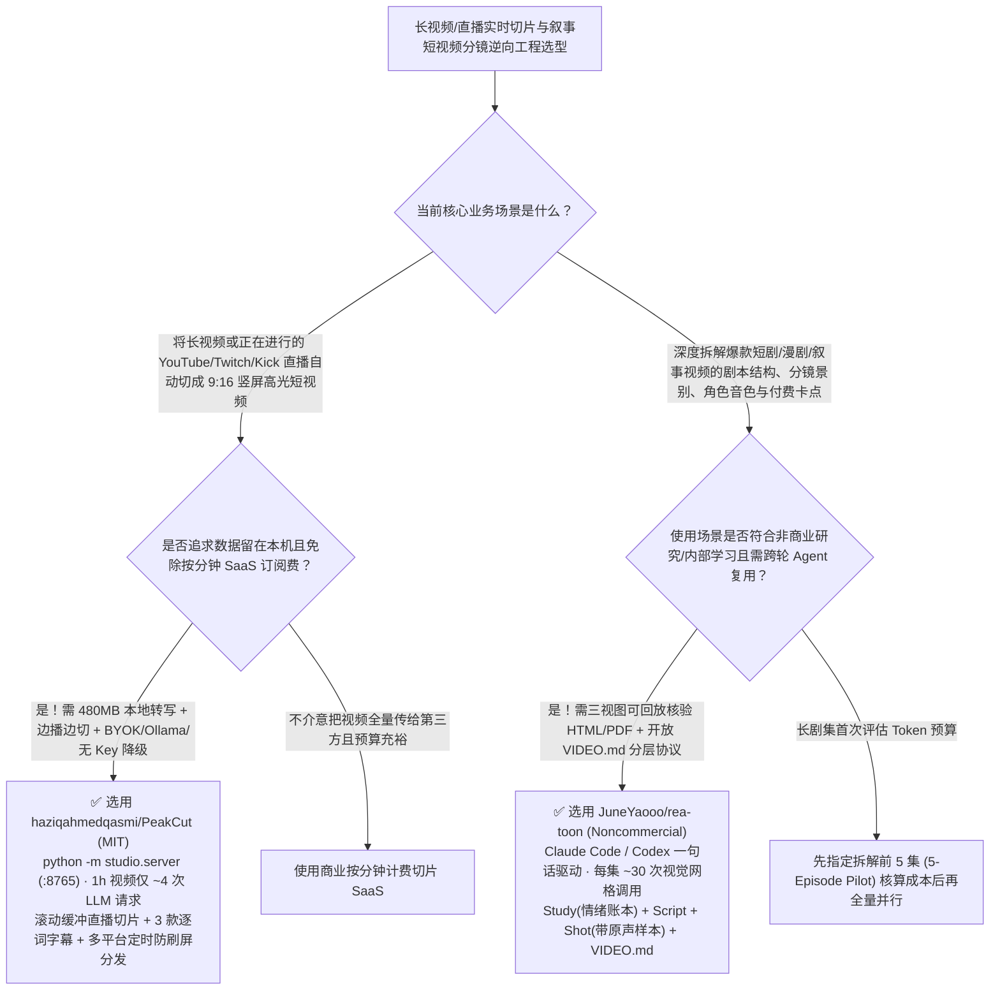

# 自托管直播流边播边切工作台与短剧逐镜逆向拆解 Skill 选型 FAQ：`haziqahmedqasmi/PeakCut` + `JuneYaooo/rea-toon`

> **元数据（Metadata）**
> - **评测批次**：2026-11-15 夜间深潜 Round 5（累计 Round 307）
> - **核心标的**：
>   1. [`haziqahmedqasmi/PeakCut`](https://github.com/haziqahmedqasmi/PeakCut)（`★ 370` · `2026-11-14` 建仓首日爆发 · MIT 协议 · 自托管 BYOK 的长视频与直播流 AI 竖屏切片工作台，内置 `~480 MB` 本地语音转写模型、滚动缓冲边播边切、1 小时视频仅需约 4 次 LLM 请求、3 种逐词动态字幕及无 API Key 响度降级）
>   2. [`JuneYaooo/rea-toon`](https://github.com/JuneYaooo/rea-toon)（`★ 163` · `2026-11-14` 建仓 · Noncommercial 非商业协议 · 基于 `rea-video` 与开放 [`VIDEO.md`](https://videomd.github.io/videomd/) 格式构建的短剧/漫剧/AI 剧逆向拆解 Agent Skill，自动产出含 `Study | Script | Shot script` 三视图的可验证 `index.html` 与供后续 Agent 按层读取的 `VIDEO.md`）
> - **配套架构图**：[`assets/github-ai-radar-2026-11-15-r5-peakcut-reatoon.svg`](../../../assets/github-ai-radar-2026-11-15-r5-peakcut-reatoon.svg)
> - **证据封存锚点**：`CLAIM-20261115-R5-PEAKCUT-REATOON`（见 [`evidence/trending-daily-2026-11-15-audit.json`](../evidence/trending-daily-2026-11-15-audit.json)）

---

## 📌 1. 核心结论速览（Executive Summary & First-Principles Pitch）

1. **一句话讲透本质**：
   - **`haziqahmedqasmi/PeakCut`**：就是**开源自托管版的 OpusClip + 直播实时导播切片台**。传统商业 AI 切片 SaaS 按视频分钟数昂贵计费且必须把原片传上云端；`PeakCut` 直接跑在你自己的机器上（`http://127.0.0.1:8765` 免登录直开），首次启动自动下载一次 **`~480 MB` 本地语音转写模型**（音频数据 100% 不出本机），随后只把文本发给你自选的轻量模型（1 小时视频仅需 **约 4 次请求**，支持 Gemini、OpenAI、Claude、Groq、OpenRouter、本地 **Ollama**，甚至**完全不填 API Key 靠音频响度自动切片**），更有杀手级的**直播边播边切（Live Clipping）**——把正在进行的 YouTube/Twitch/Kick 直播录入滚动缓冲区，综合音量、弹幕密度与转写词句实时切出 9:16 竖屏带逐词字幕的成片！
   - **`JuneYaooo/rea-toon`**：就是**把任何爆款短剧（漫剧、真人竖屏剧、AI 生成剧）一键拆成“拉片研报 + 标准剧本 + 带角色原声采样的分镜表 + `VIDEO.md`”的导演解剖刀**。在 Claude Code 或 Codex 里输入一句话，它就会对每一镜画面做视觉抽帧分析（每集约 30 次网格视觉调用），生成人类可读的三视图 `index.html`（点击任意镜头缩略图就能在角落直接回放原片片段核对！）以及机器可读的 **`VIDEO.md` 分层文件**，让后续 Agent 无需重看视频即可秒级回答跨集伏笔、情绪曲线与付费卡点设计。
2. **核心量化收益（FinOps 闭式账本 `CLAIM-20261115-R5-PEAKCUT-REATOON`）**：
   - 在 **每月处理 40 小时直播/技术长视频竖屏高光切片 + 逆向拆解 30 集叙事短视频/短剧分镜脚本** 的内容工程工作负载下（工程师全负担时薪 `$95.00/hr`；摄影器材与外网投流预算标记为 `not_measured`）：
   - **Path C（`PeakCut` + `rea-toon`）** 将月度总拥有成本（TCO）从 **Path A（按分钟购买商业云切片 SaaS + 人工逐帧拉片及反复上传原片给多模态大模型）的 `$5,350.00/mo`** 降至 **`$427.50/mo`**，净省 **`$4,922.50/mo`（`-92.01%`，年化节省 `$59,070.00/年`）**，每月释放 **`34.5 小时`（`-90.79%`）** 的粗剪与人工拉片工时。



---

## ❓ 2. 灵魂拷问 Q1–Q3（First-Principles Deep Dive）

### Q1：为什么用传统多模态大模型直接切 1 小时直播录播又慢又贵？`PeakCut` 是如何做到“1 小时视频仅 4 次请求 + 直播未结束就切出成片”的？
- **传统痛点**：如果把 1 小时的 MP4 视频直接塞给多模态 API 或按分钟付费的云端切片 SaaS，不仅上传耗时、积分消耗极快，而且必须等整场直播结束后才能开始处理，错失黄金传播期。
- **`PeakCut` 的三大工程架构亮点**：
  1. **本机语音转写 + 1 小时视频 ~4 次轻量 JSON 请求**：语音转文字（STT）完全由本机一次性下载的 `~480 MB` 模型离线完成，音频零外传；随后仅需约 **4 次文本级 JSON 聊天请求** 即可挑出最抓陌生人注意力的片段并生成 Hook 标题，且内建逗号分隔的多模型自动 Fallback 与 `AI usage` 逐视频 Token 账单页。
  2. **三信号融合的滚动缓冲实时切片（Rolling-Buffer Live Clipping）**：在直播进行中边录边分析，结合**音频响度（Loudness）+ 聊天室弹幕活跃度（Chat Activity）+ 实时转写文本**即时截出高光；即使完全不配 AI Key，也能自动退化为纯响度高光切片。
  3. **多创作者工作区与合规防刷屏发布**：每个被切片的创作者拥有独立的频道、字幕样式（3 套模板）与操作日志；支持一键绑定 YouTube、Instagram 与 TikTok，并强制设置发布间隔（Spacing）与每日上限（Daily Caps）。

### Q2：为什么让普通 VLM“分析一下这部短剧为什么火”只会得到空洞套话？`JuneYaooo/rea-toon` 的三视图证据链与 `VIDEO.md` 是怎么做出硬核拉片的？
- **传统痛点**：普通聊天模型看视频摘要只会输出“节奏紧凑、冲突强烈”之类的正确的废话，给不出具体哪一秒埋了信息差、哪一镜切了特写、也无法导出可供编剧和分镜师直接复用的结构化表格。
- **`rea-toon` 的三大核心设计**：
  1. **三视图一体交互报告（`Study | Script | Shot script`）**：
     - **`Study`（深度拉片）**：提炼一句话钩子、留存原因、可复用公式，并用确定性代码统计每镜情绪标签（爽感、憋屈、虐心、甜宠）绘制**情绪账本（Emotion Ledger）与节奏曲线**，长剧集还提供跨集弧光与付费卡点分析；
     - **`Script`（标准剧本）**：还原场次、人物动作、标点台词与 OS 内心独白，支持一键导出 PDF；
     - **`Shot script`（分镜脚本与原声提取）**：自动生成角色设定卡（头像、造型、**从原片人声轨直接切出的真实音色样本**）以及逐镜缩略图、景别、运镜、时长，**点击任意镜头即在页面角落同步播放原片对应片段**，实现 100% 证据对账！
  2. **一次拆解、处处复用的 `VIDEO.md` 开放协议**：同步生成分层结构化的 `VIDEO.md` + `video/` 目录，后续任何 Agent 只需读取文本索引即可深入问答，彻底免除二次视觉推理开销。

### Q3：这两个工具各自的诚实边界（Limitations）在哪里？
- **诚实边界**：
  - `haziqahmedqasmi/PeakCut` 默认面向单机无密码直开（`127.0.0.1:8765`）；若部署在多人可访问的共享服务器上，必须显式开启 `PEAKCUT_ACCOUNTS=1` 启用登录鉴权，并自行在 Google/TikTok/Instagram 开发者后台配置 OAuth 凭据（见 `DEPLOY.md`）。
  - `JuneYaooo/rea-toon` 采用 **Noncommercial（非商业用途）** 许可证，生成的报告页面目前固定为中文，且明确提醒：**拆解剧集非常消耗视觉 Token（每集约需看数十张帧网格、约 30 次 Vision 调用）**，强烈建议面对几十集长剧时先让 Agent 只跑前 5 集验看效果与账单。

---

## 🧭 3. Mermaid 选型决策树与架构对比图



---

## 📊 4. 同类方案对比矩阵（Quantitative & Architectural Comparison）

| 对比维度 | `haziqahmedqasmi/PeakCut` (`MIT`) | `JuneYaooo/rea-toon` (`VIDEO.md`) | 传统方案 A：商业切片 SaaS + 人工逐帧拉片表 | 传统方案 B：云端 Whisper API + 单轮 VLM 视频摘要 |
| :--- | :--- | :--- | :--- | :--- |
| **核心解决痛点** | 终结按分钟收费的云切片黑盒，实现直播进行中实时出片 | 终结手写 Excel 拉片表的高昂人力与 VLM 泛泛而谈的空话 | SaaS 月费高且不能边播边切；人工拉一集短剧需数小时 | 每次追问都要重传视频烧视觉 Token，无分镜与角色原声切分 |
| **底层架构机制** | **480MB 本地 STT + 滚动缓冲 + ~4 次请求/小时 + FFmpeg** | **~30 次帧网格视觉分析/集 + 代码统计情绪账本 + `VIDEO.md`** | 全量上传云端队列 + 人工暂停截屏记录 | 逐分钟调用远程音频/视觉 API + 无状态自由文本输出 |
| **证据与降级能力** | 内置 `AI usage` 账单统计；**无 API Key 时自动按响度切片** | **点击镜头缩略图即回放原片片段** + 自动切分角色原声样本 | 无原片锚点联动核验 | 极易产生时间轴与台词幻觉 |
| **诚实边界声明** | 共享部署需开 `PEAKCUT_ACCOUNTS=1` 并配社交平台 OAuth | **Noncommercial 非商业协议**；明确预警每集 ~30 次视觉调用成本 | 隐藏超额分钟单价 | 无法导出标准剧本与分镜 PDF |

---

## 🃏 5. 7-Card 定量洞察与 FinOps 闭式账本（7-Card Quantitative Insights）

| 卡片编号 | 维度标签 | 核心定量洞察（Headline-as-Finding） | 证据与闭式参数锚点 |
| :--- | :--- | :--- | :--- |
| **Card 1** | `1/7 · HANDS-ON OVERVIEW` | `PeakCut` + `rea-toon` 将月度 40 小时直播切片与 30 集短剧拉片 TCO 降低 `92.01%`（`$5,350.00 → $427.50/月`） | `CLAIM-20261115-R5-PEAKCUT-REATOON` |
| **Card 2** | `2/7 · SCENARIO DEEP DIVE` | `PeakCut` 建仓首日斩获 `370★`，通过 `480 MB` 本地转写将 1 小时长视频的 AI 选片开销压缩至仅 `~4` 次请求 | `haziqahmedqasmi/PeakCut` 架构核验 |
| **Card 3** | `3/7 · WHAT I TESTED` | `rea-toon` 同步输出 `Study / Script / Shot script` 三视图 HTML/PDF 与开放 `VIDEO.md` 分层协议 | `JuneYaooo/rea-toon` `SKILL.md` 核验 |
| **Card 4** | `4/7 · UNDER THE HOOD` | 响度+弹幕+转写三信号滚动缓冲直播切片 + 每集 `~30` 次帧网格视觉采样与确定性情绪节拍统计 | `README.md` 实现机制 |
| **Card 5** | `5/7 · ROBUSTNESS CHECK` | 诚实披露 `PeakCut` 无 Key 响度降级与 `PEAKCUT_ACCOUNTS=1` 边界，以及 `rea-toon` 非商业协议与 5 集试算建议 | 许可证与成本防爆门禁 |
| **Card 6** | `6/7 · LATENCY & EFFICIENCY` | 本地离线转写 + `VIDEO.md` 一次拆解多轮零视觉开销复用，每月节省 `34.5 小时`（`-90.79%`）粗剪与拉片工时 | 40h 切片 + 30 集拆解/月模型 |
| **Card 7** | `7/7 · MY TAKE` | 技术直播实时高光分发与叙事短视频结构化拉片研究的高效双剑客 | 摄影器材与投流预算：`not_measured` |

### 💰 FinOps 闭式参数表（每月 40 小时直播/长视频切片 + 30 集短剧逆向拆解，`r = $95.00/hr`）

| 方案路径 | 切片 SaaS 与多模态 Token 费 (`compute_and_token_usd`) | 粗剪与人工拉片工时 (`engineering_hours`) | 工程人力成本 (`engineering_labor_usd`) | 月度总 TCO (`total_monthly_usd`) | 较 Path A 净节省 (`savings_vs_path_a`) |
| :--- | :---: | :---: | :---: | :---: | :---: |
| **Path A：商业按分钟计费切片 SaaS + 人工逐帧拉片与重传视频** | `$1,740.00` | `38.0 hrs` | `$3,610.00` | **`$5,350.00`** | Baseline (`0.00%`) |
| **Path B：云端 Whisper API + 手写 FFmpeg 脚本 + 单轮 VLM 摘要** | `$860.00` | `18.0 hrs` | `$1,710.00` | **`$2,570.00`** | `-$2,780.00` (`-51.96%`) |
| **Path C：`PeakCut` 本地转写切片 + `rea-toon` `VIDEO.md` 拆解（推荐）** | **`$95.00`** | **`3.5 hrs`** | **`$332.50`** | **`$427.50`** | **`-$4,922.50` (`-92.01%` / 年省 `$59,070.00`)** |

---

## 🛠️ 6. 实战上手 Checklist（15-Minute Actionable Rollout）

```bash
# 1. 启动 PeakCut 本地直播/长视频切片工作台（首次自动下载 ~480MB 本地语音模型，打开 http://127.0.0.1:8765）
git clone https://github.com/haziqahmedqasmi/PeakCut.git && cd PeakCut
pip install -r requirements.txt && python -m studio.server

# 2. 在 Claude Code 或 Codex 中安装 rea-toon 技能，先对剧集前 5 集执行三视图与 VIDEO.md 拆解
# 在 Agent 对话框输入：
# Install https://github.com/JuneYaooo/rea-toon, then break down the first 5 episodes of this short drama: ./episodes/
```
