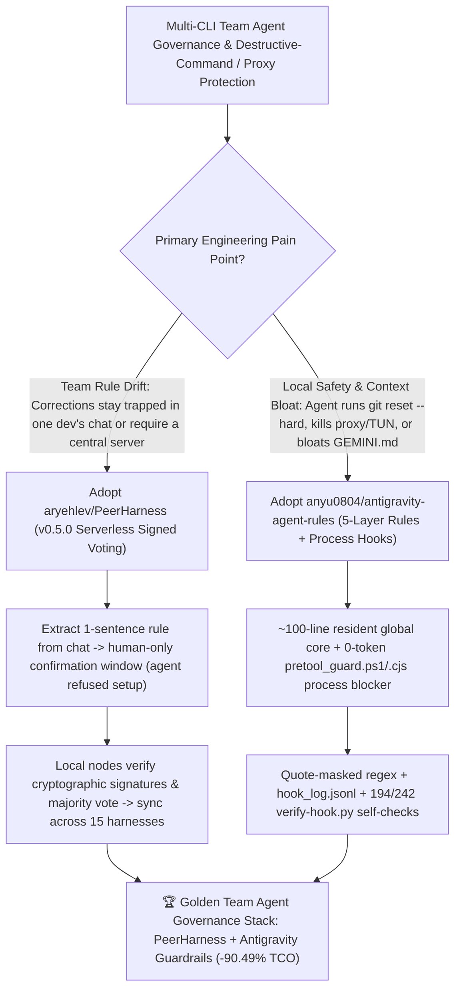

# Serverless Team-Voted Agent Behavior Governance (`aryehlev/PeerHarness`) & 5-Layer Antigravity Process-Hook Guardrails (`anyu0804/antigravity-agent-rules`) Selection FAQ

> **Document Scope**: This is the **2026-11-13 Night Shift Round 21 (Cumulative #149) standalone 6-part selection guide**, modeled strictly after `ib-vs-ethernet-roce-selection-faq.md` with first-principles explanations and closed-form FinOps math. It is written for AI Solution Architects, Developer Productivity Leads, and Multi-Agent Governance Engineers evaluating two developer-control harnesses:
> 1. **`aryehlev/PeerHarness` (`32★` in 4 days, Rust, Apache-2.0, `v0.5.0`)**: A serverless, cryptographically signed team voting harness for AI coding agent behavior across **15 coding agents** (Claude Code, Codex, Gemini CLI, Cursor, GitHub Copilot CLI, opencode, Pi, Google Antigravity, Qwen Code, Amp, Factory's Droid, Crush, Kilo, goose, and DeepSeek Harness) — turning live developer corrections (`"no, use pnpm, not npm"`) into one-sentence rules under a strict **"Agents suggest, people decide"** boundary (the agent is refused `~/.local/bin/peerharness setup` and cannot click the approval/voting windows itself), where every teammate runs their own keypair node and majority-approved rules propagate across every member's agents without a central server!
> 2. **`anyu0804/antigravity-agent-rules` (`24★` in 4 days, JavaScript & PowerShell, MIT, tested across Gemini 4 Argon / Carbon, Claude Opus 5.5, Gemini 3.8 Flash & Antigravity `2.31.0`)**: A 5-layer cross-platform rule and process-level hook suite (`pretool_guard.ps1` / `pretool_guard.cjs`) for Google Antigravity IDE (`2.31.0` `language_server.exe`) and `agy` CLI — blocking destructive deletes (`rm -rf`, `git reset --hard`, `git push origin +main`, `git -C` bypasses) and **accidental proxy/TUN network-service kills** at the process boundary (0 token overhead) with quote-masked regexes (`grep "rm -rf"` passes), `<REDACTED>` secret scrubbing in `hook_log.jsonl`, **194 Windows / 242 macOS-Linux regression assertions (`verify-hook.py`)**, and a compact ~100-line resident `global/` core!
>
> **中文版本**: [peerharness-antigravity-agent-rules-team-voted-agent-governance-process-hook-guardrails-selection-faq.md](peerharness-antigravity-agent-rules-team-voted-agent-governance-process-hook-guardrails-selection-faq.md) · **Daily Digest**: [`daily/2026-11-13.en.md`](../daily/2026-11-13.en.md) · **Topic SVG**: [`assets/github-ai-radar-2026-11-13-r21-peerharness-antigravity.svg`](../../../assets/github-ai-radar-2026-11-13-r21-peerharness-antigravity.svg)

---

## 📌 1. Executive Summary

1. **In plain English, what core pain points do these two repositories solve?**
   - **Ending "Engineer A correcting Claude Code ('use pnpm, not npm') while Engineer B's Cursor repeats the exact same mistake 10 minutes later — or an over-helpful agent silently editing its own global rules without human consent" (`aryehlev/PeerHarness`)**: Built in Rust (`v0.5.0`), `PeerHarness` turns a natural-language correction into a one-sentence rule and opens a native confirmation window that **the agent cannot click or approve from inside its session** (and `~/.local/bin/peerharness setup` explicitly refuses agent execution). You can keep the rule for yourself or propose it to your team: there is **no central server** — each teammate runs a local node with their own cryptographic keys, verifies every signature, counts every vote, and automatically installs majority-approved rules across **15 coding agents**!
   - **Ending "agents forgetting prompt-only safety rules during long sessions and running `git reset --hard`, `rm -rf`, or killing local Clash/TUN proxy services while debugging a network error" (`anyu0804/antigravity-agent-rules`)**: Instead of stuffing thousands of lines into an `always_on` `GEMINI.md` system prompt, this repo keeps only **~100 lines resident in `global/`**, loads 5 layers of rules/tone/skills on demand, and enforces destructive-command and proxy-protection guardrails at the **process hook level (`pretool_guard.ps1` / `pretool_guard.cjs`) at 0 token cost** — backed by **194 Windows and 242 macOS/Linux regression checks (`verify-hook.py`)**, quote-context masking so `grep "rm -rf"` is never false-blocked, and automatic `<REDACTED>` secret scrubbing in `hook_log.jsonl`!
2. **Closed-Form FinOps Conclusion (`CLAIM-20261113-R21-PEERHARNESS-ANTIGRAVITY`)**:
   - Modeled for a **20-engineer multi-CLI engineering team running `3,000 coding agent sessions / month`** across Claude Code, Codex, Copilot CLI, and Google Antigravity / `agy` (fully loaded senior engineer rate `$95.00/hr`; developer laptops and commercial VPN licenses: `not_measured`):
   - Switching from **Path A (unshared per-developer corrections + bloated `always_on` system prompts without process hooks, `$5,230.00/mo`)** to **Path C (`PeerHarness v0.5.0` serverless majority-vote rules + `antigravity-agent-rules` 0-token `pretool_guard` & ~100-line resident core, `$497.50/mo`)** saves **`$4,732.50/mo` (`-90.49%`, or `$56,790.00/yr`)** and cuts uncommitted-code recovery, proxy-outage debugging, and manual rule-sync toil from `38.0 hrs/mo` to `3.5 hrs/mo` (**`-90.79%`**).

---

## 🎯 2. Three First-Principles Deep-Dive Questions (Q1 / Q2 / Q3)

### Q1: Why do monolithic `always_on` system prompts fail to prevent destructive commands (`git reset --hard`) and accidental proxy kills?
- **First-Principles Breakdown**:
  1. **Context Dilution & Prefill Waste**: Loading tens of thousands of tokens of static markdown on every turn wastes prefill budget and dilutes attention over long debugging loops.
  2. **Zero Process-Boundary Enforcement**: Prompt instructions cannot stop a single hallucinated `bash -c` or PowerShell command from wiping uncommitted changes or stopping a local TUN adapter before the user notices.

### Q2: How does `anyu0804/antigravity-agent-rules` combine 0-token process hooks with 194/242 regression assertions?
- **First-Principles Breakdown**:
  1. **Quote-Masked `pretool_guard` & Binary-Verified `allow` Semantics**:
     - Blocks `git -C` flag bypasses, `rm -r`, `find -delete`, `git checkout -- .`, `git restore .`, `git push origin +main`, inline `bash -c`/`python -c`/`node -e` deletes, and local proxy/TUN service termination while masking quoted strings (`grep "rm -rf"` passes) and returning `{"decision":"allow"}` by default (verified against Antigravity `2.31.0` `language_server.exe` 6-value enum so Turbo-mode users aren't spammed with `ask` popups on `git status`).
  2. **Secret-Redacted Audit Logs & 5-Step Reversible Installer**:
     - Logs only `DENY-DANGER`, `CONFIRM-DANGER`, and `ERROR-FAILOPEN` events to `hook_log.jsonl` with automatic `<REDACTED>` secret scrubbing, backs up `~/.gemini` with `manifest.json`, and executes `verify-hook.py` (194 Windows / 242 Unix assertions).

### Q3: How does `aryehlev/PeerHarness` enforce "Agents suggest, people decide" across 15 coding harnesses without a central server?
- **First-Principles Breakdown**:
  1. **Agent-Refused Setup & Out-of-Session Confirmation Windows**:
     - Verifies `SHA256SUMS` on install and refuses agent-initiated runs of `~/.local/bin/peerharness setup`; keeping, proposing, voting on, or joining a team rule requires a human click outside the agent's control.
  2. **Serverless Cryptographic Signatures & Majority Tallying**:
     - Every developer node signs votes with its own private key and independently verifies team signatures before distributing approved rules to Claude Code, Codex, Gemini CLI, Cursor, Copilot CLI, Antigravity, and 9 other harnesses.

---

## 🧭 3. Mermaid Decision Tree & PeerHarness + Antigravity Guardrail Architecture

---

## 📊 4. Head-to-Head Selection Matrix

| Dimension | Path A: Unshared Chat Corrections + Bloated Prompts | Path B: Manual Wiki Sync + Naive `ask` Hooks | **Path C (Recommended): `PeerHarness v0.5.0` + `antigravity-agent-rules`** |
| :--- | :--- | :--- | :--- |
| **Team Rule Capture & Multi-CLI Sync** | Trapped in individual sessions; lost across tools | Manual copy-paste across `.cursorrules` / `CLAUDE.md` | **Live 1-sentence capture + serverless signed majority vote synced across 15 coding agents** |
| **Privilege Separation Against Agent Self-Approval** | Agent can edit its own markdown rules | File-permission workarounds | **`peerharness setup` & keep/share/vote windows strictly require human action** |
| **Destructive Delete & Proxy/TUN Protection** | Prompt-only warning (forgotten in long context) | Naive substring match false-blocks `grep "rm -rf"` | **0-token `pretool_guard` process hook + quote masking + 194 Win / 242 Unix regression checks** |
| **Resident Prompt Overhead & Verification Discipline** | Tens of thousands of `always_on` tokens | Moderate prompt overhead; unverified claims | **~100-line resident `global/` core + on-demand skills + strict `VERIFIED` vs `NOT_PROVEN` gate** |
| **Monthly TCO (20 Engineers / 3,000 Sessions)** | **`$5,230.00 / mo`** (`$1,620` token + `$3,610` labor) | **`$2,640.00 / mo`** (`$740` token + `$1,900` labor) | **`$497.50 / mo` (Saves `$4,732.50/mo` · `-90.49%`)** |

---

## 🧪 5. Closed-Form FinOps Worked Example & 7-Card Insights (`CLAIM-20261113-R21-PEERHARNESS-ANTIGRAVITY`)

### 5.1 Baseline Parameters & Explicit Scope Boundaries
- **Scenario**: A 20-engineer software team executing **3,000 coding and debugging agent sessions per month** across Claude Code, Codex, Copilot CLI, and Google Antigravity (`agy`).
- **Labor Rate**: Fully loaded senior software engineer rate of **`$95.00 / hr`**.
- **Explicit Not-Measured Boundary**: Corporate laptop hardware depreciation and commercial VPN/proxy subscription fees are marked **`not_measured`**. This model strictly accounts for resident system-prompt prefill token spend, repeated-mistake reruns, and engineering hours spent recovering wiped uncommitted code, fixing killed proxy/TUN adapters, and manually syncing rules.

### 5.2 Three-Path Monthly Cost Comparison

| Cost Component | Path A: Unshared Rules + Bloated Prompt Guard | Path B: Manual Wiki Sync + Naive `ask` Popups | **Path C: `PeerHarness v0.5.0` + `antigravity-agent-rules` (Recommended)** |
| :--- | :--- | :--- | :--- |
| **Monthly Resident Prompt Token & Repeated-Mistake Spend** | **`$1,620.00`** (bloated `always_on` prompts + repeated mistakes) | **`$740.00`** (moderate prompt overhead) | **`$165.00`** (~100-line resident core + 0-token process hook + team-wide rule immunity) |
| **Wiped-Work Recovery, Proxy Repair & Rule-Sync Labor (`$95/hr`)** | `38.0 hrs × $95.00` = **`$3,610.00`** | `20.0 hrs × $95.00` = **`$1,900.00`** | `3.5 hrs × $95.00` = **`$332.50`** |
| **Total Monthly TCO** | **`$5,230.00 / mo`** | **`$2,640.00 / mo`** (`-49.52%`) | **`$497.50 / mo`** |
| **Net Savings vs. Path A** | Baseline | Saves `$2,590.00 / mo` | **Saves `$4,732.50 / mo` (`-90.49%` · `$56,790.00/yr`)** |
| **Developer Laptops & Commercial VPN Subscriptions** | `not_measured` | `not_measured` | `not_measured` |

---

## 🛠️ 6. Production Adoption Checklist

- [ ] **1. `anyu0804/antigravity-agent-rules` Install & Self-Check**: Run `powershell -NoProfile -ExecutionPolicy Bypass -File .\install.ps1` (Windows) or `./install.sh` (macOS/Linux) and confirm all 194 Windows / 242 Unix assertions in `verify-hook.py` pass.
- [ ] **2. Quote-Masking & `<REDACTED>` Audit Log Verification**: Verify that `grep "rm -rf"` returns `allow` while unquoted `git reset --hard` or proxy-kill commands return `deny` and scrub secrets to `<REDACTED>` in `hook_log.jsonl`.
- [ ] **3. `aryehlev/PeerHarness` Human-Gated Setup**: Run `~/.local/bin/peerharness setup` manually in your own terminal (confirming the agent cannot invoke `setup` itself) to register your local keypair and connect installed coding agents.
- [ ] **4. Team Majority-Vote Rule Rollout**: Propose a repository convention rule from a live correction, collect majority signatures from teammate nodes, and verify propagation across all connected coding agent harnesses.
