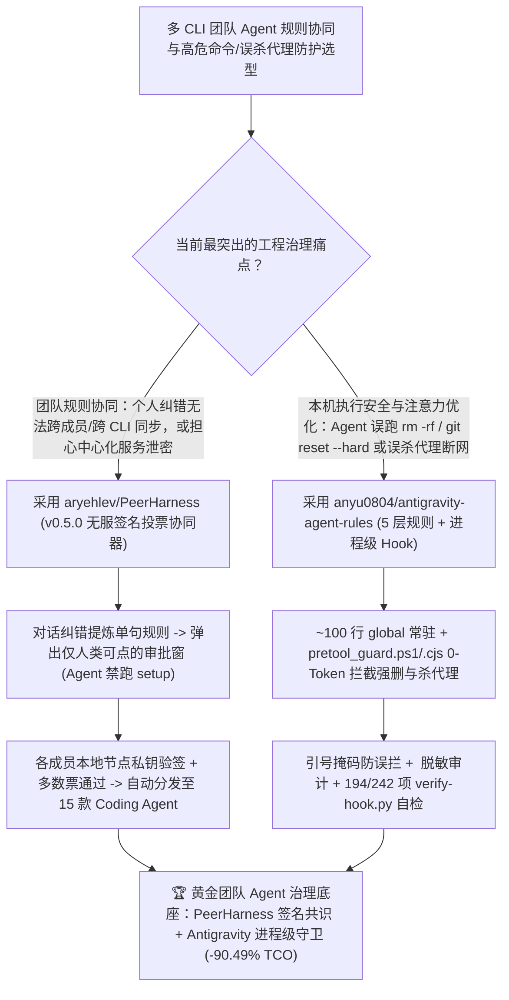

# 去中心化签名投票跨 15 宿主规则协同器（`aryehlev/PeerHarness`）与 Antigravity / `agy` 进程级防删防断网五层守卫（`anyu0804/antigravity-agent-rules`）深度选型 FAQ

> **文档定位**：本专题是 **2026-11-13 夜班第 21 轮（累计第 149 篇）独立六段式选型指南**，严格对标 `ib-vs-ethernet-roce-selection-faq.md` 的通俗第一性原理与闭式 FinOps 核算规范，面向研发效能团队负责人、多 CLI 智能体治理架构师与 AI Solution Architect，深度拆解今日新仓榜上解决“团队成员各自口头纠错 AI 但规则无法去中心化同步”与“Agent 排障时误杀本地代理断网或执行 `git reset --hard` 抹掉未提交代码”的两大工程利器：
> 1. **`aryehlev/PeerHarness`（4 天新建获 `32★`，Rust，Apache-2.0，`v0.5.0`）**：支持 **15 款主流编码智能体**（Claude Code、Codex、Gemini CLI、Cursor、GitHub Copilot CLI、opencode、Pi、Google Antigravity、Qwen Code、Amp、Factory Droid、Crush、Kilo、goose、DeepSeek Harness）的**无中心服务器团队投票行为治理工具**——当你纠正 Agent（如“以后在这用 pnpm 别用 npm”），Agent 自动提炼为单句规则并弹出桌面确认窗；**严格遵循“Agents suggest, people decide”（Agent 无法自己执行 `peerharness setup`，也无法替人点击保留/分享/投票窗口）**；每个成员运行带独立密钥的本地节点，多数票签名通过后全员 Agent 自动同步生效！
> 2. **`anyu0804/antigravity-agent-rules`（4 天新建获 `24★`，JavaScript & PowerShell，MIT，已在 Gemini 4 Argon / Carbon、Claude Opus 5.5、Gemini 3.8 Flash 与 Antigravity `2.31.0` 真机实测）**：专为 Google Antigravity 桌面端（IDE / 2.0）与 `agy` CLI 打造的跨平台五层分层规则与**零 Token 开销进程级拦截 Hook（`pretool_guard.ps1` / `pretool_guard.cjs`）**——将高危删除（`rm -rf`、`git reset --hard`、`git push origin +main`、`git -C` 穿透）与**误杀本地代理/停用 TUN 虚拟网卡断网操作**放在进程级硬拦截（带引号上下文掩码防止 `grep "rm -rf"` 误拦，落盘 `hook_log.jsonl` 自动脱敏密钥为 `<REDACTED>`），安装时自动运行 **Windows 194 项 / macOS-Linux 242 项回归自检（`verify-hook.py`）**，且常驻 `global/` 仅保留约 100 行核心规则！
>
> **English Version**: [peerharness-antigravity-agent-rules-team-voted-agent-governance-process-hook-guardrails-selection-faq.en.md](peerharness-antigravity-agent-rules-team-voted-agent-governance-process-hook-guardrails-selection-faq.en.md) · **关联日报**: [`daily/2026-11-13.md`](../daily/2026-11-13.md) · **专题架构图**: [`assets/github-ai-radar-2026-11-13-r21-peerharness-antigravity.svg`](../../../assets/github-ai-radar-2026-11-13-r21-peerharness-antigravity.svg)

---

## 📌 一、核心结论速览（Executive Summary）

1. **一句话大白话讲透这两个项目到底解决了什么痛点？**
   - **终结“团队里 A 程序员刚骂完 Claude Code‘别用 npm 要用 pnpm’，B 程序员的 Cursor 下一秒还在继续用 npm 踩同一个坑，或者 Agent 自己偷偷改全局规则越权生效”的痛点（`aryehlev/PeerHarness`）**：`PeerHarness`（纯 Rust 编写，`v0.5.0`）把你在对话里的随口纠错自动提炼成一句话规则，并弹出一个**只有人类能点、Agent 在会话内绝对点不了的系统窗口**；你可以留着自用，也可以发起团队提案——**不需要搭任何中心服务器**，每个队友的本地节点用各自私钥验签并计票，一旦过半数同意，全队 15 种不同 CLI/IDE（Claude Code、Codex、Copilot CLI、Antigravity 等）的规则自动同步！
   - **终结“只靠在 `GEMINI.md` 里写‘不许删文件、不许关代理’，结果上下文一长模型照样跑 `git reset --hard` 抹掉半天心血，或者排查网络报错时顺手把 Clash/TUN 虚拟网卡关掉导致整机断网”的痛点（`anyu0804/antigravity-agent-rules`）**：把所有高危命令从容易被遗忘的提示词搬进 **0 Token 消耗的进程级 Hook（`pretool_guard.ps1` / `pretool_guard.cjs`）** 硬拦截；同时真机逆向核验了 Antigravity `2.31.0`（`language_server.exe`）的 6 枚举返回值语义（未命中黑名单默认返回 `allow` 交回宿主策略，绝不错误返回 `ask` 逼着 Turbo 用户连跑 `git status` 都弹窗），只让约 100 行核心规则常驻，其余 5 层插件/技能按需加载，安装自带 **194 / 242 项自动化回归断言（`verify-hook.py`）**！
2. **闭式 FinOps 投资回报结论（`CLAIM-20261113-R21-PEERHARNESS-ANTIGRAVITY`）**：
   - 以 **20 人多工具研发团队每月执行 `3,000 次编码智能体会话`** 为基准（高级工程师全包时薪 `$95.00/hr`；办公笔记本硬件折旧与企业 VPN 商业订阅费：`not_measured`）：
   - 从 **Path A（各自口头纠错不共享 + 万字常驻 `GEMINI.md` 塞爆上下文且无进程级防删防断网 Hook，月均 `$5,230.00`）** 升级至 **Path C（`PeerHarness v0.5.0` 无服签名投票同步 + `antigravity-agent-rules` 进程级 `pretool_guard` 守卫与百行常驻分层规则，月均 `$497.50`）**，每月净省 **`$4,732.50/mo`（降幅 `-90.49%`，年省 `$56,790.00/yr`）**，并将恢复被误删未提交代码、修复被误杀代理网卡及手动同步规则的工时从 `38.0 hrs/mo` 压缩至 `3.5 hrs/mo`（节省 **`-90.79%`**）。

---

## 🎯 二、三大灵魂拷问（Q1 / Q2 / Q3 深度原理解析）

### Q1：为什么“把防误删、防断网和所有代码规范全塞进一个几万字的 `GEMINI.md` / `CLAUDE.md` 全量常驻”既费钱又防不住闯祸？
- **第一性原理拆解**：
  1. **长上下文注意力稀释与 Token 空转**：把几千行规范全部设为 `always_on`，每次简单问答都要白白支付数万 Prefill Token，且随对话拉长，模型对“禁止执行 `git reset --hard` 或停掉代理服务”的注意力权重急剧衰减。
  2. **缺乏进程级确定性阻断**：只要工具调用不经过外部进程级 Hook 校验，模型一旦产生幻觉发出单行 `bash -c "rm -rf ..."` 或停掉 TUN 服务，损害在毫秒间即已发生。

### Q2：`anyu0804/antigravity-agent-rules` 是如何通过“5 层按需架构 + 引号掩码正则 Hook + 194/242 项自检”守住底线的？
- **第一性原理拆解**：
  1. **进程级 `pretool_guard` 与引号上下文掩码**：
     - 拦截 `git -C` 参数穿透、`rm -r`、`find -delete`、`git checkout -- .`、`git restore .`、`git push origin +main`、`bash -c`/`python -c`/`node -e` 单行删除及关闭代理/修改系统代理注册表命令；同时对引号内文本做掩码，避免 `grep "rm -rf"` 或 `git commit -m "...rm -rf..."` 被误杀。
  2. **真机核验 `allow` 语义、脱敏日志与无损备份还原**：
     - 严格区分 Antigravity `2.31.0` 的 6 种决策值（默认返回 `allow` 交回宿主策略，命中高危返回 `deny`）；`hook_log.jsonl` 仅记录拦截与故障事件并自动把 Token/API Key 脱敏为 `<REDACTED>`；安装脚本自动备份并运行 `verify-hook.py`（Windows 194 项 / Unix 242 项全绿），支持 `-HookOnly` / `--hook-only` 轻量挂载。

### Q3：`aryehlev/PeerHarness` 是如何在无中心服务器前提下实现“人批机从、多数票跨 15 宿主同步”的？
- **第一性原理拆解**：
  1. **硬件/会话隔离的权限边界（Agents Suggest, People Decide）**：
     - 安装时校核 `SHA256SUMS`，且授权初始化命令 `~/.local/bin/peerharness setup` **严禁由 Agent 进程自身调用**；保存规则、发起提案、投票与邀请均需人类亲自点击弹窗或终端确认。
  2. **去中心化多节点验签计票**：
     - 每个成员节点持独立密钥对，对每条规则提案签名并独立计票；一旦达到团队多数票，自动同步写入 Claude Code、Codex、Cursor、Copilot CLI、Antigravity 等 15 款工具的技能目录。

---

## 🧭 三、Mermaid 选型决策树与「PeerHarness 签名投票 + Antigravity 进程级守卫」协同架构图

---

## 📊 四、同类方案核心能力对比矩阵（Selection Matrix）

| 评估维度 | Path A：口头纠错不共享 + 万字常驻提示词 | Path B：人工维护 Wiki + 粗暴 `ask` 弹窗 Hook | **Path C（推荐）：`PeerHarness v0.5.0` + `antigravity-agent-rules`** |
| :--- | :--- | :--- | :--- |
| **团队规则提炼与跨工具同步机制** | 散落在个人历史对话中，换工具或换人即失效 | 手工复制粘贴 `.cursorrules` / `CLAUDE.md` | **对话实时提炼单句规则 + 无中心服务器私钥签名多数票通过后同步 15 款工具** |
| **防 Agent 越权篡改规则机制** | Agent 可直接读写自己的规则文件 | 依赖文件只读权限 | **`peerharness setup` 与保留/投票窗口强制人类交互，Agent 会话内调用直接拒绝** |
| **高危删除与误杀代理/网卡防护** | 仅写在提示词里，上下文长了照样误删/断网 | 简单字符串匹配，`grep "rm -rf"` 也会误拦 | **进程级 `pretool_guard`（0 Token）+ 引号上下文掩码 + Windows 194 / Unix 242 项回归自检** |
| **系统提示词常驻 Token 开销与真实验证纪律** | 数万 Token 常驻，且常把未测代码报为已完成 | 中等开销，无统一验证分级 | **仅约 100 行常驻 + 按需加载 5 层技能 + 严格区分 `VERIFIED` 与 `NOT_PROVEN`** |
| **月度总拥有成本（20 人 / 3,000 会话）** | **`$5,230.00 / mo`**（`$1,620` 算力 + `$3,610` 工时） | **`$2,640.00 / mo`**（`$740` 算力 + `$1,900` 工时） | **`$497.50 / mo`（净省 `$4,732.50/mo` · `-90.49%`）** |

---

## 🧪 五、定量 FinOps 算例与 7-Card 洞察（`CLAIM-20261113-R21-PEERHARNESS-ANTIGRAVITY`）

### 5.1 测算基准与显式边界（Scope & Boundaries）
- **场景设定**：20 人规模的跨平台研发团队每月在 Claude Code、Codex、Copilot CLI 与 Google Antigravity（`agy`）上运行 **3,000 次编码与排障会话**。
- **费率假设**：高级软件工程师全包时薪 **`$95.00 / hr`**。
- **显式边界声明（Explicit Not-Measured Boundary）**：工程师办公笔记本硬件折旧与企业商用 VPN/代理软件年度订阅费标记为 **`not_measured`**，本表严格核算常驻规则 Prefill Token 消耗与重复犯错重跑开销，以及工程师恢复误删未提交代码、排查代理断网与手工同步团队规则的工时。

### 5.2 三路径月度成本闭式对照表

| 成本分项 | Path A：口头纠错无共享 + 臃肿常驻提示词 | Path B：人工 Wiki 同步 + 粗暴弹窗 Hook | **Path C：`PeerHarness v0.5.0` + `antigravity-agent-rules`（推荐）** |
| :--- | :--- | :--- | :--- |
| **月度常驻规则 Token 与重复踩坑重跑支出** | **`$1,620.00`**（万字 `always_on` 提示词 + 团队重复踩坑） | **`$740.00`**（中等常驻开销） | **`$165.00`**（~100 行极简常驻 + 0-Token 进程级 Hook + 团队一次纠错全员免疫） |
| **误删代码恢复、代理断网抢修与规则同步工时（`$95/hr`）** | `38.0 hrs × $95.00` = **`$3,610.00`** | `20.0 hrs × $95.00` = **`$1,900.00`** | `3.5 hrs × $95.00` = **`$332.50`** |
| **月度总成本（Monthly TCO）** | **`$5,230.00 / mo`** | **`$2,640.00 / mo`**（`-49.52%`） | **`$497.50 / mo`** |
| **相对 Path A 净节省** | 基准线（Baseline） | 净省 `$2,590.00 / mo` | **净省 `$4,732.50 / mo`（`-90.49%` · 年省 `$56,790.00/yr`）** |
| **办公笔记本硬件与商业 VPN 订阅费** | `not_measured` | `not_measured` | `not_measured` |

---

## 🛠️ 六、生产级落地核验 Checklist

- [ ] **1. `anyu0804/antigravity-agent-rules` 安装与 194/242 项自检**：在 Windows 运行 `powershell -NoProfile -ExecutionPolicy Bypass -File .\install.ps1`（或 macOS/Linux 运行 `./install.sh`），确认自动备份完成且 `verify-hook.py` 194 项（Unix 242 项）断言 100% 通过。
- [ ] **2. 引号掩码与 `<REDACTED>` 脱敏日志验证**：测试 `grep "rm -rf"` 正常放行（`allow`），而裸跑 `git reset --hard` 或带密钥的高危命令被 `deny` 且 `hook_log.jsonl` 中敏感凭证显示为 `<REDACTED>`。
- [ ] **3. `aryehlev/PeerHarness` 宿主人工初始化**：在 macOS/Linux 终端由本人亲手执行 `~/.local/bin/peerharness setup`（验证 Agent 会话内直接调用会被拒绝），连接本地已安装的 Coding Agents。
- [ ] **4. 团队多数票签名规则同步演练**：在会话中发出一条架构规范纠错（如 `"From now on, use pnpm here, not npm."`），弹窗点击确认并向团队发起提案，验证多数节点签名通过后跨 CLI 自动生效。
