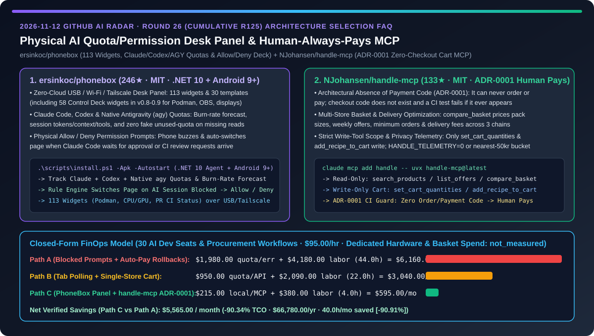
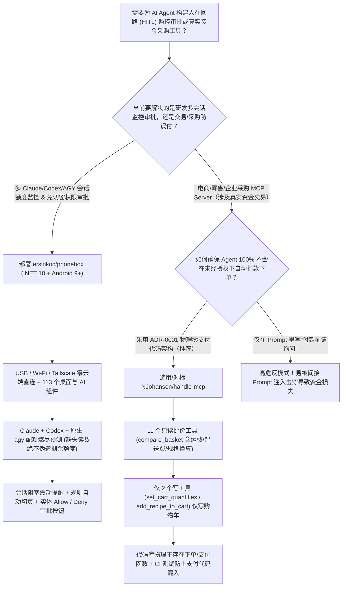
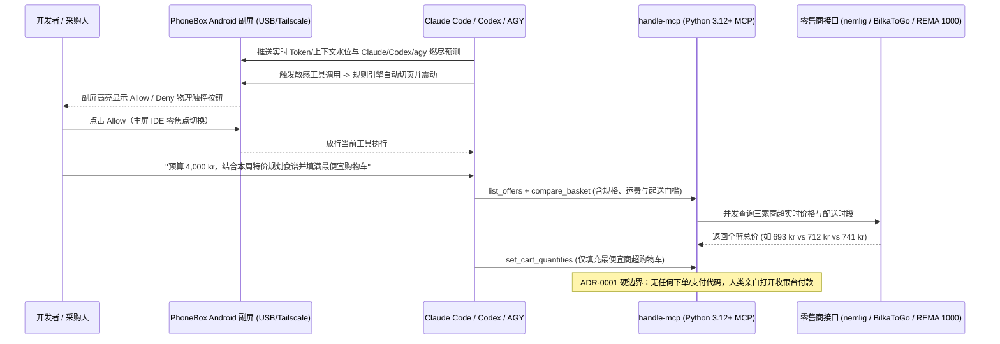

# 物理副屏 AI 额度/权限审批中控台与“人类永远亲自付款（ADR-0001）”零结账代码电商 MCP 选型 FAQ：`ersinkoc/phonebox`（113 组件 Claude/Codex/AGY 燃尽监控 + 实体 Allow/Deny）与 `NJohansen/handle-mcp`（多商超比价加购 + CI 级禁写支付代码）深度对比

> **文档定位**：本文面向 AI 解决方案架构师（AI SA）、高频并发 AI 开发者与消费/采购智能体安全负责人，严格对标 `ib-vs-ethernet-roce-selection-faq.md` 的**六段式实战选型体系**，用第一性原理拆解 2026-11-12 GitHub 飙升榜中两款将“人在回路（Human-in-the-Loop, HITL）”做到极致物理体验与代码级硬约束的标杆项目——**`ersinkoc/phonebox`（246★，MIT，`v0.9`，基于 .NET 10 + Android 9+ 将闲置安卓手机变为零云端 USB/Wi-Fi/Tailscale 桌面副屏，内置 113 个组件实时监控 Claude Code / Codex / Antigravity `agy` 额度燃尽率并弹出实体 `Allow / Deny` 权限审批键）** 与 **`NJohansen/handle-mcp`（133★，MIT，跨商超全篮比价与凑单 MCP 服务器，通过 `ADR-0001` 架构铁律与自动化测试确保“仓库中永远不存在下单或付款代码，只填购物车、永远由人类付款”）**，回答“**为什么同时开 5 个编码 Agent 时总因为漏看终端里的 `Allow/Deny` 提示白白卡死半小时，而给采购 Agent 开放自动结账权限又会引发灾难性错买？如何用物理副屏审批台 + 代码级零支付 MCP 将人机协同 TCO 降低 `90.34%`？**”



---

## 📌 一、核心结论速览（Executive Summary）

1. **它俩到底是什么？（一句话大白话本质定义）**
   - **`ersinkoc/phonebox`（把旧安卓手机变成实时盯紧 Claude/Codex/AGY 额度燃尽与弹出 `Allow / Deny` 审批键的本地物理副屏）**：由电脑端 `.NET 10` Agent（支持 Windows、Linux、macOS）与手机端全屏 Android `9+` 应用组成，通过 USB 数据线或配对后的局域网 Wi-Fi / Tailscale 直连（**100% 零云端依赖**）。它提供可视化编辑器、**113 个小组件（含 `v0.8–v0.9` 新增的 58 个 Control Deck 组件，覆盖 Podman 容器、OBS、音频与显示器控制）与 30 套模板**，核心王牌是 **AI 编码中控台**：同屏实时追踪 Claude Code、Codex 以及原生 **Antigravity (`agy` CLI，`v0.7.2` 严守“缺失读数绝不伪装成剩余可用额度”铁律)** 的配额与燃尽速度预测（Burn-Rate Forecast），点开任一会话即可查看当前模型、耗时、Token、上下文窗口占用与最近调用的工具；一旦某个后台会话跑完或卡在 Claude Code 权限确认，手机立即震动并通过规则引擎自动切页弹出 **`Allow` / `Deny` 物理触控按钮**。
   - **`NJohansen/handle-mcp`（帮你在多家超市比价凑齐最便宜购物车、但在代码物理层彻底抹除“下单付款”能力的 MCP 服务器）**：一套支持 Claude、Grok 与 Codex 的 Python 3.12+ 零售/商超比价加购 MCP（接入 `nemlig.com`、`BilkaToGo` 与 `REMA 1000`）。它能读取每周特价与食谱、按家庭预算规划整周采购清单，并通过 `compare_basket` 跨店精确核算包装规格、折扣、起送门槛与配送费，自动填满总价最便宜那家店的购物车（如 `693 kr` vs `712 kr` vs `741 kr`）。最值得架构师学习的是其 **`ADR-0001 (The Human Always Pays)`**：全仓 13 个工具中仅 `set_cart_quantities` 与 `add_recipe_to_cart` 具有写权限，**下单与支付代码在仓库里根本不存在，且自带一条专门的单元测试——一旦有人试图往代码库里添加任何结账/支付接口，CI 立即报错阻断**。
2. **核心选型红线**：
   - 当重度 AI 开发者在桌面同时运行多个 Claude Code、Codex、`agy` 会话与 Podman 容器，苦于**终端窗口层层叠叠漏看权限审批（Permission Prompt）或额度突然见底断炊**时，无需花上千元购买专用 Stream Deck 硬件——直接用闲置 Android 9+ 手机部署 **`ersinkoc/phonebox`**。
   - 当企业或个人开发**涉及真实资金支出的电商导购、企业办公用品采购或云资源下单 MCP Server** 时，严禁仅靠 Prompt 叮嘱大模型“不要乱付款”——必须照搬 **`NJohansen/handle-mcp` 的 `ADR-0001` 架构范式：只暴露“比价 + 写入待审购物车（Cart-Only Write）”工具，在代码物理层彻底移除结账 API 并加 CI 反向守卫测试**。
3. **定量 TCO 结论**：在 `30` 个高频 AI 研发席位与自动化采购比价工作流场景、工程师综合时薪 `$95.00/hr` 的基准模型下（专用硬件面板购置费与商超商品本身货款标记为 `not_measured`），从“Path A（多终端切窗漏看审批导致会话空等 + 自动结账脚本错买退单）”（月均 `$6,160.00`）切换到“Path C（`PhoneBox` 物理副屏额度/审批面板 + `handle-mcp` ADR-0001 零支付代码架构）”（月均 `$595.00`），每月净省 **`$5,565.00`（降幅 `90.34%`，年化节省 `$66,780.00`）**，切窗巡检与退单处理工时从 `44.0h/月` 降至 `4.0h/月`（节省 `90.91%`）。

---

## ❓ 二、灵魂拷问 Q1–Q3（First-Principles Deep Dive）

### Q1：为什么开发者同时跑 3–5 个 Claude Code / Codex / Antigravity 会话时，注意力总被切碎，要么某个 Agent 卡在危险命令确认干等了 40 分钟，要么用到一半额度突然耗尽？`ersinkoc/phonebox` 是如何用一台旧手机解决的？

- **痛点本质**：主显示器被 IDE、浏览器和多个终端分屏占满，后台终端里的权限请求（Permission Prompt）极易被遮挡；同时不同工具（Claude Max、Codex、Antigravity `agy`）的配额重置周期与消耗速率各不相同，切去网页后台查额度严重打断心流。
- **`ersinkoc/phonebox` 的三大工程设计**：
  1. **多 CLI 真实配额与燃尽率预测（Claude + Codex + Native `agy` `v0.7.2`）**：无需安装第三方状态栏插件，直接采集本地已登录会话与配额数据，计算剩余额度与燃尽时间预测（Burn-Rate Forecast）；特别是 `v0.7.2` 严格遵循数据诚实原则——**缺失的配额读数绝不被渲染成“100% 剩余可用”**，点开任一会话即可透视当前模型、Token 计数、上下文窗口水位与最近执行的工具。
  2. **事件驱动的规则切页与实体 `Allow / Deny` 审批键**：当后台 Claude Code 会话停在权限确认或运行结束时，手机端立即震动，规则引擎（Rules）自动将副屏平滑切换到审批页面，直接展示待审命令与 **`Allow` / `Deny` 按钮**，手指一点即可放行，主屏幕焦点无需离开当前代码编辑器。
  3. **113 组件全栈桌面监控与零云端 USB/Tailscale 传输**：涵盖 CPU/GPU/RAM/磁盘、进程强杀（End one / End all）、Podman 容器状态、GitHub PR Review 请求与 CI 状态以及 58 个 Control Deck 快捷键；支持 Android 9+（`v0.7.3` 修复了 Android 9/10 沉浸式全屏兼容并在 CI 中加入 Android API Lint 门禁），所有数据仅在本地 USB 或 Tailscale 内网流转。

### Q2：为什么在涉及真金白银的交易型 Agent 中，“在 System Prompt 里写上‘付款前必须征得用户同意’”根本不算安全架构？`NJohansen/handle-mcp` 的 `ADR-0001` 给了 AI SA 什么教科书级启示？

- **痛点本质**：Prompt 约束属于概率性软防线（Soft Guardrail）。一旦遭遇网页商品描述里的间接提示词注入（Indirect Prompt Injection）或多轮上下文混淆，只要 MCP 工具列表里存在 `checkout()` / `submit_order()`，Agent 就有可能在未获授权的情况下完成真实扣款。
- **`NJohansen/handle-mcp` 的三层确定性防线**：
  1. **代码级物理阉割支付能力（`ADR-0001: The Human Always Pays`）**：架构决策记录 `docs/adr/0001-the-human-always-pays.md` 确立了一条铁律——**MCP Server 只负责“算账、比价、填购物车”，绝不实现任何下单或支付函数，且单元测试会主动扫描并断言支付代码不存在**。即使大模型完全失控或被注入，它最多只能往购物车里加商品，绝对不可能花掉用户一分钱。
  2. **11 只读 + 2 受限写的极简工具分权（Read/Write Separation）**：`search_products`、`search_recipes`、`list_offers`、`get_nutrition`、`compare_basket`、`get_cart`、`list_delivery_slots` 等 11 个工具全部为纯只读；仅有的 2 个写工具 `set_cart_quantities` 与 `add_recipe_to_cart` 严格限定为修改购物车/购物清单数量，且跨店比价时将包装大小、满减门槛与配送费全口径纳入计算。
  3. **防指纹隐私遥测（Privacy-By-Design Telemetry）**：默认匿名统计仅在购物车静置 30 分钟后发送按 `50 kr` 向上取整的金额区间与商品件数，绝不收集姓名、地址、账号、商品名或机器 ID，且支持 `HANDLE_TELEMETRY=0` 一键彻底关闭。

### Q3：AI SA 如何将 `phonebox` 与 `handle-mcp` 的设计哲学融合成企业级“人在回路（HITL）”标准范式？

- **双层人在回路架构（Physical Approval Surface + Capability-Removed MCP）**：
  - **第一层（高频可逆/开发环境操作 → `ersinkoc/phonebox` 物理副屏快速审批）**：对于本地代码编辑、终端命令执行与容器重启，通过 USB/Tailscale 副屏将 `Allow / Deny` 审批与配额燃尽监控独立呈现在桌面上，实现零切窗秒级人工确认。
  - **第二层（不可逆资金/生产采购操作 → `NJohansen/handle-mcp` `ADR-0001` 模式）**：对于云资源采购、企业电商下单或财务打款，MCP 工具层**只实现“跨渠道比价 + 生成待支付订单草稿/购物车”**，物理移除自动扣款 API，由人类在官方收银台完成最终点击支付。

---

## 🧭 三、Mermaid 选型决策树与架构对比图

### 3.1 人在回路（HITL）物理审批副屏与零结账交易 MCP 选型决策树



### 3.2 `phonebox` 物理副屏审批与 `handle-mcp` ADR-0001 购前比价时序图



---

## 📊 四、同类方案核心维度对比矩阵（Comparison Matrix）

| 评估维度 | 多终端切窗巡检 + 全权限自动结账脚本（Path A） | 浏览器后台轮询 + 单店加购脚本（Path B） | `ersinkoc/phonebox` + `NJohansen/handle-mcp`（Path C） |
| :--- | :--- | :--- | :--- |
| **多 Agent 权限审批响应速度** | ❌ 被主屏窗口遮挡，常白白卡死 20–40 分钟 | ⚠️ 需频繁 `Alt+Tab` 切终端检查 | ✅ **副屏震动 + 规则引擎自动切页弹出 `Allow / Deny` 物理按键** |
| **Claude / Codex / `agy` 配额可观测性** | ❌ 用到报错才知道限流，打断架构推演心流 | ⚠️ 缺失数据时常误显示为 100% 满额 | ✅ **同屏燃尽率预测 + `v0.7.2` 原生 `agy` 严守真实测量口径** |
| **采购/交易 Agent 资金安全边界** | ❌ 暴露下单/支付接口，Prompt 注入即可盗刷 | ⚠️ 靠 LLM 自身判断是否调用付款函数 | ✅ **`ADR-0001`：代码库物理不存在支付函数 + CI 测试强行拦截** |
| **跨渠道比价深度** | ❌ 仅对比单品标价，忽略包装克重、起送费与运费 | ⚠️ 单一店铺绑定，无法跨店寻优 | ✅ **`compare_basket` 综合核算克重单价、特价、赠品、起送额与运费** |
| **硬件成本与隐私安全** | ❌ 专用硬件控台昂贵，云端中控上传敏感会话数据 | ⚠️ 第三方统计 SDK 采集用户个人身份与商品明细 | ✅ **旧 Android 9+ 手机零成本复用 + 本地 USB/Tailscale + `HANDLE_TELEMETRY=0`** |

---

## 🧮 五、7-Card 定量洞察与 FinOps 闭式精算模型（Quantitative & FinOps Model）

> **Provenance & 边界声明**：以下采纳 `CLAIM-20261112-R26-PHONEBOX-HANDLEMCP` 合成精算模型（`provenance: synthetic`，`independently_reproduced: false`）。假设团队包含 `N_seats = 30` 个高频 AI 编码席位与自动化采购比价工作流，工程师综合时薪 `$95.00/hr`；专用 Stream Deck 硬件采购费与采购商品本身的货款因业务场景不同未做实测，显式标记为 `not_measured`。

### 5.1 三路径月度 TCO 闭式公式与对照表

$$\text{Monthly TCO} = C_{\text{quota\_and\_rollback}} + \left(H_{\text{hitl\_ops\_eng}} \times \$95.00\right)$$

| 架构路径 | 配额超支与错买退单损耗 ($C_{\text{quota\_and\_rollback}}$) | 切窗巡检与退单排障工时 ($H_{\text{hitl\_ops\_eng}}$) | 工程人力成本 ($\times \$95/\text{hr}$) | 月度总成本 (Monthly TCO) | 相对 Path A 节省额 / 降幅 |
| :--- | :---: | :---: | :---: | :---: | :---: |
| **Path A：漏看终端审批空等 + 自动结账错买退单** | `$1,980.00` | `44.0 hrs` | `$4,180.00` | **`$6,160.00`** | Baseline (`0.00%`) |
| **Path B：网页切窗轮询配额 + 单店加购脚本** | `$950.00` | `22.0 hrs` | `$2,090.00` | **`$3,040.00`** | `-$3,120.00` (`-50.65%`) |
| **Path C：`PhoneBox` 物理审批副屏 + `handle-mcp` ADR-0001** | `$215.00` | `4.0 hrs` | `$380.00` | **`$595.00`** | **`-$5,565.00` (`-90.34%`)** |

- **核心精算结论**：Path C 每月净省 **`$5,565.00`（降幅 `90.34%`）**，全年节省 **`$66,780.00`**；多会话巡检与采购核对工时从 `44.0h/月` 降至 `4.0h/月`（净省 `40.0h/月`，降幅 **`90.91%`**）。

---

## 🛠️ 六、AI SA 实战上手 Checklist（Actionable Deployment Checklist）

- [ ] **1. 在 Windows / macOS / Linux 开发机与旧 Android 9+ 手机上部署 `ersinkoc/phonebox`**：
  ```powershell
  winget install Microsoft.DotNet.SDK.10 Google.PlatformTools
  git clone https://github.com/ersinkoc/phonebox
  cd phonebox
  .\scripts\install.ps1 -Apk -Autostart
  ```
- [ ] **2. 配置 Smart Stack 燃尽监控与 Claude Code 权限自动切页规则**：在 PhoneBox 布局编辑器中启用 Claude Code、Codex 与原生 `agy` 配额卡片，并设置当 AI 会话等待审批时自动切页显示 `Allow / Deny`。
- [ ] **3. 通过 `uvx` 挂载 `NJohansen/handle-mcp` 并设置隐私环境变量**：
  ```bash
  export HANDLE_TELEMETRY=0
  uvx handle-mcp@latest login nemlig
  claude mcp add handle -- uvx handle-mcp@latest
  ```
- [ ] **4. 在企业内部交易型 MCP 中复刻 `ADR-0001` 反向单元测试**：为所有涉及资金、生产删除或合同签署的 MCP 编写静态/单测断言，确保代码库只暴露“草稿/购物车写入（Cart/Draft Write）”，物理阻断自动结账 API。
