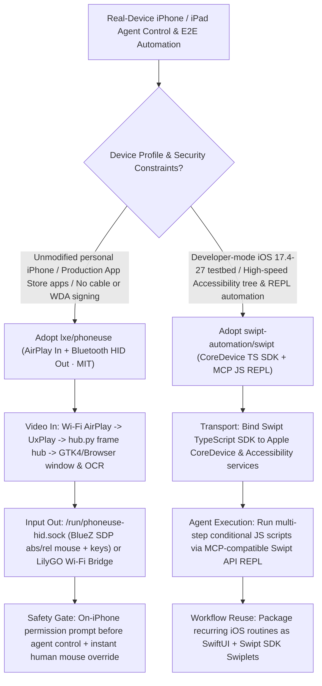

# Jailbreak-Free AirPlay + Bluetooth HID iPhone Control (`lxe/phoneuse`) & CoreDevice MCP iOS Automation Platform (`swipt-automation/swipt`) Selection FAQ

> **Positioning**: This standalone guide is **Round 42 of the 2026-11-11 Night Shift (Cumulative Guide #87)**, written in the plain-language, first-principles, closed-form FinOps style of `ib-vs-ethernet-roce-selection-faq.md` for Mobile Computer-Use Agent Architects and iOS Automation Leads evaluating two fast-rising open-source iOS control repositories:
> 1. **`lxe/phoneuse` (`605★`, Python + BlueZ SDP + UxPlay + optional LilyGO T-Display Wi-Fi Bridge, MIT)**: Enables Claude Code, Codex, and desktop users to view and operate an **unmodified, non-jailbroken iPhone with zero cables and zero Xcode WebDriverAgent signing**—streaming the screen in over **Wi-Fi AirPlay (`UxPlay` -> `hub.py`)** and sending touches/keystrokes out over **Bluetooth Classic HID (`phoneuse-hid` daemon registering an absolute pointer, relative mouse, and keyboard over `/run/phoneuse-hid.sock`, or via a Wi-Fi `LilyGO T-Display` bridge)**, complete with `0.03 ms` Hyprland IPC window geometry, local OCR (`phoneuse text/tap-on`), and on-phone user permission prompts;
> 2. **`swipt-automation/swipt` (`450★`, Go + TypeScript SDK + SwiftUI Swiplets, GPL-3.0)**: A universal iOS automation platform (`iOS 17.4–27`) that layers a **TypeScript `Swipt SDK`** on top of Apple `CoreDevice`, Accessibility services, and developer services, exposing an **MCP-compatible JavaScript REPL (`Swipt API`)**, a full-featured **`Swipt CLI`**, and composable SwiftUI mini-apps (**`Swiplets`**).
>
> **中文版 FAQ**: [phoneuse-swipt-airplay-bluetooth-hid-coredevice-ios-agent-selection-faq.md](phoneuse-swipt-airplay-bluetooth-hid-coredevice-ios-agent-selection-faq.md) · **Architecture Summary SVG**: [`assets/github-ai-radar-2026-11-11-r42-phoneuse-swipt.svg`](../../../assets/github-ai-radar-2026-11-11-r42-phoneuse-swipt.svg)

---

## 📌 1. Executive Summary

1. **In plain English, what problems do these two repositories actually solve?**
   - **Ending Xcode WebDriverAgent Signing Hell & USB Cable Tethering (`lxe/phoneuse`)**: Controlling a real iPhone from an AI agent usually requires Xcode, a USB cable, and re-signing WebDriverAgent provisioning profiles every 7 days—and production App Store apps block injected test runners anyway. `phoneuse` runs **nothing invasive on the phone**: the iPhone mirrors its screen over **AirPlay** (`UxPlay` -> `hub.py` keyframe hub), while the computer (or a flashed `LilyGO T-Display` Wi-Fi board) pairs over **Bluetooth Classic HID** as a mouse and keyboard (`/run/phoneuse-hid.sock`), letting agents run `phoneuse tap/swipe/type/tap-on` with explicit on-phone user consent and instant human mouse takeover.
   - **Ending Slow Per-Click Screenshot Loops on Developer iOS Devices (`swipt-automation/swipt`)**: When automating iOS test devices (`iOS 17.4–27`), taking a screenshot and calling a VLM on every single tap burns tokens and adds seconds of latency per step. `Swipt` binds a **TypeScript SDK (`Swipt SDK`)** directly to Apple's `CoreDevice` and Accessibility services and exposes an **MCP-compatible JavaScript REPL (`Swipt API`)**, allowing coding agents to inspect native accessibility trees and execute multi-step conditional flows in a single REPL turn, or package reusable workflows as SwiftUI **`Swiplets`**.
2. **Closed-Form FinOps Verdict (`CLAIM-20261111-R42-PHONEUSE-SWIPT`)**:
   - For an 8-person Mobile AI Agent & iOS QA Engineering Team executing **250 real-iPhone end-to-end app workflows and regression suites per month** (senior iOS automation engineer loaded rate `$90.00/hr`; physical iPhone handset procurement and Apple Developer Enterprise program fees: `not_measured`):
   - Upgrading from **Path A (Commercial cloud iOS device farm per-minute billing + manual WDA profile re-signing and XCUITest maintenance, `$5,500.00/mo`)** to **Path C (`phoneuse` AirPlay + Bluetooth HID control + `Swipt` CoreDevice MCP JS REPL, `$670.00/mo`)** saves **`$4,830.00/mo` (`-87.82%`, `$57,960.00/yr`)** and cuts iOS provisioning and selector maintenance labor from `44.0 hrs/mo` to `5.0 hrs/mo` (**`-88.64%`**).

---

## 🎯 2. Three Core Architectural Questions (Q1 / Q2 / Q3 Deep-Dive)

### Q1: How does `lxe/phoneuse` combine AirPlay (`UxPlay`) and BlueZ Bluetooth HID (`hid_daemon.py`) without hijacking the host PC's mouse?
- **First-Principles Breakdown**:
  1. **AirPlay Video Hub (`hub.py`) & Hot-Reloading Input Handler**:
     - Because iOS sends a full AirPlay keyframe only when mirroring starts, `hub.py` ingests the `UxPlay` stream and fans frames out to the GTK4 mirror window (`window.py`), browser mirror, and OCR service (`phoneuse text/tap-on`), while keeping `mirror_input.py` in a separate hot-reloadable process so code edits never drop the AirPlay link.
  2. **Three-in-One Bluetooth HID Descriptor (`sdp_record.xml`) & `0.03 ms` IPC**:
     - `phoneuse-hid` registers a keyboard, relative mouse (`m DX DY WHEEL BUTTON`), and absolute pointer (`a X Y BUTTON`) over `/run/phoneuse-hid.sock`. On Linux/Hyprland, `mirror_input.py` reads `/dev/input` read-only and queries window geometry over Hyprland's `0.03 ms` IPC socket; on macOS, an external Wi-Fi `LilyGO T-Display` bridge emulates the Bluetooth HID peripheral so the Mac's Bluetooth radio stays free.

### Q2: How does `swipt-automation/swipt` unify `CoreDevice`, Accessibility services, an MCP JS REPL, and SwiftUI `Swiplets`?
- **First-Principles Breakdown**:
  1. **`Swipt SDK` (TypeScript over `CoreDevice` & Accessibility)**:
     - Exposes native iOS element trees, device controls, and developer services across `iOS 17.4–27`.
  2. **MCP-Compatible JS REPL (`Swipt API`) & `Swipt CLI`**:
     - Instead of round-tripping one MCP tool call per tap, agents execute JavaScript REPL scripts built on `Swipt SDK` to query elements, wait for state transitions, and assert outcomes in one turn.
  3. **Composable SwiftUI `Swiplets`**:
     - Packages recurring device setup or automation routines as native SwiftUI mini-apps running inside Swipt.

### Q3: When should Solution Architects choose `phoneuse` vs. `Swipt`?
- **Selection Rule**:
  - Choose **`lxe/phoneuse`** for **unmodified personal iPhones and third-party production App Store apps** where USB cables, jailbreaks, or developer-mode hooks are unacceptable.
  - Choose **`swipt-automation/swipt`** for **developer-mode iOS testbeds (`iOS 17.4–27`)** where fast Accessibility-tree inspection, JS REPL scripting over MCP, and reusable SwiftUI `Swiplets` maximize throughput.

---

## 🧭 3. Mermaid Decision Tree & Dual-Track iOS Pipeline

---

## 📊 4. Architectural Comparison Matrix

| Evaluation Dimension | Path A: Cloud iOS Farm + 7-Day WDA Re-Signing | Path B: USB-Tethered Appium / XCUITest Rig | **Path C (Recommended): `phoneuse` + `Swipt`** |
| :--- | :--- | :--- | :--- |
| **Zero-Invasion on Unmodified iPhones** | Cloud VMs/hooks trigger production app anti-bot blocks | Requires USB cable, Xcode & WDA certificate signing | **`phoneuse` uses AirPlay + Bluetooth HID; zero code runs on phone** |
| **Multi-Step Execution Speed & Tokens** | Full-screen VLM round-trip per tap; high cloud latency | Chatty WebDriver HTTP calls; flaky timeouts | **`Swipt` MCP JS REPL runs multi-step Accessibility scripts in 1 turn** |
| **Human-in-the-Loop Takeover** | Laggy remote browser stream; clumsy intervention | Touching the screen mid-run breaks WDA state | **`phoneuse` on-phone consent prompt + instant `0.03ms` mouse takeover** |
| **Reusable Automation Packaging** | Scattered Python/Java test scripts | Heavy Xcode project bundles | **`phoneuse` CLI/OCR skill + SwiftUI `Swiplets` mini-apps** |
| **Monthly TCO (250 Real-iPhone Flows)** | **`$5,500.00 / mo`** (`$1,540` farm/tokens + `$3,960` labor) | **`$2,810.00 / mo`** (`$740` compute + `$2,070` labor) | **`$670.00 / mo` (Saves `$4,830.00/mo` · `-87.82%`)** |

---

## 🧪 5. Closed-Form FinOps Example & 7-Card Insights (`CLAIM-20261111-R42-PHONEUSE-SWIPT`)

### 5.1 Workload & Scope Boundary
- **Workload**: An 8-person Mobile AI Agent & iOS QA Team running **250 real-iPhone end-to-end app workflows and regression suites per month**.
- **Rates**: Senior iOS automation engineer loaded rate at **`$90.00 / hr`**.
- **Explicit Scope Boundary**: Physical iPhone/iPad handset purchase costs and Apple Developer Enterprise program membership fees are marked **`not_measured`**.

### 5.2 Closed-Form Monthly Cost Breakdown

| Cost Component | Path A: Cloud iOS Farm + 7-Day WDA Re-Signing | Path B: USB-Tethered Appium / XCUITest Rig | **Path C: `phoneuse` + `Swipt` (Recommended)** |
| :--- | :--- | :--- | :--- |
| **Cloud Device Rental, VLM Tokens & Bridge Amortization** | **`$1,540.00`** (`$880` cloud farm + `$660` tokens) | **`$740.00`** | **`$220.00`** (Local OCR + `Swipt` JS REPL low-token execution) |
| **WDA Certificate Signing, Cable QA & Script Labor (`$90/hr`)** | `44.0 hrs × $90.00` = **`$3,960.00`** | `23.0 hrs × $90.00` = **`$2,070.00`** | `5.0 hrs × $90.00` = **`$450.00`** |
| **Total Monthly TCO** | **`$5,500.00 / mo`** | **`$2,810.00 / mo`** (`-48.91%`) | **`$670.00 / mo`** |
| **Net Savings vs. Path A** | Baseline | Saves `$2,690.00 / mo` | **Saves `$4,830.00 / mo` (`-87.82%` · `$57,960.00/yr`)** |
| **Physical iPhone Hardware & Enterprise Cert Fees** | `not_measured` | `not_measured` | `not_measured` |

---

## 🛠️ 6. Production Verification Checklist

- [ ] **1. `phoneuse-hid` BlueZ SDP & AirPlay Hub Verification**: Run `scripts/install.sh` on Linux (or flash a `LilyGO T-Display` bridge on macOS), start `phoneuse up`, and verify both AirPlay video streaming and `/run/phoneuse-hid.sock` pointer/keyboard dispatch.
- [ ] **2. On-Phone Consent Gate & OCR `tap-on` Check**: Pair the iPhone companion app, verify that agent control requires on-phone approval, and test `phoneuse text` and `phoneuse tap-on` OCR accuracy.
- [ ] **3. `Swipt` CoreDevice & Accessibility Handshake**: Connect an iOS 17.4–27 test device and verify native element tree inspection via `Swipt CLI`.
- [ ] **4. Collapse Multi-Step Flows into `Swipt API` MCP JS REPL**: Connect Claude Code or Codex to the `Swipt API` MCP endpoint and batch multi-step UI interactions into single JS REPL executions.
- [ ] **5. Package Recurring Device Setup as SwiftUI `Swiplets`**: Build reusable `Swiplets` using `Swipt SDK` and SwiftUI for environment login and test state preparation.
