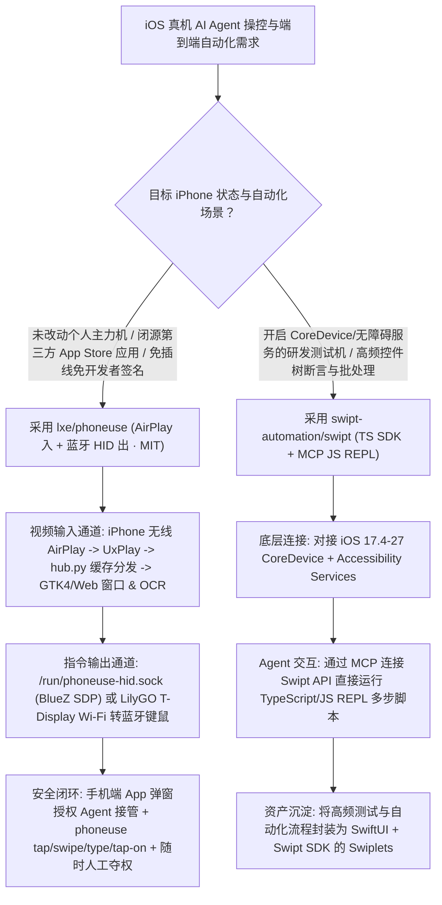

# 免越狱免插线 iPhone 投屏蓝牙 HID 操控（`lxe/phoneuse`）与 CoreDevice 级 iOS 自动化 MCP 平台（`swipt-automation/swipt`）深度选型 FAQ

> **文档定位**：本专题是 **2026-11-11 夜班第 42 轮（累计第 87 篇）独立六段式选型指南**，严格对标 `ib-vs-ethernet-roce-selection-faq.md` 的通俗第一性原理与闭式 FinOps 核算规范，面向移动端 Computer-Use Agent 架构师与 iOS 真机自动化测试负责人，深度拆解今日在未越狱 iPhone 物理操控与 CoreDevice 开发者服务层自动化赛道爆发的两大新锐开源仓：
> 1. **`lxe/phoneuse`（`605★`，Python + BlueZ SDP + UxPlay + LilyGO T-Display Wi-Fi 桥，MIT）**：让 Claude Code、Codex 等 AI Agent 或桌面用户**无需越狱、无需数据线、无需配置繁琐的 Xcode WebDriverAgent 证书**，直接在电脑窗口里查看并操控一台原厂未改动的 iPhone——采用**“AirPlay 无线投屏入（`UxPlay` → `hub.py` 关键帧缓存分发）+ 蓝牙经典 HID 键鼠出（`/run/phoneuse-hid.sock` 绝对指针/相对鼠标/键盘描述符，或通过外置 LilyGO T-Display 硬件桥）”**的双通道解耦架构，配合 `0.03 ms` Hyprland IPC 坐标转换、`phoneuse text/tap-on` OCR 视觉定位与手机端人工授权接管；
> 2. **`swipt-automation/swipt`（`450★`，Go + TypeScript SDK + SwiftUI Swiplets，GPL-3.0）**：面向 iOS 17.4–27 的**通用 iOS 自动化平台**——底层基于 Apple **`CoreDevice`、无障碍服务（Accessibility Services）与开发者服务**封装 TypeScript `Swipt SDK`，向上暴露 **MCP 兼容的实时 JavaScript REPL（`Swipt API`）**、全功能 `Swipt CLI` 以及基于 SwiftUI 构建的可复用自动化微应用 **`Swiplets`**！
>
> **English Version**: [phoneuse-swipt-airplay-bluetooth-hid-coredevice-ios-agent-selection-faq.en.md](phoneuse-swipt-airplay-bluetooth-hid-coredevice-ios-agent-selection-faq.en.md) · **架构总结图**: [`assets/github-ai-radar-2026-11-11-r42-phoneuse-swipt.svg`](../../../assets/github-ai-radar-2026-11-11-r42-phoneuse-swipt.svg)

---

## 📌 一、核心结论速览（Executive Summary）

1. **一句话大白话讲透这两个项目到底解决了 iOS 真机 Agent 操控的什么痛点？**
   - **终结“想让 Agent 点一下自己的真机 iPhone，却被 Xcode 签名、7 天证书过期和数据线断连折磨疯”的痛点（`lxe/phoneuse`）**：苹果对 iOS 的沙盒封锁极严，传统方案必须用数据线连 Mac、编译安装 WebDriverAgent（WDA）并处理复杂的开发者签名，而且第三方生产 App（如银行、社交、外卖 App）根本不允许注入测试桩。`phoneuse` 换了一条完全无需在手机里跑任何侵入代码的路：画面像连 Apple TV 一样通过 **Wi-Fi AirPlay** 投到电脑上，点击和打字则让电脑（或一块几十元的 `LilyGO T-Display` Wi-Fi 小板子）通过 **Bluetooth HID 伪装成蓝牙鼠标和键盘**发给手机！手机完全处于原厂未越狱状态，任何 App Store 生产应用都能点，且 Agent 接管前会在手机端弹窗请求你的许可，你随时动一下鼠标就能瞬间夺回控制权。
   - **终结“纯靠截屏 OCR 慢且费 Token、而传统 Appium/XCUITest 笨重无法交互式调试”的痛点（`swipt-automation/swipt`）**：当处于开发/测试机环境（开启开发者服务与无障碍接口）时，每一步都截屏调多模态大模型既慢又贵。`Swipt` 直接在 Apple `CoreDevice` 与 Accessibility 服务之上构建了 **TypeScript `Swipt SDK`**，并通过 **MCP 兼容的 `Swipt API` 暴露了一个实时 JS REPL**——让 Coding Agent 直接发一段精简的 TypeScript/JS 代码一次性读取控件树、完成复杂连续操作，还能把高频操作打包成基于 SwiftUI 的微应用（`Swiplets`）！
2. **闭式 FinOps 投资回报结论（`CLAIM-20261111-R42-PHONEUSE-SWIPT`）**：
   - 以 8 人移动端 AI Agent 研发与 iOS 真机端到端回归测试团队每月执行 **250 轮真机 iPhone 跨应用业务流与自动化验收** 为基准（高级 iOS 自动化工程师含税费率 `$90.00/hr`；物理 iPhone 测试样机采购与 Apple 企业开发者年费：`not_measured`）：
   - 从 **Path A（商业云真机按分钟租用 + 手工维护 WDA 证书重签与脆弱 XCUITest 脚本，月均 `$5,500.00`）** 升级至 **Path C（`phoneuse` AirPlay+蓝牙 HID 免签名生产 App 操控 + `Swipt` CoreDevice MCP JS REPL 控件树直连，月均 `$670.00`）**，每月净省 **`$4,830.00/mo`（降幅 `-87.82%`，年省 `$57,960.00/yr`）**，并将 iOS 签名排障与脚本维护工时从 `44.0 hrs/mo` 压缩至 `5.0 hrs/mo`（节省 **`-88.64%`**）。

---

## 🎯 二、三大灵魂拷问（Q1 / Q2 / Q3 深度原理解析）

### Q1：`lxe/phoneuse` 是如何利用 AirPlay 关键帧中心（`hub.py`）与 BlueZ 三合一 HID 描述符（`hid_daemon.py`）实现零侵入精准点击的？
- **第一性原理拆解**：
  1. **AirPlay 关键帧缓存（`hub.py`）解决中途接入黑屏问题**：
     - iOS 的 AirPlay 屏幕镜像只在连接刚开始时发送一帧完整的关键帧（Keyframe），后续连续一分钟内可能全都是差量帧。`phoneuse` 通过 `UxPlay` 接收视频流后送入 `phoneuse/hub.py`，由其缓存最新状态并向桌面 GTK4 镜像窗口（`window.py`）、浏览器镜像及 OCR 视觉服务（`phoneuse text/tap-on`）多路分发，且修改输入处理代码热重载时**绝不断开 AirPlay 连接**！
  2. **BlueZ 三合一 SDP 描述符（绝对指针 + 相对鼠标 + 键盘）与 `/run/phoneuse-hid.sock`**：
     - `phoneuse-hid` 作为 systemd 服务接管蓝牙 HID 控制与中断通道（自动配置 `bluetoothd` 防止系统把设备类别重置回普通电脑），声明**绝对坐标指针（`a X Y BUTTON`）、相对鼠标（`m DX DY WHEEL BUTTON`）与键盘（`type TEXT`）**；
     - 在 Linux/Hyprland 下，`mirror_input.py` 以只读方式读取 `/dev/input` 并通过 `0.03 ms` 延迟的 Hyprland IPC 获取窗口几何坐标，绝不抢占宿主机的物理鼠标；在 macOS 下则支持一键烧录 **LilyGO T-Display** 作为独立 Wi-Fi 转蓝牙 HID 硬件桥。

### Q2：`swipt-automation/swipt` 的四层架构（`Swipt SDK` / `Swipt API` / `Swipt CLI` / `Swiplet`）为何比传统 Appium/WDA 更适合 Coding Agent？
- **第一性原理拆解**：
  1. **基于 `CoreDevice` + Accessibility 的 TypeScript `Swipt SDK`**：
     - 直接对接 iOS 17.4–27 的 `CoreDevice` 通道与系统无障碍服务，无需通过笨重的 WebDriver HTTP JSON 协议逐个元素来回轮询。
  2. **MCP 原生 JS REPL（`Swipt API`）实现“单次调用、多步带条件执行”**：
     - 传统 MCP 每次点击都要走一轮 `大模型推理 -> MCP 调用 -> 截屏回传`，10 步操作就要耗费 10 轮上下文。`Swipt API` 允许 Agent 通过 MCP 直接把一段基于 `Swipt SDK` 的 JS 代码发进 REPL 沙箱里跑（例如循环等待某个弹窗出现并点击确认），将多步 UI 交互折叠为 1 次原子调用。
  3. **SwiftUI `Swiplets` 沉淀固定工作流**：
     - 对团队日常高频复用的 iOS 巡检、数据采集或测试前置动作，直接用 `Swipt SDK` + `SwiftUI` 编写成运行在 Swipt 内部的 `Swiplet` 小应用，兼顾人工可视化点击与 Agent 命令行调度。

### Q3：AI 架构师在什么场景下选 `lxe/phoneuse`，什么场景下选 `swipt-automation/swipt`？
- **黄金组合落地范式**：
  - **操作个人日常主力 iPhone 或第三方闭源商业 App（免开发者模式/免插线）** → 选 **`lxe/phoneuse`**（AirPlay + 蓝牙 HID / LilyGO 硬件桥，手机端授权提示 + 随时人工接管）；
  - **iOS 研发测试机自动化、无障碍控件树精准断言与多步 JS REPL 批处理** → 选 **`swipt-automation/swipt`**（`CoreDevice` + TypeScript SDK + MCP REPL + SwiftUI `Swiplets`）！

---

## 🧭 三、Mermaid 选型决策树与 iOS 双轨自动化流水线

---

## 📊 四、同类 iOS 自动化方案核心能力对比矩阵（Selection Matrix）

| 评估维度 | Path A：商业云真机农场 + 传统 WDA 签名 | Path B：本地 USB 插线 Appium / XCUITest | **Path C（推荐）：`phoneuse` + `Swipt`** |
| :--- | :--- | :--- | :--- |
| **真机零侵入性（免插线/免重签）** | 云端虚拟机/改机易触发商业 App 风控拦截 | 必须插 USB 线、配 Xcode WDA 签名（免费号 7 天过期） | **`phoneuse` 纯 AirPlay + 蓝牙 HID，手机零代码侵入、零数据线** |
| **多步执行效率与 Token 开销** | 每次点击全屏截图回传云端，延迟高且烧 Token | HTTP WebDriver 协议逐跳往返，长链路极易超时 | **`Swipt` MCP 原生 JS REPL 一次执行多步控件树逻辑** |
| **人机协同与随时接管能力** | 远端网页视频流卡顿，人工难以平滑介入 | 测试运行中人工触碰屏幕常导致 WDA 会话崩溃 | **`phoneuse` 0.03ms IPC 镜像窗口，手机端授权 + 动鼠标即刻接管** |
| **可复用工作流封装** | 散落在各处的 Python/Java 测试脚本 | 笨重的 Xcode 工程文件 | **既支持 `phoneuse` CLI/Skill，又支持 SwiftUI `Swiplets` 微应用** |
| **月度总拥有成本（250 轮真机流/月）** | **`$5,500.00 / mo`**（`$1,540` 云租/Token + `$3,960` 人工） | **`$2,810.00 / mo`**（`$740` 算力 + `$2,070` 人工） | **`$670.00 / mo`（净省 `$4,830.00/mo` · `-87.82%`）** |

---

## 🧪 五、定量 FinOps 算例与 7-Card 洞察（`CLAIM-20261111-R42-PHONEUSE-SWIPT`）

### 5.1 测算基准与显式边界（Scope & Boundaries）
- **场景设定**：8 人移动端 AI Agent 与 iOS 质量工程团队，每月在真机 iPhone 上执行 **250 轮跨 App 业务流操控与端到端回归测试**。
- **费率假设**：高级 iOS 自动化工程师全包时薪 **`$90.00 / hr`**。
- **显式边界声明（Explicit Not-Measured Boundary）**：物理 iPhone/iPad 测试真机硬件采购成本与 Apple Developer Enterprise 账号年费标记为 **`not_measured`**，本表核算云真机租用/视觉 Token 消耗与工程师签名维护/排障工时。

### 5.2 三路径月度成本闭式对照表

| 成本分项 | Path A：云真机按分钟租用 + WDA 签名排障 | Path B：本地 USB Appium + 纯截屏 VLM 循环 | **Path C：`phoneuse` + `Swipt`（推荐）** |
| :--- | :--- | :--- | :--- |
| **云真机时长费、多跳截屏 Token 与硬件桥分摊** | **`$1,540.00`**（`$880` 云真机 + `$660` 重试 Token） | **`$740.00`** | **`$220.00`**（本地 OCR + `Swipt` JS REPL 低 Token 调用） |
| **WDA 证书重签、USB 断连排障与脚本维护工时（`$90/hr`）** | `44.0 hrs × $90.00` = **`$3,960.00`** | `23.0 hrs × $90.00` = **`$2,070.00`** | `5.0 hrs × $90.00` = **`$450.00`** |
| **月度总成本（Monthly TCO）** | **`$5,500.00 / mo`** | **`$2,810.00 / mo`**（`-48.91%`） | **`$670.00 / mo`** |
| **相对 Path A 净节省** | 基准线（Baseline） | 净省 `$2,690.00 / mo` | **净省 `$4,830.00 / mo`（`-87.82%` · 年省 `$57,960.00/yr`）** |
| **物理 iPhone 样机采购与 Apple 企业开发者年费** | `not_measured` | `not_measured` | `not_measured` |

---

## 🛠️ 六、生产级落地核验 Checklist

- [ ] **1. `phoneuse-hid` BlueZ 描述符与双通道验证**：在 Linux 主机安装 Flatpak 或源码运行 `scripts/install.sh` 配置 `bluetoothd`（或在 macOS 上烧录 `LilyGO T-Display` Wi-Fi 桥），执行 `phoneuse up` 验证 AirPlay 镜像画面与 `/run/phoneuse-hid.sock` 绝对坐标点击（`a X Y BUTTON`）同步。
- [ ] **2. 手机端授权门禁与 OCR 点击测试**：在 iPhone 安装配套 App，点击 `Connect Claude Code`，验证 Agent 操控前手机端弹出明确授权确认，并测试 `phoneuse text` 与 `phoneuse tap-on` 的本地 OCR 定位精度。
- [ ] **3. `Swipt` CoreDevice 与无障碍权限握手**：在测试用 iPhone/iPad（iOS 17.4–27）上启用开发者模式与无障碍服务，通过 `Swipt CLI` 验证设备连接与控件树拉取。
- [ ] **4. MCP JS REPL 批量交互取代逐跳截屏**：将 Claude Code 或 Codex 接入 `Swipt API` MCP Server，把多步连续表单填写与状态轮询合并为单段 TypeScript/JS REPL 脚本执行。
- [ ] **5. 高频前置流程沉淀为 SwiftUI `Swiplet`**：将登录态准备、测试环境切换等高频动作封装为基于 `Swipt SDK` 的 `Swiplet` 微应用，供人工与 Agent 共享调用。
