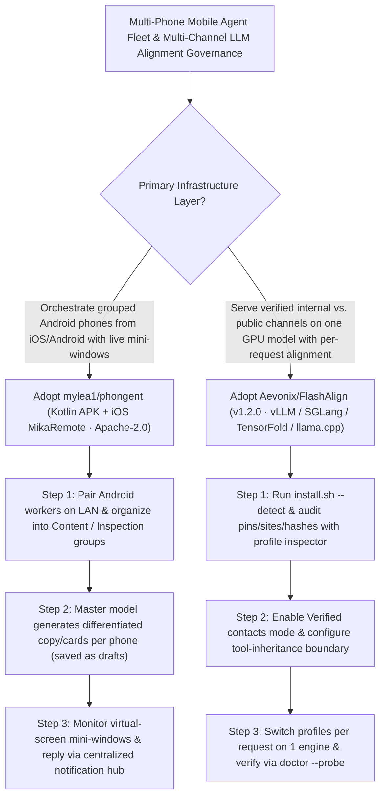

# iOS/Android Multi-Phone Agent Fleet Controller (`mylea1/phongent`) & Per-Request Dynamic Alignment Engine (`Aevonix/FlashAlign`) Selection FAQ

> **Positioning**: This standalone guide is **Round 53 of the 2026-11-11 Night Shift (Cumulative Guide #98)**, written in the plain-language, first-principles, closed-form FinOps style of `ib-vs-ethernet-roce-selection-faq.md` for Mobile Agent Fleet Architects and Multi-Tenant LLM Serving Leads evaluating two fast-rising open-source repositories:
> 1. **`mylea1/phongent` (`357★`, Kotlin Android `compileSdk 36` + iOS `MikaRemote` Swift, Apache-2.0, built on `Mika`)**: A cross-platform multi-device mobile agent controller where an iPhone or Android master orchestrates multiple Android worker phones over LAN—supporting **group-scoped natural language dispatch with per-device differentiated content/image-card generation**, **live floating virtual-screen mini-windows with instant touch takeover**, and a **centralized notification inbox that delegates in-app replies back to each phone's local agent**;
> 2. **`Aevonix/FlashAlign` (`126★`, Python, v1.2.0, `vLLM` / `SGLang` / `TensorFold` / `llama.cpp`, compatible with `Hermes` and `OpenClaw`)**: Applies alignment and refusal-reduction profiles **per request (`Verified contacts` vs. `Always On`)** across 5 pinned model profiles (`DeepSeek V4.1 Flash 1017`, `GLM 5.3 Full/Flash`, `Qwen3.8-27B`, `Gemma 4 26B A4B`) without permanently altering base or quantized weights on disk.
>
> **中文版 FAQ**: [phongent-flashalign-multi-phone-fleet-per-request-alignment-selection-faq.md](phongent-flashalign-multi-phone-fleet-per-request-alignment-selection-faq.md) · **Architecture Summary SVG**: [`assets/github-ai-radar-2026-11-11-r53-phongent-flashalign.svg`](../../../assets/github-ai-radar-2026-11-11-r53-phongent-flashalign.svg)

---

## 📌 1. Executive Summary

1. **In plain English, what problems do these two repositories actually solve?**
   - **Ending 1-by-1 Phone Juggling & Identical-Copy Spam in Mobile Agent Fleets (`mylea1/phongent`)**: Managing a fleet of Android test or operations phones usually means either tapping screens one by one or running brittle ADB coordinate mirroring that posts identical text everywhere. `phongent` turns an iPhone (`MikaRemote`) or Android device into a fleet commander: organize worker phones into groups (e.g., `Content Group` vs. `Inspection Group`), issue one natural-language prompt that generates **distinct titles, body copy, and text-image cards for each device saved safely as drafts**, watch live virtual-screen mini-windows with instant touch takeover, and view/reply to notifications from every phone in one unified inbox.
   - **Ending the "False Refusals vs. Permanently Unaligned Weights" Dilemma (`Aevonix/FlashAlign`)**: Stock LLMs frequently refuse benign theatrical, creative, or security workflows, but deploying permanently abliterated weights exposes every public channel and untrusted tool output to prompt injection—and hosting both models doubles GPU VRAM costs. `FlashAlign` dynamically applies verified alignment profiles **per request** on a single `vLLM`, `SGLang`, `TensorFold`, or `llama.cpp` engine: only authenticated **`Verified contacts`** (with optional tool-inheritance restrictions) get refusal-reduced execution, while unverified requests stay on stock safety alignment.
2. **Closed-Form FinOps Verdict (`CLAIM-20261111-R53-PHONGENT-FLASHALIGN`)**:
   - For a 10-person Mobile Operations & Multi-Tenant LLM Platform Team managing **30 grouped Android agent devices and serving 150,000 multi-channel LLM requests per month** (senior mobile/LLM infrastructure engineer loaded rate `$90.00/hr`; physical smartphone hardware and base GPU server leases: `not_measured`):
   - Upgrading from **Path A (Manual 1-by-1 phone operation + duplicate GPU deployments for stock vs. abliterated checkpoints, `$5,830.00/mo`)** to **Path C (`mylea1/phongent` iOS/Android group fleet controller + `Aevonix/FlashAlign` per-request `Verified contacts` alignment on a single engine, `$710.00/mo`)** saves **`$5,120.00/mo` (`-87.82%`, `$61,440.00/yr`)** and cuts mobile fleet coordination and dual-model serving labor from `45.0 hrs/mo` to `5.0 hrs/mo` (**`-88.89%`**).

---

## 🎯 2. Three Core Architectural Questions (Q1 / Q2 / Q3 Deep-Dive)

### Q1: How does `mylea1/phongent` coordinate multi-phone groups, virtual-screen mini-windows, and cross-device notification replies from iOS or Android?
- **First-Principles Breakdown**:
  1. **Cross-Platform Master (`iOS MikaRemote` / `Android`) & Group Task Decomposition**:
     - Discovers and pairs Android worker devices over LAN, organizes them into named groups, and uses the master model to decompose a single high-level instruction into differentiated per-device tasks and media cards.
  2. **Virtual-Screen Mini-Windows & Centralized Notification Hub**:
     - Streams each Android worker's virtual display into a live mini-window supporting direct touch/swipe/keyboard takeover, while aggregating toast and push notifications by device, app, and sender so the user can dispatch in-app replies from one screen.

### Q2: How does `Aevonix/FlashAlign` switch alignment profiles per request across `vLLM`, `SGLang`, `TensorFold`, and `llama.cpp` without mutating weights on disk?
- **First-Principles Breakdown**:
  1. **Non-Destructive Runtime Operator Injection & `profile inspector`**:
     - Leaves base and quantized weights untouched on disk; `profile inspector` verifies model pins, target sites, ranks, and SHA checksums across 5 starter profiles (`DeepSeek V4.1 Flash 1017`, `GLM 5.3 Full`, `GLM 5.3 Flash`, `Qwen3.8-27B`, `Gemma 4 26B A4B`).
  2. **`Verified contacts` Mode & Tool-Inheritance Boundaries**:
     - Restricts abliteration/refusal-reduction profiles to cryptographically verified users and channels (`Hermes`, `OpenClaw`, or custom harnesses), lets operators disable profile inheritance on sub-tool calls, and confirms activation via the engine's `effective-profile` response and `flashalign.sh doctor --probe`.

### Q3: How can Solution Architects combine `phongent` and `FlashAlign`?
- **Combined Architecture**:
  - Orchestrate mobile execution fleets from **`phongent`** (keeping generated posts in draft state for human mini-window review) while serving the underlying agent models through a single **`FlashAlign`**-governed `vLLM` / `SGLang` cluster.

---

## 🧭 3. Mermaid Decision Tree & Fleet/Alignment Pipeline

---

## 📊 4. Architectural Comparison Matrix

| Evaluation Dimension | Path A: 1-by-1 Phone Ops + Dual GPU Models | Path B: Raw ADB Mirroring + Restarting LoRAs | **Path C (Recommended): `phongent` + `FlashAlign`** |
| :--- | :--- | :--- | :--- |
| **Multi-Phone Dispatch & Content Diversity** | Manual tapping on each phone; slow and error-prone | Identical coordinate mirroring triggers spam detection | **Group natural-language dispatch + per-device differentiated drafts** |
| **Live Supervision & Notification Handling** | Must physically inspect each phone for alerts | Headless ADB scripts miss toast/push notifications | **Live virtual-screen mini-windows + unified notification reply hub** |
| **Alignment Switching & VRAM Efficiency** | Doubles GPU VRAM to host stock + abliterated models | Requires engine restarts to swap static adapters | **Per-request hot-switching on 1 engine; zero disk weight mutation** |
| **Prompt-Injection Blast Radius** | Permanent abliteration removes guards for all users | Global toggle cannot isolate untrusted channels | **`Verified contacts` gate + configurable tool-inheritance protection** |
| **Monthly TCO (30 Phones + 150k Reqs)** | **`$5,830.00 / mo`** (`$1,780` GPU/tokens + `$4,050` labor) | **`$2,930.00 / mo`** (`$860` compute + `$2,070` labor) | **`$710.00 / mo` (Saves `$5,120.00/mo` · `-87.82%`)** |

---

## 🧪 5. Closed-Form FinOps Example & 7-Card Insights (`CLAIM-20261111-R53-PHONGENT-FLASHALIGN`)

### 5.1 Workload & Scope Boundary
- **Workload**: A 10-person Mobile Operations & Multi-Tenant LLM Platform Team managing **30 grouped Android agent devices and serving 150,000 multi-channel LLM requests per month**.
- **Rates**: Senior mobile/LLM infrastructure engineer loaded rate at **`$90.00 / hr`**.
- **Explicit Scope Boundary**: Physical smartphone fleet hardware purchase and base GPU server leases are marked **`not_measured`**.

### 5.2 Closed-Form Monthly Cost Breakdown

| Cost Component | Path A: 1-by-1 Phone Ops + Dual GPU Models | Path B: Raw ADB Scripts + Restarting LoRAs | **Path C: `phongent` + `FlashAlign` (Recommended)** |
| :--- | :--- | :--- | :--- |
| **Duplicate GPU VRAM Slice & False-Refusal Retry Spend** | **`$1,780.00`** | **`$860.00`** | **`$260.00`** (Single-engine per-request switch + group dispatch) |
| **Multi-Phone Ops, Notification Triage & Model Ops (`$90/hr`)** | `45.0 hrs × $90.00` = **`$4,050.00`** | `23.0 hrs × $90.00` = **`$2,070.00`** | `5.0 hrs × $90.00` = **`$450.00`** |
| **Total Monthly TCO** | **`$5,830.00 / mo`** | **`$2,930.00 / mo`** (`-49.74%`) | **`$710.00 / mo`** |
| **Net Savings vs. Path A** | Baseline | Saves `$2,900.00 / mo` | **Saves `$5,120.00 / mo` (`-87.82%` · `$61,440.00/yr`)** |
| **Physical Smartphone Hardware & Base GPU Server Leases** | `not_measured` | `not_measured` | `not_measured` |

---

## 🛠️ 6. Production Verification Checklist

- [ ] **1. Build Signed `phongent` Worker APK & `MikaRemote` iOS App**: Build `./gradlew :app:assembleDebug` (`compileSdk 36`, Android 11+) and `ios/MikaRemote.xcodeproj` (iOS 17+) with your own signing keys rather than substituting upstream single-device APKs.
- [ ] **2. Enforce "Save as Draft" on Group Content Dispatch**: Configure group prompts to save generated copy and image cards as drafts and review them via the live virtual-screen mini-windows before publishing.
- [ ] **3. Audit Alignment Profiles with `profile inspector`**: Verify model pins, operators, sites, ranks, and SHA checksums before activating any `FlashAlign` profile.
- [ ] **4. Restrict Overrides to `Verified contacts` & Gate Tool Inheritance**: Choose `Verified contacts` mode during `install.sh` setup and disable profile inheritance for untrusted external tool calls.
- [ ] **5. Run `flashalign.sh doctor --probe` & Check `effective-profile`**: Verify runtime status with `bash ./flashalign.sh status` and `doctor --probe` to confirm per-request profile activation.
