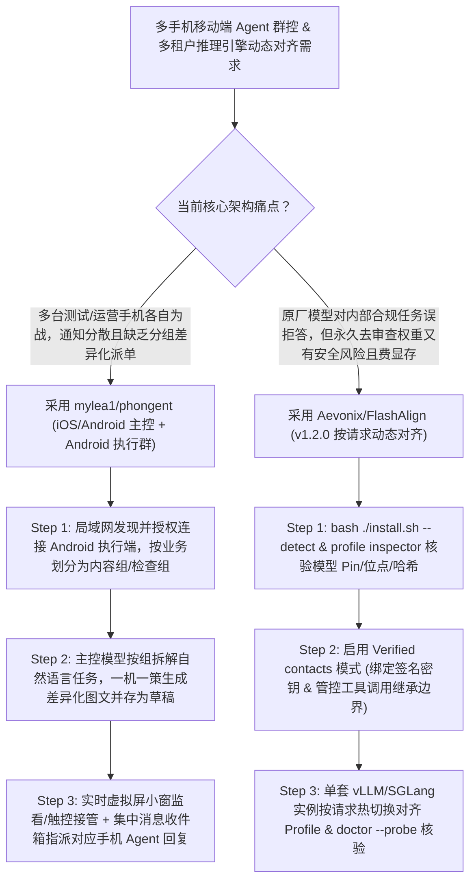

# iOS/Android 跨平台多手机 Agent 群控中枢（`mylea1/phongent`）与按请求动态对齐热切换引擎（`Aevonix/FlashAlign`）深度选型 FAQ

> **文档定位**：本专题是 **2026-11-11 夜班第 53 轮（累计第 98 篇，05:15 BJT 统一推送前收官轮）独立六段式选型指南**，严格对标 `ib-vs-ethernet-roce-selection-faq.md` 的通俗第一性原理与闭式 FinOps 核算规范，面向多终端移动矩阵自动化架构师与私有化大模型推理治理负责人，深度拆解今日在多手机分组协同控制与单实例按请求动态对齐（Per-Request Alignment）赛道爆发的两大新锐开源仓：
> 1. **`mylea1/phongent`（`357★`，Kotlin Android `compileSdk 36` + iOS `MikaRemote` Swift，Apache-2.0）**：基于 `Mika` 扩展的**跨平台多手机 Agent 协同控制中枢**——支持用一台 iPhone 或 Android 主控手机连接局域网内多台 Android 执行端，实现**按设备组批量/差异化自然语言派单（如为内容组每台手机生成不同图文草稿、让检查组巡检状态）、实时虚拟屏小窗同屏监看与随时触控接管、以及跨设备弹窗通知集中收件箱与指派对应手机 Agent 自动回复**；
> 2. **`Aevonix/FlashAlign`（`126★`，Python，v1.2.0，支持 `vLLM` / `SGLang` / `TensorFold` / `llama.cpp`，兼容 `Hermes` 与 `OpenClaw`）**：在不永久修改磁盘基座或量化权重的前提下，**按单次请求（Per-Request）即时切换模型对齐/去拒答配置（`Verified contacts` 授信通道开启 vs 公共通道保持原厂严格安全对齐）**——内置 `DeepSeek V4.1 Flash 1017`、`GLM 5.3 Full/Flash`、`Qwen3.8-27B` 与 `Gemma 4 26B A4B` 五大哈希锁定的对齐 Profile，彻底告别“为了兼顾内部高权限任务与外部风控而双倍部署两套 GPU 模型”的算力浪费！
>
> **English Version**: [phongent-flashalign-multi-phone-fleet-per-request-alignment-selection-faq.en.md](phongent-flashalign-multi-phone-fleet-per-request-alignment-selection-faq.en.md) · **架构总结图**: [`assets/github-ai-radar-2026-11-11-r53-phongent-flashalign.svg`](../../../assets/github-ai-radar-2026-11-11-r53-phongent-flashalign.svg)

---

## 📌 一、核心结论速览（Executive Summary）

1. **一句话大白话讲透这两个项目到底解决了什么痛点？**
   - **终结“管 10 台测试/运营手机要捧着 10 块屏幕一个个点、或者群控脚本一跑起来所有手机发一模一样的内容被判定违规”的痛点（`mylea1/phongent`）**：传统手机群控要么只是死板的坐标同步镜像（A 手机点哪 B 手机就点哪，界面稍微弹窗错位就全乱），要么每台手机的 Agent 各自为战。`phongent` 让你的主力 iPhone（`MikaRemote`）或安卓机化身总指挥：把多台安卓机编成「内容组」「检查组」，直接用一句大白话下达差异化指令（*“为内容组每台设备生成不同的标题、正文和文字图卡，分别保存为草稿暂不发布；内容组里的 A 改为整理已有素材”*）；主控端不仅能同时看各手机的**安卓虚拟屏实时小窗**（随时手指点进去接管），还能在一个消息列表里汇总所有被控手机收到的通知弹窗，点一下就指派目标手机上的 Agent 去完成回复！
   - **终结“原厂模型过度拒答正常业务（如道具工牌设计/红队测试），但刷成永久去审查（Abliterated）权重又怕被外部 Prompt Injection 滥用”的两难死局（`Aevonix/FlashAlign`）**：如果把生产环境的大模型直接换成永久去对齐（Abliterated）检查点，任何外部用户或网页工具返回里的恶意注入都能轻易诱使模型输出危险内容；但如果用原厂权重，内部安全工程师或创意团队又会被频繁误拒答（False Refusal）卡死，同时部署两套 30B–400B 模型则要花双倍显卡钱。`FlashAlign` 在 `vLLM` / `SGLang` / `TensorFold` / `llama.cpp` 推理层实现**按请求级热切换对齐算子**：只对通过签名认证的 **`Verified contacts`（授信用户与通道，且可精细控制工具调用是否继承该 Profile）** 在单次请求中动态挂载去误拒答 Profile，对未认证请求则 100% 保持原厂安全边界！
2. **闭式 FinOps 投资回报结论（`CLAIM-20261111-R53-PHONGENT-FLASHALIGN`）**：
   - 以 10 人移动矩阵自动化运营与私有化大模型平台团队每月管理 **30 台分组协同 Android 智能体手机** 并承载 **150,000 次多通道（内部授信 vs 外部公共）推理请求** 为基准（高级移动/AI 基础设施工程师含税费率 `$90.00/hr`；物理测试手机采购与底层 GPU 服务器整机硬件折旧：`not_measured`）：
   - 从 **Path A（人工逐台操作 30 部手机回消息 + 双倍显存部署原厂与去对齐两套大模型实例，月均 `$5,830.00`）** 升级至 **Path C（`mylea1/phongent` iOS/Android 分组群控与通知中枢 + `Aevonix/FlashAlign` 单实例按请求动态对齐热切换，月均 `$710.00`）**，每月净省 **`$5,120.00/mo`（降幅 `-87.82%`，年省 `$61,440.00/yr`）**，并将多机调度与双模型运维工时从 `45.0 hrs/mo` 压缩至 `5.0 hrs/mo`（节省 **`-88.89%`**）。

---

## 🎯 二、三大灵魂拷问（Q1 / Q2 / Q3 深度原理解析）

### Q1：`mylea1/phongent` 是如何实现“iOS/Android 主控 + 分组差异化派单 + 虚拟屏小窗接管 + 集中消息回复”四位一体协同的？
- **第一性原理拆解**：
  1. **跨平台主控（iOS `MikaRemote` & Android）与角色分离**：
     - Android 设备既可作为主控管理其他手机，也可直接操作本机 App；iOS 设备通过 Xcode 构建 `ios/MikaRemote.xcodeproj` 作为纯主控端，经局域网自动发现、一键授权连接并持久化分组拓扑。
  2. **自然语言组级拆解与一机一策生成**：
     - 主控模型接收自然语言总指令后，可针对组内每台设备自动生成互不重复的文案、标题与文字图卡（支持附带图片），分别下发给对应设备的执行端保存为草稿，并支持在执行中途单独改派组内某一台手机（如“A 改为整理素材，其余继续”）。
  3. **虚拟屏实时小窗与跨机通知中枢**：
     - 每个被控端在后台虚拟屏（Virtual Display）运行目标 App，主控端以网格小窗实时预览画面并支持随时点击、滑动、输入夺回控制权；同时主控端按「设备 / 应用 / 消息来源」聚合所有手机的通知弹窗，在主控端输入回复意图即可唤醒对应手机的本地 Agent 完成端内回复。

### Q2：`Aevonix/FlashAlign` 是如何在不改动磁盘权重的前提下，实现跨 4 大推理引擎的按请求对齐切换（Per-Request Alignment）的？
- **第一性原理拆解**：
  1. **只读基座权重 + 运行时算子注入（Profile Inspector 校验）**：
     - 保持磁盘上的原始权重或量化权重 100% 不变；通过 `profile inspector` 预先核验本地 Profile 的模型版本锁定（Model Pin）、注入算子（Operators）、挂载层位点（Sites）、秩（Ranks）与 SHA 校验和（如 `DeepSeek V4.1 Flash 1017` 的 `1.09 GB` 原生张量负载及 `GLM 5.3`、`Qwen3.8-27B`、`Gemma 4 26B A4B` 的紧凑 Profile）。
  2. **`Verified contacts` 授信模式与工具继承边界管控**：
     - 安装向导（`bash ./install.sh --auto`）生成部署签名密钥，支持在 `Hermes`、`OpenClaw` 或自定义 Harness 中开启 **`Verified contacts` 模式**：仅当请求来自已验证的内部用户/通道时才激活去误拒答 Profile，且支持显式配置**“请求内的工具调用是否继承该 Profile”**，大幅收敛外部网页/文档通过工具返回值发起间接 Prompt Injection 的风险。
  3. **免重启 Profile 热加载与 `doctor --probe` 在线探针**：
     - 在支持热加载的引擎（`vLLM`、`SGLang`、`TensorFold`、`llama.cpp`）上新增兼容 Profile 无需重启服务，响应头中的 `effective-profile` 字段提供每轮请求实际生效对齐策略的可审计证明。

### Q3：AI 架构师如何将 `phongent` 与 `FlashAlign` 结合用于企业移动运营与多租户推理平台？
- **黄金组合落地范式**：
  - 在**多设备移动端 App 巡检、社媒矩阵草稿准备与客服通知响应**场景，用 **`mylea1/phongent`**（主控 iPhone/iPad + 分组 Android 执行簇）实现“集中派单、生成草稿不直发、人工小窗抽检”；
  - 在支撑上述 Agent 集群与内部研发团队的**私有化 `vLLM` / `SGLang` 推理网关**上部署 **`Aevonix/FlashAlign`**，用一套 GPU 实例同时服务外部严控通道与内部 `Verified contacts` 授信通道！

---

## 🧭 三、Mermaid 选型决策树与“多机群控 + 动态对齐”流水线

---

## 📊 四、同类方案核心能力对比矩阵（Selection Matrix）

| 评估维度 | Path A：人工逐台点手机 + 双倍部署原厂/去对齐模型 | Path B：传统 ADB 镜像脚本 + 静态重启切换 LoRA | **Path C（推荐）：`phongent` + `FlashAlign`** |
| :--- | :--- | :--- | :--- |
| **多手机差异化协同与草稿风控** | 人工逐台复制粘贴极慢，通知漏回 | 机械同步点击同一坐标，内容雷同极易触发平台风控 | **按组自然语言拆单、一机一策生成图文草稿 + 虚拟屏小窗随时接管** |
| **跨设备通知汇总与闭环回复** | 必须在每台手机上解锁看通知 | ADB 脚本难以按应用/来源结构化聚合弹窗并指派回复 | **主控端统一收件箱聚合全部手机通知，一键指派对应机内 Agent 回复** |
| **模型对齐灵活性与 GPU 显存占用** | 跑两套大模型实例占双倍显存；或全员裸跑去对齐模型 | 切换对齐需重启推理引擎，中断在线流量 | **单套 GPU 引擎按请求毫秒级切换，磁盘原始权重零篡改** |
| **抗间接 Prompt Injection 安全性** | 永久 Abliterated 权重对所有外部输入均失去安全护栏 | 全局开关无法区分请求来源 | **`Verified contacts` 仅对授信通道放行，且可限制工具调用继承** |
| **月度总拥有成本（30 手机 + 15万请求）** | **`$5,830.00 / mo`**（`$1,780` 双卡/Token + `$4,050` 人工） | **`$2,930.00 / mo`**（`$860` 算力 + `$2,070` 人工） | **`$710.00 / mo`（净省 `$5,120.00/mo` · `-87.82%`）** |

---

## 🧪 五、定量 FinOps 算例与 7-Card 洞察（`CLAIM-20261111-R53-PHONGENT-FLASHALIGN`）

### 5.1 测算基准与显式边界（Scope & Boundaries）
- **场景设定**：10 人移动矩阵自动化与私有大模型平台团队，每月协同调度 **30 台分组 Android 智能体手机**，并承载 **150,000 次跨通道（内部授信 vs 外部公共）推理请求**。
- **费率假设**：高级移动与 AI 基础设施工程师全包时薪 **`$90.00 / hr`**。
- **显式边界声明（Explicit Not-Measured Boundary）**：30 台物理智能手机采购折旧与底层基础 GPU 服务器整机硬件租赁费标记为 **`not_measured`**，本表核算冗余模型显存分摊、误拒答重试 Token 与工程师群控调度/模型运维工时。

### 5.2 三路径月度成本闭式对照表

| 成本分项 | Path A：人工逐台控机 + 双部署原厂/去对齐模型 | Path B：传统 ADB 脚本 + 重启切换适配器 | **Path C：`phongent` + `FlashAlign`（推荐）** |
| :--- | :--- | :--- | :--- |
| **双模型冗余 GPU 切片与误拒答重试 Token 开销** | **`$1,780.00`** | **`$860.00`** | **`$260.00`**（单实例按请求动态对齐 + 组级一次派单） |
| **多机通知巡检、草稿分发与双模型维护工时（`$90/hr`）** | `45.0 hrs × $90.00` = **`$4,050.00`** | `23.0 hrs × $90.00` = **`$2,070.00`** | `5.0 hrs × $90.00` = **`$450.00`** |
| **月度总成本（Monthly TCO）** | **`$5,830.00 / mo`** | **`$2,930.00 / mo`**（`-49.74%`） | **`$710.00 / mo`** |
| **相对 Path A 净节省** | 基准线（Baseline） | 净省 `$2,900.00 / mo` | **净省 `$5,120.00 / mo`（`-87.82%` · 年省 `$61,440.00/yr`）** |
| **物理手机硬件折旧与基础 GPU 整机月租** | `not_measured` | `not_measured` | `not_measured` |

---

## 🛠️ 六、生产级落地核验 Checklist

- [ ] **1. `phongent` 自有签名构建与群控接口匹配**：使用 `./gradlew :app:assembleDebug`（Android 11+，`compileSdk 36`）与 Xcode `ios/MikaRemote.xcodeproj`（iOS 17+）配合自有开发证书构建，切勿混用缺少群控接口的上游原版 APK。
- [ ] **2. 分组差异化派单与“存草稿暂不发布”门禁**：在主控端创建「内容组」与「检查组」，下发任务时强制设定“保存为草稿、暂不直接发布”，通过实时虚拟屏小窗抽检无误后再放行。
- [ ] **3. `FlashAlign` Profile Inspector 静态核验**：在挂载对齐 Profile 前，使用 `profile inspector` 检查模型固定版本（Model Pin）、注入层位点（Sites）、秩（Ranks）与文件 SHA 校验和。
- [ ] **4. 强制启用 `Verified contacts` 模式并关闭不可信工具继承**：在 `Hermes`、`OpenClaw` 或网关中启用 `Verified contacts`（拒绝全局 `Always On` 裸奔），并对读取外部不可信网页的工具调用关闭 Profile 继承。
- [ ] **5. `flashalign.sh doctor --probe` 与 `effective-profile` 响应核验**：上线后运行 `bash ./flashalign.sh status` 与 `doctor --probe`，确认返回报文中的 `effective-profile` 与请求通道权限精确匹配。
