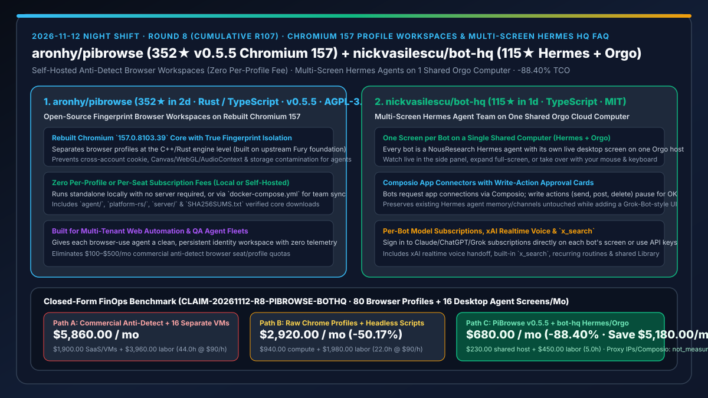
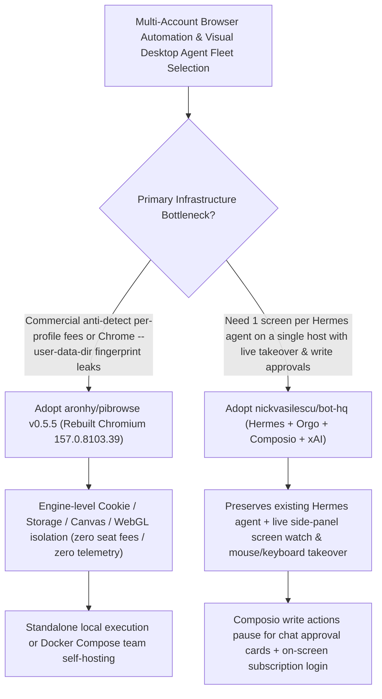

# Open-Source Chromium 157 Fingerprint Browser Workspaces (`aronhy/pibrowse` `v0.5.5`) & Shared-Computer Multi-Screen Hermes Agent HQ (`nickvasilescu/bot-hq`) Selection FAQ

> **Document Scope**: This is the **2026-11-12 Night Shift Round 8 (Cumulative #107) standalone 6-part selection guide**, modeled strictly after `ib-vs-ethernet-roce-selection-faq.md` with first-principles explanations and closed-form FinOps math. It is written for Browser-Automation Architects and Multi-Agent Operations Leads evaluating two breakout repositories for isolated browser workspaces and multi-screen desktop agents:
> 1. **`aronhy/pibrowse` (`352★` in 2 days, `~176★/day`, Rust / TypeScript / C++, AGPL-3.0-or-later, `v0.5.5`)**: An open-source anti-detect fingerprint browser built on a rebuilt **Chromium `157.0.8103.39` core** (derived from upstream Fury) — featuring **zero per-profile or per-seat subscription fees, zero telemetry**, standalone local execution or team self-hosting via `docker-compose.yml`, and dedicated `agent/` + `platform-rs/` modules!
> 2. **`nickvasilescu/bot-hq` (`115★` in 1 day, TypeScript, MIT, powered by NousResearch `Hermes Agent` + `Orgo` + `Composio` + `xAI`)**: A Grok-Bot-inspired team control room where **every AI agent gets its own live desktop screen on one shared cloud computer** — preserving your existing Hermes Agent untouched while adding live side-panel screen watching, instant mouse/keyboard takeover, per-bot subscription login, **in-chat approval cards for Composio write actions**, and xAI realtime voice + `x_search`!
>
> **中文版本**: [pibrowse-bot-hq-chromium157-fingerprint-workspaces-multi-screen-hermes-selection-faq.md](pibrowse-bot-hq-chromium157-fingerprint-workspaces-multi-screen-hermes-selection-faq.md) · **Daily Digest**: [`daily/2026-11-12.en.md`](../daily/2026-11-12.en.md) · **Architecture Summary SVG**: [`assets/github-ai-radar-2026-11-12-r8-pibrowse-bothq.svg`](../../../assets/github-ai-radar-2026-11-12-r8-pibrowse-bothq.svg)

---

## 📌 1. Executive Summary

1. **In plain English, what core pain points do these two repositories solve?**
   - **Ending "$100–$500/month per-profile commercial anti-detect browser subscriptions and cross-account bans caused by naive Chrome `--user-data-dir` fingerprint leaks" (`aronhy/pibrowse` `v0.5.5`)**: When browser agents manage dozens of client accounts or QA environments, standard Playwright contexts share identical underlying C++ hardware/Canvas/WebGL fingerprints. Commercial anti-detect browsers charge steep per-profile fees and lock profiles in vendor clouds. `PiBrowse` pairs a Rust/TypeScript client with a rebuilt **Chromium `157.0.8103.39` core** (verified via `SHA256SUMS.txt`), isolating profiles at the engine level with zero seat fees, zero telemetry, and full Docker Compose self-hosting!
   - **Ending "paying for 16 separate cloud desktop VMs for 16 GUI agents and lacking a unified chat UI to watch their screens and approve external write actions" (`nickvasilescu/bot-hq`)**: `bot-hq` runs a team of **NousResearch Hermes Agents** on **one shared Orgo computer**, giving each bot its own live desktop screen: (1) watch any bot's screen in the side panel, fold completed turns into `"Worked for 2m 10s · 7 steps"` chips, or take over with your mouse and keyboard; (2) sign in to your existing Claude/ChatGPT/Grok subscriptions directly on a bot's screen; and (3) gate every Composio write action (send, post, delete) behind an **in-chat OK approval card**!
2. **Closed-Form FinOps Conclusion (`CLAIM-20261112-R8-PIBROWSE-BOTHQ`)**:
   - Modeled for a **12-person web automation & agent ops team managing `80 isolated browser profile workspaces` and `16 concurrent desktop-screen agents` per month** (fully loaded senior automation engineer rate `$90.00/hr`; external proxy IP bandwidth and paid Composio/xAI tier fees: `not_measured`):
   - Upgrading from **Path A (commercial per-profile anti-detect SaaS + 16 separate cloud desktop VMs, `$5,860.00/mo`)** to **Path C (`PiBrowse v0.5.5` self-hosted Chromium 157 workspaces + `bot-hq` shared-computer multi-screen Hermes agents, `$680.00/mo`)** saves **`$5,180.00/mo` (`-88.40%`, or `$62,160.00/yr`)** and cuts ban-recovery and multi-VM handoff labor from `44.0 hrs/mo` to `5.0 hrs/mo` (**`-88.64%`**).

---

## 🎯 2. Three First-Principles Deep-Dive Questions (Q1 / Q2 / Q3)

### Q1: Why does `aronhy/pibrowse` (`v0.5.5`) ship a rebuilt Chromium `157.0.8103.39` core instead of using JS-injected stealth scripts?
- **First-Principles Breakdown**:
  1. **Engine-Level Profile Isolation vs. Detectable JS Monkey-Patching**:
     - Anti-bot systems easily detect JS `Object.defineProperty` shims via Web Workers and iframe prototype checks. Built on upstream Fury, `PiBrowse` separates the desktop shell from the rebuilt **Chromium `157.0.8103.39` core** (`pibrowse-core-0.5.5` with `SHA256SUMS.txt`), isolating fingerprints natively.
  2. **Standalone Local Mode & Self-Hosted Team Sync**:
     - Works standalone with no server required, or self-hosts for teams via `docker-compose.yml` with zero telemetry and dedicated `agent/` + `platform-rs/` crates.

### Q2: How does `nickvasilescu/bot-hq` multiplex multiple Hermes agent screens on one computer while enforcing Composio write approvals?
- **First-Principles Breakdown**:
  1. **Non-Intrusive Hermes Agent Wrapping + Per-Bot Orgo Desktops**:
     - The first bot attaches to the existing Hermes Agent on the host via API (keeping its messaging channels, skills, and memory intact), while each additional bot gets its own isolated desktop screen on the shared Orgo computer for live watching or mouse/keyboard takeover.
  2. **On-Screen Subscription Login & Write-Action Approval Cards**:
     - Operators can sign in to existing Claude/ChatGPT/Grok subscriptions directly inside a bot's screen; Composio app integrations automatically pause write actions (send, post, delete) until approved on a card in the chat.

### Q3: How should AI Solution Architects combine `PiBrowse` and `bot-hq`?
- **Golden-Combo Pattern**:
  - Deploy **`nickvasilescu/bot-hq`** as the multi-screen Hermes control room on a shared cloud host;
  - Inside each bot's desktop screen, launch **`aronhy/pibrowse v0.5.5`** profiles so every agent operates within a cleanly isolated Chromium 157 workspace!

---

## 🧭 3. Mermaid Decision Tree & Multi-Screen Isolated Browser Agent Pipeline

---

## 📊 4. Head-to-Head Selection Matrix

| Dimension | Path A: Commercial Anti-Detect SaaS + 16 Separate VMs | Path B: Raw Chrome Profiles + Headless Scripts | **Path C (Recommended): `PiBrowse v0.5.5` + `bot-hq`** |
| :--- | :--- | :--- | :--- |
| **Fingerprint Isolation & Licensing** | Engine-level, but $100–$500/mo per-profile quotas | Shared underlying C++ fingerprint triggers bans | **Rebuilt Chromium 157 engine isolation; 100% free & self-hostable** |
| **Multi-Agent Desktop Density** | 16 separate VMs required for 16 screens | Headless only; blind on CAPTCHAs/2FA | **One screen per Hermes bot on a single shared Orgo computer** |
| **Subscription Reuse** | API keys only | API keys only | **Sign in to existing Claude/ChatGPT/Grok subscriptions on the bot's screen** |
| **External SaaS Write Governance** | None | Direct API writes risk accidental sends/deletes | **Composio write actions pause for in-chat approval cards** |
| **Monthly TCO (80 Profiles + 16 Bots)** | **`$5,860.00 / mo`** (`$1,900` SaaS/VMs + `$3,960` labor) | **`$2,920.00 / mo`** (`$940` compute + `$1,980` labor) | **`$680.00 / mo` (Saves `$5,180.00/mo` · `-88.40%`)** |

---

## 🧪 5. Closed-Form FinOps Worked Example & 7-Card Insights (`CLAIM-20261112-R8-PIBROWSE-BOTHQ`)

### 5.1 Baseline Parameters & Explicit Scope Boundaries
- **Scenario**: A 12-person web automation & agent operations team maintaining **80 isolated browser profile workspaces** and **16 concurrent desktop-screen Hermes agents**.
- **Labor Rate**: Fully loaded senior automation engineering rate of **`$90.00 / hr`**.
- **Explicit Not-Measured Boundary**: Third-party proxy IP bandwidth bills and paid Composio / xAI commercial tier subscriptions are marked **`not_measured`**. This model strictly accounts for anti-detect browser SaaS seats, cloud VM hosting, and engineering hours spent on ban recovery and multi-VM remote desktop handoffs.

### 5.2 Three-Path Monthly Cost Comparison

| Cost Component | Path A: Commercial Anti-Detect + 16 Cloud VMs | Path B: Raw Chrome + Headless Scripts | **Path C: `PiBrowse v0.5.5` + `bot-hq` (Recommended)** |
| :--- | :--- | :--- | :--- |
| **Monthly Browser SaaS & Desktop Host Spend** | **`$1,900.00`** | **`$940.00`** | **`$230.00`** ($0 self-hosted `PiBrowse` + 1 shared multi-screen host) |
| **Ban Recovery, CAPTCHA Triage & Multi-VM Handoff Labor (`$90/hr`)** | `44.0 hrs × $90.00` = **`$3,960.00`** | `22.0 hrs × $90.00` = **`$1,980.00`** | `5.0 hrs × $90.00` = **`$450.00`** |
| **Total Monthly TCO** | **`$5,860.00 / mo`** | **`$2,920.00 / mo`** (`-50.17%`) | **`$680.00 / mo`** |
| **Net Savings vs. Path A** | Baseline | Saves `$2,940.00 / mo` | **Saves `$5,180.00 / mo` (`-88.40%` · `$62,160.00/yr`)** |
| **Proxy IP Bandwidth & Paid Composio/xAI Tiers** | `not_measured` | `not_measured` | `not_measured` |

---

## 🛠️ 6. Production Adoption Checklist

- [ ] **1. `PiBrowse v0.5.5` SHA-256 Checksum Verification**: Verify both the desktop client and `pibrowse-core-0.5.5` (`Chromium 157.0.8103.39`) against `SHA256SUMS.txt` before launch.
- [ ] **2. Multi-Profile Isolation & Self-Hosted Team Sync**: Test profile fingerprint separation locally and deploy the optional `docker-compose.yml` stack for team profile sharing.
- [ ] **3. `bot-hq` Non-Destructive Hermes Integration**: Attach `bot-hq` to an existing Hermes Agent and verify that existing memory, skills, and messaging channels continue working unchanged.
- [ ] **4. Live Screen Takeover & Composio Write Approval Test**: Take over a bot's screen in the side panel to complete an interactive login, and trigger a Composio write action to verify the in-chat approval card gate.
