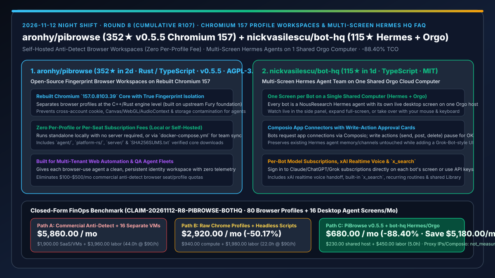
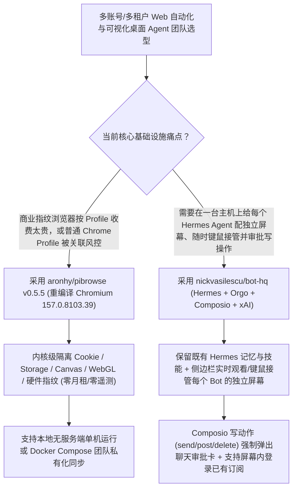

# 开源 Chromium 157 指纹隔离工作区（`aronhy/pibrowse` `v0.5.5`）与单机多屏 Hermes 智能体指挥部（`nickvasilescu/bot-hq`）深度选型 FAQ

> **文档定位**：本专题是 **2026-11-12 夜班第 8 轮（累计第 107 篇）独立六段式选型指南**，严格对标 `ib-vs-ethernet-roce-selection-faq.md` 的通俗第一性原理与闭式 FinOps 核算规范，面向多租户浏览器自动化、Web Agent 评测与远程桌面智能体架构师，深度拆解今日在内核级浏览器环境隔离与单机多屏 Hermes Agent 编排赛道突起的两大开源仓：
> 1. **`aronhy/pibrowse`（建仓 2 天狂揽 `352★`，日均 `≈176★/天`，Rust / TypeScript / C++，AGPL-3.0-or-later，最新 `v0.5.5`）**：基于自编译 **Chromium `157.0.8103.39` 内核** 与上游 Fury 架构打造的开源指纹隔离浏览器工作区——**零按席位/按环境数量收费、零遥测上报**，支持单机无服务端独立运行或通过 `docker-compose.yml` 团队自托管，并内置 `agent/` 与 `platform-rs/` 模块！
> 2. **`nickvasilescu/bot-hq`（建仓 1 天 `115★`，TypeScript，MIT，基于 NousResearch `Hermes Agent` + `Orgo` + `Composio` + `xAI`）**：让你在**同一台云电脑上为每个 AI 助手分配一块独立桌面屏幕（Each with its own screen on one cloud computer）**的 Grok-Bot 风格团队指挥台——底层直接复用你已有的 Hermes Agent（保留原有记忆、技能与消息通道），支持在每个 Bot 自己的屏幕上直接登录 Claude / ChatGPT / Grok 订阅账号、侧边栏实时围观并键鼠接管、以及写操作（发送/发帖/删除）触发**聊天内 Composio 审批卡**！
>
> **English Version**: [pibrowse-bot-hq-chromium157-fingerprint-workspaces-multi-screen-hermes-selection-faq.en.md](pibrowse-bot-hq-chromium157-fingerprint-workspaces-multi-screen-hermes-selection-faq.en.md) · **关联日报**: [`daily/2026-11-12.md`](../daily/2026-11-12.md) · **架构总结图**: [`assets/github-ai-radar-2026-11-12-r8-pibrowse-bothq.svg`](../../../assets/github-ai-radar-2026-11-12-r8-pibrowse-bothq.svg)

---

## 📌 一、核心结论速览（Executive Summary）

1. **一句话大白话讲透这两个项目到底解决了什么痛点？**
   - **终结“商业指纹浏览器（AdsPower / Multilogin）按 Profile 数量和团队席位收高额月租，而普通 Chrome `--user-data-dir` 无法隔离底层 Canvas/WebGL/硬件指纹导致多账号 Web Agent 被关联封禁”的痛点（`aronhy/pibrowse` `v0.5.5`）**：当企业运行几十个并发浏览器 Agent 执行多租户 SaaS 巡检、跨境电商运营或端到端测试时，普通 Playwright Context 共享相同的底层浏览器指纹，极易触发风控验证；而商业反检测浏览器动辄每月几百美元且把环境数据存在厂商云端。`PiBrowse` 直接基于重编译的 **Chromium `157.0.8103.39` 内核**（并提供完整 `SHA256SUMS.txt` 校验），在 Rust/C++ 层实现彻底的 Profile 环境隔离，既能免服务器单机运行，又能通过 `docker-compose.yml` 在内网为整个团队免费自托管！
   - **终结“给 10 个桌面 Agent 配 10 台独立云桌面虚拟机太烧钱，且没办法在同一个聊天面板里一边看每个 Bot 的实时屏幕、一边审批它们的对外发帖/发邮件动作”的痛点（`nickvasilescu/bot-hq`）**：`bot-hq` 将 NousResearch 的 **Hermes Agent** 与 **Orgo** 屏幕虚拟化结合，在**单台共享云主机上为每个 Bot 切出独立的桌面屏幕**：① 你可以在聊天右侧面板实时观看任意 Bot 的屏幕操作，随时全屏放大并用自己的鼠标键盘接管（たとえば帮 Bot 点过一次登录或输入自己已付费的 Claude/ChatGPT 网页订阅）；② 接入 **Composio** 应用生态，所有只读查询自动放行，凡涉及写操作（发消息、发推、删文件）一律在聊天框弹出 OK 审批卡；③ 内置 **xAI 实时语音通话与 `x_search` 实时情报工具**！
2. **闭式 FinOps 投资回报结论（`CLAIM-20261112-R8-PIBROWSE-BOTHQ`）**：
   - 以 **12 人 Web 自动化、多租户巡检与智能体运营团队维护 `80 个` 隔离浏览器身份环境，并并发运行 `16 个` 带可视化桌面的长驻 Agent** 为基准（高级自动化工程师全包时薪 `$90.00/hr`；第三方住宅代理 IP 流量费与外部 Composio/xAI 超额 API 账单：`not_measured`）：
   - 从 **Path A（按席位/Profile 购买商业指纹浏览器 SaaS + 为 16 个 Agent 租用 16 台独立云桌面 VM，月均 `$5,860.00`）** 升级至 **Path C（`PiBrowse v0.5.5` 自托管 Chromium 157 工作区 + `bot-hq` 单机多屏 Hermes/Orgo 编排与写操作审批，月均 `$680.00`）**，每月净省 **`$5,180.00/mo`（降幅 `-88.40%`，年省 `$62,160.00/yr`）**，并将因指纹关联风控排障与跨多台 VM 远程桌面切屏接管耗费的工时从 `44.0 hrs/mo` 压缩至 `5.0 hrs/mo`（节省 **`-88.64%`**）。

---

## 🎯 二、三大灵魂拷问（Q1 / Q2 / Q3 深度原理解析）

### Q1：`aronhy/pibrowse` (`v0.5.5`) 为什么必须重编译 Chromium `157.0.8103.39` 内核，它比普通 Playwright `--user-data-dir` 或 JS 注入插件强在哪？
- **第一性原理拆解**：
  1. **C++ 内核级指纹隔离 vs 脆弱的 JS `Object.defineProperty` 注入**：
     - 现代反爬与风控脚本会通过 Web Worker、iframe 原型链对比与底层渲染时序检测出 JS 层伪造的 `navigator` 或 Canvas 补丁。`PiBrowse` 继承并演进了开源 Fury 内核，直接将桌面端壳（`desktop/`、`platform-rs/`）与重编译的 **Chromium `157.0.8103.39` 核心包（`pibrowse-core-0.5.5`）** 分离打包并附带 SHA-256 校验，从浏览器引擎原生层隔离每个工作区的指纹参数。
  2. **双模运行（Standalone Local vs Team Self-Hosted）与 `agent/` 原生目录**：
     - 个人开发者无需启动任何后端服务即可本地管理数十个独立 Profile；团队则可通过仓库内置的 `server/` 与 `docker-compose.yml` 私有化部署共享环境，且零遥测、零按量计费。

### Q2：`nickvasilescu/bot-hq` 是如何在单台主机上跑起“一 Bot 一屏幕”的 Hermes 团队，并实现“订阅复用 + Composio 写审批”的？
- **第一性原理拆解**：
  1. **零侵入挂载既有 Hermes Agent + 单机多桌面会话**：
     - 接管主机上的第一个 Bot 就是本机原有的 `Hermes Agent`（其原有的 Telegram/Discord 消息通道、Skills 和记忆原封不动保留，`bot-hq` 仅通过 API 调用并为其挂载 Orgo 屏幕）；新建的每个队友 Bot 同样获得各自的独立桌面屏幕，聊天界面会将已完成的回合折叠为清晰可展开的 `"Worked for 2m 10s · 7 steps"` 轨迹胶囊。
  2. **屏幕内直接登录已有模型订阅 + Composio 写操作卡片门禁**：
     - 用户可以直接点开某个 Bot 的专属屏幕，在里面手动登录自己已经付费的 Claude、ChatGPT 或 Grok 订阅，省去高昂的按 Token 计费账单；
     - 当 Bot 通过 Composio 操作外部 SaaS 应用时，凡触发 Write 级动作（send / post / delete），执行流自动挂起并在聊天窗口生成审批卡，人工点击 OK 后方可执行。

### Q3：AI 架构师如何将 `PiBrowse` 与 `bot-hq` 组合构建高安全的多租户 Web Agent 矩阵？
- **黄金组合落地范式**：
  - 用 **`nickvasilescu/bot-hq`** 作为团队总控台，在一台共享主机上管理 10+ 个各司其职的 Hermes 智能体（配齐侧边栏实时屏幕接管与 Composio 写操作审批）；
  - 在每个 Bot 的专属桌面中运行 **`aronhy/pibrowse v0.5.5`**，为不同客户租户或测试账号分配内核级隔离的 Chromium 157 工作区！

---

## 🧭 三、Mermaid 选型决策树与「单机多屏 Hermes + Chromium 157 指纹隔离」架构图

---

## 📊 四、同类方案核心能力对比矩阵（Selection Matrix）

| 评估维度 | Path A：商业指纹浏览器 SaaS + 每 Bot 独立云 VM | Path B：普通 Chrome 目录 + 无头无屏脚本 | **Path C（推荐）：`PiBrowse v0.5.5` + `bot-hq`** |
| :--- | :--- | :--- | :--- |
| **浏览器环境隔离深度与费用** | 内核级隔离，但按席位和 Profile 阶梯收高额月费 | 仅隔离 Cookie，底层指纹完全一致易触发连坐风控 | **重编译 Chromium 157 内核级隔离，100% 开源免费可自托管** |
| **多 Agent 桌面资源密度** | 16 个 Bot 需开 16 台独立云主机，成本高昂 | 无可视化桌面，遇到验证码或登录态失效直接卡死 | **单台主机通过 Orgo 为每个 Hermes Bot 分配独立可接管屏幕** |
| **模型计费与既有订阅复用** | 必须全部走高价按量 API | 仅支持 API Key | **支持直接在 Bot 专属屏幕内登录已付费 Claude/ChatGPT/Grok 订阅** |
| **外部 SaaS 写操作安全门禁** | 无统一拦截 | 脚本直接调接口，极易误发邮件或误删数据 | **Composio 写操作自动挂起并在聊天内弹出人工审批卡** |
| **月度总拥有成本（80 环境 + 16 桌面 Bot）** | **`$5,860.00 / mo`**（`$1,900` SaaS/VM + `$3,960` 工时） | **`$2,920.00 / mo`**（`$940` 算力 + `$1,980` 工时） | **`$680.00 / mo`（净省 `$5,180.00/mo` · `-88.40%`）** |

---

## 🧪 五、定量 FinOps 算例与 7-Card 洞察（`CLAIM-20261112-R8-PIBROWSE-BOTHQ`）

### 5.1 测算基准与显式边界（Scope & Boundaries）
- **场景设定**：12 人多租户 Web 自动化与智能体运营团队，长期维护 **80 个隔离浏览器身份工作区**，并并发运行 **16 个带独立桌面的长驻 Hermes 智能体**。
- **费率假设**：高级自动化与智能体工程师全包时薪 **`$90.00 / hr`**。
- **显式边界声明（Explicit Not-Measured Boundary）**：第三方住宅/数据中心代理 IP 流量费与外部 Composio / xAI 高阶商业套餐订阅费标记为 **`not_measured`**，本表严格核算指纹浏览器订阅费、云桌面主机租金以及因账号风控解封、无头卡死排障与多 VM 切屏接管耗费的工程工时。

### 5.2 三路径月度成本闭式对照表

| 成本分项 | Path A：商业指纹 SaaS + 16 台独立云 VM | Path B：普通 Chrome + 无头脚本 | **Path C：`PiBrowse v0.5.5` + `bot-hq`（推荐）** |
| :--- | :--- | :--- | :--- |
| **月度指纹浏览器席位与云桌面主机支出** | **`$1,900.00`** | **`$940.00`** | **`$230.00`**（`PiBrowse` 免费自托管 + 单台共享主机多屏复用已有订阅） |
| **风控解封、验证码卡死排障与跨机接管工时（`$90/hr`）** | `44.0 hrs × $90.00` = **`$3,960.00`** | `22.0 hrs × $90.00` = **`$1,980.00`** | `5.0 hrs × $90.00` = **`$450.00`** |
| **月度总成本（Monthly TCO）** | **`$5,860.00 / mo`** | **`$2,920.00 / mo`**（`-50.17%`） | **`$680.00 / mo`** |
| **相对 Path A 净节省** | 基准线（Baseline） | 净省 `$2,940.00 / mo` | **净省 `$5,180.00 / mo`（`-88.40%` · 年省 `$62,160.00/yr`）** |
| **代理 IP 流量与外部 Composio/xAI 高阶套餐** | `not_measured` | `not_measured` | `not_measured` |

---

## 🛠️ 六、生产级落地核验 Checklist

- [ ] **1. `PiBrowse v0.5.5` Chromium 157 核心包 SHA-256 校验**：下载客户端与 `pibrowse-core-0.5.5` 压缩包，严格对照 Release 中的 `SHA256SUMS.txt` 校验文件完整性后再启动。
- [ ] **2. 多工作区指纹隔离与 Docker Compose 团队同步验证**：创建多个独立 Profile 工作区，验证 Cookie、LocalStorage 与硬件指纹互不串扰。
- [ ] **3. `bot-hq` 无损对接既有 Hermes Agent**：在已运行 Hermes 的主机上启动 `bot-hq`，确认第一个 Bot 完整继承原有记忆、技能与消息渠道。
- [ ] **4. 侧边栏键鼠接管与 Composio 写操作审批卡测试**：在侧边栏实时接管 Bot 屏幕完成一次网页登录，并触发一次 Composio 外部写动作，验证聊天内审批卡拦截生效。
