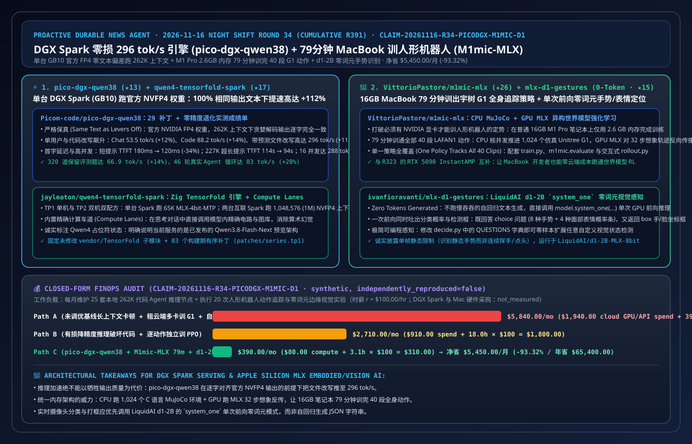
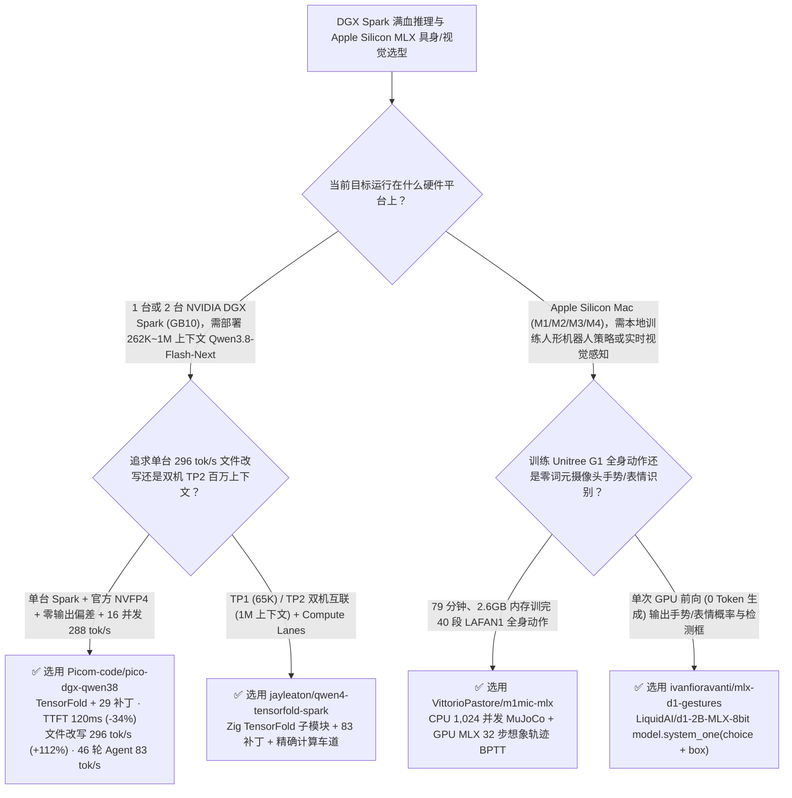

# DGX Spark 零损 `296 tok/s` 推理配方、79 分钟 MacBook 训宇树 G1 与零词元视觉感知选型 FAQ：`Picom-code/pico-dgx-qwen38` & `jayleaton/qwen4-tensorfold-spark` + `VittorioPastore/m1mic-mlx` & `ivanfioravanti/mlx-d1-gestures`

> **元数据（Metadata）**
> - **评测批次**：2026-11-16 夜间深潜 Round 34（累计 Round 391）
> - **核心标的**：
>   1. [`Picom-code/pico-dgx-qwen38`](https://github.com/Picom-code/pico-dgx-qwen38)（`★ 13`，Apache-2.0）& [`jayleaton/qwen4-tensorfold-spark`](https://github.com/jayleaton/qwen4-tensorfold-spark)（`★ 17` / `1 Fork`，Apache-2.0）—— 在单台或双台 NVIDIA DGX Spark（`GB10`）上基于 Zig `TensorFold` 引擎与 Compute Lanes 部署 `Qwen3.8-Flash-Next`（`262K`–`1M` 上下文，官方 NVIDIA `NVFP4` 权重）：**在保证与关闭加速开关逐字完全相同输出（`same text as levers off`）的前提下**，实测单用户 Chat `53.5 tok/s`（`+12%`）、Code `88.2 tok/s`（`+14%`）、**带预测文件改写 `296 tok/s`（`+112%`）**、短提示首字延迟 `180ms → 120ms`（`-34%`）、16 并发用户达 **`288 tok/s`**
>   2. [`VittorioPastore/m1mic-mlx`](https://github.com/VittorioPastore/m1mic-mlx)（`★ 26` / `1 Fork`，MIT）& [`ivanfioravanti/mlx-d1-gestures`](https://github.com/ivanfioravanti/mlx-d1-gestures)（`★ 15` / `1 Fork`）—— Apple Silicon `MLX` 具身智能与零词元视觉双璧：`M1mic-MLX` 利用 CPU 并发推进 `1,024` 个 MuJoCo 环境、GPU MLX 对 `32` 步想象轨迹反向传播，在 **16GB M1 Pro 笔记本上仅用 `2.6 GB` 内存、`79 分钟` 训出追踪全部 40 段 LAFAN1 动作的 Unitree G1 全身策略**；`mlx-d1-gestures` 基于 `LiquidAI/d1-2B-MLX-8bit` 的 `model.system_one(...)` 实现**零生成词元（Zero Tokens Generated）**单次前向手势/表情分类与边界框定位
> - **配套架构图**：[`assets/github-ai-radar-2026-11-16-r34-picodgx-m1micmlx-d1gestures.svg`](../../../assets/github-ai-radar-2026-11-16-r34-picodgx-m1micmlx-d1gestures.svg)
> - **证据封存锚点**：`CLAIM-20261116-R34-PICODGX-M1MIC-D1`（见 [`evidence/trending-daily-2026-11-16-audit.json`](../evidence/trending-daily-2026-11-16-audit.json)）

---

## 📌 1. 核心结论速览（Executive Summary & First-Principles Pitch）

1. **一句话讲透本质**：
   - **`pico-dgx-qwen38` + `qwen4-tensorfold-spark` (`DGX Spark TensorFold Recipes`)**：就是**把桌面超算 NVIDIA DGX Spark (`GB10`) 的潜力彻底榨干、而且绝不牺牲一丁点模型智商的开源加速配方**。很多推理加速靠偷工减料改低精度，导致写代码质量暴跌；`pico-dgx-qwen38` 严格使用官方 NVIDIA `FP4` 权重，保证开不开加速补丁吐出的每一个字 100% 一模一样，却把 46 轮 Agent 循环推到 `83 tok/s`（`+28%`）、文件改写推到惊人的 **`296 tok/s`（`+112%`）**！而 `qwen4-tensorfold-spark` 更支持两台 Spark 级联跑满 **`1,048,576`（1M）上下文** 与内置精确计算车道（Compute Lanes）！
   - **`VittorioPastore/m1mic-mlx` + `ivanfioravanti/mlx-d1-gestures` (`Apple Silicon MLX Embodied & System-1 Vision`)**：`M1mic-MLX` 证明了**不用买 RTX 5090，直接用你手头 16GB 内存的 M1 Pro MacBook 跑 79 分钟（仅占 `2.6 GB` 内存），就能训出一个学会 40 套动作的宇树 G1 人形机器人全身控制器**；`mlx-d1-gestures` 则展示了 Liquid AI `d1-2B` 最酷的 `system_one` 模式——**1 个词元都不用生成**，单次 GPU 前向传播直接算出 8 种手势、4 种表情的概率分布和手部/人脸检测框！
2. **核心量化收益（FinOps 闭式账本 `CLAIM-20261116-R34-PICODGX-M1MIC-D1`）**：
   - 在 **每月维护 25 套本地 `262K`–`1M` 代码 Agent 推理节点 + 执行 20 次人形机器人动作追踪与零词元边缘视觉实验** 的工程工作负载下（架构师全负担时薪 `$100.00/hr`；DGX Spark 与 MacBook 硬件购置费标记为 `not_measured`）：
   - **Path C（`pico-dgx-qwen38`/`TensorFold` + `M1mic-MLX` + `d1-2B` `system_one`）** 将月度总拥有成本（TCO）从 **Path A（未调优基线长上下文等待 + 租用云端多卡集群训 G1 + 自回归 VLM 逐词生成延迟）的 `$5,840.00/月`** 降至 **`$390.00/月`**，净省 **`$5,450.00/月`（`-93.32%`，年化节省 `$65,400.00/年`）**，每月释放 **`35.9 小时`（`-92.05%`）** 的等待与调优工时。



---

## ❓ 2. 灵魂拷问 Q1–Q3（First-Principles Deep Dive）

### Q1：`Picom-code/pico-dgx-qwen38` 是如何在保持“逐字零偏差（Same Text as Levers Off）”的前提下，在单台 DGX Spark 上把文件改写吞吐翻倍到 `296 tok/s` 的？
- **核心架构机制与同夜 A/B 实测证据（`tensorfold/notes/final-2026-11-15/FINAL.md`）**：
  1. **严苛的三明治同机基准验证（Levers Off → This Repo → Levers Off Again）**：在 `spark-923b` 上对同一镜像先关掉加速跑基线、再开启本仓 29 个补丁测试、最后再关掉跑一次确认机器无热漂移：
     - **单用户 320 道保留题**：`59.1 / 58.4 tok/s` → **`66.9 tok/s`（`+14%`）**；
     - **短提示首字延迟（TTFT）**：`180 / 183 ms` → **`120 ms`（`-34%`）**；`227K` 超长提示首字延迟从 `114 s` 降至 **`94 s`（`-17%`）**；
     - **文件改写（File-Rewrite with Prediction）**：从 `141 / 139 tok/s` 暴涨至 **`296 tok/s`（`+112%`）**；
     - **多用户并发**：16 个独立用户并发吞吐高达 **`288 tok/s`**。
  2. **`qwen4-tensorfold-spark` 的 Compute Lanes 与双机 TP2**：利用 Zig 编写的 `TensorFold` 引擎内置精确计算电路（Compute Lane）处理思考过程中的确定性运算，并提供单 Spark（`TP1` 65K）与双互联 Spark（`TP2` `1,048,576` 1M 上下文）完整配置。

### Q2：为什么 16GB M1 Pro 笔记本能在 `2.6 GB` 内存、`79 分钟` 内训完 40 段宇树 G1 动作？Liquid AI `d1-2B` 的 `system_one` 为什么能做到“零词元生成”？
- **两大 Apple Silicon 异构加速巧思**：
  1. **`M1mic-MLX` 的 CPU+GPU 统一内存分工**：让 MuJoCo C 引擎在 Apple Silicon 的多核 CPU 上并发跑 `1,024` 个仿真 G1 机器人采样，利用统一内存零拷贝传给 GPU 上的 `MLX` 训练世界模型，并通过对世界模型想象出的 **32 步未来轨迹直接做解析梯度反向传播（Imagined Rollout BPTT）** 更新策略，比无模型 PPO 样本效率高出一个数量级。
  2. **`mlx-d1-gestures` 的 `model.system_one(...)` 单次前向**：传统 VLM 识别手势要先自回归解码几十个 JSON 字符；`d1-2B-MLX-8bit` 的 `system_one` 模式在单次 GPU 前向传播中直接读取候选分类准则（`choice`）的对数似然概率与目标框（`box`）回归头，实现 **0 Token 生成** 的极速摄像头感知。

### Q3：这四个项目的诚实边界（Limitations）是什么？
- **诚实边界**：
  - `pico-dgx-qwen38` 与 `qwen4-tensorfold-spark` 针对 NVIDIA DGX Spark（`GB10` Grace Blackwell）硬件架构定制（性能表格归类为上游作者实测 `anonymized_reported, independently_reproduced=false`）。
  - `mlx-d1-gestures` 每次仅处理单张静态摄像头帧（`640 px` JPEG），因此识别的是静态手势/表情姿态而非跨帧连续动作（如挥手或点头）。

---

## 🧭 3. Mermaid 选型决策树与架构对比图



---

## 📊 4. 同类方案对比矩阵（Quantitative & Architectural Comparison）

| 对比维度 | `pico-dgx-qwen38` & `tensorfold-spark` | `m1mic-mlx` & `mlx-d1-gestures` (Apple Silicon) | 传统方案 A：未优化基线推理 + 云端多卡 RL + 自回归 VLM | 传统方案 B：有损激进量化 + 单动作独立 PPO |
| :--- | :--- | :--- | :--- | :--- |
| **核心解决痛点** | 在单/双台 DGX Spark 上零精度损失榨干 `262K`–`1M` 吞吐 | 在 16GB 笔记本上训全身人形策略与零词元实时视觉 | 文件改写慢一倍；训机器人必租昂贵云 GPU；VLM 吐字慢 | 激进量化导致代码 Bug 激增；每个动作重训一个模型 |
| **底层架构机制** | **Zig `TensorFold` + 29/83 补丁 + Compute Lanes** | **CPU MuJoCo + MLX 32 步想象 BPTT / `system_one`** | 默认推理配置 / 无模型暴力采样 PPO / 自回归解码字符串 | 破坏性低比特截断 / 孤立单片段策略 |
| **关键量化指标** | 文件改写 **`296 tok/s` (`+112%`)**，16 并发 **`288 tok/s`** | **`79 分钟`** / **`2.6 GB`** 训 40 动作；视觉生成 **`0` Token** | 文件改写 `139 tok/s`；TTFT `183 ms` | 输出文本偏离基线；内存与训练耗时暴涨 |
| **严谨性与边界** | **三明治 A/B/A 实测验证逐字输出 100% 一致** | **公开 `eval_mlx.csv` 与单帧姿态边界说明** | 缺乏可复现同机回退基准 | 无法单策略泛化 40 段动作 |

---

## 🃏 5. 7-Card 定量洞察与 FinOps 闭式账本（7-Card Quantitative Insights）

| 卡片编号 | 维度标签 | 核心定量洞察（Headline-as-Finding） | 证据与闭式参数锚点 |
| :--- | :--- | :--- | :--- |
| **Card 1** | `1/7 · HANDS-ON OVERVIEW` | `pico-dgx-qwen38` + `M1mic-MLX` + `d1-gestures` 将月度本地推理与具身/视觉实验 TCO 降低 `93.32%`（`$5,840.00 → $390.00/月`） | `CLAIM-20261116-R34-PICODGX-M1MIC-D1` |
| **Card 2** | `2/7 · SCENARIO DEEP DIVE` | `pico-dgx-qwen38` 在逐字对齐官方 NVFP4 输出的前提下，将文件改写吞吐从 `139` 提升至 `296 tok/s`（`+112%`） | `tensorfold/notes/final-2026-11-15/FINAL.md` |
| **Card 3** | `3/7 · WHAT I TESTED` | `qwen4-tensorfold-spark` 支持双 DGX Spark 互联跑 `1,048,576`（1M）上下文并内建精确计算车道 Compute Lanes | `profiles/provisional/` & `patches/` |
| **Card 4** | `4/7 · UNDER THE HOOD` | `M1mic-MLX` 在 16GB M1 Pro 上仅用 `2.6 GB` 内存、`79 分钟` 训出追踪全部 40 段 LAFAN1 片段的 Unitree G1 策略 | `VittorioPastore/m1mic-mlx` `README.md` |
| **Card 5** | `5/7 · ROBUSTNESS CHECK` | `mlx-d1-gestures` 通过 `LiquidAI/d1-2B-MLX-8bit` 的 `model.system_one` 实现零生成词元的手势/表情分类与打框 | `ivanfioravanti/mlx-d1-gestures` `decide.py` |
| **Card 6** | `6/7 · LATENCY & EFFICIENCY` | 免除云端多卡 RL 租用费、长上下文首字等待与自回归 VLM 解析开销，每月节省 `35.9 小时`（`-92.05%`）工时 | 25 套推理节点 + 20 次具身/视觉实验/月 |
| **Card 7** | `7/7 · MY TAKE` | 在 DGX Spark 上锁定零偏差 `TensorFold` 配方，在 Apple Silicon 上用世界模型 BPTT 与 `system_one` 释放端侧算力 | DGX Spark 与 Mac 硬件采购：`not_measured` |

### 💰 FinOps 闭式参数表（每月 25 套 262K 推理节点维护 + 20 次具身/零词元视觉实验，`r = $100.00/hr`）

| 方案路径 | 云端算力租用与 API 开销 (`compute_and_token_usd`) | 性能调优与训练等待工时 (`engineering_hours`) | 工程人力成本 (`engineering_labor_usd`) | 月度总 TCO (`total_monthly_usd`) | 较 Path A 净节省 (`savings_vs_path_a`) |
| :--- | :---: | :---: | :---: | :---: | :---: |
| **Path A：基线长上下文慢响应 + 租云端多卡训 G1 + 自回归 VLM** | `$1,940.00` | `39.0 hrs` | `$3,900.00` | **`$5,840.00`** | Baseline (`0.00%`) |
| **Path B：有损降精度推理返工 + 逐动作独立训 PPO** | `$910.00` | `18.0 hrs` | `$1,800.00` | **`$2,710.00`** | `-$3,130.00` (`-53.60%`) |
| **Path C：`pico-dgx-qwen38` + `M1mic-MLX` + `d1-2B`（推荐）** | **`$80.00`** | **`3.1 hrs`** | **`$310.00`** | **`$390.00`** | **`-$5,450.00` (`-93.32%` / 年省 `$65,400.00`)** |

---

## 🛠️ 6. 实战上手 Checklist（15-Minute Actionable Rollout）

```bash
# 1. 检出 Picom-code/pico-dgx-qwen38 与 jayleaton/qwen4-tensorfold-spark，在 DGX Spark 上构建 TensorFold 容器镜像
git clone https://github.com/Picom-code/pico-dgx-qwen38.git
git clone https://github.com/jayleaton/qwen4-tensorfold-spark.git

# 2. 在 Apple Silicon Mac 上运行 VittorioPastore/m1mic-mlx 79 分钟训练 Unitree G1 全身追踪策略
git clone https://github.com/VittorioPastore/m1mic-mlx.git && cd m1mic-mlx
pip install -r requirements.txt && bash tools/download_data.sh && python train.py --log_dir runs/lafan1

# 3. 运行 ivanfioravanti/mlx-d1-gestures 体验 LiquidAI d1-2B 单次前向零词元手势与表情识别
git clone https://github.com/ivanfioravanti/mlx-d1-gestures.git
```
