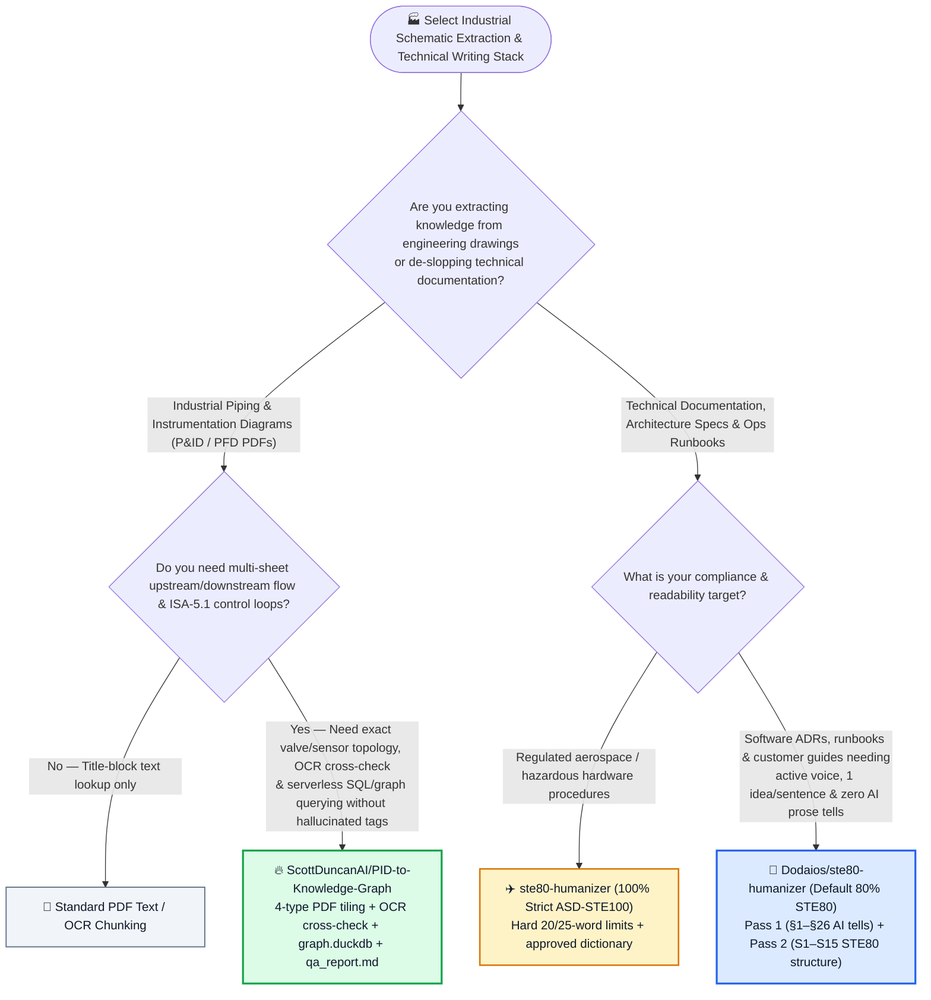
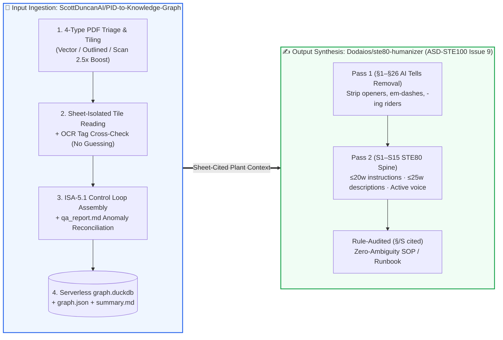

# Industrial P&ID Diagram-to-Knowledge-Graph Extraction & Aerospace ASD-STE100 Controlled-English Writing Selection FAQ: `ScottDuncanAI/PID-to-Knowledge-Graph` (`graph.duckdb` + ISA-5.1) + `Dodaios/ste80-humanizer` (§1–§26 + S1–S15 Two-Pass Rewrite) vs. Naive VLM Chunk RAG & Single-Pass Synonym Swappers

> **中文版**: [pid-knowledge-graph-ste80-humanizer-selection-faq.md](pid-knowledge-graph-ste80-humanizer-selection-faq.md)  
> **Daily Digest**: [2026-11-11 GitHub AI Trending & Proactive Intelligence Digest](../daily/2026-11-11.en.md) · **Visual Deck**: [`cards.en.html`](../cards.en.html) · **Live Radar**: [`github-radar.html`](../../../github-radar.html)

Written for **AI Solution Architects, Industrial / Manufacturing AI Leads, and Technical Documentation Engineering Leads**, this selection guide is grounded in primary-source audits of two high-signal domain skills from the 2026-11-11 radar — **`ScottDuncanAI/PID-to-Knowledge-Graph` (`pid-to-kg`, a hybrid Python + Claude skill that converts digital or scanned Piping and Instrumentation Diagram [P&ID] PDFs into an ISA-5.1 process Knowledge Graph backed by `graph.duckdb` and `qa_report.md`, MIT, `213` API stars in 3 days)** and **`Dodaios/ste80-humanizer` (a two-pass technical writing skill combining Wikipedia's 26 AI-writing tell removals [`§1–§26`] with Andrej Karpathy's "80% of the way to aerospace ASD-STE100 Issue 9" structural rules [`S1–S15`], MIT, `374` API stars in 2 days)** — answering three core engineering questions from first principles:
1. **Why does feeding full-page industrial P&ID PDFs into standard multimodal RAG (VLM page embeddings) fail catastrophically on 6pt instrument tags (`FIC-0502`), pipe segment splits, and off-page connectors—and how does `PID-to-Knowledge-Graph` solve this via 4-type PDF triage, adaptive overlapping tiling, OCR cross-checking, ISA-5.1 loop assembly, and serverless `graph.duckdb`?**
2. **Why do single-pass "humanizer" prompts that merely swap out buzzwords (`"delve"`, `"seamless"`) still leave behind turgid, multi-clause AI prose—and how does `Dodaios/ste80-humanizer`'s two-pass pipeline (`§1–§26` AI tells + `S1–S15` ASD-STE100 controlled technical English) produce crystal-clear engineering docs and runbooks?**
3. **How can enterprise architects chain `PID-to-Knowledge-Graph` and `ste80-humanizer` into an end-to-end pipeline for regulated manufacturing, energy, and cloud operations?**

> 🛡️ **Provenance & Attribution Disclosure**:
> - **`measured` (Primary-Source Verified in This Shift)**: Repository metadata and source trees for `ScottDuncanAI/PID-to-Knowledge-Graph` (`213` API stars, `44` forks, Python, MIT, created `2026-11-08`) and `Dodaios/ste80-humanizer` (`374` API stars, `23` forks, Python, MIT, created `2026-11-09`) are verified via GitHub REST API (`README.md`, `SKILL.md`, `references/ai-tells.md`, `references/ste80-rules.md`, `skills/pid-to-kg`); because neither appeared in the 10-item main Daily Trending HTML snapshot (`bacf15c2...`), `stars_today` is strictly labeled **`not_measured`**.
> - **`anonymized_reported` (`independently_reproduced=false`, Upstream Documentation & Standard Specifications)**: The 4-type P&ID preprocessing rules (`Digital searchable`, `Digital outlined`, `Scanned 2.5× upscale + contrast boost`, `Scanned with OCR hint`), ISA-5.1 control loop assembly, and `work/<plant>/kg/` outputs (`summary.md`, `graph.json`, `graph.duckdb`, `qa_report.md`) in `ScottDuncanAI/PID-to-Knowledge-Graph`, as well as Karpathy's Oct 2, 2026 ASD-STE100 tip and the `§1–§26` + `S1–S15` rule catalog (20-word instructions, 25-word descriptions, 6-sentence paragraphs, no semicolons, ASD-STE100 Issue 9 alignment) in `Dodaios/ste80-humanizer`, are documented in upstream repository files.
> - **`synthetic` (`independently_reproduced=false`, Architect Parametric FinOps & Engineering Review Model)**: Section 5.1 models an industrial and platform engineering team digitizing **`40` multi-sheet P&ID drawing packages (`400 sheets/mo`)** and authoring/reviewing **`200` technical SOPs/runbooks per month** (senior engineer labor valued at `$80.00/hr`; commercial CAD licenses and plant historian software bills are explicitly labeled `not_measured`), comparing Path A Full-Page VLM RAG + Manual Tracing & Rewriting (`$6,640.00/mo`, `80.0h`) vs. Path B Generic OCR + Single-Pass Synonym Swapper (`$4,030.00/mo`, `48.0h`) vs. Path C `PID-to-Knowledge-Graph` + `ste80-humanizer` (`$1,280.00/mo`, `14.0h`, saving `$5,360.00/mo` [`-80.72%`] and `66.0 hours/mo` [`-82.50%`]).

---

## 1. 📌 Executive Summary

| Dimension | Plain-Language Core Takeaway (First Principles) |
| :--- | :--- |
| **What is `ScottDuncanAI/PID-to-Knowledge-Graph` (`pid-to-kg`)?** | It is a hybrid **Python + Claude skill** built on the rule: *"Claude reads the drawings; Python scripts do everything else."* Deterministic scripts triage 4 PDF types, auto-orient sideways sheets, upscale scans up to `2.5×`, cut overlapping tiles, cross-check tags with OCR, assemble upstream/downstream pipe segments and **ISA-5.1 control loops**, flag anomalies in `qa_report.md`, and export a serverless **`graph.duckdb`** database. |
| **What is `Dodaios/ste80-humanizer`?** | It is a **two-pass technical writing skill (`npx skills add Dodaios/ste80-humanizer`)** that first strips the **26 Wikipedia "Signs of AI writing" tells (`§1–§26`)** and then rebuilds sentence structure **"80% of the way to ASD-STE100 Issue 9" (`S1–S15`)**—enforcing `<= 20` words per instruction, `<= 25` words per description, one idea per sentence, active voice, and strict separation of instructions from descriptions. |
| **Why do they pair so well for enterprise AI SAs?** | **`pid-to-kg` turns dense, visual engineering schematics into verifiable structured facts (`graph.duckdb` + sheet citations without hallucinated tags)**, while **`ste80-humanizer` turns verbose LLM explanations into crisp, aerospace-grade operational runbooks** with explicit rule audit trails (`§1, §8, S2`). |

---

## 2. 🎯 First-Principles Q&A (Q1 / Q2 / Q3)

### Q1: Why does naive multimodal VLM RAG fail on industrial P&ID drawings, and how does `PID-to-Knowledge-Graph` guarantee high-precision extraction?

**Plain-language answer: A full-sheet P&ID downsampled into a single VLM image blurs 6pt instrument tags into illegible pixels and loses off-page pipe continuity; `pid-to-kg` uses deterministic Python scripts for 4-way PDF triage, text-size-aware overlapping tiling, OCR cross-checking, and iterative `qa_report.md` self-healing.**

Verified from `ScottDuncanAI/PID-to-Knowledge-Graph/README.md`:
1. **Four-Type PDF Triage & Adaptive Overlapping Tiling**:
   - **Digital, searchable text**: Renders directly from CAD vector data and uses embedded PDF text to cross-check every tag Claude reads.
   - **Digital, outlined text** (letters drawn as vector shapes): High-resolution vector render + OCR tag cross-check (requires Python `3.12` for full OCR + auto-orientation support).
   - **Scanned paper drawings**: Upscaled up to **`2.5×`** with contrast boosting so faded lines and small tags stand out + OCR cross-check + automatic low-res warnings.
   - **Scanned with noisy OCR layer**: Treated as a scan; the embedded OCR text is used only as a hint.
   - Every sheet is rotated upright, rendered at a DPI calculated from the smallest text size, and sliced into overlapping tiles (skipping blank margin/border tiles).
2. **Sheet-Isolated Reading & Zero-Guessing Rule**:
   - Claude inspects the full sheet for topology, then reads each tile up close, recording equipment, pipe runs, valves, instruments, signal lines, and off-page connectors with confidence scores. **Unreadable tags are explicitly marked unreadable—never guessed**—and each sheet is persisted to disk before starting the next so large drawing sets never overflow context.
3. **Three-Layer Graph Assembly (ISA-5.1) + `qa_report.md` Loop**:
   - Python scripts split pipes at valves/fittings, link off-page connectors across sheets, attach instruments to exact segments, and assemble **ISA-5.1 control loops** (sensor → controller → I/P relay / cascade / interlock → valve or VFD drive).
   - `qa_report.md` flags unlocated sensors, orphaned off-page connectors, and tags seen by OCR but missed by Claude—prompting targeted re-reads until clean, and exporting `summary.md`, `graph.json`, and serverless **`graph.duckdb`**.

---

### Q2: Why do single-pass "AI humanizers" fail, and why does Karpathy's "80% ASD-STE100 (`STE80`)" method work so well for technical prose?

**Plain-language answer: Deleting `"Great question!"` and `"delve"` leaves behind 40-word passive sentences packed with three clauses and stacked hedges; `ste80-humanizer` runs Pass 1 (`§1–§26`) to strip lexical AI tells, followed by Pass 2 (`S1–S15`) to enforce aerospace ASD-STE100 sentence structure without the robotic 900-word vocabulary straightjacket.**

Verified from `Dodaios/ste80-humanizer/README.md` and `SKILL.md`:
1. **Why Two Passes Are Mandatory**:
   - **Pass 1 (`§1 to §26` AI Tells)**: Removes chatbot openers, dramatic closers, `"not just X, it's Y"` contrasts, em-dash chains, `"-ing"` participial tails (`", ensuring that..."`), and double hedges (`"could potentially"`).
   - **Pass 2 (`S1 to S15` STE80 Structure Rules)**: Applies the structural spine of **ASD-STE100 Issue 9** (Simplified Technical English, created in the 1980s for aircraft maintenance manuals):
     - **`<= 20` words per instruction** and **`<= 25` words per description**;
     - **One instruction or idea per sentence**;
     - **Active voice and simple tenses** (naming the actor explicitly: *"If the probe fails, the kubelet restarts the container"*);
     - **Instructions separated from descriptions**, at most **6 sentences per paragraph**, and **zero semicolons (`;`)**.
2. **Why `80%` Default Instead of `100%` Strict Mode?**:
   - At `100% Strict`, `"check"` and `"test"` are approved only as nouns (never verbs), `"may"` and `"should"` are banned, and writers are restricted to ~900 approved words.
   - At **`80% (STE80 default)`**, you keep 100% of the structural clarity while allowing plain common words, `"check"`/`"test"` as verbs, and `"may"`/`"should"` for genuine uncertainty—and every edit cites its exact rule codes (e.g., `"§1, §8, S2"`).

---

### Q3: How should architects combine `PID-to-Knowledge-Graph` and `ste80-humanizer` in enterprise engagements?

- **Industrial / Energy / Semiconductor Plant Assistants**: Use **`ScottDuncanAI/PID-to-Knowledge-Graph`** to turn CAD/scanned P&ID PDFs into `graph.duckdb` + `summary.md` so LLMs answer upstream/downstream isolation and ISA-5.1 loop questions with exact sheet citations.
- **Engineering Runbooks, ADRs & Customer Deliverables**: Install **`Dodaios/ste80-humanizer`** (`npx skills add Dodaios/ste80-humanizer --global`) to run `/ste80-humanizer` (80% mode for architecture docs; Strict mode for high-hazard maintenance/DR procedures).

---

## 3. 🧭 Mermaid Selection Decision Tree & End-to-End Pipeline

### 3.1 Industrial Schematic Extraction & Controlled Technical Writing Decision Tree

### 3.2 `PID-to-Knowledge-Graph` Tiled Extraction × `STE80 Humanizer` Two-Pass Pipeline

---

## 4. 📊 Architecture Selection Decision Matrix

| Evaluation Dimension | **`PID-to-Knowledge-Graph` + `ste80-humanizer`** | **Full-Page VLM Chunk RAG + Single-Pass Humanizer Prompt** | **Manual CAD Tracing + Manual Line Editing** |
| :--- | :--- | :--- | :--- |
| **6pt Tag Legibility & Scan Handling** | ✅ **Text-size-driven DPI + overlapping tiles + `2.5×` scan contrast boost + OCR cross-check** | ❌ Full-page downsampling blurs small tags into hallucinations | ✅ Accurate but slow |
| **Multi-Sheet Flow & ISA-5.1 Loops** | ✅ **Links off-page connectors & assembles sensor→controller→valve loops in `graph.duckdb`** | ❌ Chunked text vectors lose pipe connectivity | ⚠️ Takes hours of manual sheet flipping |
| **Anti-Hallucination QA Gate** | ✅ **Marks illegible tags `unreadable`; `qa_report.md` forces re-check of OCR mismatches** | ❌ Guesses plausible-looking tag numbers | ✅ Human verified |
| **Prose De-Slopping Depth** | ✅ **Two passes: `§1–§26` lexical tell removal + `S1–S15` ASD-STE100 structural rewrite** | ❌ Swaps buzzwords while keeping 3-clause passive sentences | ⚠️ High editorial labor |
| **Auditability & Citations** | ✅ **Every node cites drawing sheet/location; every prose edit cites `§/S` rule IDs** | ❌ Black-box rewrite | N/A |

---

## 5. 🧪 Quantitative FinOps & Engineering Review Model (`synthetic`, `independently_reproduced=false`)

### 5.1 Monthly `40` P&ID Packages (`400 Sheets`) + `200` Industrial/Ops SOPs TCO Model (`synthetic`, `independently_reproduced=false`)

> 📌 **Scope & Provenance Disclosure**: This worked example is a **parametric API + senior engineer verification/editing labor model (`synthetic`, `independently_reproduced=false`; commercial AutoCAD/SmartPlant licenses and plant historian software bills are explicitly labeled `not_measured`)**. Scenario: **An industrial and platform engineering team digitizing `40` multi-sheet P&ID packages (`400 sheets/mo`) and authoring/reviewing `200` operational SOPs/runbooks per month (senior engineer labor valued at `$80.00/hr`)**:

| Architecture Path | Monthly VLM Extraction & Rewrite API Bill | Monthly Engineer P&ID Loop Verification Labor (`@ $80/hr`) | Monthly Manual SOP / Runbook Editing Labor (`@ $80/hr`) | Total Monthly Cost (API + Engineering Labor) | Savings vs. Path A |
| :--- | :--- | :--- | :--- | :--- | :--- |
| **Path A: Full-Page VLM RAG + Manual P&ID Tracing & Manual AI-Slop Rewriting** | **`$240.00 / mo`** (repeated full-sheet VLM retries) | `45.0 hours / mo` × `$80.00` = **`$3,600.00 / mo`** (manual tag & off-page connector tracing) | `35.0 hours / mo` × `$80.00` = **`$2,800.00 / mo`** (rewriting verbose AI drafts) | **`$6,640.00 / mo`** (**`80.0 hours / mo`** engineer toil) | Baseline (high tag hallucination rate & heavy prose editing) |
| **Path B: Generic OCR + Single-Pass Synonym Swapper (No `qa_report` or `STE80`)** | **`$190.00 / mo`** | `28.0 hours / mo` × `$80.00` = **`$2,240.00 / mo`** | `20.0 hours / mo` × `$80.00` = **`$1,600.00 / mo`** | **`$4,030.00 / mo`** (**`48.0 hours / mo`** engineer toil) | Net savings `-$2,610.00/mo` (`-39.31%`) |
| **Path C: `PID-to-Knowledge-Graph` (`graph.duckdb`) + `ste80-humanizer` Two-Pass** | **`$160.00 / mo`** (tiled extraction + two-pass STE80 rewrite) | `8.0 hours / mo` × `$80.00` = **`$640.00 / mo`** (reviewing `qa_report.md` exceptions only) | `6.0 hours / mo` × `$80.00` = **`$480.00 / mo`** (verifying `§/S`-cited STE80 runbooks) | API `$160.00` + P&ID QA `$640.00` + SOP QA `$480.00` = **`$1,280.00 / mo`** (`14.0h`) | **Net savings `$5,360.00/mo` (`-80.72%`, `$64,320.00/yr`); Engineer toil `-66.0h/mo` (`-82.50%`)** |

---

## 6. 🛠️ Production Adoption & 30-Minute PoC Checklist

- [ ] **Step 1 — Install `pid-to-kg` on Python 3.12**: Copy `skills/pid-to-kg` into `~/.claude/skills/` and use **Python `3.12`** so both OCR tag cross-checking and automatic page orientation are enabled.
- [ ] **Step 2 — Audit `work/<plant>/kg/qa_report.md` Before Consuming the Graph**: Confirm that illegible tags are flagged as `unreadable` rather than guessed, and verify that all off-page connectors and ISA-5.1 loops reconcile cleanly.
- [ ] **Step 3 — Query `graph.duckdb` + `summary.md` for Upstream/Downstream & Loop Traces**: Connect to the serverless `graph.duckdb` file to answer upstream equipment, sensor placement, and `FIC`/`PIC` cascade loop queries with sheet-level provenance.
- [ ] **Step 4 — Install `Dodaios/ste80-humanizer` Globally**: Run `npx skills add Dodaios/ste80-humanizer --global --agent '*'` and apply `/ste80-humanizer` to generated architecture docs and runbooks, verifying both Pass 1 (`§1–§26`) and Pass 2 (`S1–S15`) rule citations.
- [ ] **Step 5 — Select `80% (STE80)` vs. `Strict` Mode by Risk Tier**: Use default `80%` STE80 mode for readable architecture guides and customer FAQs, and switch to `Strict` ASD-STE100 mode for safety-critical maintenance and incident response runbooks.
