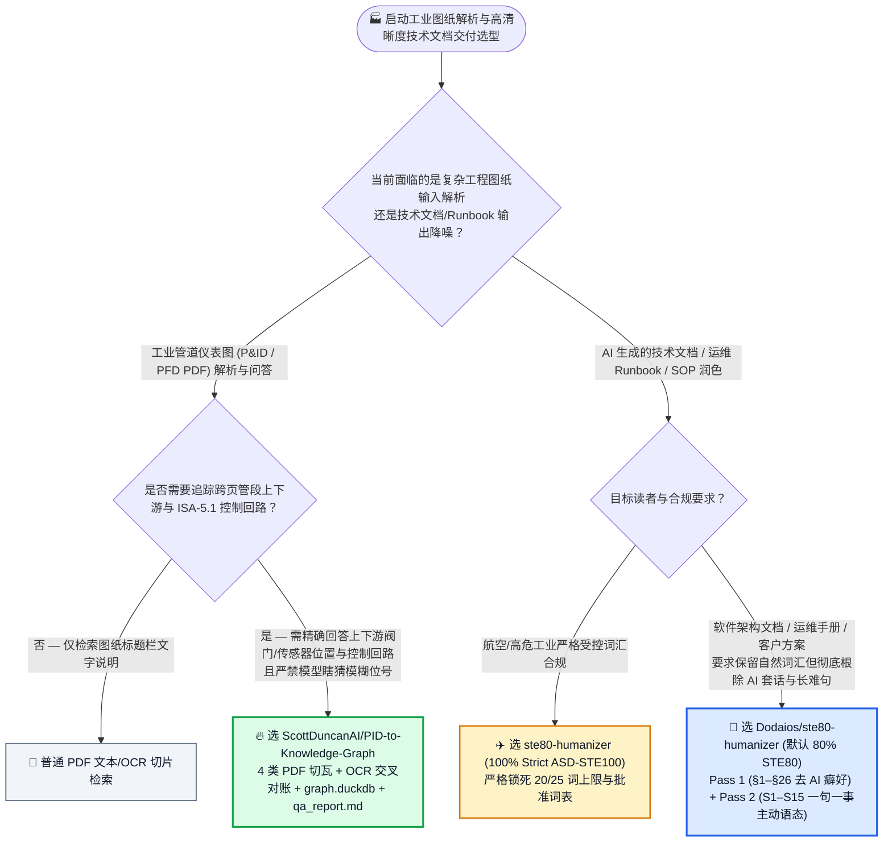
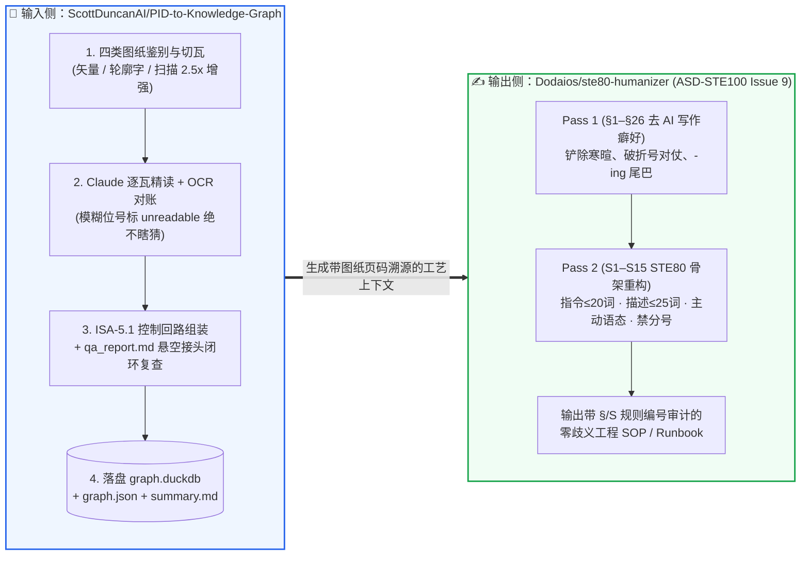

# 工业管道仪表流程图（P&ID PDF）转工艺知识图谱与航空级受控技术英语（ASD-STE100）去 AI 腔调选型常见问题解答：`ScottDuncanAI/PID-to-Knowledge-Graph` (`graph.duckdb` + ISA-5.1) + `Dodaios/ste80-humanizer`（§1–§26 + S1–S15 双遍重写）vs 裸多模态切片 RAG & 单遍同义词替换

> **English Edition**: [pid-knowledge-graph-ste80-humanizer-selection-faq.en.md](pid-knowledge-graph-ste80-humanizer-selection-faq.en.md)  
> **关联日报**: [2026-11-11 GitHub AI 最热榜单与情报摘要](../daily/2026-11-11.md) · **视觉评测卡**: [`cards.html`](../cards.html) · **在线面板**: [`zh-github-radar.html`](../../../zh-github-radar.html)

本文档面向 **AI Solution Architect（AI 解决方案架构师）、制造业/能源化工数字化负责人与技术文档工程主管**，基于 2026-11-11 GitHub 新仓爆发榜两款直击企业高合规落地痛点的标杆 Skill 项目 —— **`ScottDuncanAI/PID-to-Knowledge-Graph`（将数字 CAD 或扫描版工业管道仪表流程图 P&ID / PFD PDF 自动转化为可查询 `graph.duckdb` 工艺知识图谱的 Claude Skill，MIT，建仓 3 天 `213★`）** 与 **`Dodaios/ste80-humanizer`（结合维基百科 26 条 AI 写作癖好剥离与 Andrej Karpathy 推荐的航空维修手册受控英语标准 ASD-STE100 Issue 9 的双遍重写 Skill，MIT，建仓 2 天 `374★`）** 的一手源码与文档深度核验，用通俗大白话与第一性原理解答：
1. **为什么在化工、制药、电力、半导体等重资产行业，把工厂的 P&ID 工程图纸 PDF 直接塞进传统多模态 RAG（VLM 整页截图向量检索），问一句“哪个流量计控制 TK-101 进料、下游连着哪台泵”必定张冠李戴？`PID-to-Knowledge-Graph` 是如何用「4 类图纸自适应切瓦 + OCR 位号交叉核验 + ISA-5.1 控制回路组装 + `graph.duckdb`」破局的？**
2. **为什么市面上绝大多数“去 AI 味（Humanizer）”提示词只是把 `"delve"`、`"seamless"` 换个近义词，读起来依然像冗长拖沓的 AI 八股文？`Dodaios/ste80-humanizer` 是如何用「Pass 1（`§1–§26` 剥离 AI 套话）+ Pass 2（`S1–S15` 向航空维修手册标准 ASD-STE100 靠拢 80% 重构句子骨架）」让运维 Runbook 与技术文档实现零歧义秒读的？**
3. **在企业架构选型中，如何将这两者串联为“工业/企业高可靠知识抽取 → 免服务 DuckDB 图查询 → 航空级受控技术文档交付”的标准流水线？**

> 🛡️ **数据来源、归属核验与证据分级声明（Provenance & Attribution Disclosure）**：
> - **`measured`（本班次一手实测抓取）**：`ScottDuncanAI/PID-to-Knowledge-Graph`（`213` API Stars，`44` Forks，Python，MIT，创建于 `2026-11-08`）与 `Dodaios/ste80-humanizer`（`374` API Stars，`23` Forks，Python，MIT，创建于 `2026-11-09`）均通过 GitHub REST API 源码树（`SKILL.md`、`README.md`、`references/`、`scripts/`）一手核验；两者不在主日榜 24h DOM 快照内，故 `stars_today` 严格标注为 **`not_measured`**。
> - **`anonymized_reported`（`independently_reproduced=false`，上游仓库文档与方法论规格）**：`ScottDuncanAI/PID-to-Knowledge-Graph` 官方文档披露的 4 类 PDF 图纸预处理策略（矢量可搜索文本、矢量轮廓字、扫描件 `2.5×` 放大与对比度增强、带 OCR 层扫描件）、ISA-5.1 仪表回路组装与四件套产物（`summary.md`、`graph.json`、`graph.duckdb`、`qa_report.md`），以及 `Dodaios/ste80-humanizer` 基于 Andrej Karpathy（`2026-10-02`）ASD-STE100 Issue 9 建议构建的 `§1–§26` + `S1–S15` 双遍重写规则（指令 `<= 20 词`、描述 `<= 25 词`、每段 `<= 6 句`、禁用分号）。
> - **`synthetic`（`independently_reproduced=false`，架构师参数化 FinOps 与工程审校工时算例）**：第 5.1 节「工业与平台工程团队每月数字化解析 `40 套` 多页 P&ID 图纸（共 `400 页/月`）+ 编写审校 `200 份` 运维与工艺 SOP/Runbook（工程师综合时薪 `$80.00/h`；商业 CAD 软件许可与工厂 Historian 数据库费用明确标注为 `not_measured`）」的闭式成本对比（Path A 整页 VLM 盲扫 + 人工追图纸与改写 AI 八股 `$6,640.00/月` vs Path B 普通 OCR + 单遍同义词替换 `$4,030.00/月` vs Path C `PID-to-Knowledge-Graph` + `ste80-humanizer` `$1,280.00/月`，净省 `$5,360.00/月` [`-80.72%`] 与 `66.0 小时/月` [`-82.50%`] 工程师工时）。

---

## 1. 📌 核心结论速览（Executive Summary）

| 评估维度 | 一句话大白话核心结论（直指本质） |
| :--- | :--- |
| **`PID-to-Knowledge-Graph` 到底是个什么东西？** | 它是一个遵循**“让 Claude 只做视觉判断（认阀门/仪表符号、追管线），让确定性 Python 脚本包办切瓦、OCR 对账、拓扑拼接与自检”**的工业 P&ID 图纸解析 Skill。它把几十页复杂的 CAD/扫描版管道仪表图直接变成免服务器的 **`graph.duckdb` 数据库 + `graph.json` + `summary.md` + `qa_report.md` 异常对账单**。 |
| **`Dodaios/ste80-humanizer` 到底是个什么东西？** | 它是把 **Wikipedia 26 条 AI 写作痕迹清理（Pass 1：`§1–§26`）** 与 **Andrej Karpathy 力推的“向航空维修手册受控英语标准 ASD-STE100 靠拢 80%（Pass 2：`S1–S15`）”** 结合起来的文档重写 Skill。它不仅删掉 `"Great question!"` 等套话，更强制把长难句拆成**“一句一指令（≤20 词）、主动语态、指令与描述物理分离”**的清爽工程文本！ |
| **这两者分别解决了企业落地的什么核心痛点？** | **前者解决了“复杂工程图纸进不了大模型上下文”的输入难题**（告别整页缩略图看不清 `FIC-0502` 位号和跨页断流）；**后者解决了“大模型写出来的技术文档又臭又长没人愿意看”的输出难题**（把阅读理解负担降到最低，且每次修改都给出精确的 `§/S` 规则编号供审计）！ |

---

## 2. 🎯 第一性原理灵魂三问（Q1 / Q2 / Q3 大白话拆解）

### Q1：为什么直接拿多模态大模型（VLM）读整张 P&ID 图纸必翻车？`PID-to-Knowledge-Graph` 是怎么做到工业级防幻觉的？

**先说大白话结论：一张标准 A1/A0 化工 P&ID 图纸上有上百个 6 号小字位号（如 `PT-104A`、`FIC-0502`）和跨越十几页图纸的页间连接符（Off-Page Connectors）——整张塞进 VLM 会因为分辨率压缩把位号看成乱码，而普通切片又会把一根管线腰斩！**

根据 `ScottDuncanAI/PID-to-Knowledge-Graph` 官方架构设计，它用四步确定性工程流水线解决了这一顽疾：
1. **阶段 1：四类 PDF 自动鉴别与自适应高分辨率切瓦（Page Triage & Overlapping Tiles）**：
   - Python 脚本先逐页鉴别图纸类型：① **数字可搜索矢量图**（直接矢量渲染 + 提取 PDF 原生文本做位号交叉核对）；② **数字轮廓字图（Outlined Text）**（CAD 导出时把字母画成了几何线条，无法复制文字 -> 高清矢量渲染 + OCR 提取位号对账）；③ **纯扫描件**（按原始分辨率最高放大 **`2.5×`** 并增强对比度凸显褪色管线 + OCR 对账，低清扫描件自动打标预警）；④ **带旧 OCR 层的扫描件**（旧 OCR 层错漏百出，仅作提示参考）。
   - 自动把横向图纸旋转摆正，根据图上最小字号动态计算渲染分辨率，切成**带重叠区的瓦片（Overlapping Tiles）**并自动跳过空白边框。
2. **阶段 2：全图概览 + 逐瓦片精读 + 严禁瞎猜（Never Guessed）**：
   - Claude 先看全图建立拓扑感，再逐个瓦片近距离认读设备、管段、阀门、仪表、信号线与跨页连接符；**凡是模糊不可读的位号强制标记为 `unreadable` 留待人工确认，绝不允许脑补瞎猜**！每读完一页立即落盘独立文件，防止长图纸集撑爆上下文。
3. **阶段 3：按 ISA-5.1 组装三大图层与 `qa_report.md` 闭环自愈**：
   - Python 脚本将管线按阀门/管件切分为精确管段，跨页配对连接符，并按 **ISA-5.1 国际仪表标准** 将传感器、控制器、I/P 继电器、串级/联锁逻辑与最终调节阀/VFD 变频器组装为完整控制回路（Control Loops）。
   - 自动生成 **`qa_report.md`**：列出“没有位置的传感器”、“找不到配对的跨页连接符”、“OCR 看到了但 Claude 漏记的位号”，驱动 Claude 回到原图对应坐标二次复查，直到质检报告清零！
4. **阶段 4：免服务 `graph.duckdb` 精准查询**：
   - 直接生成单文件 **`graph.duckdb`**，无需部署 Neo4j 服务器，即可用精准 SQL/图查询秒答 *“TK-101 进料流量由哪个传感器测量、具体装在哪一段管线上？”*，且每个结果都精确附带原始图纸页码！

---

### Q2：为什么普通 Humanizer 改出来的文章还是股“AI 味”？Karpathy 推荐的 `STE80`（80% ASD-STE100）到底强在哪？

**先说大白话结论：因为 AI 味不仅在“用词”（比如喜欢说 `delve`、`crucial`、`not just X, it's Y`），更在“句法骨架”（喜欢把三个因果关系揉成一句 45 个词的长句、隐藏动作执行者、堆砌模糊状语）——只换词不拆骨，读起来依然累人！**

根据 `Dodaios/ste80-humanizer` 官方 [`SKILL.md`](https://github.com/Dodaios/ste80-humanizer/blob/main/SKILL.md) 与 [`README.md`](https://github.com/Dodaios/ste80-humanizer/blob/main/README.md) 拆解：
1. **为什么单遍重写不够，必须走「Two Passes（双遍流水线）」？**
   - **Pass 1（`§1–§26` 词汇与修辞去癖）**：对照维基百科《AI 写作特征》26 条清单，铲除寒暄开头（`"Great question!"`）、破折号对仗（`"— and it's not just X, it's Y"`）、分词伴随尾巴（`", ensuring that..."`）、双重软化词（`"could potentially"`）与口号式结尾。
   - **Pass 2（`S1–S15` STE80 句法骨架重塑）**：引入 1980 年代航空航天工业为非英语母语飞机维修师制定的 **ASD-STE100（Issue 9）受控技术英语规范**——在飞机维修中，读错一句话会出人命，因此它强制要求：
     - **操作指令句 `<= 20 词`**，**原理描述句 `<= 25 词`**；
     - **一句只讲一件事（One instruction / idea per sentence）**；
     - **强制主动语态与简单时态**（明确写出“谁对谁做了什么”，如 *"If the probe fails, the kubelet restarts the container"*，绝不写 *"the container will be automatically restarted"*）；
     - **操作指令与背景描述物理分段**，每段最多 6 句话，且**全文严禁使用分号（`;`）**。
2. **为什么默认用 `80%`（STE80）而不是 `100%`（Strict STE）？**
   - 在 `100% Strict` 航空标准下，只能使用约 900 个批准词，且 `"check"` 和 `"test"` 只能当名词不能当动词、禁用 `"may"`/`"should"`，写日常软件文档会过于死板；
   - **`80% (STE80)` 完美保留了 ASD-STE100 100% 的清晰句法骨架，但放开了日常通用词汇与 `"check"`/`"test"` 动词用法**，并提供规则编号回溯（如汇报本次修改触发了 `"§1, §8, S2"`），让工程师一眼看懂、零认知负担！

---

### Q3：作为 AI 解决方案架构师，在哪些客户场景下应该立即组合打出这套王牌？

- **场景 A（流程工业/智能制造/数据中心暖通供电图纸数字化）**：客户手头有几百张历史 CAD 或扫描版 P&ID、单线图（SLD），直接用 **`ScottDuncanAI/PID-to-Knowledge-Graph`** 转成 `graph.duckdb` + `summary.md`，作为设备故障根因分析（RCA）与安全联锁问答的确定性上下文底座。
- **场景 B（企业架构决策记录 ADR、运维故障 Runbook、客户交付手册去 AI 八股化）**：通过 `npx skills add Dodaios/ste80-humanizer --global` 全局挂载 **`/ste80-humanizer`**，把所有 Agent 自动生成的冗长文档强制过一遍 `§1–§26` + `S1–S15`，输出像资深首席工程师亲手写出的干净手册。

---

## 3. 🧭 Mermaid 选型决策树与端到端工业知识交付架构图

### 3.1 复杂工程图纸解析与技术文档受控重写选型决策树（Decision Tree）

### 3.2 `PID-to-Knowledge-Graph` 切瓦对账建图 × `STE80 Humanizer` 双遍重写流水线图

---

## 4. 📊 同类方案全方位选型决策矩阵（Decision Matrix）

| 评估维度 | **`PID-to-Knowledge-Graph` + `ste80-humanizer`** | **整页 PDF 多模态 VLM 切片 RAG + 单遍去 AI 味 Prompt** | **人工 CAD 描图录入 + 人工逐句删改 AI 初稿** |
| :--- | :--- | :--- | :--- |
| **小字号位号与扫描件识别率** | ✅ **按最小字号定 DPI 重叠切瓦 + 扫描件 `2.5×` 放大增强 + OCR 交叉对账** | ❌ 整页缩放至 1024px 后 6pt 仪表位号完全糊成乱码 | ✅ 准确但耗费数十小时人工 |
| **跨页管线与控制回路拓扑** | ✅ **自动配对跨页连接符，按 ISA-5.1 组装传感器→控制器→执行阀回路并存入 `graph.duckdb`** | ❌ 仅做文本向量匹配，完全无法回答上下游连通性 | ⚠️ 靠工程师肉眼翻几十页图纸手绘 |
| **防幻觉与质检自愈机制** | ✅ **看不清强制标 `unreadable`；`qa_report.md` 驱动回图重查漏记位号与孤立接头** | ❌ 模型遇到模糊位号直接按概率瞎编 | ✅ 人工核对 |
| **技术文档去 AI 腔调深度** | ✅ **Pass 1 (`§1–§26`) 删套话 + Pass 2 (`S1–S15` STE80) 拆长句、改主动语态、分离指令与描述** | ❌ 仅替换表面词汇，保留冗长从句与模糊被动语态 | ⚠️ 审校耗时极长，风格因人而异 |
| **修改可解释性与规则溯源** | ✅ **图纸节点精确到页码与位置；文档重写明确输出命中规则号（如 `§1, §8, S2`）** | ❌ 黑盒改写，不知道改了哪条规则 | N/A |

---

## 5. 🧪 定量算例与 7-Card 评测洞察（Quantitative Example & 7-Card Insights）

### 5.1 月度解析 40 套 P&ID（400 页）+ 交付 200 份工业/运维 SOP 闭式成本算例（`synthetic`，`independently_reproduced=false`）

> 📌 **透明口径与边界声明（Scope & Provenance）**：本算例为架构师评估工业图纸知识工程与高清晰度技术文档交付的 **API + 工程师核验审校工时参数化算例（`synthetic` model；商业 AutoCAD/SmartPlant 软件许可费与工厂实时数据库 Historian 订阅费明确标注为 `not_measured`）**。场景设定为：**工业智能与平台工程团队每月需解析数字化 `40 套` 多页 P&ID 图纸包（共 `400 页/月`），并编写审校 `200 份` 工艺操作规程或系统运维 Runbook（资深工艺/平台工程师综合工时费按 `$80.00 / 小时` 计算）**：

| 方案路径 | 每月多模态读图与文档重写 API 账单 | 每月工程师人工追查跨页管线与核对位号工时 (`@ $80/h`) | 每月人工删改 AI 冗长八股 SOP 工时 (`@ $80/h`) | 每月总综合成本（API + 工程师工时） | 相对 Path A 降本增效幅度 |
| :--- | :--- | :--- | :--- | :--- | :--- |
| **Path A：整页 PDF 裸喂 VLM + 人工追查图纸与手工改写 AI 初稿** | **`$240.00 / 月`** （整页看不清反复追问重试） | `45.0 小时 / 月` × `$80.00` = **`$3,600.00 / 月`**（人工翻图纸核对位号与跨页回路） | `35.0 小时 / 月` × `$80.00` = **`$2,800.00 / 月`**（手工拆分长难句与删套话） | **`$6,640.00 / 月`** （耗费 **`80.0 小时 / 月`** 工程师工时） | 基线（整页位号漏检严重，AI 初稿阅读负担大） |
| **Path B：普通 OCR 切片 + 单遍同义词替换（无 `qa_report` 与 STE80 句法重构）** | **`$190.00 / 月`** | `28.0 小时 / 月` × `$80.00` = **`$2,240.00 / 月`** | `20.0 小时 / 月` × `$80.00` = **`$1,600.00 / 月`** | **`$4,030.00 / 月`** （耗费 **`48.0 小时 / 月`** 工时） | 综合降本 `-$2,610.00/月` (`-39.31%`) |
| **Path C：`PID-to-Knowledge-Graph` (`graph.duckdb`) + `ste80-humanizer` 双遍重写** | **`$160.00 / 月`** （逐瓦精准提取 + 双遍受控重写） | `8.0 小时 / 月` × `$80.00` = **`$640.00 / 月`**（仅复核 `qa_report.md` 标出的模糊项） | `6.0 小时 / 月` × `$80.00` = **`$480.00 / 月`**（按 `§/S` 编号快速终审 STE80 文档） | API `$160.00` + 读图复核 `$640.00` + 文档终审 `$480.00` = **`$1,280.00 / 月`** (`14.0h`) | **月度净省 `$5,360.00/月` (`-80.72%`，年省 `$64,320.00`)；工程师工时省 `66.0h/月` (`-82.50%`)** |

---

## 6. 🛠️ 架构师生产落地与 30 分钟 PoC 核验清单（Production & PoC Checklist）

- [ ] **Step 1 — 在 Python 3.12 环境部署 `pid-to-kg` 技能并验证 OCR 交叉对账**：将 `ScottDuncanAI/PID-to-Knowledge-Graph/skills/pid-to-kg` 放入 `~/.claude/skills/`，推荐使用 **Python `3.12`**（确保 OCR 交叉核验与自动页面摆正全功能开启），用公开化工图纸集测试单页矢量图与扫描图切瓦效果。
- [ ] **Step 2 — 审计 `work/<plant>/kg/qa_report.md` 零猜测防线**：检查生成的 `qa_report.md`，确认模糊位号是否被如实标为 `unreadable` 而未被胡乱猜测，并验证悬空跨页连接符是否在二次复查后闭环。
- [ ] **Step 3 — 用 `graph.duckdb` 执行上下游与控制回路确定性查询**：直接连接生成的 `graph.duckdb` 文件，测试上游设备追溯（Upstream trace）、传感器安装管段定位与 ISA-5.1 控制回路（Sensor → Controller → Valve/VFD）查询。
- [ ] **Step 4 — 全局安装 `Dodaios/ste80-humanizer` 并跑通双遍重写**：运行 `npx skills add Dodaios/ste80-humanizer --global --agent '*'`，对团队现有的架构说明或运维 Runbook 执行 `/ste80-humanizer`，检查输出是否同时清除了 `§1–§26` AI 癖好并符合 `S1–S15`（指令 `<= 20 词`、一句一事、主动语态、无分号）。
- [ ] **Step 5 — 按场景切换默认 `80% (STE80)` 与 `100% (Strict STE)` 模式**：对日常软件架构文档、博客与内部 FAQ 使用默认的 **80% STE80 模式**（保持自然流畅）；对高危硬件操作规程、灾备切换步骤（Disaster Recovery Runbooks）显式指定 **Strict STE 模式**，实现零歧义执行。
