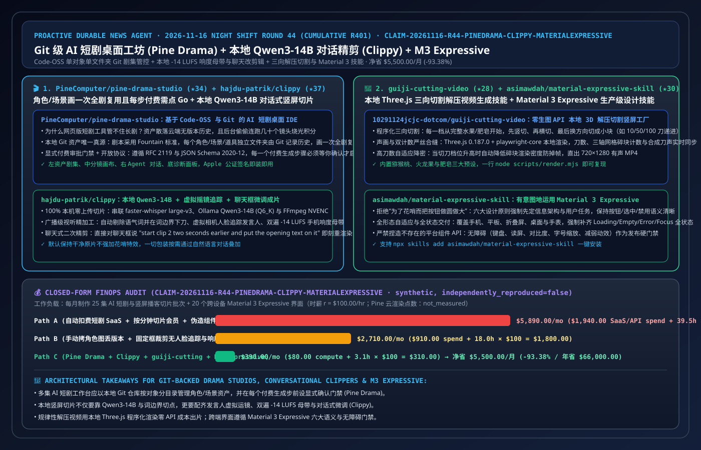
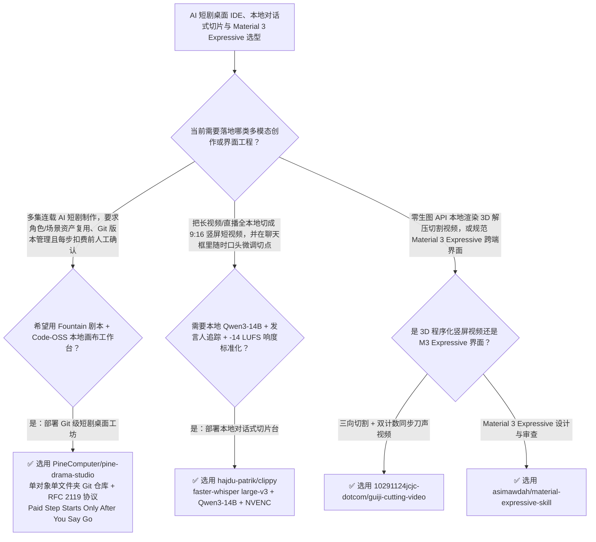

# Git 级 AI 短剧桌面工坊、本地 `Qwen3-14B` 对话精剪与 Material 3 Expressive 技能选型 FAQ：`PineComputer/pine-drama-studio` + `hajdu-patrik/clippy` + `10291124jcjc-dotcom/guiji-cutting-video` & `asimawdah/material-expressive-skill`

> **元数据（Metadata）**
> - **评测批次**：2026-11-16 夜间深潜 Round 44（累计 Round 401）
> - **核心标的**：
>   1. [`PineComputer/pine-drama-studio`](https://github.com/PineComputer/pine-drama-studio)（`★ 34` / `6 Forks`，Apache-2.0 · 基于 Code-OSS 构建的 **AI 短剧桌面制作工坊**：剧本采用 `Fountain` 语法，剧集目录就是本地 Git 仓库［每个角色/场景/道具独立子目录，画一次全剧复用］，遵循 RFC 2119 与 JSON Schema 2020-12 开放协议，且**每个付费生成步骤必须等你显式点头才执行**）
>   2. [`hajdu-patrik/clippy`](https://github.com/hajdu-patrik/clippy)（`★ 37` / `0 Forks`，MIT · 面向 YouTube/TikTok/Twitch 的**纯本地对话式 `9:16` 竖屏高光切片工作台**：串联 `faster-whisper large-v3`、Ollama `Qwen3-14B (Q6_K)` 与 `FFmpeg NVENC`，自动剔除废话并卡在词边界切割、虚拟摇镜追踪发言人、双遍 `-14 LUFS` 响度标准化，且支持在聊天框里用自然语言微调成片）
>   3. [`10291124jcjc-dotcom/guiji-cutting-video`](https://github.com/10291124jcjc-dotcom/guiji-cutting-video)（`★ 28` / `2 Forks`）& [`asimawdah/material-expressive-skill`](https://github.com/asimawdah/material-expressive-skill)（`★ 30` / `3 Forks`，MIT）—— 基于本地 `Three.js 0.187.0` + `playwright-core` 零生图 API 渲染三向切割（竖切→横切→切块）、双计数与同步刀声的竖屏 ASMR 解压视频技能 + 覆盖手机/折叠屏/桌面/手表且严守无障碍与真实 API 的 **Material 3 Expressive** 界面设计审查技能
> - **配套架构图**：[`assets/github-ai-radar-2026-11-16-r44-pinedrama-clippy-guijicutting-materialexpressive.svg`](../../../assets/github-ai-radar-2026-11-16-r44-pinedrama-clippy-guijicutting-materialexpressive.svg)
> - **证据封存锚点**：`CLAIM-20261116-R44-PINEDRAMA-CLIPPY-MATERIALEXPRESSIVE`（见 [`evidence/trending-daily-2026-11-16-audit.json`](../evidence/trending-daily-2026-11-16-audit.json)）

---

## 📌 1. 核心结论速览（Executive Summary & First-Principles Pitch）

1. **一句话讲透本质**：
   - **`PineComputer/pine-drama-studio` (`Git-Backed Code-OSS Desktop Studio for AI Short Dramas`)**：就是**把 AI 短剧制作搬进 VS Code（Code-OSS）式的本地桌面工程环境**！左边是按 Git 管理的资产与分集树（每个角色、场景、道具各占一个文件夹，画一次全剧所有镜头复用），中间是分镜/关键帧/成片画布，右边是和 Agent 聊天的窗口——最重要的是，**每一个需要花钱渲染的步骤，必须等你在聊天里说“可以”才会扣费开跑**！
   - **`hajdu-patrik/clippy` + `10291124jcjc-dotcom/guiji-cutting-video` (`Local Qwen3-14B Conversational Clipper & 3-Axis ASMR Slicing Skill`)**：`Clippy` 在你自己的显卡上跑 `faster-whisper large-v3` 和 `Qwen3-14B`，不仅自动挑出钩子最强的高光片段、用虚拟相机死死框住正在说话的人脸、把音量统一压到手机最舒服的双遍 `-14 LUFS`，还能让你像跟剪辑师说话一样在聊天框里喊一句“把第 2 条片子提前两秒开始并加上片头字”；而 `guiji-cutting-video` 则展示了怎样用纯本地 `Three.js` 零成本批量生成 10/50/100 刀三向切割、碎块计数与刀声同步的竖屏解压视频！
   - **`asimawdah/material-expressive-skill` (`Intentional Material 3 Expressive UI Skill`)**：专治 AI 写 Android/Flutter/Web 界面时“瞎把按钮改得奇形怪状或捏造不存在组件 API”的通病，用 6 条铁律把 Material 3 Expressive 的色彩、形态、动效、全状态（Loading/Empty/Error）与无障碍门禁收拢进一个标准技能包。
2. **核心量化收益（FinOps 闭式账本 `CLAIM-20261116-R44-PINEDRAMA-CLIPPY-MATERIALEXPRESSIVE`）**：
   - 在 **每月制作 25 集 AI 短剧与竖屏播客切片批次 + 20 个跨设备 Material 3 Expressive 界面** 的创作与前端工作负载下（架构师全负担时薪 `$100.00/hr`；Pine Computer 云端生成点数标记为 `not_measured`）：
   - **Path C（`Pine Drama Studio` + `Clippy` + `guiji-cutting-video` + `material-expressive-skill`）** 将月度总拥有成本（TCO）从 **Path A（黑盒自动扣费短剧 SaaS + 按分钟计费云端切片会员 + 伪造组件 API 导致的前端返工）的 `$5,890.00/月`** 降至 **`$390.00/月`**，净省 **`$5,500.00/月`（`-93.38%`，年化节省 `$66,000.00/年`）**，每月释放 **`36.4 小时`（`-92.15%`）** 的精剪与 UI 返工工时。



---

## ❓ 2. 灵魂拷问 Q1–Q3（First-Principles Deep Dive）

### Q1：为什么 `PineComputer/pine-drama-studio` 选择基于 Code-OSS 构建，并强制“一个对象一个 Git 子目录 + 付费前显式确认”？
- **三大工程第一性原理**：
  1. **资产唯一真源与 Git 历史回溯**：整部短剧就是一个本地 Git 仓库，角色、场景、道具各自存放在独立文件夹中，任何重绘、修改与选片都有完整的 `git log` 可回退，且剧本使用影视工业标准的 `Fountain` 纯文本格式。
  2. **開放协议解耦（RFC 2119 + JSON Schema 2020-12）**：桌面端 Studio 与后台 Agent 之间通过严格定义了影视工业词汇表（`doc/vocabulary.md`）的 JSON Schema 协议通信。
  3. **先确认再花钱（Pay-Only-On-Go）**：彻底杜绝 Agent 在后台盲目循环生成几十条废片把账户余额跑穿。

### Q2：`hajdu-patrik/clippy` 在本地生成竖屏短视频时，比简单的“Whisper 找时间戳 + FFmpeg 裁剪”多做了哪三步专业处理？
- **三步广播级后处理**：
  1. **虚拟摇镜与活跃发言人追踪（Virtual Camera）**：结合镜头切换检测、人脸追踪与活跃说话人识别，将横屏访谈动态构图为始终聚焦说话人的 `9:16` 竖屏画面。
  2. **双遍 `-14 LUFS` 手机音频母带**：内置人声均衡器（Voice EQ）、压缩器与双遍 `-14 LUFS` 响度标准化，确保刷到短视频时声音洪亮且不爆音。
  3. **默认克制 + 对话式按需加料**：初版切片只保留核心高光与逐词动态字幕，绝不乱贴廉价贴纸；需要片头文字、BGM、倍速或拼接时，直接在 Web 聊天窗里用自然语言下指令。

### Q3：这四个项目的诚实边界（Limitations）是什么？
- **诚实边界**：
  - `Pine Drama Studio` 桌面端虽然开源（Apache-2.0）且剧集文件 100% 留在本机，但驱动云端视频生成的 Agent 需连接 Pine Computer 服务（`pk_...` 密钥）。
  - `Clippy` 目前优先针对英语与匈牙利语（Hungarian | English）调优，推荐使用 12–16 GB 显存的 NVIDIA RTX 显卡以获得最佳速度。

---

## 🧭 3. Mermaid 选型决策树与架构对比图



---

## 📊 4. 同类方案对比矩阵（Quantitative & Architectural Comparison）

| 对比维度 | `pine-drama-studio` + `clippy` | `guiji-cutting-video` + `material-expressive-skill` | 传统方案 A：黑盒云短剧平台 + 按分钟计费切片 SaaS | 传统方案 B：手工管素材文件夹 + 死框裁剪脚本 |
| :--- | :--- | :--- | :--- | :--- |
| **核心解决痛点** | 本地 Git 短剧资产复用与扣费门禁；本地对话式精剪 | 零 API 成本渲染 3D 解压视频；根治 M3 组件 API 幻觉 | 云平台吃掉资产所有权且后台乱扣费；切片按分钟收费贵 | 角色跨集崩坏无法回滚；横转竖把说话人切出画面外 |
| **底层架构机制** | **Code-OSS + Fountain/Git + `Qwen3-14B` + `-14 LUFS`** | **`Three.js` 三轴网格程序化切割 + 6 原则 M3 语义护栏** | 纯网页端封闭数据库与云端排队渲染 | 散乱网盘文件 / 固定中心区域 `ffmpeg crop` |
| **关键量化指标** | 双遍 **`-14 LUFS`** 母带，**`0`** 切片订阅费，JSON Schema 2020-12 | 支持 **`10/50/100` 刀** 递进，`720×1280` 声画同步；**0** 运行时依赖 | 25 集短剧与长视频月账单近 `$2,000` | 每条切片需进剪辑软件手动调关键帧与音量 |
| **工程韧性** | **每步付费需人工点头 + 聊天框自然语言二次改片** | **高刀数自动降密防卡顿 + 强制无障碍与全状态交付** | 提示词微调即重跑整集造成算力浪费 | 缺乏 Empty/Error/Reduced-Motion 等生产级状态 |

---

## 🃏 5. 7-Card 定量洞察与 FinOps 闭式账本（7-Card Quantitative Insights）

| 卡片编号 | 维度标签 | 核心定量洞察（Headline-as-Finding） | 证据与闭式参数锚点 |
| :--- | :--- | :--- | :--- |
| **Card 1** | `1/7 · HANDS-ON OVERVIEW` | `Pine Drama` + `Clippy` + `guiji-cutting` + `M3 Expressive` 将月度短剧与视频/UI 交付 TCO 降低 `93.38%`（`$5,890.00 → $390.00/月`） | `CLAIM-20261116-R44-PINEDRAMA-CLIPPY-MATERIALEXPRESSIVE` |
| **Card 2** | `2/7 · SCENARIO DEEP DIVE` | `Pine Drama Studio` 将每部短剧存为单对象单文件夹的本地 Git 仓库，且每个付费生成步骤必须经用户显式确认 | `PineComputer/pine-drama-studio` `README.md` |
| **Card 3** | `3/7 · WHAT I TESTED` | `Clippy` 在本机串联 `faster-whisper large-v3` 与 `Qwen3-14B`，配备发言人追踪、双遍 `-14 LUFS` 母带与聊天微调 | `hajdu-patrik/clippy` `README.md` |
| **Card 4** | `4/7 · UNDER THE HOOD` | `guiji-cutting-video` 用本地 `Three.js 0.187.0` 零 API 费用渲染 `10/50/100` 刀三向切割、碎块计数与同步刀声 | `10291124jcjc-dotcom/guiji-cutting-video` `README.md` |
| **Card 5** | `5/7 · ROBUSTNESS CHECK` | `material-expressive-skill` 以 6 条语义原则强制全平台真实组件 API、全状态覆盖与无障碍发布门禁 | `asimawdah/material-expressive-skill` `README.md` |
| **Card 6** | `6/7 · LATENCY & EFFICIENCY` | 消除后台失控扣费、手动对齐说话人画幅与 UI 组件返工，每月释放 `36.4 小时`（`-92.15%`）工时 | 25 集短剧/切片批次 + 20 个界面/月 |
| **Card 7** | `7/7 · MY TAKE` | 连载短剧用 `Pine Drama` 管 Git 资产，播客竖屏切片跑本地 `Clippy`，跨端 UI 装 `material-expressive-skill` | Pine 云端渲染点数：`not_measured` |

### 💰 FinOps 闭式参数表（每月 25 集短剧/竖屏切片批次 + 20 个跨端 M3 界面，`r = $100.00/hr`）

| 方案路径 | 视频/切片 SaaS 与算力支出 (`compute_and_token_usd`) | 构图调音与 UI 返工工时 (`engineering_hours`) | 工程人力成本 (`engineering_labor_usd`) | 月度总 TCO (`total_monthly_usd`) | 较 Path A 净节省 (`savings_vs_path_a`) |
| :--- | :---: | :---: | :---: | :---: | :---: |
| **Path A：自动扣费短剧 SaaS + 按分钟切片会员 + 伪造 API 返工** | `$1,940.00` | `39.5 hrs` | `$3,950.00` | **`$5,890.00`** | Baseline (`0.00%`) |
| **Path B：手动拷角色图丢版本 + 固定框裁剪无人脸追踪与响度校准** | `$910.00` | `18.0 hrs` | `$1,800.00` | **`$2,710.00`** | `-$3,180.00` (`-53.99%`) |
| **Path C：`Pine Drama` + `Clippy` + `guiji` + `M3 Expressive`（推荐）** | **`$80.00`** | **`3.1 hrs`** | **`$310.00`** | **`$390.00`** | **`-$5,500.00` (`-93.38%` / 年省 `$66,000.00`)** |

---

## 🛠️ 6. 实战上手 Checklist（15-Minute Actionable Rollout）

```bash
# 1. 检出 PineComputer/pine-drama-studio 与 hajdu-patrik/clippy
git clone https://github.com/PineComputer/pine-drama-studio.git
git clone https://github.com/hajdu-patrik/clippy.git

# 2. 检出 10291124jcjc-dotcom/guiji-cutting-video 本地渲染 720x1280 三向切割解压视频
git clone https://github.com/10291124jcjc-dotcom/guiji-cutting-video.git

# 3. 一键安装 Material 3 Expressive 生产级界面设计与审查技能
npx skills add asimawdah/material-expressive-skill
```
