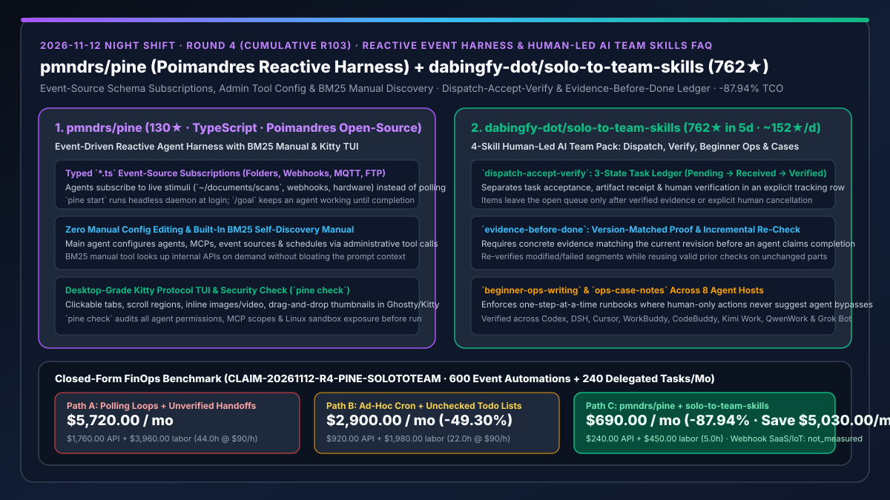
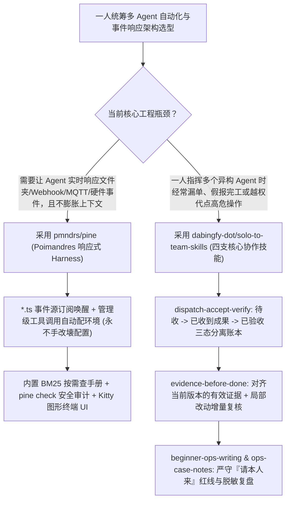

# 事件驱动响应式智能体执行器（`pmndrs/pine`）与“一人统筹多 AI 团队”派收核协作技能包（`dabingfy-dot/solo-to-team-skills`）深度选型 FAQ

> **文档定位**：本专题是 **2026-11-12 夜班第 4 轮（累计第 103 篇）独立六段式选型指南**，严格对标 `ib-vs-ethernet-roce-selection-faq.md` 的通俗第一性原理与闭式 FinOps 核算规范，面向独立开发者、AI 解决方案架构师与精益研发团队负责人，深度拆解今日在事件驱动响应式 Harness 与一人统筹多 Agent 交付治理赛道突起的两大高信号开源仓：
> 1. **`pmndrs/pine`（`130★`，建仓 2 天，TypeScript，知名开源组织 Poimandres 出品）**：打破传统“你说一句、它动一下”或简单定时器的被动模式，让 Agent **直接订阅任意外部事件刺激（文件夹变动、Webhook、MQTT、FTP、网页更新、物理硬件如 Flipper Zero）**——通过管理级工具调用实现**零手写配置（Never touches user config）**、内置 **BM25 按需手册检索（零上下文文档膨胀）**、`pine check` 安全边界自检以及支持行内图片/视频/拖拽缩略图的 **Kitty 协议图形级终端 UI**！
> 2. **`dabingfy-dot/solo-to-team-skills`（建仓 5 天狂揽 `762★`，日均 `≈152★/天`，中英双语协作技能包）**：专为“一个人总控多个长期 AI 助手”打造的四支核心协作技能——**`dispatch-accept-verify`（派活-接单-收成果-验收三态分离登记）**、**`evidence-before-done`（交活前必须附带对齐当前版本的有效证据，局部改动增量复核）**、**`beginner-ops-writing`（面向新手的一次一步操作说明，须本人亲自完成的步骤严禁写代做绕过）** 与 **`ops-case-notes`（真实踩坑脱敏复盘）**，已完成 Codex、DeepSeek Harness、Cursor、WorkBuddy、CodeBuddy、Kimi Work、千问办公（QwenWork）与 Grok Bot 八家宿主实测！
>
> **English Version**: [pine-solo-to-team-skills-reactive-event-harness-human-led-ai-teams-selection-faq.en.md](pine-solo-to-team-skills-reactive-event-harness-human-led-ai-teams-selection-faq.en.md) · **关联日报**: [`daily/2026-11-12.md`](../daily/2026-11-12.md) · **架构总结图**: [`assets/github-ai-radar-2026-11-12-r4-pine-solototeam.svg`](../../../assets/github-ai-radar-2026-11-12-r4-pine-solototeam.svg)

---

## 📌 一、核心结论速览（Executive Summary）

1. **一句话大白话讲透这两个项目到底解决了什么痛点？**
   - **终结“为了让 Agent 监控目录或 Webhook 只能写死循环轮询烧 Token，或者手改 JSON 配置文件把整个 Harness 改崩”的痛点（`pmndrs/pine`）**：绝大多数 CLI Harness 只能被动等你在聊天框敲回车。`pmndrs/pine` 将事件源抽象为带 Schema 的 `*.ts` 服务（文件监控、MQTT、FTP、Webhook、Telegram），你只需用自然语言对主 Agent 说“监控 `~/documents/scans`，每有新扫描件就提取摘要和付款信息”，主 Agent 就会通过受控的**管理级工具调用（Administrative Tool Calls）**自动创建并订阅事件源，绝不直接乱改用户配置文件；同时内置 **BM25 手册工具**，Agent 需要查内部 API 时按需检索，平时上下文保持极度干净！
   - **终结“一个人同时使唤四五个 AI 助手时，活派出去没人收、Agent 嘴上说『全改好了』其实根本没跑验证、以及把账号登录/授权等高危人工步骤教给 AI 代点”的痛点（`dabingfy-dot/solo-to-team-skills`）**：当架构师一人带一支 AI 团队时，最容易翻车在交接与验收环节。`solo-to-team-skills` 提供了一套跨宿主通用的工程纪律：① **三态分离登记行**（派出去记「待收」，交回来记「已收到成果」并写明路径，查验完证据记「已验收」才准销项）；② **版本对齐证据门禁**（交活必须附带匹配当前版本的有效证据，改过或失败过的部分强制补核，未改动部分可复用上次核验）；③ **人机红线铁律**（凡须本人亲自完成的步骤，文档只准写「请本人来」，严禁编写代做或绕过脚本）！
2. **闭式 FinOps 投资回报结论（`CLAIM-20261112-R4-PINE-SOLOTOTEAM`）**：
   - 以 **10 人架构师与技术运营团队每月运行 `600 次` 外部事件触发自动化任务，并由单人统筹派发 `240 项` 跨 Agent 交付物** 为基准（高级技术负责人全包时薪 `$90.00/hr`；第三方商业 Webhook SaaS 订阅与外部物联网硬件采购费：`not_measured`）：
   - 从 **Path A（定时轮询全量上下文带入 API 手册 + 无证据门禁口头报完工导致漏单返工，月均 `$5,720.00`）** 升级至 **Path C（`pmndrs/pine` 事件订阅与 BM25 按需检索 + `solo-to-team-skills` 三态登记与证据验收，月均 `$690.00`）**，每月净省 **`$5,030.00/mo`（降幅 `-87.94%`，年省 `$60,360.00/yr`）**，并将人工催单、假完工返工与配置修复工时从 `44.0 hrs/mo` 压缩至 `5.0 hrs/mo`（节省 **`-88.64%`**）。

---

## 🎯 二、三大灵魂拷问（Q1 / Q2 / Q3 深度原理解析）

### Q1：`pmndrs/pine` 是如何通过「`*.ts` 事件源订阅 + 管理工具改配置 + BM25 按需自发现」消除空转与上下文膨胀的？
- **第一性原理拆解**：
  1. **事件驱动唤醒（Event-Driven Awakening）与 `/goal` 持久目标循环**：
     - 在 `pine start` 后台守护进程模式下，Agent 处于零 Token 消耗的休眠订阅态，仅当绑定的 `*.ts` 事件源（文件夹新增文件、MQTT 消息、FTP 上传、Webhook 回调）触发 Schema 匹配的事件时才精准唤醒；配合 `/goal` 指令与可固定的会话标签页（Pinned Tab），让 Agent 围绕目标持续工作直至达成。
  2. **零手写配置（No Configs）与内置 BM25 手册工具（Self-Discovery）**：
     - 用户永远不需要手写 YAML/JSON：主 Agent 通过专用管理工具调用（Administrative Tool Calls）完成子 Agent、MCP、事件源与定时器的增删改查，从根源上杜绝语法写错搞挂宿主；
     - 内置 BM25 检索引擎，Agent 在需要调用陌生的内部接口时才按需拉取对应手册片段，省去每轮常驻数千 Token 的说明文档；`pine check` 则在启动前全面扫描 Agent 权限、MCP 范围与 Linux 沙箱漏口。

### Q2：`dabingfy-dot/solo-to-team-skills` 的四支技能是如何防止“派活丢单、无证据谎报完工、越界代操作”三大顽疾的？
- **第一性原理拆解**：
  1. **`dispatch-accept-verify`（派、收、核三态分离登记表）**：
     - 强制在派活前写入一行登记（「待收」：写清谁在干、谁来收、谁到点查）；收到产出时改为「已收到成果」并绑定产物路径；只有经过证据核对标为「已验收」或经人工授权取消，才允许从未完清单移除。
  2. **`evidence-before-done`（版本对齐证据与增量补核）+ `beginner-ops-writing`（人机权限边界）**：
     - 拒绝“我改好了”的空口白话，要求交活前必须出示与当前版本严格对应的实测证据；若后续发生局部修改，只对改动或曾失败的部分执行增量补核，未变部分直接复用上一轮证据以节省成本；
     - 在编写操作手册时坚持“一次一步、点名唯一、写清做完会看到什么”，且对必须人类本人操作的高敏环节严守「请本人来」红线，并配套 `ops-case-notes` 真实脱敏排障案例库。

### Q3：AI 架构师如何把 `pmndrs/pine` 与 `solo-to-team-skills` 组合成“一人成队”的自动化指挥中心？
- **黄金组合落地范式**：
  - 用 **`pmndrs/pine`** 作为底层的事件感知与多标签页并发执行底座（监听代码仓、文档目录、监控告警与硬件事件）；
  - 在主控 Agent 与各专项子 Agent 中加载 **`dabingfy-dot/solo-to-team-skills`**，让每次事件触发派出的子任务都自动登记三态流水并强制通过 `evidence-before-done` 验收后才向架构师汇报！

---

## 🧭 三、Mermaid 选型决策树与「事件唤醒 + 派收核闭环」架构图

---

## 📊 四、同类方案核心能力对比矩阵（Selection Matrix）

| 评估维度 | Path A：传统定时轮询 + 口头无证据交接 | Path B：手写 Cron 脚本 + 普通 Todo 清单 | **Path C（推荐）：`pmndrs/pine` + `solo-to-team-skills`** |
| :--- | :--- | :--- | :--- |
| **外部事件响应与唤醒机制** | 靠高频轮询空转烧 Token，延迟高且浪费预算 | 需人工维护脆弱的 Shell/Webhook 胶水脚本 | **原生 `*.ts` Schema 事件源订阅（文件/MQTT/FTP/Webhook）按需唤醒** |
| **配置安全与内部文档开销** | 每次全量塞入内部 API 文档；Agent 直接改配置文件易崩 | 手工改 JSON/YAML 常写错语法 | **管理级工具调用零手写配置 + 内置 BM25 手册按需自发现** |
| **多 Agent 派活与完工验收纪律** | 派出去无人跟踪，Agent 没跑测试就谎报“已完成” | 仅有简单的 `done` 勾选，分不清“交了”和“验过了” | **待收/已收到成果/已验收三态分离 + `evidence-before-done` 增量复核** |
| **跨宿主兼容性与人机安全边界** | 绑死单一宿主，常诱导 Agent 硬闯登录验证码 | 文档含糊不清，新手照做易出错 | **8 大主流宿主实测通过 + 严守「请本人来」红线与一次一步说明** |
| **月度总拥有成本（600 事件 + 240 派单）** | **`$5,720.00 / mo`**（`$1,760` API + `$3,960` 返工工时） | **`$2,900.00 / mo`**（`$920` API + `$1,980` 工时） | **`$690.00 / mo`（净省 `$5,030.00/mo` · `-87.94%`）** |

---

## 🧪 五、定量 FinOps 算例与 7-Card 洞察（`CLAIM-20261112-R4-PINE-SOLOTOTEAM`）

### 5.1 测算基准与显式边界（Scope & Boundaries）
- **场景设定**：10 人精益架构与技术运营团队，每月处理 **600 次文件/Webhook/设备事件触发任务**，并由单人总控向多 Agent 派发 **240 项跨宿主研发与运营交付任务**。
- **费率假设**：高级技术负责人全包时薪 **`$90.00 / hr`**。
- **显式边界声明（Explicit Not-Measured Boundary）**：外部商业 Webhook 中间件（如 Zapier/Make）订阅费与外部物联网硬件采购成本标记为 **`not_measured`**，本表严格核算轮询/上下文 Token 消耗与人工催单、假完工返工及配置排障工时。

### 5.2 三路径月度成本闭式对照表

| 成本分项 | Path A：高频轮询 + 无证据口头报完工 | Path B：手写 Cron + 普通 Todo 表 | **Path C：`pmndrs/pine` + `solo-to-team-skills`（推荐）** |
| :--- | :--- | :--- | :--- |
| **月度事件监听与多 Agent 协作模型 API 支出** | **`$1,760.00`**（轮询空转 + 常驻手册 + 全量重复核验） | **`$920.00`** | **`$240.00`**（事件唤醒零空转 + BM25 按需检索 + 未改动部分复用核验） |
| **漏单催办、无证据假完工返工与配置修复工时（`$90/hr`）** | `44.0 hrs × $90.00` = **`$3,960.00`** | `22.0 hrs × $90.00` = **`$1,980.00`** | `5.0 hrs × $90.00` = **`$450.00`** |
| **月度总成本（Monthly TCO）** | **`$5,720.00 / mo`** | **`$2,900.00 / mo`**（`-49.30%`） | **`$690.00 / mo`** |
| **相对 Path A 净节省** | 基准线（Baseline） | 净省 `$2,820.00 / mo` | **净省 `$5,030.00 / mo`（`-87.94%` · 年省 `$60,360.00/yr`）** |
| **外部商业 Webhook SaaS 与物联网硬件费** | `not_measured` | `not_measured` | `not_measured` |

---

## 🛠️ 六、生产级落地核验 Checklist

- [ ] **1. `pmndrs/pine` 初始化与 `pine check` 安全自检**：执行 `npm install -g @pmndrs/pine && pine init && pine check`，核查所有已注册 Agent 的模型、工具、MCP 权限与 Linux 沙箱隔离状态。
- [ ] **2. 事件源订阅与 BM25 按需手册验证**：通过自然语言让主 Agent 订阅本地目录或 Webhook 事件源，确认其通过管理工具调用生效且不破坏 `~/.pine` 用户配置。
- [ ] **3. `dispatch-accept-verify` 三态登记表启用**：在跨 Agent 派活前强制写入「待收」登记行，验证「已收到成果」与「已验收」分步流转。
- [ ] **4. `evidence-before-done` 增量核验与「请本人来」红线审查**：在验收交付物时核对当前版本证据，确认局部返工仅补核修改部分，且操作文档中所有须本人操作步骤均明确标注「请本人来」。
