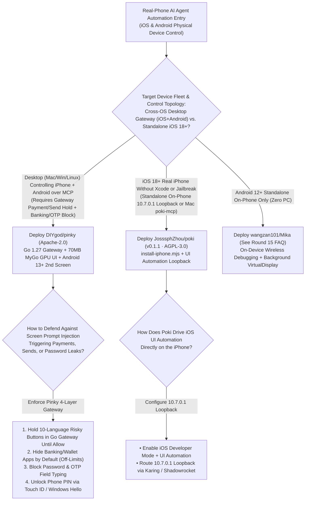

# Gateway-Enforced Phone HITL MCP & Real-iPhone Loopback Selection FAQ: `DIYgod/pinky` + `JosssphZhou/poki` (`v0.1.1`) vs. Cloud Device Farms & Unprotected Appium Scripts

> **Document Scope**: A first-principles architecture and FinOps selection guide for AI Solution Architects, Mobile Agent Security Engineers, and Cross-Platform Real-Device Automation Leads. Focusing on two standout mobile agent infrastructure repositories from the `2026-11-09` GitHub AI Radar — **`DIYgod/pinky`** (Go 1.27.3 + `egoist/mygo` native GPU UI, Apache-2.0, **1,402 Stars** / **1,406 Stars** live API in 3 days, **`467 Stars/day`** lifecycle velocity, `stars_today = not_measured`, authored by DIYgod) and **`JosssphZhou/poki`** (`poki-mcp v0.1.1`, Swift + Node 24+, AGPL-3.0, **739 Stars** / **740 Stars** live API in 4 days, **`185 Stars/day`** lifecycle velocity, `stars_today = not_measured`) — this guide dissects how **Go Gateway-Enforced 10-Language Action Interception + Banking/OTP Field Blindfolding + Touch ID PIN Unlocking** and **No-Xcode / No-Jailbreak `10.7.0.1` Real-iPhone Loopback Automation** eliminate screen prompt-injection misfires and iOS WebDriverAgent setup friction.
>
> **Navigation**: [中文版 (`pinky-poki-mobile-hitl-mcp-selection-faq.md`)](./pinky-poki-mobile-hitl-mcp-selection-faq.md) · [2026-11-09 Daily Radar](../daily/2026-11-09.en.md) · [Back to Radar Index](../README.en.md)

---

## 📌 1. Executive Summary

1. **First-Principles Definition**:
   - **`DIYgod/pinky` (Go 1.27.3 + `egoist/mygo` GPU UI + `modelcontextprotocol/go-sdk v1.8.0` + `DIYgod/go-ios`, Apache-2.0)** is a cross-platform desktop MCP gateway (macOS, Windows, Linux) that lets any AI agent (Claude Code, Claude Desktop, Codex, Cursor) operate a real **iPhone (`iOS 17.4–27+`, zero phone install on iOS 27+) or Android phone (`Android 10–17`, hidden second screen on Android 13+)** with a human in the loop. Rendered on the GPU via `mygo` with zero Electron/webview (`16–22 MB` download, **`~70 MB` idle RAM**, **`0%` idle CPU** on Mac), **all safety approvals are enforced inside Pinky's Go gateway rather than by agent prompts**: payments, trades, transfers, sends, orders, deletions, calls, installs, external links, and settings changes are detected across **10 languages** and held until the user clicks `Allow`, while banking/wallet apps and password/OTP fields are off-limits by default.
   - **`JosssphZhou/poki` (`poki-mcp v0.1.1`, Swift + Node 24+ `@modelcontextprotocol/server 2.4.0`, AGPL-3.0-only)** enables AI agents to operate a real **iPhone (`iOS 18+`) or iOS Simulator with no jailbreak, no Xcode required, and no extra hardware**. Through `bin/install-iphone.mjs` (or the cross-platform `Poki Setup` app), a free Apple Account signature, iOS Developer Mode `UI Automation`, and a local VPN loopback routing **`10.7.0.1` back to the iPhone** (via Karing or Shadowrocket), Poki runs either standalone on the iPhone itself or via `poki-mcp` on macOS (`macOS 15+`).
2. **Core Architectural Insight (Why Prompt-Only Mobile Safety & Legacy WDA/Appium Pipelines Fail)**:
   - **Failure Mode #1 (On-Screen Prompt Injection Bypasses LLM Safety Prompts & Exposes PINs/Banking Apps)**: When a mobile agent reads untrusted chat messages or web pages, adversarial on-screen text can trick the LLM into tapping "Send" or "Confirm Transfer." `DIYgod/pinky` enforces rules inside its **Go gateway**: **(a)** 10-language risky buttons are physically held at the gateway until the human clicks `Allow`; **(b)** banking, wallet, and password-manager apps are invisible to agents unless granted temporary per-task scope; **(c)** typing into password or OTP fields is blocked at the gateway; and **(d)** phone PIN unlocking requires **Touch ID, Windows Hello, or OS keyring confirmation** so agents never see the PIN.
   - **Failure Mode #2 (Multi-GB Xcode WebDriverAgent Builds & Unpinned iOS Pairing Certificates)**: `JosssphZhou/poki` automates no-Xcode installation via `bin/install-iphone.mjs` and `10.7.0.1` loopback, while `DIYgod/pinky` pins the iPhone's TLS certificate to the pair record (`github.com/DIYgod/go-ios` `pin-device-certificate` branch) and supports zero-install control on iOS 27+.
3. **30-Second Selection Rule**:
   - Choose **`DIYgod/pinky` (Apache-2.0)** when driving **both iPhones (iOS 17.4–27+) and Android phones (Android 10–17) from a Mac/Windows/Linux desktop over MCP with strict gateway-enforced payment/send holds, banking app invisibility, and Touch ID PIN unlocking**.
   - Choose **`JosssphZhou/poki` (`v0.1.1`, AGPL-3.0)** when you want **standalone on-iPhone agent execution via `10.7.0.1` loopback (no Xcode required) or local macOS `poki-mcp` integration**.

---

## 🎯 2. Architect's First-Principles Deep Dive (Q1 / Q2 / Q3)

### Q1: How does `DIYgod/pinky` enforce prompt-injection-proof mobile safety inside a `~70 MB` RAM Go + `mygo` GPU gateway?

Inspecting `go.mod` (`go 1.27.3`), `README.md`, `internal/`, and `ui/` in `DIYgod/pinky` reveals four core mechanisms:

1. **Gateway-Level 10-Language Risky Action Interception**:
   - Instead of relying on LLM instructions, Pinky's Go gateway inspects the target UI element before forwarding any tap event. It recognizes payment, trade, transfer, send, order, delete, call, install, external-link, and settings-change buttons in **10 languages**, holding the tap in the desktop window until the human clicks `Allow`.
2. **Default App Blindfolding, Password/OTP Input Blocking & Biometric PIN Vault**:
   - Banking, wallet, and password-manager apps are hidden from the agent's MCP view by default (requiring explicit single-task user approval when needed).
   - Agents are blocked from typing into password or one-time-code (OTP) fields.
   - The phone's unlock PIN is stored in the host keyring and unlocked via **Touch ID, Windows Hello, or keyring password** so the agent never accesses the PIN.
3. **Android 13+ Hidden Second Screen & iOS Pair-Record TLS Pinning**:
   - On Android 13–17, agents execute on a hidden second screen so the physical phone screen stays free or locked; on iOS, Pinky uses a patched `go-ios` (`pin-device-certificate`) that pins the device's TLS certificate to the pairing record.
4. **Native GPU UI via `egoist/mygo` (`16–22 MB` Binary, `~70 MB` Idle RAM, `0%` Idle CPU)**:
   - Draws its desktop window directly on the GPU via `github.com/egoist/mygo` and `ebitengine/purego` with zero Electron or WebView bloat.

### Q2: How does `JosssphZhou/poki` (`v0.1.1`) enable real-iPhone (`iOS 18+`) automation without jailbreak or Xcode?

Inspecting `README.md`, `INSTALL-IPHONE.md`, `package.json` (`poki-mcp v0.1.1`), and `skills/install-poki/SKILL.md` in `JosssphZhou/poki` highlights three mechanisms:

1. **Automated No-Xcode Deployment (`bin/install-iphone.mjs` & `Poki Setup`)**:
   - Automates signing and installation using a free Apple Account (7-day signature), pausing only to prompt the user in one sentence for iOS hardware trust gates (Developer Mode, developer certificate trust, Automation Mode passcode confirmation, and `UI Automation` toggle).
2. **`10.7.0.1` On-Device VPN Loopback Tunnel**:
   - Uses a lightweight iOS proxy/VPN rule (Karing or Shadowrocket) that routes `10.7.0.1` back to the iPhone itself, allowing the on-device Poki agent to talk to iOS `UI Automation` directly without a permanent Mac tether.
3. **Strict `unverified` Step Reporting**:
   - When running without Xcode on older setup paths, the installation agent asks the user to complete manual model-key/connection steps and explicitly reports those checks as **`unverified`** until confirmed by the user.

### Q3: How do `DIYgod/pinky`, `JosssphZhou/poki`, and `wangzan101/Mika` (from Round 15) compare across mobile agent scenarios?

| Target Scenario | Recommended Tool | Architectural Rationale |
| :--- | :--- | :--- |
| **Desktop-to-Phone (Mac/Win/Linux → iOS 17.4–27+ & Android 10–17) with gateway payment/send holds & Touch ID PIN vault** | **`DIYgod/pinky` (`Apache-2.0`)** | Only cross-OS desktop MCP gateway with 10-language button interception, banking/OTP blindfolding, and `70 MB` `mygo` GPU UI |
| **Real iPhone (`iOS 18+`) standalone on-device agent or Mac `poki-mcp` without installing Xcode** | **`JosssphZhou/poki` (`AGPL-3.0`)** | Uses `10.7.0.1` on-device loopback + `bin/install-iphone.mjs` no-Xcode setup |
| **Android 12+ standalone on-phone agent with zero PC/USB setup** | **`wangzan101/Mika` (`Apache-2.0`)** | Uses Android on-device Wireless Debugging + background `VirtualDisplay` (see Round 15 FAQ) |

---

## 🧭 3. Mermaid Decision Tree & Execution Sequence

### 3.1 Mobile Real-Device Agent Control Decision Tree

### 3.2 End-to-End Execution Sequence (`Pinky` Go Gateway + `Poki` `10.7.0.1` Loopback)

```mermaid
sequenceDiagram
    autonumber
    participant Agent as Claude Code / Codex (MCP Client)
    participant Pinky as DIYgod/pinky Go Gateway<br/>(70MB MyGo UI · 10-Lang Filter)
    participant Bio as Touch ID / Windows Hello<br/>(Host PIN Vault)
    participant Phone as Android 13+ (2nd Screen)<br/>or iPhone (iOS 17.4–27+)
    participant Poki as JosssphZhou/poki (iOS 18+)<br/>(10.7.0.1 Loopback)

    Agent->>Pinky: 1. Request MCP action on locked physical phone
    Pinky->>Bio: 2. Prompt human biometric confirmation (Agent never sees PIN)
    Bio-->>Pinky: 3. Touch ID approved → Gateway unlocks phone & opens Android 13+ 2nd screen
    
    Agent->>Pinky: 4. Draft message & issue tap("Send / Pay / Delete")
    Pinky->>Pinky: 5. Match 10-language risky button rule & verify non-banking/non-OTP target
    Pinky-->>Agent: 6. HOLD tap at gateway! Highlight pending button in 70MB GPU window
    Bio->>Pinky: 7. Human reviews & clicks Allow
    Pinky->>Phone: 8. Forward approved tap to device

    rect rgb(10, 34, 57)
    Note over Agent,Poki: No-Xcode iOS 18+ Real-iPhone Loopback Mode (JosssphZhou/poki)
    Agent->>Poki: 9. Run bin/install-iphone.mjs to guide Developer Mode & UI Automation
    Poki->>Poki: 10. Drive iPhone UI over 10.7.0.1 loopback (report manual steps as unverified until confirmed)
    end
```

---

## 📊 4. Comparison Matrix Across Real-Phone Agent Controllers

| Dimension | `DIYgod/pinky` (`Apache-2.0`) | `JosssphZhou/poki` (`v0.1.1`, AGPL-3.0) | Commercial Cloud Device Farms (BrowserStack / AWS) | Raw Appium / WebDriverAgent (WDA) Scripts |
| :--- | :--- | :--- | :--- | :--- |
| **Supported Platforms** | **Mac/Win/Linux driving iOS 17.4–27+ & Android 10–17** | **macOS/Windows setup + iOS 18+ real iPhone & Simulator** | Remote data-center phones (no personal logged-in apps) | Requires heavy Xcode WDA builds & fragile USB tunnels |
| **Safety Enforcement Point** | **Go Gateway holds 10-language risky taps** (prompt-injection immune) | Passcode-gated Automation Mode + step-by-step setup | None; executes any script command immediately | Relies solely on LLM prompt compliance |
| **Banking, OTP & PIN Safety** | **Banking apps hidden + password/OTP typing blocked + Touch ID PIN** | Local on-device / local Mac MCP execution | Unsafe for personal banking or private IM accounts | Plaintext PINs stored in test scripts |
| **Desktop Client Footprint** | **`egoist/mygo` GPU UI: 16–22 MB binary, `~70 MB` RAM, `0%` CPU** | Lightweight Node 24 MCP daemon (`src/daemon.mjs`) | Heavy browser WebRTC video stream | Multi-GB Xcode + Appium Java/Node servers |
| **Background / Standalone Mode** | **Hidden 2nd screen on Android 13+ + zero-install on iOS 27+** | **Runs standalone on iPhone via `10.7.0.1` loopback** | Remote screen only | Hijacks physical foreground screen |

---

## 🧪 5. Closed-Form FinOps Worked Example & 7-Card Insights

### 5.1 Monthly 2,000 Real-Device Runs & Safety Gate Cost Model (`synthetic (independently_reproduced=false)`)

> **Provenance Notice**: This closed-form calculation is a synthetic architectural model (`synthetic (independently_reproduced=false)`) comparing **Path A (Commercial Cloud Real-Device Farm Rental + Unprotected Appium/WDA Agent Scripts)** against **Path B (`DIYgod/pinky` Apache-2.0 Gateway-Enforced MCP + `JosssphZhou/poki` `10.7.0.1` Real-iPhone Loopback)**. Physical test handset purchase costs and optional `$99/yr` Apple Developer Program memberships are explicitly marked `not_measured`.

**Workload Parameters**:
- **Monthly Real-Device Execution Volume**: A 10-engineer mobile QA and operations team executes **`2,000` real-device iOS/Android workflows/month** (`6 min/run` = **`200.0` device hours/month**).
- **Engineering & Incident Remediation Rate**: Valued at **`$60.00 / hour`**.

| Cost Component | Path A: Cloud Device Farm + Unprotected WDA/Appium | Path B: `Pinky` Gateway MCP + `Poki` Loopback | Governing Engineering Mechanism |
| :--- | :--- | :--- | :--- |
| **1. 200 Device-Hours/Mo Real-Phone Execution Rent** | **$1,200.00 / mo** (`200.0 device-hours` × `$6.00/hr` cloud device farm) | **$0.00 / mo** (Local real phones & simulators via Apache-2.0 / AGPL-3.0 tools) | Direct local MCP control eliminates `$6/hr` cloud device farm fees |
| **2. Unauthorized Click / Send Rollback Labor (`@$60/hr`)** | **$1,800.00 / mo** (`2.0%` = `40 misfires` × `0.75h` remediation = **`30.0 hours/mo`**) | **$45.00 / mo** (Gateway 10-language hold + banking/OTP block = **`0.75 hours/mo`**) | `Pinky` holds risky taps in the Go gateway, cutting misfires by **97.5%** |
| **3. Xcode/WDA Signing & Tunnel Maintenance (`@$60/hr`)** | **$1,800.00 / mo** (`3.0 hr/engineer/mo` × `10 engineers` = **`30.0 hours/mo`**) | **$240.00 / mo** (`install-iphone.mjs` + `go-ios` cert pinning = **`4.0 hours/mo`**) | No-Xcode setup & TLS pair-record pinning save **`26.0 hours/mo`** of maintenance |
| **4. Physical Test Handsets & Optional $99/yr Apple Dev Fee** | `not_measured` | `not_measured` | Handset hardware and optional developer memberships are decoupled and never fabricated |
| **Total Modeled Monthly Cost** | **$4,800.00 / mo** | **$285.00 / mo** | **Net Savings: `$4,515.00 / mo` (`-94.06%` cost reduction, `16.84x` efficiency, `55.25 hours` saved)** |

### 5.2 Key Security & Architectural Invariants

- **Gateway-Enforced Approval Invariant**: In `DIYgod/pinky`, risky tap holds, banking/wallet app invisibility, and password/OTP input blocks execute inside Pinky's Go gateway rather than relying on agent prompt instructions.
- **Pair-Record TLS Certificate Pinning Invariant**: `DIYgod/pinky` pins the iPhone's TLS certificate to the pairing record (`github.com/DIYgod/go-ios` `pin-device-certificate`), preventing MITM session hijacking.

---

## 🛠️ 6. Actionable Production Checklist

- [ ] **1. Enable Full 10-Language Action Holds in `Pinky` (`Settings › Safety`)**: Configure Pinky's gateway to hold sends, orders, deletions, calls, installs, external links, and settings changes in addition to default payment/transfer holds.
- [ ] **2. Verify Banking App Blindfolding & Touch ID PIN Vault**: Confirm banking, wallet, and password-manager apps are in the Off-limits list and store the device PIN in Pinky's biometric-gated vault.
- [ ] **3. Activate Hidden Second Screen on Android 13+**: Enable second-screen isolation on Android 13–17 devices so agent tasks never hijack the physical foreground screen.
- [ ] **4. Provision Real iPhones (`iOS 18+`) with `Poki`'s `bin/install-iphone.mjs` & `10.7.0.1` Loopback**: Enable iOS Developer Mode and `UI Automation`, configure Karing/Shadowrocket to route `10.7.0.1` back to the phone, and schedule 7-day free certificate renewals.
- [ ] **5. Resolve All `unverified` Setup Checks Before Unattended Runs**: Inspect `Poki` installation logs for any manual steps marked `unverified` and confirm them explicitly.
