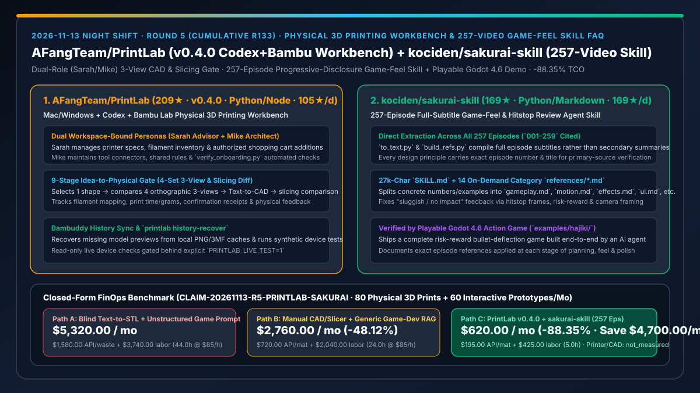
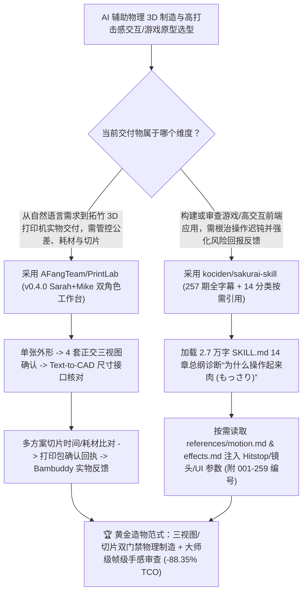

# 双角色三视图受控 3D 打印制造工作台（`AFangTeam/PrintLab` `v0.4.0`）与 257 期全本篇字幕提炼游戏打击感/交互审查技能（`kociden/sakurai-skill`）深度选型 FAQ

> **文档定位**：本专题是 **2026-11-13 夜班第 5 轮（累计第 133 篇）独立六段式选型指南**，严格对标 `ib-vs-ethernet-roce-selection-faq.md` 的通俗第一性原理与闭式 FinOps 核算规范，面向软硬一体创客工程负责人、交互体验设计师与 AI Solution Architect，深度拆解今日在新仓黑马榜脱颖而出的两大“把模糊创意变成可交付实物/高打击感交互”的标杆项目：
> 1. **`AFangTeam/PrintLab`（2 天新建获 `209★`，生命周期日均 `105★/d`，Python / Node.js，今日发布 `v0.4.0`）**：面向 **Mac / Windows + Codex + 拓竹（Bambu Lab）3D 打印机**的本地长期工作台与协作流程（`http://127.0.0.1:8018`）——自动建立共享同一工作空间的 **`Sarah · 3D 打印顾问`**（管耗材库存、常见故障与授权加购）与 **`Mike · 工作流设计师`**（管工具连接、共用规则与 `verify_onboarding.py` 验收）双常驻角色，强制执行 **「选单张外形 → 4 套三视图确认 → Text-to-CAD 建模 → 切片对比 → 绑定确认回执与实物反馈」** 的 9 步物理制造门禁！
> 2. **`kociden/sakurai-skill`（1 天新建获 `169★`，生命周期日均 `169★/d`，Python / Markdown）**：直接从传奇制作人樱井政博《樱井政博聊游戏制作（桜井政博のゲーム作るには）》**全部 257 期正片字幕（编号 `001–259`）** 提取编译而成的游戏企划与操作打击感审查 Agent Skill——采用 **2.7 万字核心 `SKILL.md`（14 章原则与排障步骤）+ 14 个按需加载分类参考文件（`references/gameplay.md`、`motion.md`、`effects.md`、`ui.md` 等）** 的两级渐进式披露设计，专门根治 AI 生成游戏或交互应用“软绵绵、没手感（手応えがない / もっさり）”的顽疾，并随仓附带由 AI 读取该技能从零做出的 Godot 4.6 可玩动作游戏《ハジキ（Hajiki）》！
>
> **English Version**: [printlab-sakurai-skill-3d-printing-workbench-257-video-game-feel-skill-selection-faq.en.md](printlab-sakurai-skill-3d-printing-workbench-257-video-game-feel-skill-selection-faq.en.md) · **关联日报**: [`daily/2026-11-13.md`](../daily/2026-11-13.md) · **专题架构图**: [`assets/github-ai-radar-2026-11-13-r5-printlab-sakurai.svg`](../../../assets/github-ai-radar-2026-11-13-r5-printlab-sakurai.svg)

---

## 📌 一、核心结论速览（Executive Summary）

1. **一句话大白话讲透这两个项目到底解决了什么痛点？**
   - **终结“让 AI 直接一句话生成 3D 打印模型（Text-to-STL），结果尺寸不对、悬空无法打印、打废好几盘耗材，且每次重开聊天就忘了打印机喷嘴与材料配置”的痛点（`AFangTeam/PrintLab` `v0.4.0`）**：为什么大多数 AI 3D 建模工具做出来的东西根本打不出来？因为跳过了工业设计最关键的“三视图正交确认”和“切片对比”。`PrintLab` 为 Codex 搭建了一个带持久记忆的本地工作台（`http://127.0.0.1:8018`）：由 **`Sarah`（3D 打印顾问）** 记住你的拓竹机型（如 X2D、0.4mm 喷嘴、AMS 主料与纹理 PEI 盘）和耗材余量，由 **`Mike`（工作流设计师）** 守住工具接口；每做一个物件，必须先选 1 张概念图，再从该方案的 **4 套正交三视图** 中敲定 1 套，随后才进 Text-to-CAD 建模、核对装配公差、比较不同切片参数的时间/克重，最后生成带确认回执的打印包并结合 Bambuddy 记录实物反馈！
   - **终结“AI 写出来的网页小游戏或交互原型虽然代码能跑，但操作起来像踩在棉花上、毫无帧停顿（Hitstop）与风险回报反馈，而把几百篇设计教程全塞进上下文又会撑爆 Token”的痛点（`kociden/sakurai-skill`）**：很多开发者用 LLM 写游戏或交互动效时，AI 只会写死板的位移公式，不懂“受击帧停顿（Hitstop）、起跳加速曲线、镜头前瞻与音效瞬态”。`sakurai-skill` 没有偷懒用二手摘要，而是用 `tools/to_text.py` 和 `tools/build_refs.py` 直接处理了樱井政博 **全部 257 期视频的原始字幕**，把核心方法论浓缩进 14 章 `SKILL.md`（约 2.7 万字），同时将具体数值、案例与带 `001–259` 视频编号的出处拆分进 `references/` 下的 14 个分类文件（只在需要调动作、特效或 UI 时按需读取），并直接用 Godot 4.6 实机作品《Hajiki》（贴身引诱敌弹反击的风险回报机制）证明了这套技能的实战威力！
2. **闭式 FinOps 投资回报结论（`CLAIM-20261113-R5-PRINTLAB-SAKURAI`）**：
   - 以 **软硬一体创新实验室与互动媒体团队每月打样 `80 件` 3D 打印结构件/外壳、并交付 `60 个` 高交互手感游戏/UI 动效原型** 为基准（工业原型与交互工程师全包时薪 `$85.00/hr`；拓竹 3D 打印机设备购置与商业 CAD 软件年费：`not_measured`）：
   - 从 **Path A（单次 Prompt 盲生 3D 网格直接上机打废盘 + 无结构 Vibe-Coding 反复调交互手感，月均 `$5,320.00`）** 升级至 **Path C（`AFangTeam/PrintLab v0.4.0` 三视图/切片门禁工作台 + `kociden/sakurai-skill` 257 期按需加载打击感审查技能，月均 `$620.00`）**，每月净省 **`$4,700.00/mo`（降幅 `-88.35%`，年省 `$56,400.00/yr`）**，并将废件返工与交互打磨工时从 `44.0 hrs/mo` 压缩至 `5.0 hrs/mo`（节省 **`-88.64%`**）。

---

## 🎯 二、三大灵魂拷问（Q1 / Q2 / Q3 深度原理解析）

### Q1：为什么从“数字生成”跨越到“物理可打印”和“人类觉得爽快的交互手感”，不能靠单轮抽卡式 Prompt？
- **第一性原理拆解**：
  1. **三维几何约束与物理制造参数的强耦合**：单张透视概念图掩盖了背面结构与壁厚干涉；如果不经过正交三视图锁定和切片器（Slicer）支撑/克重/时间比对，直接打印会导致极高的炒面（Spaghetti）废件率。
  2. **“手感（Game Feel）”本质上是毫秒级多感官帧同步参数**：为什么玩家觉得动作“肉（もっさり）”？因为缺少攻击命中瞬间的 3–6 帧停顿（Hitstop）、屏幕微震、音效高低频分层与风险-回报（Risk-Reward）反差。通用大模型训练语料里充满平庸教程，必须注入大师级一手的定量调参准则。

### Q2：`AFangTeam/PrintLab` (`v0.4.0`) 是如何通过 `Sarah + Mike + 任务小组` 与 9 步门禁实现“把想法做成拿得起来的东西”的？
- **第一性原理拆解**：
  1. **双常驻角色与每作品独立任务小组共享本地工作空间**：
     - `Sarah · 3D 打印顾问` 维护设备档案、材料库存与跨项目采购单（实际加购物车需人类授权后由 Codex 执行）；`Mike · 工作流设计师` 维护工具链与 `scripts/verify_onboarding.py` 自检；每件作品单独开一个任务小组对话，将选图、源模型、切片与实物反馈持久保存在本机 `Project/`。
  2. **三视图正交门禁 + Bambuddy 历史恢复 + 安全测试隔离**：
     - 严格执行“先选单张方案 → 再从同一方案的 4 套三视图中选 1 套 → 实际 CAD → 切片比较 → 确认回执”；支持用 `printlab history-recover` 从本地 PNG/3MF 恢复缺图档案，且自动化测试默认使用合成设备，只有显式设置 `PRINTLAB_LIVE_TEST=1` 才允许只读访问真实打印机。

### Q3：`kociden/sakurai-skill` 与同类多文件重型技能库相比，在语料完整度与上下文效率上做了什么精巧取舍？
- **第一性原理拆解**：
  1. **257 期全本篇原始字幕直提（附 `001–259` 视频编号溯源）**：
     - 不同于仅基于二手总结视频摘要的方案，`kociden/sakurai-skill` 直接拉取全部 257 期正片（含杂谈回 `misc.md`）字幕，每条原则均保留视频序号与标题，方便架构师或策划随时回查原片。
  2. **单入口 `SKILL.md` + 14 个分类 `references/*.md` 渐进式披露**：
     - 顶层 `SKILL.md` 控制在约 2.7 万字，涵括 14 章核心原则与“没手感/太肉”的标准化诊断流程；而具体的帧数参数、作品案例则按 `gameplay.md`、`motion.md`、`effects.md`、`sound.md`、`ui.md` 等 14 个文件拆分，Agent 审查到哪一环才按需读取对应文件，既省 Token 又在 Godot 4.6 实机作品《Hajiki》中验证了端到端闭环。

---

## 🧭 三、Mermaid 选型决策树与「物理制造工作台 + 257 期大师级交互审查」架构图

---

## 📊 四、同类方案核心能力对比矩阵（Selection Matrix）

| 评估维度 | Path A：单轮 Text-to-STL 盲打 + 裸 Prompt 写游戏 | Path B：纯手工 CAD 切片 + 二手摘要多技能堆砌 | **Path C（推荐）：`PrintLab v0.4.0` + `kociden/sakurai-skill`** |
| :--- | :--- | :--- | :--- |
| **3D 打印几何与公差把控** | 无三视图确认，悬空与壁厚错误导致高频废件 | 依赖人工反复导入导出 STL 与切片软件 | **1 张概念图 → 4 套三视图确认 → CAD → 切片对比与打印回执闭环** |
| **跨会话设备与耗材状态记忆** | 每次新开会话丢失喷嘴、盘面与耗材信息 | 靠人工维护 Excel 表格 | **`Sarah` 顾问 + `Mike` 流程师常驻同一工作空间 + Bambuddy 历史同步** |
| **交互/游戏手感语料溯源深度** | 通用大模型泛泛而谈“增加特效” | 仅覆盖部分二手总结笔记，无原片编号 | **257 期全本篇字幕直提，每条要点均带 `001–259` 视频编号与标题** |
| **上下文加载开销与实机验证** | 反复多轮盲改消耗大量 Token | 24 个子技能 + 路由图结构较重 | **1 个轻量化 `SKILL.md` + 14 个按需 `references/*.md` + Godot 4.6《Hajiki》实证** |
| **月度总拥有成本（80 件打印 + 60 个交互原型）** | **`$5,320.00 / mo`**（`$1,580` API/废料 + `$3,740` 工时） | **`$2,760.00 / mo`**（`$720` 资源 + `$2,040` 工时） | **`$620.00 / mo`（净省 `$4,700.00/mo` · `-88.35%`）** |

---

## 🧪 五、定量 FinOps 算例与 7-Card 洞察（`CLAIM-20261113-R5-PRINTLAB-SAKURAI`）

### 5.1 测算基准与显式边界（Scope & Boundaries）
- **场景设定**：软硬一体创新实验室与互动产品团队每月完成 **80 件定制 3D 打印结构件/外壳交付**，并开发打磨 **60 个高反馈交互/小游戏原型**。
- **费率假设**：工业结构与交互原型工程师全包时薪 **`$85.00 / hr`**。
- **显式边界声明（Explicit Not-Measured Boundary）**：拓竹 3D 打印机物理整机购置费与商业级工业 CAD 软件年费标记为 **`not_measured`**，本表严格核算模型 API、废件耗材损耗以及工程师返工调优工时。

### 5.2 三路径月度成本闭式对照表

| 成本分项 | Path A：盲生 STL 上机 + 无结构 Vibe-Coding | Path B：传统手工切片 + 泛化设计提示词 | **Path C：`PrintLab v0.4.0` + `sakurai-skill`（推荐）** |
| :--- | :--- | :--- | :--- |
| **月度模型 API 与 3D 打印耗材损耗净支出** | **`$1,580.00`**（多轮 3D 抽卡 API + 高废件率耗材浪费） | **`$720.00`**（常规打样耗材 + 零散 API 调用） | **`$195.00`**（三视图/切片前置拦截废件 + 14 文件按需加载省 Token） |
| **废件返工、公差修补与交互手感打磨工时（`$85/hr`）** | `44.0 hrs × $85.00` = **`$3,740.00`** | `24.0 hrs × $85.00` = **`$2,040.00`** | `5.0 hrs × $85.00` = **`$425.00`** |
| **月度总成本（Monthly TCO）** | **`$5,320.00 / mo`** | **`$2,760.00 / mo`**（`-48.12%`） | **`$620.00 / mo`** |
| **相对 Path A 净节省** | 基准线（Baseline） | 净省 `$2,560.00 / mo` | **净省 `$4,700.00 / mo`（`-88.35%` · 年省 `$56,400.00/yr`）** |
| **3D 打印机整机购置与商业 CAD 许可费** | `not_measured` | `not_measured` | `not_measured` |

---

## 🛠️ 六、生产级落地核验 Checklist

- [ ] **1. `AFangTeam/PrintLab` (`v0.4.0`) 本地工作台安装与三项自动化测试**：在 Mac 或 Windows（PowerShell `scripts/setup.ps1` & `scripts/start.ps1`）启动 `http://127.0.0.1:8018`，运行 `verify_onboarding.py`、`pytest Harness/tests -q` 与 `node --test Harness/tests/native-inspection.test.mjs` 确保合成设备测试全绿（未显式设置 `PRINTLAB_LIVE_TEST=1` 时不触碰真实设备）。
- [ ] **2. `Sarah` + `Mike` 双角色绑定与三视图/切片确认闭环**：创建绑定同一工作空间的 `Sarah` 与 `Mike` 会话，跑通“单张外形 → 4 套三视图选 1 → Text-to-CAD → 切片比对 → 打印确认回执”全流程。
- [ ] **3. `kociden/sakurai-skill` 安装与按需 `references/` 检索验证**：执行 `cp -r sakurai-skill/skills/sakurai ~/.claude/skills/`，在 Claude Code / Codex 中发起“按樱井政博原则审查当前交互为什么手感肉”，验证 Agent 仅按需读取 `references/motion.md` / `effects.md` 并输出带 `001–259` 编号的改进项。
- [ ] **4. Godot 4.6《Hajiki》风险回报与帧停顿基准对照**：打开 `examples/hajiki/README.md`，对照其中引用的视频编号核验受击帧停顿（Hitstop）、镜头晃动与贴身反击风险回报参数在自研原型中的落地效果。
