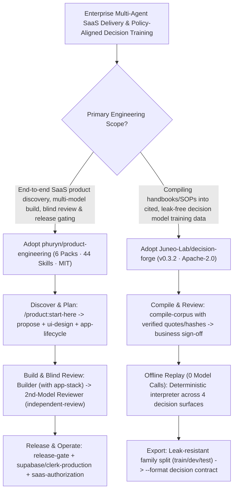

# 44-Skill End-to-End Product Shipping Suite (`phuryn/product-engineering`) & Deterministic Policy-to-Decision Data Compiler (`Juneo-Lab/decision-forge`) Selection FAQ

> **Positioning**: This standalone guide is **Round 44 of the 2026-11-11 Night Shift (Cumulative Guide #89)**, written in the plain-language, first-principles, closed-form FinOps style of `ib-vs-ethernet-roce-selection-faq.md` for AI Product Engineering Leads and Enterprise Agent Governance Architects evaluating two high-signal open-source repositories:
> 1. **`phuryn/product-engineering` (`526★`, Python / 6 Skill Packs / 44 Agent Skills, MIT, by Paweł Huryn)**: Distills **44 production-tested skills** from shipping three live revenue-generating SaaS products (`AskOne`, `Staygreen`, and `AFK Pilot`) into an **8-step, 3-phase lifecycle** across Claude Code, Codex, Cursor, Gemini CLI, OpenCode, and GitHub Copilot—coordinating a builder agent (`app-stack`), a deliberately isolated second-model reviewer (`independent-review` + `intended-vs-implemented`), and a hard production `release-gate`;
> 2. **`Juneo-Lab/decision-forge` (`259★`, Python 3.11–3.13, strict `mypy`, `311` tests at `90.89%` coverage, Apache-2.0, v0.3.2)**: Compiles organizational handbooks, SOPs, and approval tables (PDF, DOCX/XLSX/PPTX, Markdown, HTML, CSV, local OCR) into **verifiable decision training data** across **4 decision surfaces (`Allocate work`, `Share information`, `Select actions`, `Evaluate outcomes`)** via a **deterministic offline policy interpreter (`0` model calls)** with leak-resistant family splits.
>
> **中文版 FAQ**: [product-engineering-decision-forge-44-skills-policy-compiler-selection-faq.md](product-engineering-decision-forge-44-skills-policy-compiler-selection-faq.md) · **Architecture Summary SVG**: [`assets/github-ai-radar-2026-11-11-r44-producteng-decisionforge.svg`](../../../assets/github-ai-radar-2026-11-11-r44-producteng-decisionforge.svg)

---

## 📌 1. Executive Summary

1. **In plain English, what problems do these two repositories actually solve?**
   - **Ending "Prototype-Only" Vibe Coding & Self-Review Blind Spots (`phuryn/product-engineering`)**: Coding agents can scaffold a prototype in minutes, but shipping to paying users stalls on missing auth/billing boundaries, unverified UI flows, and having the same model review its own flawed assumptions. Built from shipping `AskOne`, `Staygreen`, and `AFK Pilot`, `product-engineering` organizes **44 skills across 6 packs** (`product`, `ai-shipping`, `agent-teams`, `agent-harness`, `app-stack`, `work-humanizer`): type `/product:start-here` at any point to orient, equip the builder agent with `app-stack`, keep the second-model reviewer (`independent-review`) clean without `app-stack` so it checks `intended-vs-implemented` objectively, and gate production pushes on `release-gate`, `supabase-production`, `clerk-production`, and `saas-authorization`.
   - **Ending Hallucinated Policy Labels & Train/Test Leakage in Organizational Agents (`Juneo-Lab/decision-forge`)**: What one organization encourages (e.g., `Lumen Labs` allowing agents to auto-issue `$400` refunds under `$1,000`), another forbids (`Halcyon Health` requiring human sign-off—flipping 8 of 17 identical agent actions). Instead of asking an LLM to guess labels, `Decision Forge` compiles source documents into business-reviewed rules with exact text quotations and then runs a **deterministic policy interpreter (`0` model calls)** offline to generate leak-resistant, family-split training datasets (`336` episodes across 4 decision surfaces in `Northstar Support`).
2. **Closed-Form FinOps Verdict (`CLAIM-20261111-R44-PRODUCTENG-DECISIONFORGE`)**:
   - For a 12-person Enterprise AI Product & Governance Engineering Team delivering **12 multi-agent SaaS product releases and compiling 15 policy-verified organizational decision datasets per month** (senior product/governance engineer loaded rate `$90.00/hr`; production cloud SaaS bills like Supabase/Clerk/Stripe and external legal counsel retainers: `not_measured`):
   - Upgrading from **Path A (Unreviewed single-model vibe coding + LLM-synthesized policy labels requiring manual audit, `$6,080.00/mo`)** to **Path C (`product-engineering` 44-skill 8-step lifecycle + `Decision Forge` `0`-model-call deterministic policy replay, `$710.00/mo`)** saves **`$5,370.00/mo` (`-88.32%`, `$64,440.00/yr`)** and cuts release rework and policy dataset verification labor from `48.0 hrs/mo` to `5.0 hrs/mo` (**`-89.58%`**).

---

## 🎯 2. Three Core Architectural Questions (Q1 / Q2 / Q3 Deep-Dive)

### Q1: How does `phuryn/product-engineering` structure its 6 skill packs across Coordinator, Builder, and Blind Reviewer roles?
- **First-Principles Breakdown**:
  1. **Role-Scoped Skill Isolation (`app-stack` vs. `independent-review`)**:
     - When one agent coordinates, another builds, and a third reviews, the builder loads `app-stack` (UI screens + MCP server scaffolding) while the reviewer deliberately starts **without** `app-stack`—preventing shared-template bias during `intended-vs-implemented`, `derive-tests`, `security-audit-static`, and `performance-audit-static`.
  2. **`agent-instructions` Router & Automated Test Backfilling**:
     - Running `agent-instructions` once wires router rules into the repository's entry file and scans existing code against installed skill packs to add missing tests automatically.

### Q2: How does `Juneo-Lab/decision-forge` compile unstructured SOPs into verified decision supervision with `0` offline model calls?
- **First-Principles Breakdown**:
  1. **Source-Quoted Rule Compilation + Deterministic Offline Interpreter**:
     - `compile-corpus` extracts candidate rules with verified source quotations, spans, and file hashes for human business review. Once approved (or authored in YAML), `decision-forge validate / build / export` runs **100% offline (`0` model calls)**, replaying scenarios through a deterministic interpreter so every label cites the exact governing rule.
  2. **Four Decision Surfaces & Leak-Resistant Family Splits**:
     - Models organizational judgment across **`Allocate work`**, **`Share information`**, **`Select actions`**, and **`Evaluate outcomes`**, assigning related scenario variants to the same `family` across `train / development / test` splits (`196 / 84 / 56` in `Northstar Support`) and exporting candidate-readout `decision` contracts.

### Q3: How should AI Solution Architects combine `product-engineering` and `decision-forge`?
- **Combined Architecture**:
  - Use **`phuryn/product-engineering`** to govern the multi-agent software delivery lifecycle (`Start -> Proposal -> Plan -> Build -> Click-through -> Release review -> Release -> Real users`).
  - Use **`Juneo-Lab/decision-forge`** to compile customer SOPs into auditable decision datasets that train and gate the product's internal action-selection and authorization models.

---

## 🧭 3. Mermaid Decision Tree & Dual Lifecycle Pipeline

---

## 📊 4. Architectural Comparison Matrix

| Evaluation Dimension | Path A: Unreviewed Vibe Coding + LLM Label Gen | Path B: Single-Model Prompts + Manual CSV Rules | **Path C (Recommended): `product-engineering` + `Decision Forge`** |
| :--- | :--- | :--- | :--- |
| **Product Lifecycle & Production Readiness** | Ad-hoc code generation; misses auth, legal & monitoring | Static prompt snippets without router wiring | **8-step lifecycle across 44 skills (`/product:start-here` to `release-gate`)** |
| **Cross-Model Review Independence** | Same model writes and reviews its own bugs | Manual spot-checks without `intended-vs-implemented` | **Builder (`app-stack`) separated from blind 2nd-model `independent-review`** |
| **Policy Label Fidelity & API Cost** | LLM-generated labels hallucinate policy exceptions | Slow manual spreadsheet labeling; brittle on SOP updates | **Deterministic offline policy replay (`0` model calls) with exact citations** |
| **Split Hygiene & Contamination Guard** | Random split leaks paraphrased scenarios into test set | Manual split tracking prone to human error | **Family-level split isolation (`196/84/56`) + cross-split duplicate dropping** |
| **Monthly TCO (12 Releases + 15 Datasets)** | **`$6,080.00 / mo`** (`$1,760` tokens + `$4,320` labor) | **`$3,010.00 / mo`** (`$850` compute + `$2,160` labor) | **`$710.00 / mo` (Saves `$5,370.00/mo` · `-88.32%`)** |

---

## 🧪 5. Closed-Form FinOps Example & 7-Card Insights (`CLAIM-20261111-R44-PRODUCTENG-DECISIONFORGE`)

### 5.1 Workload & Scope Boundary
- **Workload**: A 12-person Enterprise AI Product & Governance Team shipping **12 multi-agent SaaS product releases and compiling 15 policy-verified organizational decision datasets per month**.
- **Rates**: Senior product/governance engineer loaded rate at **`$90.00 / hr`**.
- **Explicit Scope Boundary**: Production cloud SaaS infrastructure subscriptions (Supabase/Clerk/Stripe) and external legal counsel retainers are marked **`not_measured`**.

### 5.2 Closed-Form Monthly Cost Breakdown

| Cost Component | Path A: Unreviewed Vibe Coding + LLM Label Gen | Path B: Single-Model Prompts + Manual CSV Rules | **Path C: `product-engineering` + `Decision Forge` (Recommended)** |
| :--- | :--- | :--- | :--- |
| **Build Rework Tokens & Synthetic Labeling API Spend** | **`$1,760.00`** | **`$850.00`** | **`$260.00`** (Offline `0`-model-call `decision-forge` + scoped 2-model review) |
| **Release Drift Fixing & Policy Label Audit Labor (`$90/hr`)** | `48.0 hrs × $90.00` = **`$4,320.00`** | `24.0 hrs × $90.00` = **`$2,160.00`** | `5.0 hrs × $90.00` = **`$450.00`** |
| **Total Monthly TCO** | **`$6,080.00 / mo`** | **`$3,010.00 / mo`** (`-50.49%`) | **`$710.00 / mo`** |
| **Net Savings vs. Path A** | Baseline | Saves `$3,070.00 / mo` | **Saves `$5,370.00 / mo` (`-88.32%` · `$64,440.00/yr`)** |
| **Production SaaS Infra Bills & External Legal Retainers** | `not_measured` | `not_measured` | `not_measured` |

---

## 🛠️ 6. Production Verification Checklist

- [ ] **1. Install the 6 `product-engineering` Packs & Disable Legacy `pm-ai-shipping`**: Install `product`, `ai-shipping`, `agent-teams`, `agent-harness`, `app-stack`, and `work-humanizer`, and disable `pm-ai-shipping@pm-skills` if `pm-skills` is also installed.
- [ ] **2. Verify Multi-Worktree `installed_plugins.json` Records**: When using `--scope project` across multiple git worktrees, inspect `projectPath` and `gitCommitSha` in `~/.claude/plugins/installed_plugins.json` after plugin upgrades.
- [ ] **3. Run `agent-instructions` & Enforce Asymmetric `independent-review`**: Wire router rows via `agent-instructions`, backfill missing skill tests, and run a second model without `app-stack` for `independent-review` and `release-gate`.
- [ ] **4. Verify `Decision Forge` Zero-Model-Call Offline Build**: Run `uv run decision-forge validate/build/export examples/customer_support/project.yaml` and confirm `336` accepted episodes with `0` model calls.
- [ ] **5. Audit 4-Surface Quotas & Family Split Isolation**: Confirm exported `--format decision` datasets cover `allocate`, `share`, `act`, and `evaluate` surfaces with zero cross-split family leakage.
