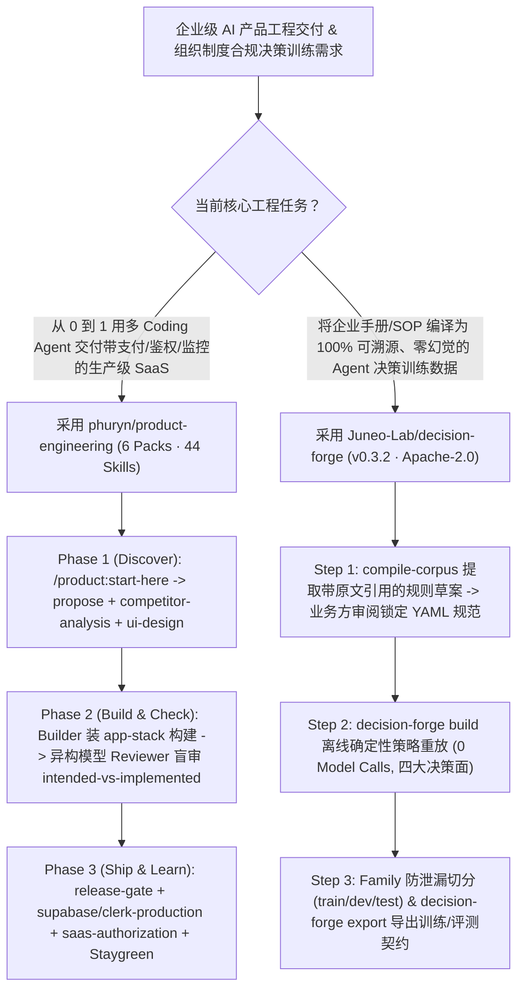

# 44 技能全周期产品交付套件（`phuryn/product-engineering`）与企业制度确定性决策数据编译器（`Juneo-Lab/decision-forge`）深度选型 FAQ

> **文档定位**：本专题是 **2026-11-11 夜班第 44 轮（累计第 89 篇）独立六段式选型指南**，严格对标 `ib-vs-ethernet-roce-selection-faq.md` 的通俗第一性原理与闭式 FinOps 核算规范，面向 AI 产品工程负责人与企业 Agent 信任治理（Trust & Policy Governance）架构师，深度拆解今日在多智能体产品工程闭环与组织制度编译赛道爆发的两大新锐开源仓：
> 1. **`phuryn/product-engineering`（`526★`，Python / 6 大插件包 / 44 个 Agent Skills，MIT，The Product Compass 出品）**：从真实交付并产生付费收入的 3 款生产级 SaaS 产品（`AskOne` 实时问答、`Staygreen` 跨三洲探针监控、`AFK Pilot` 手机遥控四 Agent 中继）中实战提炼出的 **44 个跨平台 Agent 技能**——覆盖**“决定做什么 → 用 Claude Code/Codex 构建 → 让第二个模型盲审（`independent-review`） → 生产发布门禁（`release-gate`）”**的 8 步完整产品生命周期；
> 2. **`Juneo-Lab/decision-forge`（`259★`，Python 3.11–3.13，严格 `mypy` 类型检查，`311` 项测试 / `90.89%` 语句覆盖率，Apache-2.0，v0.3.2）**：将企业内部的员工手册、SOP、审批权限表与运行回执（支持 PDF、DOCX/XLSX/PPTX、Markdown、HTML 及本地 OCR）**编译为 100% 可溯源、零大模型幻觉的确定性决策训练数据**——在规则通过业务审阅后，**离线构建路径实现 `0` 次大模型调用（`0 model calls`）**，通过确定性策略解释器重放生成覆盖**四大组织决策面（分配工作、共享信息、选择动作、验收结果）**的防泄漏家族划分数据集！
>
> **English Version**: [product-engineering-decision-forge-44-skills-policy-compiler-selection-faq.en.md](product-engineering-decision-forge-44-skills-policy-compiler-selection-faq.en.md) · **架构总结图**: [`assets/github-ai-radar-2026-11-11-r44-producteng-decisionforge.svg`](../../../assets/github-ai-radar-2026-11-11-r44-producteng-decisionforge.svg)

---

## 📌 一、核心结论速览（Executive Summary）

1. **一句话大白话讲透这两个项目到底解决了什么痛点？**
   - **终结“Vibe Coding 做出玩具 Demo 很快、但一上生产就缺鉴权/缺监控/设计走样/自己审自己代码漏掉致命 Bug”的痛点（`phuryn/product-engineering`）**：很多团队用 Coding Agent 写代码时既没有产品前期验证，也没有上线前的独立交叉审查。作者 Paweł Huryn 在用 Agent 从零交付 `AskOne`、`Staygreen`、`AFK Pilot` 三款商用产品后，把全流程沉淀为 **6 个技能包（44 个技能）**：在任何阶段迷路只需输入 `/product:start-here`；构建者（Builder）安装 `app-stack` 写界面和 MCP，而审查者（Reviewer）**故意不装 `app-stack`** 执行跨模型独立审查（`independent-review` + `intended-vs-implemented`），上线前强制过 `release-gate`、静态安全/性能审计以及 `supabase-production` / `clerk-production` / `saas-authorization` 生产检查！
   - **终结“通用大模型不懂每个公司独特的审批红线、而让大模型直接生成合成微调数据又会编造违规标签”的痛点（`Juneo-Lab/decision-forge`）**：同样是“给已验证客户退款 400 美元”，创业公司 `Lumen Labs` 的制度允许 Agent 直接放行（`< $1,000` 免审），而医疗机构 `Halcyon Health` 的制度则要求必须转交人工账务（17 个完全相同的动作中有 8 个在不同企业制度下结论截然相反！）。`Decision Forge` 先把企业制度文档提取为带原文精确引用的规则规范供业务方确认，随后在离线构建阶段**完全不调任何大模型（`0 model calls`）**，用确定性策略解释器在四大决策面上重放打标，并按场景家族（Family）严格隔离训练/验证/测试集，彻底杜绝合成数据幻觉与相似样本跨集泄漏！
2. **闭式 FinOps 投资回报结论（`CLAIM-20261111-R44-PRODUCTENG-DECISIONFORGE`）**：
   - 以 12 人企业级 AI 产品交付与智能体合规治理团队每月完成 **12 次多 Agent SaaS 特性上线** 与 **15 份企业部门制度到决策模型微调数据集的编译更新** 为基准（高级产品工程/AI 治理工程师含税费率 `$90.00/hr`；底层 Supabase/Clerk/Stripe 生产云资源账单与外部法务顾问费：`not_measured`）：
   - 从 **Path A（无门禁单模型 Vibe Coding 返工 + 调大模型生成含幻觉的制度问答合成数据并人工逐条核对，月均 `$6,080.00`）** 升级至 **Path C（`product-engineering` 44 技能 8 步双模型盲审交付 + `Decision Forge` 零模型调用确定性策略重放编译，月均 `$710.00`）**，每月净省 **`$5,370.00/mo`（降幅 `-88.32%`，年省 `$64,440.00/yr`）**，并将上线故障返工与制度数据清洗工时从 `48.0 hrs/mo` 压缩至 `5.0 hrs/mo`（节省 **`-89.58%`**）。

---

## 🎯 二、三大灵魂拷问（Q1 / Q2 / Q3 深度原理解析）

### Q1：`phuryn/product-engineering` 的 6 大技能包是如何组织“协调者 + 构建者 + 独立盲审者”三方角色，并自动给老代码补齐测试的？
- **第一性原理拆解**：
  1. **六大技能包（44 Skills）与三角色非对称挂载设计**：
     - 包含 `product`（竞品/细分市场/价值曲线/增长回路）、`ai-shipping`（发布门禁 `ship-check`）、`agent-teams`（多模型委派 `delegation`、`codex-agents`、`claude-agents`、`grok-agents`、`independent-review`）、`agent-harness`（交接 `handover` 与复盘 `retro`）、`app-stack`（UI 设计、法务页、Supabase/Clerk 生产化、SaaS 授权、事务邮件、Staygreen 监控）与 `work-humanizer`。
     - 当多个 Agent 协同工作时：**协调者（Coordinator）**挂载全套技能进行排期与派单，**构建者（Builder）**额外挂载 `app-stack` 生成页面与 MCP Server，而**审查者（Reviewer）故意不挂载 `app-stack`**，从而在 Step 6（Release Review）对照需求原意执行无偏见的 `intended-vs-implemented`、`derive-tests`、`security-audit-static` 与 `performance-audit-static`。
  2. **`agent-instructions` 路由表注入与存量代码测试自动回填**：
     - 安装技能包后运行一次 `agent-instructions`，会自动在仓库入口文件写入路由规则（如改界面自动调 `ui-design`、发版自动调 `release-gate`），并在已有存量代码库中自动扫描相关模块、**补齐各领域技能要求但当前缺失的测试用例**！

### Q2：`Juneo-Lab/decision-forge` 是如何实现“离线 `0` 次大模型调用”完成确定性打标，并覆盖企业四大决策面的？
- **第一性原理拆解**：
  1. **编译（Compile）与确定性重放（Deterministic Replay）彻底解耦**：
     - 只有在最初从非结构化文档（PDF/DOCX/XLSX/PPTX/OCR）提取规则草稿（`compile-corpus`）时可选调用指定模型端点，且每条提取出的规则都强制绑定原文引用片段（Span/Locator）与源文件哈希；
     - 一旦业务人员审阅批准了规则规范（或直接手写 YAML 规范），后续的 `decision-forge validate -> build -> export` 全链路**100% 离线运行（`Model calls = 0`）**：由确定性策略解释器对每个场景计算唯一正确标签与引用的制度原句。
  2. **四大组织决策面（Four Decision Surfaces）与防泄漏家族切分（Family Split）**：
     - 将企业委派给员工或 Agent 的判断归纳为 4 类标准接口：**`Allocate work`（任务派给谁）**、**`Share information`（信息能否发给该接收方及脱敏粒度）**、**`Select actions`（直接执行、调整参数还是申请授权）** 与 **`Evaluate outcomes`（交付物是否达标）**；
     - 在 `Northstar Support` 基准示例中，仅 `1.2 KB` 的制度手册即可零模型调用生成 `336` 个验证回合（`96 allocate · 96 share · 96 act · 48 evaluate`），并按场景家族切分为 `196 train / 84 dev / 56 test`，自动检测并剔除跨集重复变体。

### Q3：AI 架构师如何将 `product-engineering` 与 `decision-forge` 结合用于企业级 Agent 产品交付？
- **黄金组合落地范式**：
  - 用 **`phuryn/product-engineering`** 规范开发团队从产品提案（Step 2）、跨模型构建与盲审（Step 4–6）到生产鉴权与监控（Step 7–8）的工程流水线；
  - 用 **`Juneo-Lab/decision-forge`** 将客户企业的内部审批 SOP 编译为 `decision` 格式的候选动作评测集与训练数据，训练或评测产品内部的路由/权限决策模型（并可无缝对接 `benchmark-harness` 的 7-Card 决策评测报告）！

---

## 🧭 三、Mermaid 选型决策树与“产品交付 + 制度编译”双闭环流水线

---

## 📊 四、同类方案核心能力对比矩阵（Selection Matrix）

| 评估维度 | Path A：单模型 Vibe Coding + LLM 合成制度数据 | Path B：通用提示词模板 + 人工标注 Excel 规则集 | **Path C（推荐）：`product-engineering` + `Decision Forge`** |
| :--- | :--- | :--- | :--- |
| **产品工程生命周期覆盖度** | 只管生成代码片段，缺产品定位、法务页、生产鉴权与监控 | 仅有零散提示词，无统一状态路由与存量代码测试补齐 | **8 步全周期 44 技能（含 `/product:start-here` 与 `agent-instructions`）** |
| **跨模型审查独立性（防自嗨）** | 同一个模型既写代码又自检，顺着错误假设一路绿灯 | 人工抽查部分 PR，缺乏系统性 `intended-vs-implemented` 比对 | **Builder（含 `app-stack`）与盲审 Reviewer（不含 `app-stack`）物理分离** |
| **组织制度打标准确性与成本** | 调 LLM 生成合成标签，频繁编造越权审批且烧 API 费 | 人工逐条标注枯燥极慢，制度一改整套数据作废 | **确定性策略解释器离线重放（`0` 次模型调用），每条标签绑定制度原句** |
| **训练/测试集防泄漏保证** | 随机打乱切分，同源改写样本同时出现在训练集与测试集 | 手工分表极易混入重复场景 | **按场景家族（Family）强制隔离切分，自动报告并丢弃跨集重复项** |
| **月度总拥有成本（12 发版 + 15 数据集）** | **`$6,080.00 / mo`**（`$1,760` Token + `$4,320` 人工） | **`$3,010.00 / mo`**（`$850` 算力 + `$2,160` 人工） | **`$710.00 / mo`（净省 `$5,370.00/mo` · `-88.32%`）** |

---

## 🧪 五、定量 FinOps 算例与 7-Card 洞察（`CLAIM-20261111-R44-PRODUCTENG-DECISIONFORGE`）

### 5.1 测算基准与显式边界（Scope & Boundaries）
- **场景设定**：12 人企业级 AI 产品与治理工程团队，每月完成 **12 次多 Agent 协同 SaaS 生产发版**，并编译更新 **15 套部门制度到决策模型的监督数据集**。
- **费率假设**：高级产品工程与 AI 治理工程师全包时薪 **`$90.00 / hr`**。
- **显式边界声明（Explicit Not-Measured Boundary）**：生产环境云数据库/身份认证服务（Supabase/Clerk/Stripe）商业账单与外部律所合规审查费标记为 **`not_measured`**，本表核算多模型构建/合成数据 API 开销与工程师返工/数据核验工时。

### 5.2 三路径月度成本闭式对照表

| 成本分项 | Path A：无门禁 Vibe Coding + LLM 合成制度打标 | Path B：普通提示词 + 人工标注 CSV 数据集 | **Path C：`product-engineering` + `Decision Forge`（推荐）** |
| :--- | :--- | :--- | :--- |
| **多模型返工 Token 与合成数据生成 API 开销** | **`$1,760.00`**（反复返工 + 全量调 LLM 打标） | **`$850.00`** | **`$260.00`**（`Decision Forge` 离线 `0` 模型调用 + 精准盲审） |
| **上线回归排障、需求偏差修复与制度标签核对工时（`$90/hr`）** | `48.0 hrs × $90.00` = **`$4,320.00`** | `24.0 hrs × $90.00` = **`$2,160.00`** | `5.0 hrs × $90.00` = **`$450.00`** |
| **月度总成本（Monthly TCO）** | **`$6,080.00 / mo`** | **`$3,010.00 / mo`**（`-50.49%`） | **`$710.00 / mo`** |
| **相对 Path A 净节省** | 基准线（Baseline） | 净省 `$3,070.00 / mo` | **净省 `$5,370.00 / mo`（`-88.32%` · 年省 `$64,440.00/yr`）** |
| **生产云组件商业订阅与外部法务咨询费** | `not_measured` | `not_measured` | `not_measured` |

---

## 🛠️ 六、生产级落地核验 Checklist

- [ ] **1. `product-engineering` 六大包安装与 `pm-ai-shipping` 冲突清理**：在 Claude Code 或 Codex 中安装 6 个技能包（若同时安装了 `pm-skills`，务必执行 `claude plugin disable pm-ai-shipping@pm-skills` 防止旧版转发技能重复加载）。
- [ ] **2. 多 Worktree 插件更新记录核查**：在同一个 Git 仓库开启多个 Worktree 使用项目级安装（`--scope project`）时，升级插件后检查 `~/.claude/plugins/installed_plugins.json` 中各 Worktree 的 `projectPath` 与 `gitCommitSha` 是否同步更新。
- [ ] **3. 执行 `agent-instructions` 注入路由表与补齐测试**：首次接入已有项目时运行 `agent-instructions` 技能，生成入口路由规则并补齐存量代码缺失的领域测试，发版前强制执行 `$ai-shipping:ship-check` 与 `release-gate`。
- [ ] **4. `Decision Forge` 离线零模型调用验证**：通过 `uv sync --group dev` 安装后，运行 `uv run decision-forge validate/build/export examples/customer_support/project.yaml`，核验生成的 `336` 个回合满足 `Model calls = 0` 且 `Rejected = 0`。
- [ ] **5. 四大决策面覆盖与 Family Split 防泄漏审计**：检查导出的 `--format decision` 数据集是否完整包含 `allocate`、`share`、`act`、`evaluate` 四类表面，并确认 `train / development / test` 按 `family` 严格正交无跨集重复。
