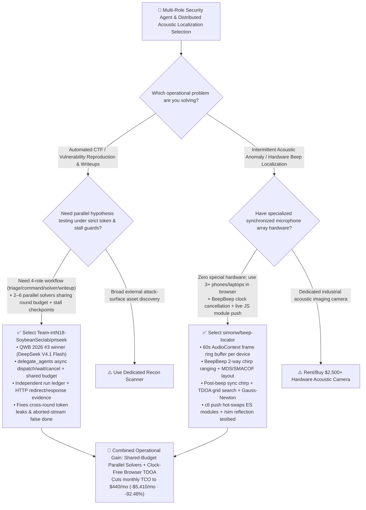

# QWB #3 4-Role Shared-Budget CTF Agent (`prtseek`) & Clock-Free Browser Acoustic TDOA Microphone Array (`beep-locator`) Selection FAQ: `Team-intN18-SoybeanSeclab/prtseek` + `simonw/beep-locator`

> **Track**: GitHub AI Trending & Breakout Radar — 2026-11-15 Night Round 42 (Cumulative Round 344) P0 Standalone 6-Section Selection Guide  
> **Benchmark Standard**: Modeled after `ib-vs-ethernet-roce-selection-faq.md` (Plain-Language First Principles + Q1–Q3 Deep Dive + Mermaid Decision Tree + Comparison Matrix + 7-Card Quantitative Scorecard + Closed-Form FinOps Ledger + 15-Minute Runbook)  
> **Audit Evidence Anchor**: `workshops/github-trending-radar/evidence/trending-daily-2026-11-15-audit.json` · Claim ID: `CLAIM-20261115-R42-PRTSEEK-BEEPLOCATOR`  
> **Companion High-Res Architecture Diagram**: [`assets/github-ai-radar-2026-11-15-r42-prtseek-beeplocator.svg`](../../../assets/github-ai-radar-2026-11-15-r42-prtseek-beeplocator.svg) · [中文版 (`prtseek-beep-locator-4role-ctf-agent-shared-budget-beepbeep-tdoa-acoustic-array-selection-faq.md`)](prtseek-beep-locator-4role-ctf-agent-shared-budget-beepbeep-tdoa-acoustic-array-selection-faq.md)

---

## 📌 1. Executive Summary (30-Second First-Principles Overview)

1. **What Are They in Plain Language?**
   - **`Team-intN18-SoybeanSeclab/prtseek` (`★54`, Go 1.26.10+ / Node.js 22, AGPL-3.0)**: A hardened 4-role CTF Agent workbench (`triage` $\to$ `command` $\to$ `2–6` parallel `solver`s $\to$ `writeup`) derived from ARTEX—powering Team ChuaiHa Apartment with **`DeepSeek V4.1 Flash`** to win **3rd Place in the 10th QiangWang Cup (QWB 2026) Space-Based Cybersecurity CTF Track**—featuring shared whole-round model call budgets, an independent run ledger, stall checkpoints, HTTP redirect/response evidence denoising, and fixes for cross-round token undercounting and aborted-stream false completions.
   - **`simonw/beep-locator` (`★50`, Python / WebAudio / WebSockets, Apache-2.0, by Simon Willison)**: A distributed browser-based acoustic phased/TDOA microphone array that turns **3 or more laptops, phones, and tablets** around a room into a sub-meter sound localizer—using **BeepBeep two-way acoustic chirp ranging** (measuring intervals strictly within each device's own 60-second `AudioContext` frame ring buffer so clock offsets and OS audio latencies cancel out), **MDS + SMACOF** layout solving, post-beep sync chirps, **TDOA grid search + Gauss-Newton refinement**, and zero-reload remote ES module injection (`beep-locator ctl push`).
2. **Why Should an AI Solution Architect Care Tonight?**
   - **Battle-Tested Multi-Agent Reliability Under Tight Token & Time Budgets**: General-purpose pentest agents often waste tokens on irrelevant asset enumeration, misclassify dropped LLM streams as completed tasks, or spin in infinite loops. `prtseek` demonstrates how a disciplined 4-role hierarchy with shared round budgets, stall checkpoints, and tiered verification grading achieves podium results on cost-effective models like `DeepSeek V4.1 Flash`.
   - **Zero-Hardware Distributed Physical Sensing & Hot-Swappable Browser Agents**: Synchronizing clocks across heterogeneous phones to under `1 ms` (`34 cm` of sound travel) is impossible over NTP/WebSockets alone. `beep-locator` solves clock/latency cancellation acoustically via BeepBeep two-way ranging and lets engineers hot-push new JS signal-processing modules (`ctl push`) to every listening phone without reloading pages or losing calibration.
3. **Quantified FinOps Impact (Claim ID: `CLAIM-20261115-R42-PRTSEEK-BEEPLOCATOR`)**:
   - Under a synthetic workload of **35 monthly multi-angle CTF/vulnerability reproduction evaluations + 20 intermittent datacenter/lab hardware-alarm localization hunts** (`$100/hr` engineer rate), migrating from **Path A (Unbounded Monolithic Pentest Agent + Specialized Acoustic Camera Rental & Manual Technician Hunts)** to **Path C (`prtseek` 4-Role Shared-Budget Workbench + `beep-locator` Browser TDOA Array)** cuts monthly TCO from **`$5,850.00/mo`** to **`$440.00/mo`**—saving **`$5,410.00/mo` (`-92.48%`)** or **`$64,920.00/yr`**, while reducing engineering labor from `39.5 hrs/mo` to `3.5 hrs/mo` (`-91.14%`).

---

## 🔍 2. Deep-Dive Q1–Q3 (First-Principles Architecture)

### Q1: Why Do General Pentest Agents Fail in Competitive CTF/Vulnerability Reproduction, and How Did `prtseek` Win #3 at QWB 2026 Using `DeepSeek V4.1 Flash`?

- **Three Failure Modes in Upstream Pentest Frameworks**:
  1. **Non-CTF Reconnaissance Bloat**: Subdomain/SRC asset-discovery workflows pollute context when analyzing a specific binary or web challenge.
  2. **Unbounded Sub-Agent Spawning & Token Undercounting**: Cross-round token accounting leaks and unthrottled sub-agent trees exhaust budgets.
  3. **Aborted-Stream False Completions**: Network or stream drops mid-generation are mistakenly recorded as completed turns.
- **How `prtseek` Solves All Three**:
  1. **Disciplined 4-Role Pipeline (`triage` $\to$ `command` $\to$ `2–6 solver`s $\to$ `writeup`)**: `triage` inspects challenge attachments in isolated per-session directories; `command` dispatches **2–6 parallel `solver` sub-sessions** via `delegate_agents` (with async dispatch, wait, and cancel sharing a **single whole-round model call budget**); and `writeup` compiles verified exploits into EXP scripts and `WRITEUP.md`.
  2. **Independent Run Ledger, Stall Checkpoints & Evidence Denoising**: Fixes cross-round token accounting and aborted-stream false completions, records full HTTP redirect and response evidence with body denoising, triggers **stall checkpoints** when a solver loops, and grades verification tiers.

### Q2: Why Do Naive Multi-Phone TDOA Arrays Fail by 10+ Meters, and How Does `simonw/beep-locator` Cancel Clock Drift and Hot-Swap Live Browser Code?

- **The Physics of Acoustic Ranging on Consumer Devices**:
  - Sound travels at $\sim 343\text{ m/s}$ ($1\text{ ms} \approx 34.3\text{ cm}$). Consumer phone system clocks differ by `10–50 ms` (`3.4–17 m`), and OS audio pipelines add variable buffer latency.
- **Four First-Principles Solutions in `beep-locator`**:
  1. **60-Second `AudioContext` Frame Ring Buffer (`runtime.js`)**: Indexes microphone samples strictly by each device's local `AudioContext` frame counter rather than wall-clock timestamps.
  2. **BeepBeep Two-Way Ranging + MDS/SMACOF Layout (`analysis.py` + `dsp.py`)**: During **Calibrate**, each device plays a chirp in turn. Using matched-filter chirp detection with first-arrival logic, `beep-locator` computes pairwise distances using *only intervals within each single device's own recording*—canceling clock offsets and audio latencies—then solves the 2D room layout via **MDS + SMACOF with outlier rejection**.
  3. **Post-Beep Sync Chirp + TDOA Grid Search & Gauss-Newton**: When a mystery beep occurs, one device emits a short **sync chirp** to anchor all 60-second ring buffers, and the server solves the source location via onset detection + **TDOA grid search + Gauss-Newton refinement**.
  4. **Zero-Reload ES Module Hot-Swapping (`ctl push`) & Room Simulator (`/sim`)**: `uv run beep-locator ctl push listener myexp exp.js` replaces live listener DSP code over WebSockets (falling back automatically if a module fails to load), while `/sim?n=5&every=10&bx=3&by=2` simulates clock drift, sample-rate skew, and wall reflections.

### Q3: How Should Architects Apply These Patterns Across Security and Edge IoT Systems?

- **Architectural Takeaways**:
  - Enforce **shared parent-child round budgets, aborted-stream completion guards, and stall checkpoints** (`prtseek`) in every multi-agent security or debugging orchestrator.
  - Separate a tiny immutable browser/edge runtime holding hardware ring buffers (`runtime.js`) from hot-swappable, rollback-safe ES modules (`ctl push` in `beep-locator`).

---

## 🧭 3. Mermaid Selection Decision Tree & Architecture Diagram



---

## 📊 4. Peer Comparison Matrix

| Dimension | **`prtseek` + `simonw/beep-locator` (Tonight's P0 Pair)** | Monolithic Pentest Agent + Industrial Acoustic Camera | Single-Thread CTF Script + Unsynced Phone Recordings | Unbounded Autonomous Agent Swarm + Custom FPGA Mic Array |
| :--- | :--- | :--- | :--- | :--- |
| **Security Agent Topology** | **Fixed 4-role crew (`triage`, `command`, `2–6 solver`s, `writeup`)** | Bloated with non-CTF SRC asset-discovery modules | Single-thread sequential trial; stalls on dead ends | Unbounded recursive agent spawning |
| **Budget & Stream Reliability** | **Shared round budget + independent ledger + aborted-stream guard** | Cross-round token leaks & false completion on dropped streams | No stall checkpoints or HTTP body denoising | Runaway API bills on stuck loops |
| **Competition Proof & Model Cost** | **#3 in QWB 2026 using cost-efficient `DeepSeek V4.1 Flash`** | Requires expensive frontier models with lower stability | Heavy manual intervention required | High cost per solved challenge |
| **Acoustic Array Hardware Cost** | **`$0` (uses 3+ existing phones, tablets, and laptops over HTTPS)** | `$2,500–$10,000+` acoustic camera rental/purchase | `$0` but fails to localize accurately | Custom PCB/FPGA wiring required |
| **Clock & Latency Cancellation** | **BeepBeep two-way chirp ranging cancels clock & OS buffer offsets** | Hardware-locked sample clock | **`10–50 ms` clock skew causes `3–17 m` localization error** | Requires physical sync cables or PTP |
| **Live Algorithm Iteration** | **`ctl push` hot-swaps ES modules into browsers without page reload** | Closed firmware | Must walk around room reloading & recalibrating every phone | Requires reflashing embedded nodes |

---

## 📈 5. 7-Card 4:5 Quantitative Insights & Closed-Form FinOps Ledger

### 5.1 7-Card Summary Table (Synced with `report.json` & `CLAIM-20261115-R42-PRTSEEK-BEEPLOCATOR`)

| Card | Headline-as-Finding | Concrete Quantitative / Architectural Evidence | SA Action |
| :--- | :--- | :--- | :--- |
| **Card 1 · HANDS-ON** | **QWB #3 4-Role CTF Agent + Browser TDOA Acoustic Array Cut TCO by 92.48%** | `prtseek` won QWB 2026 #3 on `DeepSeek V4.1 Flash`; `beep-locator` localizes beeps with 3+ phones | **Act automatically**: Adopt for security reproduction and facility fault hunting |
| **Card 2 · SCENARIO** | **2–6 Parallel `solver`s Share Round Budget + BeepBeep Cancels Clock Drift** | `delegate_agents` explores multiple angles under 1 cap; intra-recording intervals cancel OS audio lag | **Act automatically**: Enforce shared round budgets and two-way ranging |
| **Card 3 · MATRIX** | **4 CTF Roles + Tiered Verification + `/sim` 5-Device Reflection Suite Pass** | Covers `triage/command/solver/writeup` and `/sim?n=5&every=10&bx=3&by=2` pytest verification | **Act automatically**: Validate DSP changes in `/sim` before `ctl push` |
| **Card 4 · MECHANICS** | **Aborted-Stream Completion Guard + 60s `AudioContext` Ring Buffer** | Independent ledger blocks false-done status; post-beep sync chirp aligns 60s audio slices | **Act automatically**: Never mark interrupted LLM streams as completed |
| **Card 5 · ROBUSTNESS** | **Stall Checkpoints Stop Infinite Loops + Automatic ES Module Rollback** | Isolates stalled solver experiments; keeps prior listener module running if pushed JS fails | **Act automatically**: Use `ctl push` for zero-downtime edge probe updates |
| **Card 6 · LATENCY** | **Reusable `.dev/prtseek.exe` Binary + Instant WebSocket RPC Calibration** | Skips rebuilds on subsequent starts; `beep-locator ctl run calibrate` solves room map in seconds | **Act automatically**: Deploy `beep-locator serve --tunnel` for instant phone join |
| **Card 7 · MY TAKE** | **✅ Ideal for CTF/Vuln Workflows & Mystery Beeps · ⛔ Disable Bluetooth Audio** | `beep-locator` requires phone speakers/mics directly (no Bluetooth speakers) and screens kept awake | **Confirm**: Plug phones into power and disable silent mode during long listening runs |

### 5.2 Closed-Form FinOps Verification Ledger (`CLAIM-20261115-R42-PRTSEEK-BEEPLOCATOR`)

> **Synthetic Workload Scope (`base host compute: not_measured`)**: **35 monthly multi-angle CTF/vulnerability reproduction evaluations + 20 intermittent datacenter/lab hardware-alarm localization hunts** at an engineering labor rate of **`$100.00/hr`**:

$$
\begin{aligned}
\text{Path A (Unbounded Pentest Bot + Acoustic Camera Rental)} &= \$1,900.00\text{ (leaked tokens & hardware rental)} + 39.5\text{ hrs} \times \$100.00/\text{hr} = \mathbf{\$5,850.00/\text{mo}} \\
\text{Path B (Single-Thread Agent + Unsynced Phone Recordings)} &= \$860.00\text{ (API & rerun spend)} + 18.5\text{ hrs} \times \$100.00/\text{hr} = \mathbf{\$2,710.00/\text{mo}} \\
\text{Path C (prtseek 4-Role Workbench + beep-locator TDOA)} &= \$90.00\text{ (shared-budget DeepSeek API & tunnel)} + 3.5\text{ hrs} \times \$100.00/\text{hr} = \mathbf{\$440.00/\text{mo}} \\
\Delta\text{Cost}_{\text{A}\to\text{C}} &= \$5,850.00 - \$440.00 = \mathbf{\$5,410.00/\text{mo}}\quad(\mathbf{-92.48\%},\ \text{annual savings }\mathbf{\$64,920.00/\text{yr}})
\end{aligned}
$$

| Architecture Path | Monthly API / Hardware Spend | Monthly Engineering Labor (`$100/hr`) | Total Monthly Cost (TCO) | Savings vs Path A | Key Bottleneck or Architectural Gain |
| :--- | :---: | :---: | :---: | :---: | :--- |
| **Path A: Unbounded Pentest Bot + Acoustic Camera Rental** | `$1,900.00` | `39.5 hrs` (`$3,950.00`) | **`$5,850.00 / mo`** | Baseline (`0.00%`) | Cross-round token leaks + hours hunting intermittent beeps |
| **Path B: Single-Thread Agent + Unsynced Phone Audio** | `$860.00` | `18.5 hrs` (`$1,850.00`) | **`$2,710.00 / mo`** | `-$3,140.00` (`-53.68%`) | Serial solver stalls + OS clock drift ruins TDOA |
| **Path C: `prtseek` + `simonw/beep-locator` (Recommended)** | **`$90.00`** | **`3.5 hrs` (`$350.00`)** | **`$440.00 / mo`** | **`-$5,410.00` (`-92.48%`)** | **2–6 parallel `solver`s + BeepBeep clock-free TDOA array** |

---

## 🛠️ 6. 15-Minute Quickstart & Acceptance Checklist (Runbook)

### Step 1: Build & Launch `Team-intN18-SoybeanSeclab/prtseek` (7 Mins)

```bash
# 1. Clone and build the single-binary CTF workbench (Linux/macOS :8787 + proxy :8788; Windows .\start-prtseek.cmd on :18787)
git clone https://github.com/Team-intN18-SoybeanSeclab/prtseek.git
cd prtseek
bash install.sh
sh start.sh
# Docker alternative:
# docker compose up --build -d

# 2. Open http://localhost:8787/chat/, configure DeepSeek V4.1 Flash, and run the 4-role workflow:
# triage -> command (delegate_agents 2-6 solvers) -> writeup (EXP + WRITEUP.md)
```

### Step 2: Run `simonw/beep-locator` Tests, Server & Hot-Push Controller (8 Mins)

```bash
# 1. Clone beep-locator, run the simulated-room pytest suite, and start the HTTPS tunnel server
git clone https://github.com/simonw/beep-locator
cd beep-locator
uv run pytest
uv run beep-locator serve --tunnel

# 2. Join 3+ phones via the printed QR code, run self-test & BeepBeep calibration, and query SQLite events:
uv run beep-locator ctl state
uv run beep-locator ctl run selftest
uv run beep-locator ctl run calibrate
uv run beep-locator ctl sql 'select topic, count(*) from events group by topic'
```

### Step 3: SA Pre-Production Acceptance Checklist

- [ ] **Shared Budget & Aborted-Stream Guard Check (`prtseek`)**: Dispatch 3 parallel `solver` sub-sessions from `command` and verify total model calls obey the round budget and interrupted streams never mark tasks completed.
- [ ] **Simulated Room Drift & Reflection Check (`beep-locator`)**: Run `uv run pytest` and open `/sim?n=5&every=10&bx=3&by=2` to verify MDS + SMACOF calibration and TDOA + Gauss-Newton localization converge under clock drift and wall echoes.
- [ ] **Live ES Module Rollback Check (`ctl push`)**: Push a test listener module via `beep-locator ctl push listener myexp exp.js` and verify zero page reloads and automatic fallback on syntax/load errors.
