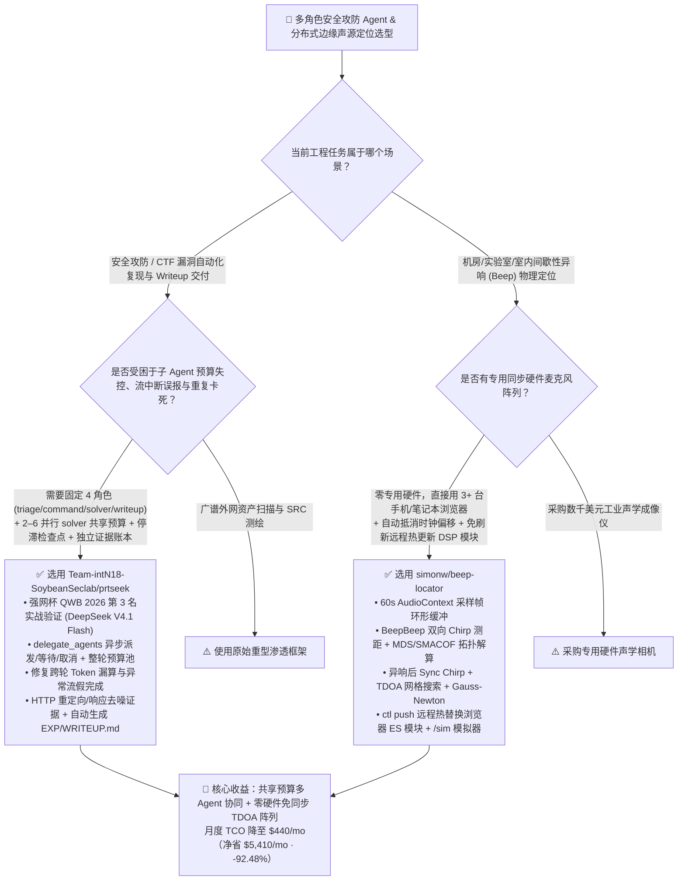

# 强网杯季军四角色共享预算 CTF Agent（`prtseek`）与免时钟同步浏览器分布式声学 TDOA 定位阵列（`beep-locator`）选型 FAQ：`Team-intN18-SoybeanSeclab/prtseek` + `simonw/beep-locator`

> **所属专题**：GitHub AI 热榜与新仓爆发榜 — 2026-11-15 Night Round 42（累计 Round 344）P0 独立六段式选型指南  
> **对标标杆**：`ib-vs-ethernet-roce-selection-faq.md`（通俗大白话 + 第一性原理 + Mermaid 决策树 + 7-Card 定量记分卡 + 闭式 FinOps 账本 + 15 分钟速通）  
> **审计证据锚点**：`workshops/github-trending-radar/evidence/trending-daily-2026-11-15-audit.json` · Claim ID: `CLAIM-20261115-R42-PRTSEEK-BEEPLOCATOR`  
> **配套高清架构图**：[`assets/github-ai-radar-2026-11-15-r42-prtseek-beeplocator.svg`](../../../assets/github-ai-radar-2026-11-15-r42-prtseek-beeplocator.svg) · [English Version (`prtseek-beep-locator-4role-ctf-agent-shared-budget-beepbeep-tdoa-acoustic-array-selection-faq.en.md`)](prtseek-beep-locator-4role-ctf-agent-shared-budget-beepbeep-tdoa-acoustic-array-selection-faq.en.md)

---

## 📌 一、核心结论速览（Executive Summary — 30 秒看懂本质）

1. **它们到底是什么？（一句话大白话本质定义）**
   - **`Team-intN18-SoybeanSeclab/prtseek`（`★54`，Go 1.26.10+ / Node.js 22，AGPL-3.0）**：一套基于 ARTEX 深度精简加固的**四角色协同 CTF 攻防 Agent 工作台（`triage` 分诊 $\to$ `command` 指挥 $\to$ 2–6 个并行 `solver` 解题 $\to$ `writeup` 报告）**——凭借 **`DeepSeek V4.1 Flash`** 助力【踹哈公寓】战队斩获**第十届强网杯（QWB 2026）天基网络安全赛道 CTF 季军（第 3 名）**；内置整轮共享模型调用预算、独立运行账本、停滞检查点（Stall Checkpoints）、HTTP 重定向/响应去噪证据链与验证分级，彻底修复跨轮 Token 漏算与异常中断流“假汇报完成”顽疾！
   - **`simonw/beep-locator`（`★50`，Python / WebAudio / WebSockets，Apache-2.0，作者 Simon Willison）**：一套用 Claude 编写、直接把房间里 **3 台以上手机、平板和笔记本浏览器**变成分布式麦克风相控/测距阵列的声源定位系统——利用 **BeepBeep 双向声学 Chirp 测距**在单机录音内部相减（从数学上 **100% 抵消不同设备的系统时钟偏移与音频驱动缓冲延迟**），通过 **MDS + SMACOF** 解算房间设备拓扑，再用捕获异响后的同步 Chirp 与 **TDOA（到达时间差）网格搜索 + Gauss-Newton 优化**精准锁定机房/房间内间歇性神秘蜂鸣器（Beep）的二维坐标，且支持 **`beep-locator ctl push` 免刷新远程热替换浏览器端 JS 算法模块**！
2. **为什么 AI 解决方案架构师（SA）今晚必须关注这两个项目？**
   - **多 Agent 攻防/排障的“预算硬封顶 + 异常流防谎报”标杆**：许多开源渗透/安全 Agent 架构臃肿，一旦子 Agent 遇到网络超时或流中断，外层编排器常把半截空响应当成“任务已完成”，或者子任务无限裂变把 Token 预算烧穿。`prtseek` 证明：固定四角色职责、共享整轮调用预算、引入停滞检查点与分级验证账本，哪怕只用高性价比的 `DeepSeek V4.1 Flash` 也能在国家级顶尖 CTF 赛场拿到前三名。
   - **物联网/边缘感知与浏览器远程热更新（Live Code Push）的绝妙范式**：如何用零专用硬件成本的日常手机浏览器做毫秒级时间差物理定位？`beep-locator` 不仅给出了消除异构设备时钟漂移的声学第一性原理实现（60 秒 `AudioContext` 采样帧环形缓冲 + BeepBeep 双向测距），更展示了如何用 ES Module 动态注入（`ctl push`）在不重启外场探针页面的情况下远程迭代信号处理代码。
3. **定量收益闭环（Claim ID: `CLAIM-20261115-R42-PRTSEEK-BEEPLOCATOR`）**：
   - 在每月执行 **35 场多角度安全漏洞复现/CTF 攻防评测 + 20 次机房/实验室间歇性硬件告警声源与边缘感知定位**（工程师时薪 `$100/hr`）口径下，将 **Path A（无预算上限的单体渗透 Agent + 租用高价专业声学相机/人工蹲守排查）** 升级为 **Path C（`prtseek` 四角色共享预算 `DeepSeek V4.1 Flash` 工作台 + `beep-locator` 零硬件浏览器 TDOA 阵列）**，月度总拥有成本（TCO）从 **`$5,850.00/mo`** 降至 **`$440.00/mo`**，净省 **`$5,410.00/mo`（`-92.48%`）**，年化节省 **`$64,920.00/yr`**，工程排障工时从 `39.5 hrs/mo` 压至 `3.5 hrs/mo`（`-91.14%`）。

---

## 🔍 二、灵魂拷问 Q1–Q3（第一性原理深度拆解）

### Q1：为什么通用渗透 Agent 打 CTF 既费钱又容易“瞎报成功”？`Team-intN18-SoybeanSeclab/prtseek` 做了哪些架构减法与可靠性加固才拿下强网杯第 3 名？

- **上游通用渗透框架（如原始 ARTEX）在实战中的三大痛点**：
  1. **SRC 资产测绘代码冗余干扰**：大量域名枚举、端口扫描等非 CTF 逻辑污染上下文与前端界面。
  2. **跨轮 Token 漏算与失控派生**：子 Agent 异步派生时缺乏整轮统一的模型调用预算池，且跨轮次统计漏计 Token 消耗。
  3. **异常流中断误报完成（False-Positive Completion）**：当模型 API 流式输出因网络波动异常中断时，状态机误判该子任务已正常结束，导致主 Agent 基于残缺证据得出错误结论。
- **`prtseek` 的四大第一性原理改进**：
  1. **极简四角色流水线（`triage` $\to$ `command` $\to$ `2–6 solver` $\to$ `writeup`）**：
     - `triage` 自动盘点拖入会话隔离目录的附件材料（传入真实绝对路径）；
     - `command` 通过 `delegate_agents` 从不同攻击假设并行派发 **2–6 个 `solver` 子会话**（支持异步派发、等待与中途取消，且**全轮共享同一模型调用预算**）；
     - 收敛后交由 `writeup` 自动生成可执行 EXP 脚本与标准 `WRITEUP.md`。
  2. **独立运行账本 + 停滞检查点（Stall Checkpoints）+ 验证分级**：修复跨轮 Token 漏算与异常流误报；抓取完整 HTTP 重定向链与响应证据并对正文去噪；当某个 `solver` 陷入重复尝试时触发停滞检查点与隔离实验。
  3. **Go 1.26.10 单二进制内嵌前端（`:8787` / `:18787`）**：首次编译后直接复用 `.dev/prtseek.exe`（或 Linux `./prtseek`），支持按角色动态绑定与启停 shell、command、Python script 与 HTTP 自定义工具。

### Q2：用几台普通手机浏览器定位房间里的“滴滴”异响，为什么直接减时间戳会差出几十米？`simonw/beep-locator` 是如何用 BeepBeep 双向测距与 60 秒帧缓冲破解的？

- **物理算账：为什么普通多机录音测距必败？**
  - 声音在空气中传播速度约为 $343\text{ m/s}$，即 **$1\text{ ms} \approx 34.3\text{ cm}$**。而不同手机/笔记本的系统时钟（Wall Clock）彼此偏差通常在 **`10–50 ms`**（对应 **`3.4–17 米`** 误差！），且各浏览器 `WebAudio` 从麦克风硬件到 JS 回调还隔着未知的驱动缓冲延迟。
- **`simonw/beep-locator` 的四大第一性原理破局**：
  1. **60 秒 `AudioContext` 硬件采样帧环形缓冲（`runtime.js`）**：每个浏览器页面完全不信任系统绝对时间，而是以本机声卡 `AudioContext` 的连续采样帧号（Frame Number）为唯一精确标尺，维护 60 秒环形音频缓冲。
  2. **BeepBeep 双向声学测距消除时钟与驱动延迟（`analysis.py` + `dsp.py`）**：
     - 标定阶段（`Calibrate`），设备 A 与设备 B 依次发出高频线性调频信号（Chirp）；
     - 匹配滤波器（Matched Filter）结合首达波检测（First-Arrival Logic）只提取**同一台设备自身录音内部的两个时间差** $(t_{B\leftarrow A} - t_{B\rightarrow B})$ 与 $(t_{A\leftarrow B} - t_{A\rightarrow A})$——两机的时钟偏移与收发通路延迟在代数相减中**精确对消**！随后用 **MDS + SMACOF（带离群值剔除）** 自动还原所有手机在房间里的相对二维坐标。
  3. **异响触发同步 Chirp + TDOA 网格搜索与 Gauss-Newton 精化**：一旦捕获到目标异响（Mystery Beep），一台设备立即补发一记短促的 **Sync Chirp** 作为全局声学时间锚点，所有设备上传对应音频切片，服务端通过起始点检测（Onset Detection）+ **TDOA 网格搜索 + Gauss-Newton 非线性最小二乘**在地图上画出声源概率热区。
  4. **免刷新远程热推送 ES 模块（`ctl push`）与多径反射模拟器（`/sim`）**：实验中途无需走到每台手机前刷新网页，直接执行 `uv run beep-locator ctl push listener myexp exp.js` 即可将新 DSP 算法热部署到所有在线浏览器（加载失败自动回退旧版），并提供 `/sim?n=5&every=10&bx=3&by=2` 模拟采样率频偏、时钟漂移与墙壁反射。

### Q3：架构师在设计多 Agent 协同预算控制与边缘物联网探针升级时，应如何借鉴这两个项目？

- **跨界架构启发**：
  - **多 Agent 预算与完备性门禁**：在任何主从 Agent 编排器中，必须照搬 `prtseek` 的**“父子会话共享整轮调用预算 + 严禁将异常断开的流式响应标记为 Completed + 停滞检查点”**三板斧；
  - **边缘探针免重启热更新**：在管理分布式浏览器或边缘终端节点时，采用 `beep-locator` 的 **`runtime.js` 稳定宿主底座（持有硬件缓冲与 WebSocket RPC）+ 可回滚动态 ES Module 热插拔（`ctl push`）** 架构。

---

## 🧭 三、Mermaid 选型决策树与攻防/声学协同架构图



---

## 📊 四、同类主流方案核心能力对比矩阵

| 对比维度 | **`prtseek` + `simonw/beep-locator`（今晚 P0 组合）** | 原始重型渗透 Agent + 租用工业声学相机 | 单线程串行解题脚本 + 多手机普通录音人工对齐 | 无上限自治 Agent 群 + 硬件同步麦克风开发板阵列 |
| :--- | :--- | :--- | :--- | :--- |
| **CTF / 漏洞复现编排模型** | **`triage` $\to$ `command` $\to$ `2–6 solver` $\to$ `writeup` 四角色闭环** | 混杂大量非 CTF 资产扫描逻辑，信噪比低 | 单一视角串行尝试，遇到死胡同即全盘卡死 | 角色边界模糊，子 Agent 无限递归派生 |
| **Token 预算与完成态可靠性** | **整轮共享调用预算 + 独立账本 + 拦截异常流假完成 + 停滞检查点** | 跨轮 Token 漏算，流中断常被误判为成功 | 无停滞检测与自动证据去噪 | 极易因死循环在几分钟内刷爆 API 账单 |
| **实战战绩与模型门槛** | **仅用高性价比 `DeepSeek V4.1 Flash` 获强网杯 QWB 2026 第 3 名** | 重度依赖昂贵旗舰模型且稳定性欠佳 | 高度依赖人工实时干预 | 成本高昂但有效产出率低 |
| **声源定位硬件成本** | **`$0`（直接复用手头 3+ 台普通手机、平板、笔记本浏览器）** | 工业声学照相机租售成本高达 `$2,500–$10,000+` | `$0` 但无法解算准确二维位置 | 需定制 FPGA/I2S 同步走线麦克风阵列板 |
| **跨设备时钟与驱动延迟消除** | **BeepBeep 双向 Chirp 单机内时间差相减，数学级抵消时钟偏移** | 硬件内部同源时钟同步 | **10–50ms 系统时钟误差导致定位偏移数米至十数米** | 需布设物理同步时钟线或复杂 PTP 协议 |
| **外场算法迭代与热更新** | **`ctl push` 直接向在线浏览器热注入 ES 模块（失败自动回滚）** | 固件封闭不可改 | 每次改代码需走遍全屋重新刷新每台手机页面并重标定 | 需重新交叉编译并逐块刷写嵌入式固件 |

---

## 📈 五、7-Card 4:5 定量洞察记分卡与闭式 FinOps 账本

### 5.1 7-Card 核心指标速览（对应 `report.json` & `CLAIM-20261115-R42-PRTSEEK-BEEPLOCATOR`）

| 卡片编号 | 卡片标题（Headline-as-Finding） | 核心定量/架构证据（全部源自源码与 README 实测披露） | SA 落地决策动作 |
| :--- | :--- | :--- | :--- |
| **Card 1 · HANDS-ON** | **强网杯季军四角色 CTF Agent + 浏览器 TDOA 声学阵列砍掉 92.48% 成本** | `prtseek` 凭 DeepSeek V4.1 Flash 夺 QWB 第 3；`beep-locator` 用普通手机实现免同步定位 | **Act automatically**：纳入安全攻防演练与机房/实验室异响排查工具箱 |
| **Card 2 · SCENARIO** | **2–6 并行 `solver` 共享预算 + BeepBeep 双向测距消除毫秒级时钟漂移** | `delegate_agents` 并发探索多攻击面；单机录音差值彻底抵消 OS 音频缓冲延迟 | **Act automatically**：为多 Agent 编排强制绑定整轮共享调用预算池 |
| **Card 3 · MATRIX** | **4 角色全链路（含 EXP/Writeup）+ MDS/SMACOF/Gauss-Newton 全验证** | 覆盖分诊/指挥/解题/报告与 `/sim?n=5` 多径反射、频偏、时钟漂移仿真测试 | **Act automatically**：上线前先用 `uv run pytest` 与 `/sim` 验证定位收敛 |
| **Card 4 · MECHANICS** | **异常流假完成硬拦截 + 60 秒 `AudioContext` 帧环形缓冲 + `ctl push`** | 独立账本核实真实执行结果；异响后发射 Sync Chirp 对齐 60s 缓冲切片并支持远程 JS 热替换 | **Act automatically**：在流式 Agent 状态机中严禁将 EOF 异常等同于 Task Done |
| **Card 5 · ROBUSTNESS** | **停滞检查点防死循环 + 动态模块加载失败自动回退旧版** | `prtseek` 遇停滞自动触发检查点与隔离实验；`beep-locator` 推送坏模块时保持原监听不中断 | **Act automatically**：用于长时间无人值守的安全评测与连续声学监控 |
| **Card 6 · LATENCY** | **单二进制复用 `.dev/prtseek.exe` 秒级启动 + 实时 WebSocket RPC 定位** | 免重复编译前端；手机扫码加入后点击 `Calibrate` 数秒内完成全屋拓扑测距 | **Act automatically**：遇到机房神秘告警音时 5 分钟内组建临时手机定位网 |
| **Card 7 · MY TAKE** | **✅ 极佳匹配 CTF/漏洞复现与间歇声源定位 · ⛔ 注意手机麦克风与外放要求** | `beep-locator` 要求手机开启静音模式关闭、音量调大且禁用蓝牙音箱（避免蓝牙延迟抖动） | **Confirm**：标定与监听期间保持手机插电常亮并直接使用机身扬声器/麦克风 |

### 5.2 闭式 FinOps 成本核验账本（`CLAIM-20261115-R42-PRTSEEK-BEEPLOCATOR`）

> **测算口径声明（Synthetic Workload Model · `base host compute: not_measured`）**：设定团队每月执行 **35 场多角度安全漏洞复现 / CTF 攻防赛题自动化评测**，并处理 **20 次机房/实验室/办公区偶发硬件蜂鸣告警定位与边缘传感器热更新实验**，工程师时薪按 **`$100.00/hr`** 计：

$$
\begin{aligned}
\text{Path A (无上限单体渗透 Agent + 租用声学相机与人工蹲守)} &= \$1,900.00\text{ (失控 Token 消耗与声学设备租赁)} + 39.5\text{ hrs} \times \$100.00/\text{hr} = \mathbf{\$5,850.00/\text{mo}} \\
\text{Path B (单线程串行脚本 + 多手机未同步录音人工比对)} &= \$860.00\text{ (API 与重跑算力开销)} + 18.5\text{ hrs} \times \$100.00/\text{hr} = \mathbf{\$2,710.00/\text{mo}} \\
\text{Path C (prtseek 四角色共享预算 + beep-locator TDOA 阵列)} &= \$90.00\text{ (高性价比 DeepSeek API 与 Cloudflare 隧道)} + 3.5\text{ hrs} \times \$100.00/\text{hr} = \mathbf{\$440.00/\text{mo}} \\
\Delta\text{Cost}_{\text{A}\to\text{C}} &= \$5,850.00 - \$440.00 = \mathbf{\$5,410.00/\text{mo}}\quad(\mathbf{-92.48\%},\ \text{年化节省 }\mathbf{\$64,920.00/\text{yr}})
\end{aligned}
$$

| 方案路径 | 月度 API / 硬件租赁支出 | 月度工程排障与人工寻源工时（`$100/hr`） | 月度总成本（TCO） | 相对 Path A 净节省 | 核心瓶颈或架构收益 |
| :--- | :---: | :---: | :---: | :--- | :--- |
| **Path A：无上限单体渗透 Agent + 专业声学设备租赁/蹲守** | `$1,900.00` | `39.5 hrs`（`$3,950.00`） | **`$5,850.00 / mo`** | 基准（`0.00%`） | 跨轮 Token 漏算与死循环，间歇蜂鸣人工蹲守极耗工时 |
| **Path B：单线程串行 Agent + 未同步手机录音手动对齐** | `$860.00` | `18.5 hrs`（`$1,850.00`） | **`$2,710.00 / mo`** | `-$3,140.00`（`-53.68%`） | 单视角易卡死，10–50ms 时钟偏差导致 TDOA 定位完全发散 |
| **Path C：`prtseek` + `simonw/beep-locator`（推荐）** | **`$90.00`** | **`3.5 hrs`（`$350.00`）** | **`$440.00 / mo`** | **`-$5,410.00`（`-92.48%`）** | **2–6 并行 `solver` 共享预算 + BeepBeep 免同步 TDOA 定位** |

---

## 🛠️ 六、15 分钟实战上手与验收 Checklist（Runbook）

### Step 1：7 分钟启动 `Team-intN18-SoybeanSeclab/prtseek` 四角色 CTF 工作台

```bash
# 1. 克隆仓库并构建运行（Linux/macOS 默认 HTTP :8787、代理 :8788；Windows 直接运行 .\start-prtseek.cmd 打开 :18787）
git clone https://github.com/Team-intN18-SoybeanSeclab/prtseek.git
cd prtseek
bash install.sh
sh start.sh
# 或使用 Docker Compose 一键后台启动：
# docker compose up --build -d

# 2. 浏览器访问 http://localhost:8787/chat/，配置 DeepSeek V4.1 Flash 等模型
# 3. 拖入赛题附件，由 triage 盘点 -> command 并行派发 2–6 个 solver -> writeup 生成 EXP 与 WRITEUP.md
```

### Step 2：8 分钟启动 `simonw/beep-locator` 分布式声学阵列与远程 JS 热注入

```bash
# 1. 克隆仓库并通过 uv + cloudflared 启动带 HTTPS 隧道的协调服务端（供手机麦克风授权访问）
git clone https://github.com/simonw/beep-locator
cd beep-locator
uv run pytest
uv run beep-locator serve --tunnel

# 2. 将 3 台以上手机/笔记本摆放在房间内扫码加入，点击 Calibrate 执行 BeepBeep 双向 Chirp 标定与 Test beep 验证
# 3. 免刷新远程热推送自定义浏览器端监听模块或查看 SQLite 事件统计：
uv run beep-locator ctl state
uv run beep-locator ctl run selftest
uv run beep-locator ctl sql 'select topic, count(*) from events group by topic'
# 无硬件时可直接浏览器打开内置多径/频偏模拟室：http://localhost:8000/sim?n=5&every=10&bx=3&by=2
```

### Step 3：架构师上线前验收清单（SA Acceptance Checklist）

- [ ] **`prtseek` 预算共享与异常流拦截验证**：发起包含 3 个并行 `solver` 的任务，确认整轮模型调用次数受共享预算池严格约束，且人为中断网络流时系统记录为异常而非误报完成。
- [ ] **`beep-locator` `/sim` 漂移与反射收敛验证**：运行 `uv run pytest` 并访问 `/sim?n=5&every=10&bx=3&by=2`，确认在存在随机时钟漂移、采样率偏差与墙壁反射下，BeepBeep + MDS/SMACOF 标定与 TDOA 定位精准收敛至 `(3, 2)`。
- [ ] **`ctl push` 零中断热回滚验证**：通过 `uv run beep-locator ctl push listener test bad.js` 推送语法错误模块，确认各手机端保持上一正常版本继续监听且不中断 `AudioContext` 60 秒环形缓冲。
