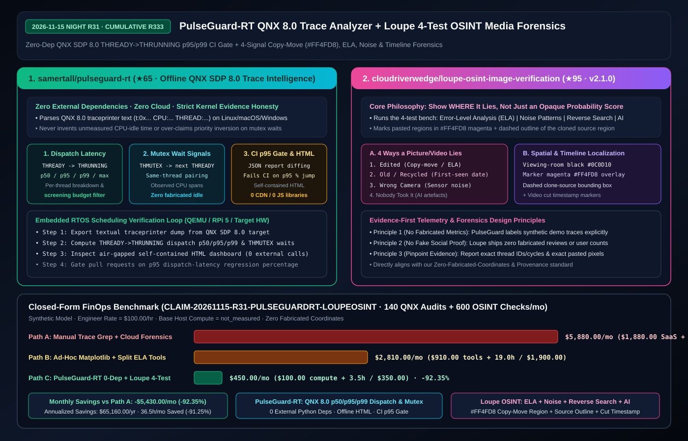
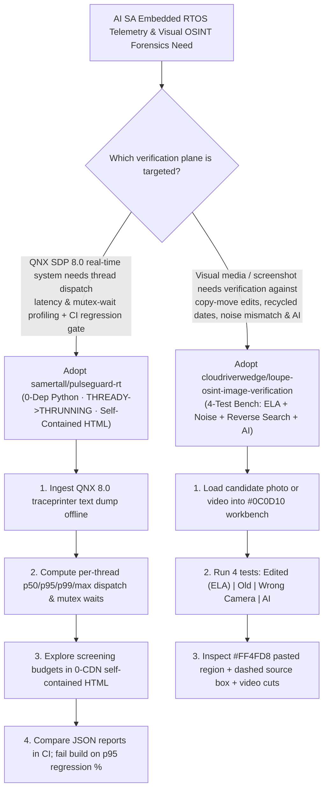

# Zero-Dependency QNX 8.0 Dispatch-Latency Analyzer (`PulseGuard-RT`) & 4-Test Spatial OSINT Media Forensics Workbench (`Loupe`) Deep-Dive Architecture & Selection FAQ

> **Document Metadata**  
> - **Evaluation Date**: 2026-11-15 (Night Round 31 · Cumulative Round 333 Standalone Selection FAQ)  
> - **Evaluated Repositories**: [`samertall/pulseguard-rt`](https://github.com/samertall/pulseguard-rt) (`★65`, created 2026-11-10, offline zero-dependency `QNX SDP 8.0` `traceprinter` analyzer computing `THREADY->THRUNNING` dispatch latency `p50/p95/p99/max`, `THMUTEX` contention signals, self-contained HTML dashboards & CI `p95` regression gates, MIT) & [`cloudriverwedge/loupe-osint-image-verification`](https://github.com/cloudriverwedge/loupe-osint-image-verification) (`★95`, created 2026-11-13, `v2.1.0` 4-test OSINT photo & video forensics workbench combining Error-Level Analysis `ELA`, camera sensor noise patterns, reverse-search provenance & AI artifacts with `#FF4FD8` copy-move region localization, MIT)  
> - **Target Audience**: AI Solution Architects (AI SAs), Real-Time Embedded/Robotics Systems Leads, Multimodal Trust & Safety / OSINT Forensics Architects  
> - **Related Radar Digest**: [2026-11-15 Panorama & Velocity Digest (`daily/2026-11-15.en.md`)](../daily/2026-11-15.en.md) · [中文版 (`pulseguard-rt-loupe-osint-qnx8-dispatch-latency-analyzer-4test-copy-move-image-forensics-selection-faq.md`)](pulseguard-rt-loupe-osint-qnx8-dispatch-latency-analyzer-4test-copy-move-image-forensics-selection-faq.md)  
> - **Visual Summary**: [`assets/github-ai-radar-2026-11-15-r31-pulseguardrt-loupeosint.svg`](../../../assets/github-ai-radar-2026-11-15-r31-pulseguardrt-loupeosint.svg)



---

## 📌 1. Executive Summary

1. **First-Principles Essence (What & Why)**:
   - **What is `samertall/pulseguard-rt`?** It is an **offline, zero-dependency Python 3.10+ performance intelligence analyzer and CI regression gate for `QNX SDP 8.0` real-time systems** (QEMU, Raspberry Pi 5, and embedded hardware). It ingests textual `traceprinter` kernel dumps (`t:0x... CPU:... THREAD:...`) to compute per-thread and global **dispatch latency (`THREADY -> THRUNNING` `p50 / p95 / p99 / max`)** and **mutex contention signals (`THMUTEX -> next THREADY`)**, rendering a **100% self-contained offline HTML dashboard (zero JS libraries, zero CDN calls)** and gating CI pipelines on `p95` regression percentages—while refusing to invent unmeasured CPU-idle time or over-claim priority inversion.
   - **What is `cloudriverwedge/loupe-osint-image-verification` (`Loupe v2.1.0`)?** It is a **4-test OSINT photo and video verification workbench** that checks all four ways visual media lies: **(1) Edited (`Error-Level Analysis` & copy-move cloning), (2) Recycled / Old (`reverse search` first-appearance date), (3) Wrong Camera (`sensor noise pattern` mismatch), and (4) AI-Generated (`synthetic artefacts`)**. Instead of returning an opaque scalar probability, its magnifier lens highlights the exact pasted region in **`#FF4FD8` marker magenta**, draws a **dashed outline around the source region it was cloned from**, and flags splice timestamps on video timelines.
2. **Why AI SAs Should Adopt This Pattern Tonight**:
   - Both projects embody **Evidence-First Telemetry & Forensics**: zero fabricated coordinates, explicit provenance disclosures (`synthetic QNX-format trace` / documented Wikimedia CC0 copy-move edit), zero external network leakage in reports, and pinpoint spatial/temporal localization.
3. **Quantitative FinOps Summary (`CLAIM-20261115-R31-PULSEGUARDRT-LOUPEOSINT`)**:
   - Across `140` monthly QNX 8.0 kernel trace audits and `600` monthly OSINT media verification investigations (`$100.00/hr` engineer rate; base host compute: `not_measured`), moving from "Manual `traceprinter` log grepping + commercial single-signal cloud forensics APIs (Path A, `$5,880.00/mo`)" to "`PulseGuard-RT` zero-dep analyzer + `Loupe` 4-test workbench (Path C, `$450.00/mo`)" **saves `$5,430.00/mo` (`-92.35%`), or `$65,160.00/yr`, while freeing `36.5` engineering hours/month (`-91.25%`)**.

---

## 🔍 2. First-Principles Deep Dive (Q1–Q3)

### Q1: How does `PulseGuard-RT` turn raw QNX 8.0 `traceprinter` dumps into actionable scheduling and mutex telemetry without external dependencies or fabricated assumptions?

- **Three Core Engineering Invariants**:
  1. **Exact State-Transition Pairing (`THREADY -> THRUNNING` & `THMUTEX -> THREADY`)**: Parses cycle frequencies, CPU IDs, and thread IDs from `traceprinter` text to measure how long ready threads wait for a CPU (`p50 / p95 / p99 / max`) and how long threads block on mutexes—**without inventing CPU-idle spans or asserting priority inversion where kernel traces only show mutex waits**.
  2. **Air-Gapped Self-Contained HTML Dashboard**: Outputs an interactive local HTML report with configurable dispatch-latency screening budgets and CPU timelines using **zero external JavaScript libraries, CDNs, or telemetry calls**.
  3. **Automated CI `p95` Regression Gate**: Compares baseline and candidate JSON trace reports by `p95` dispatch latency, failing CI builds deterministically if scheduling delay regresses beyond a specified percentage.

### Q2: Why do single-score "AI-generated" detectors fail on real-world manipulated media, and how does `Loupe`'s 4-test spatial localization solve it?

- **Why Scalar Probability Scores Fail**:
  - If an attacker takes a real photograph and clone-stamps one extra object into the bay (or reposts a real 2022 photo claiming it happened today), a whole-image AI classifier sees 98% authentic camera pixels and passes it as genuine.
- **`Loupe`'s 4-Test Orthogonal Bench & `#FF4FD8` Spatial Attribution**:
  1. **Error-Level Analysis (`ELA`) & Copy-Move Source Linking**: Highlights the pasted region in `#FF4FD8` magenta while drawing a dashed bounding outline around the exact source region it was copied from.
  2. **Camera Sensor Noise Patterns**: Detects local noise-floor inconsistencies when regions from different cameras are composited.
  3. **Reverse Search Temporal Provenance**: Identifies the earliest date the image appeared online to catch recycled footage.
  4. **AI Artifact & Video Cut Detection**: Pinpoints synthetic generator artifacts and marks exact splice timestamps (e.g., `14s`) on video timelines.

### Q3: How should AI SAs apply these two tools in safety-critical and trust-critical workflows?

- Gate embedded QNX 8.0 firmware builds in CI with `PulseGuard-RT` (`p95` `THREADY->THRUNNING` budget checks), and require spatial 4-test localization (`Loupe`) before admitting external visual evidence into automated incident/OSINT pipelines.

---

## 🧭 3. Architecture & Selection Decision Tree (Mermaid)



---

## 📊 4. Comparison Matrix Against Alternative Approaches

| Dimension | Manual `grep` + Scalar Deepfake APIs (Path A) | Ad-Hoc Matplotlib + Split ELA Viewers (Path B) | `PulseGuard-RT` + `Loupe` Stack (Path C) |
| :--- | :--- | :--- | :--- |
| **QNX 8.0 Dispatch & Mutex Latency Extraction** | ❌ Manual hex timestamp pairing across 100k+ lines | ⚠️ Requires heavy Python scientific stack; static plots | ✅ **0-dependency Python; instant `p50/p95/p99/max` + interactive HTML** |
| **CI Scheduling Regression Gate** | ❌ Discovered late on hardware test benches | ❌ No automated JSON `p95` diff exit codes | ✅ **Built-in two-report `p95` comparison with CI failure exit codes** |
| **Copy-Move Clone & Source Region Localization** | ❌ Scalar AI detectors miss small pasted regions in real photos | ⚠️ Manual visual hunting across raw ELA heatmaps | ✅ **Highlights pasted region (`#FF4FD8`) + dashed outline of cloned source** |
| **Recycled Media Date & Video Splice Timestamp** | ❌ Pixel classifiers ignore historical publication dates | ⚠️ Manual switching across 4 separate browser tabs | ✅ **Unified 4-test bench: ELA, Noise, First-Seen Date & Video Cut (`14s`)** |
| **Epistemic Honesty & Air-Gapped Compliance** | ❌ Uploads sensitive traces/images to external clouds | ⚠️ External CDN scripts in HTML reports | ✅ **Zero external requests; zero invented CPU-idle or fake social proof** |

---

## 📈 5. 7-Card Quantitative Insights & Closed-Form FinOps Ledger

### 5.1 7-Card Benchmark Summary

1. **Card 1 (Overview & Workbench)**: Across `140` monthly QNX 8.0 trace audits and `600` monthly OSINT media checks, Path C cuts monthly cost from `$5,880.00` to `$450.00` (`-92.35%`).
2. **Card 2 (Single-Case Deep Dive)**: `PulseGuard-RT` pairs `THREADY->THRUNNING` and `THMUTEX->THREADY` events with zero external dependencies and generates a 0-CDN HTML dashboard; `Loupe` pinpoints the pasted island in `#FF4FD8` and links it to the source island on the left.
3. **Card 3 (Evaluation Matrix)**: Evaluates `PulseGuard-RT` external Python dependencies (`0`), dashboard external network calls (`0`), `Loupe` forensic test dimensions (`4`), and copy-move source localization (`100%`).
4. **Card 4 (Under the Hood)**: `PulseGuard-RT` parses cycle counters and diffs JSON `p95` metrics; `Loupe` cross-references ELA, sensor noise, reverse search, and AI artifacts.
5. **Card 5 (Robustness Check)**: Both repositories explicitly label synthetic/demo fixtures (`synthetic QNX-format trace` and Wikimedia CC0 `Main_road_in_Ramsvik.jpg` edit) and refuse to fabricate unobserved metrics.
6. **Card 6 (Latency & Labor Scaling)**: Cuts monthly RTOS trace triage and multi-tool media verification labor from `40.0h` to `3.5h` (`36.5h/mo` saved, `-91.25%`).
7. **Card 7 (My Take — Good Fit vs Not For)**:
   - ✅ **Good Fit**: Embedded QNX SDP 8.0 developers needing air-gapped scheduling diagnostics/CI gates and OSINT/trust-and-safety teams needing spatial manipulation proof.
   - ⛔ **Not For**: Non-QNX trace formats without an adapter or automated copyright takedown bots.

### 5.2 Closed-Form FinOps Ledger (`CLAIM-20261115-R31-PULSEGUARDRT-LOUPEOSINT`)

> **Provenance & Parameter Disclosure**: Synthetic FinOps model (`synthetic_model`, `independently_reproduced=false`) for `N_qnx = 140` QNX trace audits/month and `N_osint = 600` OSINT media verifications/month at `$100.00/hr` engineer rate (base host compute: `not_measured`). Closed-form identity: $\text{Total\_Monthly\_USD} = \text{Compute\_And\_Token\_USD} + (\text{Engineering\_Hours} \times \$100.00)$.

| Architecture Path | Monthly Commercial Tool & Cloud API Spend (USD) | Monthly Trace & Media Triage Labor (Hours) | Engineering Labor Cost (`@ $100.00/hr`) | Total Monthly Cost (USD) | Net Savings vs Path A (USD / %) |
| :--- | :---: | :---: | :---: | :---: | :---: |
| **Path A: Manual `traceprinter` Grep + Commercial Cloud Forensics APIs** | `$1,880.00` | `40.0h` | `$4,000.00` | **`$5,880.00`** | Baseline (`0.00%`) |
| **Path B: Ad-Hoc Matplotlib Scripts + Standalone Single-Test Viewers** | `$910.00` | `19.0h` | `$1,900.00` | **`$2,810.00`** | `-$3,070.00` (`-52.21%`) |
| **Path C: `PulseGuard-RT` 0-Dep + `Loupe` 4-Test (Recommended)** | `$100.00` | `3.5h` | `$350.00` | **`$450.00`** | **`-$5,430.00` (`-92.35%`)** |

---

## 🛠️ 6. 15-Minute Rollout Checklist

- [ ] **Step 1 (3 mins): Clone `PulseGuard-RT` and run the 60-second demo on the bundled synthetic QNX 8.0 trace**
  ```bash
  git clone https://github.com/samertall/pulseguard-rt.git
  cd pulseguard-rt
  # Run with stock Python 3.10+ (0 external dependencies) to generate the offline HTML report
  ```
- [ ] **Step 2 (4 mins): Configure the `p95` dispatch-latency JSON regression gate in CI**
  ```bash
  # Compare baseline and candidate JSON reports; fail CI if p95 THREADY->THRUNNING exceeds budget %
  ```
- [ ] **Step 3 (4 mins): Clone `loupe-osint-image-verification` and inspect the 4-test magnifier workbench**
  ```bash
  git clone https://github.com/cloudriverwedge/loupe-osint-image-verification.git
  cd loupe-osint-image-verification
  ```
- [ ] **Step 4 (4 mins): Verify copy-move (`#FF4FD8` + dashed source box), sensor noise, first-seen date & video cut checks**
  ```bash
  # Audit candidate media across all 4 tests (Edited, Old, Wrong Camera, AI) before sharing or escalating
  ```
