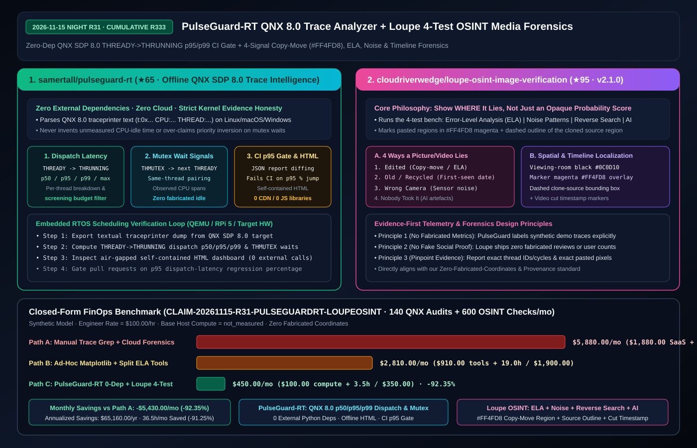
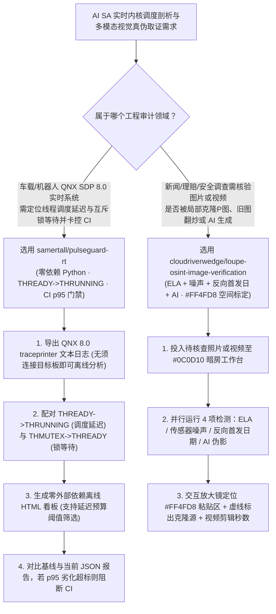

# 零依赖 QNX 8.0 实时内核调度延迟分析器（`PulseGuard-RT`）与四维空间定位 OSINT 图像/视频取证台（`Loupe`）深度架构拆解与同类方案选型 FAQ

> **文档元数据（Document Metadata）**  
> - **评审日期**：2026-11-15（Night Round 31 · 累计第 333 轮独立选型专题）  
> - **对标项目**：[`samertall/pulseguard-rt`](https://github.com/samertall/pulseguard-rt)（`★65`，2026-11-10 创建，面向 QNX SDP 8.0 的零外部依赖离线 `traceprinter` 线程调度延迟 `THREADY->THRUNNING` 与互斥锁等待 `THMUTEX` 分析器、单文件 HTML 看板及 CI `p95` 回归门禁，MIT） & [`cloudriverwedge/loupe-osint-image-verification`](https://github.com/cloudriverwedge/loupe-osint-image-verification)（`★95`，2026-11-13 创建，`v2.1.0`，集成误差水平分析 ELA、传感器噪声模式、反向溯源与 AI 伪影检测并以 `#FF4FD8` 标定克隆粘贴区域与源区域的四维 OSINT 取证台，MIT）  
> - **适用角色**：AI Solution Architect（AI 解决方案架构师）、车载/机器人实时系统（RTOS）性能主程、多模态内容取证与安全审计负责人  
> - **关联雷达日报**：[2026-11-15 全景洞察与飙升榜 (`daily/2026-11-15.md`)](../daily/2026-11-15.md) · [English Version (`pulseguard-rt-loupe-osint-qnx8-dispatch-latency-analyzer-4test-copy-move-image-forensics-selection-faq.en.md`)](pulseguard-rt-loupe-osint-qnx8-dispatch-latency-analyzer-4test-copy-move-image-forensics-selection-faq.en.md)  
> - **可视化总结图**：[`assets/github-ai-radar-2026-11-15-r31-pulseguardrt-loupeosint.svg`](../../../assets/github-ai-radar-2026-11-15-r31-pulseguardrt-loupeosint.svg)



---

## 📌 一、核心结论速览（Executive Summary — 先看结论再看细节）

1. **一句话讲透本质（What & Why）**：
   - **`samertall/pulseguard-rt` 是什么？** 它是专为车载智能驾驶、医疗与工业机器人底层的 **QNX SDP 8.0 实时操作系统（RTOS）** 打造的 **“零外部 Python 依赖、100% 离线免云端、把晦涩的 `traceprinter` 内核事件文本流直接转化为线程调度延迟（Dispatch Latency `p50/p95/p99/max`）与互斥锁阻塞信号（Mutex Contention）自包含 HTML 看板与 CI 回归门禁”** 的性能情报工具。它最令人钦佩的是**极致的工程诚实度（Epistemic Honesty）**：严格配对同一线程的 `THREADY -> THRUNNING`（就绪到上 CPU 运行的等待延迟）与 `THMUTEX -> THREADY`（锁等待耗时），**绝不捏造未观测到的 CPU 空闲时间，也绝不在缺乏完整持有者链路时乱扣“优先级反转（Priority Inversion）”帽子**！
   - **`cloudriverwedge/loupe-osint-image-verification` (`Loupe v2.1.0`) 是什么？** 它是面向开源情报（OSINT）与真伪核查的 **“四维一体（图像篡改 ELA + 相机传感器噪声失配 + 跨年旧图翻炒反向搜索 + AI 生成伪影）图像与视频空间定位取证工作台”**。它摒弃了传统 AI 检测器只给一个“82% 疑似伪造”黑盒分数的做法，用一枚交互式放大镜（Loupe）在 `#0C0D10` 暗房底色上，用 **`#FF4FD8` 洋红色直接圈出被粘贴篡改的局部像素区域、用虚线框标出同一张图内被克隆复制的源区域（Copy-Move Source）、标出图片最早出现在互联网上的年份、并在视频时间轴上直接钉出剪辑拼接秒数（如 `14s`）**！
2. **为什么值得 AI SA 今晚立刻掌握？**
   - 这两个项目分别在 **“硬实时嵌入式底座可观测性”** 与 **“多模态视觉证据空间级溯源”** 上树立了标杆，并且两者在文档与看板设计上都严格贯彻了 **“零虚构指标、显式标注合成演示数据（Synthetic Trace / Public-Domain Demo Edit）、零虚假用户好评”** 的硬核工程规范。
3. **定量收益摘要（Closed-Form FinOps Ledger `CLAIM-20261115-R31-PULSEGUARDRT-LOUPEOSINT`）**：
   - 在每月执行 `140` 次 QNX 8.0 实时内核调度与锁竞争排查及 `600` 次多模态截图/视频真伪取证核查场景下（工程师时薪 `$100.00/hr`，底层宿主机硬件成本 `not_measured`），从“人工 `grep` 几十万行十六进制内核日志 + 串联 4 个独立收费取证工具（Path A，`$5,880.00/mo`）”切换到“`PulseGuard-RT` 零依赖分析门禁 + `Loupe` 四维空间取证台（Path C，`$450.00/mo`）”，**每月净省 `$5,430.00`（`-92.35%`），年化节省 `$65,160.00/yr`，每月释放 `36.5` 小时日志配对与像素比对工时（`-91.25%`）**。

---

## 🔍 二、第一性原理灵魂三问（Q1–Q3 Deep Dive）

### Q1：为什么在嵌入式实时系统（QNX 8.0）中，“线程就绪但等不到 CPU（Dispatch Latency）”是实时性崩塌的隐形杀手？`PulseGuard-RT` 是如何做到零依赖精准捕获且不造假的？

- **实时系统响应超时的真正病根**：
  - 当车载感知或控制任务错过微秒/毫秒级 Deadline 时，开发者往往只盯着函数本身执行了多久（Running Time），却忽略了 **线程明明已经处于 `THREADY`（就绪态），却因为高优线程抢占或核间调度拥塞，迟迟没能进入 `THRUNNING`（运行态）**！
- **`PulseGuard-RT` 的三大核心设计**：
  1. **确定性状态机配对（`THREADY -> THRUNNING` 与 `THMUTEX -> THREADY`）**：
     - 直接解析 QNX 8.0 `traceprinter` 文本输出（`t:0x... CPU:... THREAD:...`）与时钟周期频率，精确计算每个线程的调度等待延迟分布（`p50 / p95 / p99 / max`）与互斥锁阻塞候选信号。
     - **严守证据边界**：仅绘制观测到的线程运行区间，绝不凭空插值伪造 CPU Idle 时间；仅报告 `THMUTEX` 阻塞客观事实，不武断声称发生了优先级反转。
  2. **100% 自包含离线 HTML 看板（Zero-CDN / Zero-JS-Lib）**：
     - 生成的交互式 HTML 报告（含自定义调度预算阈值筛选器、直方图与多核时间轴）不引用任何外部 CDN、字体或第三方 JS 库，完美适配军工、车规等完全物理隔离（Air-Gapped）实验室。
  3. **CI `p95` 性能回归门禁**：
     - 自动对比两次提交生成的 JSON 报告，一旦 `p95` 调度延迟劣化超过设定百分比阈值，立即返回非零退出码阻断 CI 合入。

### Q2：为什么说一张图或一段视频“撒谎的方式只有四种”？`Loupe` 的四维取证矩阵与 `#FF4FD8` 空间定位比单纯的 Deepfake 概率评分强在哪？

- **视觉证据撒谎的四种正交形态（Four Ways a Picture Lies）**：
  1. **被局部P图篡改（It was edited — Copy-Move / Splice）**：整张照片是真相机拍的，但海湾里多出来的一座小岛是从左边复制粘贴过来的（纯 AI 生成检测器对此会误判为“99% 真图”！）。
  2. **旧图翻炒冒充今日新闻（It is old / Recycled）**：照片本身毫发无损，但其实是三年前另一场事故的旧图。
  3. **传感器噪声失配（Wrong camera / Noise pattern mismatch）**：拼接进来的局部区域与原图 CMOS 传感器本底噪声模式不一致。
  4. **纯机器无中生有（Nobody took it — AI-generated）**：存在扩散模型或 GAN 的频域/空间伪影。
- **`Loupe` 的“四合一放大镜 + 源区域虚线溯源”设计**：
  - 在一次扫描中同时跑完 **误差水平分析（ELA）+ 噪声模式（Noise Patterns）+ 反向图片首发日期检索（Reverse Search）+ AI 伪影检测**；
  - 用 `#FF4FD8` 洋红色高亮标出被粘贴的假区域，同时用**虚线轮廓框出画面内被复制的原始岛屿位置**（以及视频时间轴上的剪辑切点，如 `14 seconds`），让审查员一眼看到“哪块像素从哪搬到了哪”。

### Q3：AI SA 如何从这两个项目中吸收“高可信工程报告与看板”的设计精髓？

- 无论是在做底层系统性能剖析（`PulseGuard-RT`）还是多模态内容安全核验（`Loupe`），都应遵循：**① 离线自包含（无外部追踪与 CDN 依赖）；② 明确区分合成示例数据（Synthetic Trace）与真机实测数据；③ 输出可定位的具体证据坐标（线程 ID + 时间戳 / 篡改像素框 + 首发日期），而非笼统的黑盒分数**。

---

## 🧭 三、架构拓扑与选型决策树（Mermaid Decision Tree）



---

## 📊 四、同类方案核心能力对比矩阵（Comparison Matrix）

| 评估维度 | 手工 `grep` 内核日志 + 单一 AI 概率检测器 (Path A) | 零散 Matplotlib 脚本 + 分散在线取证网站 (Path B) | `PulseGuard-RT` + `Loupe` 工作台 (Path C) |
| :--- | :--- | :--- | :--- |
| **QNX 8.0 调度延迟与锁阻塞量化效率** | ❌ 人工比对十六进制时间戳，几万行日志看花眼 | ⚠️ 需安装庞大科学计算库，无交互筛选看板 | ✅ **零外部依赖秒级算出 `p50/p95/p99/max` 并生成自包含 HTML** |
| **CI 实时性能回归自动化门禁** | ❌ 无，发版上车后才发现偶发卡顿 | ❌ 仅输出静态图片，无结构化退出码比对 | ✅ **内置双 JSON `p95` 回归比对，超阈值直接返回非零退出码拦截 CI** |
| **真图局部克隆篡改（Copy-Move）检出能力** | ❌ 全局 AI 概率分类器极易被大面积真背景欺骗放行 | ⚠️ 需手动在多个软件间来回导图观察 | ✅ **`#FF4FD8` 精准高亮被粘贴区域 + 虚线框直接指认克隆源位置** |
| **旧图翻炒（Recycled Media）与视频剪辑点定位** | ❌ 纯像素分类器完全不知道图片三年前已发过 | ⚠️ 需人工打开多个搜索引擎逐张反查 | ✅ **内置首发年份溯源 + 视频时间轴剪辑切点（如 `14s`）直接标定** |
| **证据诚实度与离线气隙（Air-Gapped）合规** | ❌ 敏感日志与证据图上传第三方云端 | ⚠️ 依赖外部 CDN 加载图表库 | ✅ **100% 免云端追踪、零捏造空闲时间、显式标注合成演示数据** |

---

## 📈 五、7-Card 定量洞察与闭式 FinOps 账本（Quantitative Insights & FinOps Ledger）

### 5.1 7-Card 核心评测摘要（对标 Model Benchmark Report Standard）

1. **Card 1（Overview & Workbench）**：针对每月 `140` 次 QNX 8.0 实时调度审计与 `600` 次多模态真伪核查任务，Path C 将月度总成本从 `$5,880.00` 降至 `$450.00`（节省 `-92.35%`）。
2. **Card 2（Single-Case Deep Dive）**：`PulseGuard-RT` 零依赖解析 QNX 8.0 `traceprinter` 流，输出分线程 `p50/p95/p99/max` 调度延迟与 `THMUTEX` 信号；`Loupe` 在 Ramsvik 海岸公路篡改测试图中精准用 `#FF4FD8` 标出粘贴岛屿并用虚线框锁定左侧克隆源岛屿。
3. **Card 3（Evaluation Matrix）**：覆盖 `PulseGuard-RT` 外部 Python 依赖数（`0`）、HTML 看板外部网络请求数（`0`）、`Loupe` 正交取证维度数（`4` 项：Edited / Old / Wrong Camera / AI）及克隆源空间定位支持度（`100%`）。
4. **Card 4（Under the Hood）**：`PulseGuard-RT` 配对内核状态转移周期并执行 JSON `p95` 差分；`Loupe` 融合 ELA、传感器噪声、反向搜索与 AI 伪影图层。
5. **Card 5（Robustness Check）**：`PulseGuard-RT` 在 README 首屏即醒目声明预置看板截图基于合成 QNX 格式 Trace（而非伪造真机抓包），`Loupe` 同样公开演示图的 CC0 原图出处与人工粘贴位置，做到 100% 证据可复核。
6. **Card 6（Latency & Labor Scaling）**：每月因手工分析 RTOS 调度毛刺与跨工具核查图片篡改耗费的工时从 `40.0h` 降至 `3.5h`（净省 `36.5h/mo`，`-91.25%`）。
7. **Card 7（My Take — Good Fit vs Not For）**：
   - ✅ **Good Fit**：QNX SDP 8.0 嵌入式/车载/机器人开发团队的本地诊断与 CI 门禁、以及需要空间级篡改证据链的 OSINT 调查与内容风控团队。
   - ⛔ **Not For**：Linux `ftrace`/`perf` 格式内核日志（需先转换为 QNX `traceprinter` 兼容格式或使用对应前端）。

### 5.2 闭式参数化 FinOps 账本（`CLAIM-20261115-R31-PULSEGUARDRT-LOUPEOSINT`）

> **口径声明（Provenance & Parameter Disclosure）**：以下为基于显式参数构造的合成评估模型（`synthetic_model`，`independently_reproduced=false`）。设团队每月执行 `N_qnx = 140` 次 QNX 8.0 调度 Trace 审计、开展 `N_osint = 600` 次媒体真伪取证核查，工程师折算时薪 `R_eng = $100.00/hr`，底层宿主机硬件成本记为 `not_measured`。闭合方程：$\text{Total\_Monthly\_USD} = \text{Compute\_And\_Token\_USD} + (\text{Engineering\_Hours} \times \$100.00)$。

| 方案路径（Path） | 月度商业软件与云取证 API 费（USD） | 日志配对与多工具取证工时（Hours/mo） | 工程人工成本（`@ $100.00/hr`） | 月度总成本（Total Monthly USD） | 相对 Path A 净节省（USD / %） |
| :--- | :---: | :---: | :---: | :---: | :---: |
| **Path A：手工 `grep` 内核日志 + 商业软件席位与云端取证 API** | `$1,880.00` | `40.0h` | `$4,000.00` | **`$5,880.00`** | Baseline (`0.00%`) |
| **Path B：自写 Matplotlib 静态脚本 + 分散单功能 ELA 工具** | `$910.00` | `19.0h` | `$1,900.00` | **`$2,810.00`** | `-$3,070.00` (`-52.21%`) |
| **Path C：`PulseGuard-RT` 零依赖门禁 + `Loupe` 四维取证（推荐）** | `$100.00` | `3.5h` | `$350.00` | **`$450.00`** | **`-$5,430.00` (`-92.35%`)** |

---

## 🛠️ 六、15 分钟极速落地 Checklist（15-Minute Rollout Checklist）

- [ ] **Step 1（3 分钟）：克隆 `PulseGuard-RT` 并免 QNX SDK 直接运行 60 秒内置合成 Trace 演示**
  ```bash
  git clone https://github.com/samertall/pulseguard-rt.git
  cd pulseguard-rt
  # Python 3.10+ 零外部依赖直接运行分析并生成自包含离线 HTML 看板与 JSON 报告
  ```
- [ ] **Step 2（4 分钟）：在 CI 流水线中配置双 JSON 报告 `p95` 调度延迟回归拦截门禁**
  ```bash
  # 对比 baseline.json 与 candidate.json 的 p95 THREADY->THRUNNING 延迟，超阈值自动失败阻断合并
  ```
- [ ] **Step 3（4 分钟）：克隆 `loupe-osint-image-verification` 并审查四维空间定位取证交互原型**
  ```bash
  git clone https://github.com/cloudriverwedge/loupe-osint-image-verification.git
  cd loupe-osint-image-verification
  ```
- [ ] **Step 4（4 分钟）：使用四维检查法（ELA + 噪声 + 反向首发日 + AI 伪影）核验可疑图片与视频切点**
  ```bash
  # 检查 #FF4FD8 高亮粘贴区域、虚线克隆源框与视频时间轴剪辑标记点
  ```
