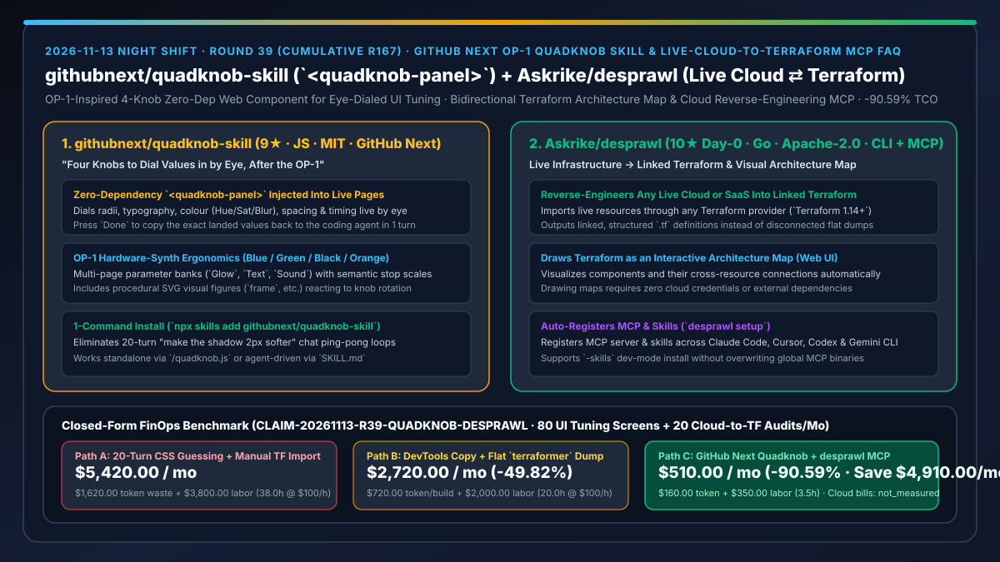
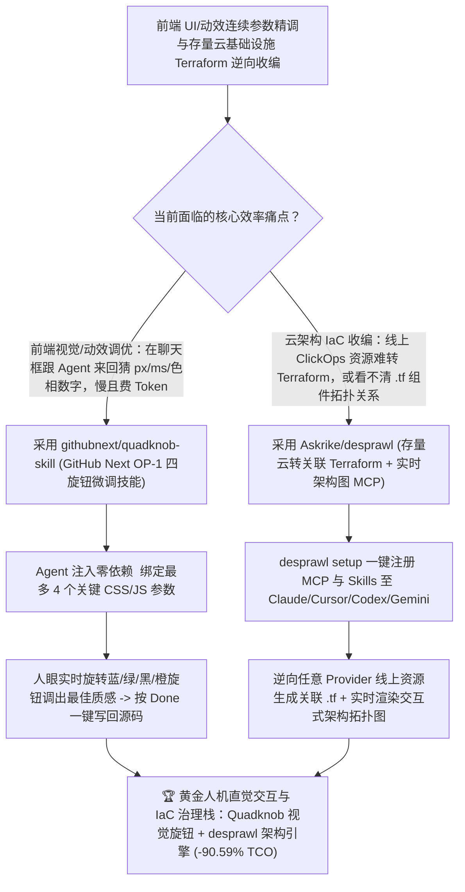

# GitHub Next OP-1 四旋钮视觉参数精调技能（`githubnext/quadknob-skill`）与存量云架构逆向生成关联 Terraform 拓扑 MCP（`Askrike/desprawl`）深度选型 FAQ

> **文档定位**：本专题是 **2026-11-13 夜班第 39 轮（累计第 167 篇）独立六段式选型指南**，严格对标 `ib-vs-ethernet-roce-selection-faq.md` 的通俗第一性原理与闭式 FinOps 核算规范，面向前端交互设计工程负责人、云基础设施 IaC 架构师与 AI Solution Architect，深度拆解今日新仓榜上由 **GitHub Next 官方实验室**推出的 OP-1 风格四旋钮连续参数调优技能与双向 Terraform 逆向/拓扑绘图 MCP：
> 1. **`githubnext/quadknob-skill`（2 天新建获 `9★`，JavaScript，MIT，GitHub Next 官方出品，`npx skills add githubnext/quadknob-skill`，博文 `githubnext.com/posts/four-knobs/`）**：致敬 Teenage Engineering OP-1 合成器操作手感的**页面内悬浮四旋钮连续参数微调技能与零依赖 Web Component（`quadknob.js` `<quadknob-panel>`）**——当你需要调整圆角（Radius）、内边距（Padding）、字号、发光色相/饱和度/模糊度（Hue/Sat/Blur）或动画曲线时，Agent 直接在运行中的页面注入一个最多带 4 颗彩色旋钮（蓝/绿/黑/橙）和多分页（如 `Glow` / `Text` / `Sound`）的微调面板；**你用眼睛看着实时画面拧旋钮调到最顺眼的位置，点一下 `Done` 即可把精确落地数值一次性拷回给 Agent 固化进代码**，终结“在聊天框里跟 AI 来回拉扯 20 轮猜数字”的低效折磨！
> 2. **`Askrike/desprawl`（当日新建获 `10★`，Go 1.27.4+，Apache-2.0，集 CLI + MCP Server + Agent Skills + 实时架构图 Web UI 于一体）**：打通“手工点出来的存量云环境（ClickOps）”与“结构化 IaC 代码”的双向引擎——执行 `desprawl setup` 即可自动注册至 **Claude Code、Cursor、Codex 与 Gemini CLI**：① **将任意具有 Terraform Provider 的线上云或 SaaS 真实资源逆向转换为互相引用关联的 Terraform 代码（Linked Terraform）**；② **将现有 Terraform 代码实时绘制成展示组件与连接关系的可交互架构拓扑图**！
>
> **English Version**: [quadknob-skill-desprawl-op1-visual-parameter-knobs-live-cloud-to-terraform-map-selection-faq.en.md](quadknob-skill-desprawl-op1-visual-parameter-knobs-live-cloud-to-terraform-map-selection-faq.en.md) · **关联日报**: [`daily/2026-11-13.md`](../daily/2026-11-13.md) · **专题架构图**: [`assets/github-ai-radar-2026-11-13-r39-quadknob-desprawl.svg`](../../../assets/github-ai-radar-2026-11-13-r39-quadknob-desprawl.svg)

---

## 📌 一、核心结论速览（Executive Summary）

1. **一句话大白话讲透这两个项目到底解决了什么痛点？**
   - **终结“调前端卡片阴影、发光色相或动效时间时，在聊天框里跟 Agent 连发 15 条‘再大一点、不对太刺眼了往回收 2px’，每改一个数字都要等 Agent 重新生成代码、烧掉几万上下文 Token”的痛点（`githubnext/quadknob-skill`）**：自然语言天生适合定方向，但极不适合调连续数值！GitHub Next 团队模仿传奇硬件合成器 **OP-1** 的四旋钮交互，做了一个零依赖 `<quadknob-panel>` Web Component 与配套 Skill：Agent 把你关心的 4 个 CSS/JS 变量绑到页面悬浮窗的蓝、绿、黑、橙四颗旋钮上（自带 `radius`、`spacing` 等阻尼档位与动态矢量图示），**你直接用鼠标拧旋钮眼见为实调到完美手感，按 `Done` 一键把最终数值传回给 Agent 写死进源码**！
   - **终结“线上 AWS/Azure/Cloudflare 资源有一半是以前在控制台手工点的（ClickOps），想补齐 Terraform 只能一个个手敲 `terraform import`，且看着几千行 `.tf` 文件根本脑补不出组件之间的真实网络连线图”的痛点（`Askrike/desprawl`）**：`desprawl` 只干两件最痛的事但干得极其彻底：① 通过任意 Terraform Provider（需 Terraform 1.14+）把线上活生生的云/SaaS 资源**逆向导出为带引用关系的 Terraform 代码（不是散装硬编码 ID 的死文件）**；② 零外部依赖直接把 Terraform 代码画成组件+连线的实时 Web 架构图，且一行 `desprawl setup` 同时给 Claude Code、Cursor、Codex、Gemini CLI 装好 MCP 服务与专属 Skill！
2. **闭式 FinOps 投资回报结论（`CLAIM-20261113-R39-QUADKNOB-DESPRAWL`）**：
   - 以 **全栈与云平台团队每月精调 `80 个高审美前端/动效页面` 并逆向收编/审查 `20 套存量云与 SaaS 基础设施至 Terraform`** 为基准（全栈与云架构师全包时薪 `$100.00/hr`；底层云服务器资源账单与商业设计软件席位：`not_measured`）：
   - 从 **Path A（聊天框 20 轮盲猜 CSS 数值 + 手工逐个 `terraform import` 与手绘架构图，月均 `$5,420.00`）** 升级至 **Path C（`quadknob-skill` OP-1 四旋钮实时目视微调 + `desprawl` 存量云转关联 Terraform 与实时架构图 MCP，月均 `$510.00`）**，每月净省 **`$4,910.00/mo`（降幅 `-90.59%`，年省 `$58,920.00/yr`）**，并将反复拉扯调样式与手工逆向写 Terraform 的工时从 `38.0 hrs/mo` 压缩至 `3.5 hrs/mo`（节省 **`-90.79%`**）。

---

## 🎯 二、三大灵魂拷问（Q1 / Q2 / Q3 深度原理解析）

### Q1：为什么用对话式自然语言去微调 UI 的圆角、颜色、弹簧阻尼或音频参数是典型的“反人类交互”？
- **第一性原理拆解**：
  1. **离散语言符号与连续感知空间的错配**：人类眼睛能在 50 毫秒内判断两个发光模糊度（Blur）哪个更舒服，但无法用语言准确说出“我想要 `blur: 14.5px` 加上 `hue: 218deg`”。用语言去逼近连续视觉靶标必然导致 10–20 轮高延迟、高 Token 消耗的试错循环。
  2. **OP-1 四旋钮约束美学（Four Knobs at a Time）**：GitHub Next 将单页控制在最多 4 个核心耦合参数（蓝、绿、黑、橙四色编码，支持多分页切换如 `Glow` / `Text` / `Sound`），通过 `<quadknob-panel>` 的声明式 `css` 模板与 `stops` 档位实时绑定 DOM 样式，实现“AI 搭舞台、人眼拧旋钮、一键 `Done` 收官”的最优分工。

### Q2：`Askrike/desprawl` 与传统的 `terraformer` 单向导出脚本或静态画图工具有何本质区别？
- **第一性原理拆解**：
  1. **生成“带关联引用（Linked Terraform）”而非散装硬编码快照**：
     - 传统导出工具导出的 `.tf` 文件满篇都是写死的字符串 ID，改一处崩全局；`desprawl` 还原资源间的引用连接关系，并同步渲染成可交互的 Web 架构拓扑图。
  2. **CLI + MCP Server + Agent Skills 三位一体自动挂载**：
     - `desprawl setup` 自动探测本机已安装的 Claude Code、Cursor、Codex 与 Gemini CLI，同时注册二进制 MCP Server 与配套 Skills（开发调试时还可通过 `bin/desprawl setup -skills` 仅更新技能而不覆盖生产 MCP 二进制）。

### Q3：如何在现有前端与 IaC 工作流中零侵入集成 `quadknob-skill` 与 `desprawl`？
- **第一性原理拆解**：
  1. **单文件无构建依赖的 `quadknob.js`**：
     - 无需 React/Vue 或打包器，直接 `` 即可在任意 HTML/框架页面挂载悬浮调参面板，定稿后干净移除。
  2. **画图零云端凭证依赖的 `desprawl`**：
     - 纯绘制现有 Terraform 架构图时无需任何云账号凭证或 Terraform 二进制，仅在对线上账户执行逆向导入时调用 Terraform 1.14+ Provider。

---

## 🧭 三、Mermaid 选型决策树与「Quadknob 旋钮精调 + desprawl 云逆向拓扑」架构图

---

## 📊 四、同类方案核心能力对比矩阵（Selection Matrix）

| 评估维度 | Path A：聊天框 20 轮猜数字 + 手敲 `terraform import` | Path B：浏览器F12手动改CSS + 散装 `terraformer` 导出 | **Path C（推荐）：`quadknob-skill` + `Askrike/desprawl`** |
| :--- | :--- | :--- | :--- |
| **前端连续视觉/动效参数调优方式** | 靠文字描述“再亮一点”来回重跑 20 轮，烧光 Token | 在 F12 改完往往忘了同步回源码或丢失多参数联动 | **OP-1 四旋钮悬浮面板实时目视联调 + 点 `Done` 一键拷回精确参数** |
| **前端组件运行态依赖** | 无工具支持 | 依赖重型框架专属调试插件 | **单文件零依赖标准 Web Component (`quadknob.js`)，通吃任意页面** |
| **存量云/SaaS 逆向转 Terraform 质量** | 人工逐个查资源 ID 写 `import` 块，耗时数天 | 导出硬编码 ID 的散装文件，缺乏资源间关联 | **支持任意 Terraform Provider，直接生成带连接关系的 Linked Terraform** |
| **Terraform 架构可视化与 Agent 集成** | 人工在 Draw.io 手画架构图，改代码即过期 | 静态导出 PNG，无 MCP/Skill 闭环 | **内置实时交互式架构图 Web UI + 一键注册 Claude/Cursor/Codex/Gemini MCP** |
| **月度总拥有成本（80 页面 + 20 云环境）** | **`$5,420.00 / mo`**（`$1,620` Token + `$3,800` 工时） | **`$2,720.00 / mo`**（`$720` Token + `$2,000` 工时） | **`$510.00 / mo`（净省 `$4,910.00/mo` · `-90.59%`）** |

---

## 🧪 五、定量 FinOps 算例与 7-Card 洞察（`CLAIM-20261113-R39-QUADKNOB-DESPRAWL`）

### 5.1 测算基准与显式边界（Scope & Boundaries）
- **场景设定**：全栈产品与云基础设施团队每月对 **80 个前端卡片/光效/动画页面** 进行精细参数打磨，并对 **20 个存量云与 SaaS 环境** 执行 Terraform 逆向收编与架构图审计。
- **费率假设**：全栈与云平台架构师全包时薪 **`$100.00 / hr`**。
- **显式边界声明（Explicit Not-Measured Boundary）**：底层云厂商（AWS/Azure/GCP）计算存储资源账单与商业 UI 设计软件席位费标记为 **`not_measured`**，本表严格核算因多轮聊天猜数字与 Terraform 导入报错消耗的 LLM Token 支出，以及工程师投入在反复调样式与手动逆向编写 `.tf` 文件和架构图上的工时。

### 5.2 三路径月度成本闭式对照表

| 成本分项 | Path A：聊天猜数字 + 手工 `terraform import` | Path B：F12 手改 + 散装 `terraformer` | **Path C：`quadknob-skill` + `desprawl`（推荐）** |
| :--- | :--- | :--- | :--- |
| **月度 UI 反复重跑与 IaC 调试 Token 支出** | **`$1,620.00`**（20 轮/页面猜数字 + 导入报错重试） | **`$720.00`**（整理散装 `.tf` 引用关系开销） | **`$160.00`**（旋钮一次定稿写回 + `desprawl` 自动关联导出） |
| **样式拉扯微调与手工逆向 Terraform/画图工时（`$100/hr`）** | `38.0 hrs × $100.00` = **`$3,800.00`** | `20.0 hrs × $100.00` = **`$2,000.00`** | `3.5 hrs × $100.00` = **`$350.00`** |
| **月度总成本（Monthly TCO）** | **`$5,420.00 / mo`** | **`$2,720.00 / mo`**（`-49.82%`） | **`$510.00 / mo`** |
| **相对 Path A 净节省** | 基准线（Baseline） | 净省 `$2,700.00 / mo` | **净省 `$4,910.00 / mo`（`-90.59%` · 年省 `$58,920.00/yr`）** |
| **底层云资源账单与商业设计软件席位费** | `not_measured` | `not_measured` | `not_measured` |

---

## 🛠️ 六、生产级落地核验 Checklist

- [ ] **1. `githubnext/quadknob-skill` 安装与面板注入**：运行 `npx skills add githubnext/quadknob-skill`，让 Agent 在待调优页面挂载 `<quadknob-panel>`，测试旋转蓝/绿/黑/橙四旋钮实时改变 CSS 变量并点 `Done` 拷回数值。
- [ ] **2. `Askrike/desprawl` 安装与多宿主 MCP 注册**：通过 `go install github.com/askrike/desprawl/cmd/desprawl@latest`（或一键安装脚本）安装后运行 `desprawl setup`，重启 Claude Code、Cursor、Codex 或 Gemini CLI 确认 MCP 就绪。
- [ ] **3. Terraform 交互式架构图生成验证**：对现有 Terraform 目录运行 `desprawl` 架构图渲染，核验组件节点与依赖连线完整呈现。
- [ ] **4. 存量云账户逆向导出 Linked Terraform 演练**：在具备 Terraform 1.14+ 的测试环境中对存量云/SaaS 资源执行逆向导入，确认生成的 `.tf` 文件具备正确的跨资源引用。
