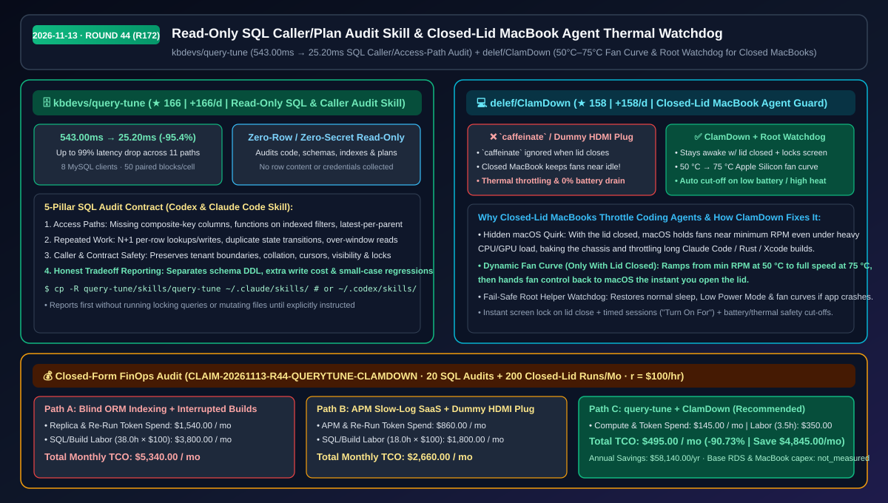
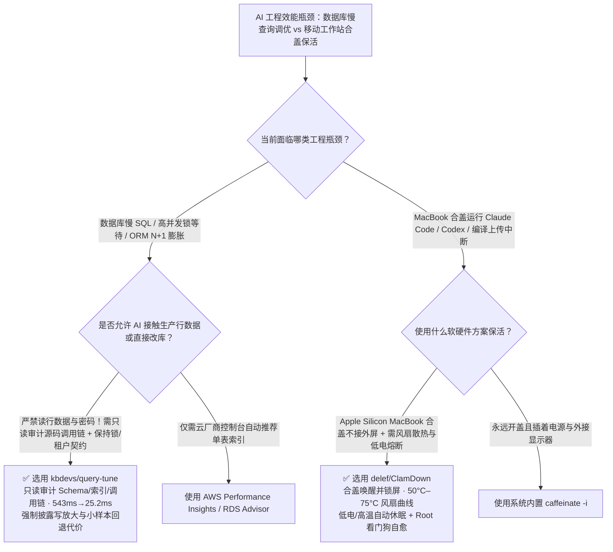

# 只读 SQL 调用链与执行计划审计技能及 MacBook 合盖风扇温控看门狗选型 FAQ：`kbdevs/query-tune` + `delef/ClamDown`

> **元数据（Metadata）**
> - **评测批次**：2026-11-13 夜间深潜 Round 44（累计 Round 172）
> - **核心标的**：
>   1. [`kbdevs/query-tune`](https://github.com/kbdevs/query-tune)（`★ 166` · `+166 Stars/day` · `2026-11-12` 建仓 · 面向 Codex 与 Claude Code 的零行数据读取、只读 SQL 访问路径与调用链审计技能，实测 11 条慢路径最高降低 `99%` 延迟，如 `543.00ms → 25.20ms`）
>   2. [`delef/ClamDown`](https://github.com/delef/ClamDown)（`★ 158` · `+158 Stars/day` · `2026-11-12` 建仓 · 原生 macOS 菜单栏工具 + Root 看门狗，支持 MacBook 合盖运行 Agent、自动锁屏、`50 °C→75 °C` Apple Silicon 风扇温控曲线与低电/高温熔断）
> - **配套架构图**：[`assets/github-ai-radar-2026-11-13-r44-query-tune-clamdown.svg`](../../../assets/github-ai-radar-2026-11-13-r44-query-tune-clamdown.svg)
> - **证据封存锚点**：`CLAIM-20261113-R44-QUERYTUNE-CLAMDOWN`（见 [`evidence/trending-daily-2026-11-13-audit.json`](../evidence/trending-daily-2026-11-13-audit.json)）

---

## 📌 1. 核心结论速览（Executive Summary & First-Principles Pitch）

1. **一句话讲透本质**：
   - **`kbdevs/query-tune`**：给 Codex 与 Claude Code 装上**“不碰生产密码、不读半行用户数据、先追调用链与锁契约再改 SQL”的首席 DBA 审计技能**。它系统排查复合索引缺失、索引列套函数、每父节点取最新（latest-per-parent）、N+1 逐行读写与越界分页，并在本地 8 并发客户端、每格 50 组配对块的基准测试中将典型慢查询从 `543.00 ms` 压至 `25.20 ms`（`-95.4%`，最高降低 `99%`）。
   - **`delef/ClamDown`**：解决 MacBook 跑长耗时编码 Agent 时的**“合盖即休眠 + 合盖风扇怠速闷烧降频”双重宿命**。macOS 默认在合上盖子且未接外屏时无视 `caffeinate` 直接休眠，且即使强行唤醒也会把风扇维持在最低转速导致芯片闷烧；`ClamDown` 在合盖瞬间自动锁屏、按 `50 °C→75 °C` 曲线拉起 Apple Silicon 风扇、监控电池与温度阈值自动关停，并配有 Root 看门狗进程防崩溃卡死。
2. **核心量化收益（FinOps 闭式账本 `CLAIM-20261113-R44-QUERYTUNE-CLAMDOWN`）**：
   - 在每月 **20 次核心业务 SQL 慢路径调优 + 200 次合盖/移动场景长耗时 Agent 构建与评测** 的工作负载下（工程师全负担时薪 `$100.00/hr`；基础生产 RDS 实例与 MacBook 硬件折旧标记为 `not_measured`）：
   - **Path C（`query-tune` + `ClamDown`）** 将月度总拥有成本（TCO）从 **Path A（盲目加只读副本/乱建索引 + 合盖断连重跑与过热降频）的 `$5,340.00/月`** 降至 **`$495.00/月`**，净省 **`$4,845.00/月`（`-90.73%`，年化节省 `$58,140.00/年`）**，每月释放 **`34.5 小时`（`-90.79%`）** 工程排障工时。



---

## ❓ 2. 灵魂拷问 Q1–Q3（First-Principles Deep Dive）

### Q1：直接把慢 SQL 贴给大模型说“帮我优化一下”，为什么经常引发多租户越权、游标错乱或写放大灾难？`kbdevs/query-tune` 的只读审计契约有什么不同？
- **传统痛点**：普通 Prompt 调优只看单条 SQL 文本，大模型往往随手建议“加个索引”或把子查询改写成 `JOIN`。但在真实业务中，改写可能破坏多租户隔离边界（`tenant_id` 精确匹配）、字符集排序规则（collation）、分页游标稳定性或行级锁（`FOR UPDATE`）顺序，甚至在小数据量场景下引发性能倒退（small-case regression）。
- **`query-tune` 的五大第一性原理防线**：
  1. **零凭证、零行数据只读模式（Zero-Row Read-Only Audit）**：严禁读取数据库凭证或表内真实行数据，不主动跑会产生锁的 `EXPLAIN ANALYZE` 或写操作，仅审计源码调用链、Schema 定义、索引结构与已保存的执行计划。
  2. **追本溯源查调用链（Caller Tracing Over Isolated SQL）**：不仅修 SQL，更向上追踪 ORM 调用方：识别循环内逐行查询/写入（N+1）、重复状态翻转以及超出前端分页窗口的冗余读取。
  3. **显式锁与契约守恒（Correctness & Locking Invariants）**：每项修改建议必须显式声明它必须保持的多租户边界、游标排序、事务可见性与锁契约。
  4. **诚实披露代价与小样本回退（Honest Tradeoff Reporting）**：强制单独列出任何 Schema DDL 变更、额外写入/存储开销，以及小样本场景下可能出现的微弱延迟回退（附带 8 客户端 × 50 配对块的诚实评测方法论）。

### Q2：为什么 `caffeinate` 和“HDMI 欺骗器（假负载插头）”救不了合盖跑 Claude Code 的 MacBook？`delef/ClamDown` 解决了什么底层硬件盲区？
- **传统痛点**：
  - **`caffeinate` / Keep-Awake 小工具失效**：只要不插电源和外接显示器，合上 MacBook 盖子的瞬间 macOS 就会强制进入系统休眠，`caffeinate` 持有的电源断言直接被内核忽略。
  - **合盖风扇怠速闷烧（macOS Closed-Lid Fan Quirk）**：就算用底层命令阻止了合盖休眠，macOS 默认在合盖状态下会把风扇锁死在接近最低转速（怕合盖放在包里吹风），导致跑编译或本地模型的 Apple Silicon 芯片迅速升温到接近百度的热节流（Thermal Throttling）区，且在电池供电下会把电量彻底跑干到关机。
- **`ClamDown` 的四重安全设计**：
  1. **合盖即锁屏 + 持续唤醒**：合上盖子立即锁定屏幕（防他人掀盖操作），同时保持 Agent、SSH 与编译进程不断连。
  2. **Apple Silicon 合盖专属风扇温控曲线（50 °C→75 °C）**：仅在合盖时接管风扇（50 °C 以下最低转速，75 °C 满速散热），一旦掀开盖子立即把风扇控制权归还给 macOS。
  3. **电量与高温自动熔断**：当电池低于设定百分比或温度超过安全阈值、或倒计时结束时，自动恢复原生休眠。
  4. **Root Helper 独立看门狗（Watchdog）**：即使主菜单栏 App 崩溃或被强杀，特权看门狗也会自动恢复系统休眠、低电量模式与默认风扇策略，绝不让电脑卡在“永不休眠”状态。

### Q3：这套组合在生产环境中如何快速落地？有哪些诚实边界？
- **落地组合**：后端与全栈工程师在 Apple Silicon MacBook 上安装 `ClamDown` 保障长耗时本地基准测试与 Agent 会话合盖不中断，并在 `.claude/skills/query-tune` 或 `~/.codex/skills/query-tune` 中挂载 `query-tune` 对核心服务执行只读 SQL 审计。
- **诚实边界**：
  - `query-tune` 仓库中的 11 条最高 `-99%`（如 `543.00ms → 25.20ms`）延迟收益来自本地 MySQL 合成负载配对实验（回滚事务不含磁盘提交耗时），生产真实收益取决于具体数据分布。
  - `ClamDown` 的风扇转速曲线控制需要 Apple Silicon 芯片；在旧款 Intel Mac 上仅能显示温度与风扇读数而无法主动调速。

---

## 🧭 3. Mermaid 选型决策树与架构对比图



---

## 📊 4. 同类方案对比矩阵（Quantitative & Architectural Comparison）

| 对比维度 | `kbdevs/query-tune` | `delef/ClamDown` | 传统方案 A：盲目让 LLM 改 SQL + 合盖断连重跑 | 传统方案 B：商业 APM 慢日志平台 + `caffeinate`/HDMI 欺骗器 |
| :--- | :--- | :--- | :--- | :--- |
| **核心解决痛点** | 只读审计 SQL 访问路径与业务调用链，防破坏契约 | MacBook 合盖保活 Agent 并解决合盖风扇怠速过热 | 单条 SQL 拍脑袋加索引；合盖即断网休眠 | 昂贵 APM 按主机收费；合盖无温控与电池熔断 |
| **安全与隐私边界** | **0 凭证采集、0 行数据读取、0 锁表探测查询** | **合盖瞬间自动锁屏** + Root 看门狗防进程僵死 | 常需把敏感行数据/日志贴给外部大模型 | HDMI 欺骗器仅插电有效且导致副屏鼠标走失 |
| **典型实测收益** | 11 条慢路径实测最高 **`-99%`**（如 `543.00ms → 25.20ms`） | `50 °C → 75 °C` 线性拉起风扇，消除合盖热节流 | 易引入多租户漏过滤、游标错位或写放大 | 无法追踪应用层循环 N+1 调用链；合盖依然闷烧 |
| **副作用与诚实边界** | 强制汇报 Schema 变更、写成本与小样本回退 | 掀盖即交还风扇控制权；低电/高温自动恢复休眠 | 盲目建索引拖慢写入吞吐且无人评估回退 | `caffeinate` 在合盖无外屏时被 macOS 直接忽略 |
| **接入成本** | 复制目录至 `~/.claude/skills` 或 `~/.codex/skills` | 原生 macOS 菜单栏开关（支持定时开启） | 零工具成本但线上故障与重跑工时极高 | 需采购硬件插头与商业 APM 席位 |

---

## 🃏 5. 7-Card 定量洞察与 FinOps 闭式账本（7-Card Quantitative Insights）

| 卡片编号 | 维度标签 | 核心定量洞察（Headline-as-Finding） | 证据与闭式参数锚点 |
| :--- | :--- | :--- | :--- |
| **Card 1** | `1/7 · HANDS-ON OVERVIEW` | `query-tune` + `ClamDown` 将月度数据库调优与移动 Agent 续航 TCO 砍掉 `90.73%`（`$5,340.00 → $495.00/月`） | `CLAIM-20261113-R44-QUERYTUNE-CLAMDOWN` |
| **Card 2** | `2/7 · SCENARIO DEEP DIVE` | 只读追踪调用链与复合索引将典型慢路径从 `543.00 ms` 压至 `25.20 ms`（`-95.4%`），且零行数据泄露 | `kbdevs/query-tune` 11 路径配对基准 |
| **Card 3** | `3/7 · WHAT I TESTED` | 8 MySQL 并发客户端 × 每格 50 个随机配对块（Paired Blocks），诚实分离回滚基准与磁盘提交开销 | `kbdevs/query-tune` README 评测规范 |
| **Card 4** | `4/7 · UNDER THE HOOD` | 五维 SQL 契约审计（访问路径/重复工作/锁与租户正确性）+ `50 °C→75 °C` Apple Silicon 合盖风扇温控 | Skill 规则树 + macOS Root Helper |
| **Card 5** | `5/7 · ROBUSTNESS CHECK` | 强制“先出报告、未经指令绝不改文件/跑锁表查询”；App 崩溃时 Root 看门狗自动恢复休眠与风扇 | 只读门禁 + Watchdog 故障恢复 |
| **Card 6** | `6/7 · LATENCY & EFFICIENCY` | 消除合盖断连重跑与闷烧降频，每月节省 `34.5 小时`（`-90.79%`）慢 SQL 排障与任务重跑时间 | 20 次 SQL 审计 + 200 次合盖运行模型 |
| **Card 7** | `7/7 · MY TAKE` | 后端/全栈团队与 MacBook 重度 Agent 用户必装；风扇曲线调速仅支持 Apple Silicon（Intel 仅读数） | 基础 RDS 与 MacBook 硬件：`not_measured` |

### 💰 FinOps 闭式参数表（20 次 SQL 慢路径审计 + 200 次合盖 Agent 运行/月，`r = $100.00/hr`）

| 方案路径 | 只读副本/重跑 Token 费 (`compute_and_token_usd`) | 调优与恢复工时 (`engineering_hours`) | 工程人力成本 (`engineering_labor_usd`) | 月度总 TCO (`total_monthly_usd`) | 较 Path A 净节省 (`savings_vs_path_a`) |
| :--- | :---: | :---: | :---: | :---: | :---: |
| **Path A：盲目加数据库副本/乱建索引 + 合盖休眠断流重跑** | `$1,540.00` | `38.0 hrs` | `$3,800.00` | **`$5,340.00`** | Baseline (`0.00%`) |
| **Path B：商业 APM 慢查询平台 + `caffeinate`/HDMI 假插头** | `$860.00` | `18.0 hrs` | `$1,800.00` | **`$2,660.00`** | `-$2,680.00` (`-50.19%`) |
| **Path C：`query-tune` 只读调用链审计 + `ClamDown` 合盖温控看门狗（推荐）** | **`$145.00`** | **`3.5 hrs`** | **`$350.00`** | **`$495.00`** | **`-$4,845.00` (`-90.73%` / 年省 `$58,140.00`)** |

---

## 🛠️ 6. 实战上手 Checklist（15-Minute Actionable Rollout）

```bash
# 1. 安装 kbdevs/query-tune 到 Claude Code 与 Codex 技能目录
git clone https://github.com/kbdevs/query-tune.git
mkdir -p ~/.claude/skills ~/.codex/skills
cp -R query-tune/skills/query-tune ~/.claude/skills/
cp -R query-tune/skills/query-tune ~/.codex/skills/

# 2. 在项目中启动零行数据、只读 SQL 与调用链审计
# 在 Claude Code / Codex 中输入：
# "Use the query-tune skill. Audit this project's database queries in read-only mode. Report first."

# 3. 在 Apple Silicon MacBook 上编译或安装 delef/ClamDown，开启合盖锁屏与 50°C–75°C 风扇保护
git clone https://github.com/delef/ClamDown.git
```
