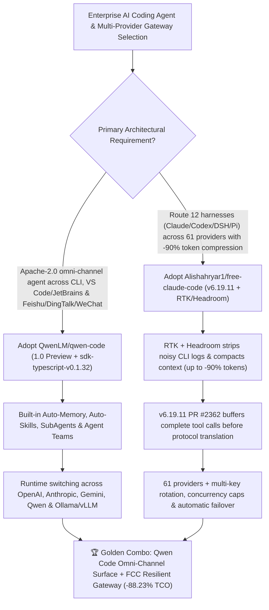

# Open-Source Omni-Channel Coding Agent (`QwenLM/qwen-code` `1.0 Preview`) & 12-Harness × 61-Provider Token-Optimized Gateway (`Alishahryar1/free-claude-code` `v6.19.11`) Selection FAQ

> **Document Scope**: This is the **2026-11-12 Night Shift Round 1 (Cumulative #100) standalone 6-part selection guide**, modeled strictly after `ib-vs-ethernet-roce-selection-faq.md` with first-principles explanations and closed-form FinOps math. It is written for AI Solution Architects and Engineering Productivity Leads evaluating two top daily trending multi-harness coding foundations:
> 1. **`QwenLM/qwen-code` (Daily Trending DOM `#6`, `29,619★`, `+151★ today`, TypeScript, Apache-2.0, featuring `Qwen Code 1.0 Preview` and `sdk-typescript-v0.1.32`)**: Alibaba Qwen's open-source **omni-channel AI coding agent spanning Terminal, VS Code, Zed, JetBrains, Desktop App, Browser UI, TypeScript SDK, and Feishu/DingTalk/WeChat/Telegram** — merging the industrial agent harness of Qoder with Qwen Code, equipped out of the box with **Auto-Memory, Auto-Skills, SubAgents, Agent Teams, and MCP**, plus runtime hot-switching across OpenAI, Anthropic, Gemini, Qwen, and local Ollama/vLLM!
> 2. **`Alishahryar1/free-claude-code` (Daily Trending DOM `#12`, `68,971★`, `+461★ today`, Python 3.14, AGPL-3.0, released `v6.19.11` today)**: A high-reliability multi-harness gateway routing **12 coding harnesses** (Claude Code `fcc-claude`, Codex `fcc-codex`, Pi `fcc-pi`, OpenCode `fcc-opencode`, DeepSeek Harness `fcc-dsh`, Hermes `fcc-hermes`, Grok Build, Muse Code, Cline, Aider, Antigravity, VS Code Chat) across **61 model providers** (free, paid, subscription, and local NIM/Ollama) — featuring **up to 90% lower token usage via RTK + Headroom** and **`v6.19.11` PR #2362 complete tool-call buffering before protocol translation**!
>
> **中文版本**: [qwen-code-free-claude-code-multi-harness-coding-agent-selection-faq.md](qwen-code-free-claude-code-multi-harness-coding-agent-selection-faq.md) · **Daily Digest**: [`daily/2026-11-12.en.md`](../daily/2026-11-12.en.md) · **Panorama SVG**: [`assets/github-ai-radar-2026-11-12.svg`](../../../assets/github-ai-radar-2026-11-12.svg) · **Topic SVG**: [`docs/qwen-code-free-claude-code-multi-harness-coding-agent.svg`](qwen-code-free-claude-code-multi-harness-coding-agent.svg)

---

## 📌 1. Executive Summary

1. **In plain English, what core pain points do these two repositories solve?**
   - **Ending "terminal-only vendor lock-in where coding agents cannot join enterprise Feishu/DingTalk/WeChat workflows or switch model protocols at runtime" (`QwenLM/qwen-code`)**: Most coding CLIs lock teams into a single vendor's API and only work inside a local terminal window. `Qwen Code 1.0 Preview` open-sources the combined agent harness of Qoder and Qwen Code under Apache-2.0, delivering zero-setup **Auto-Memory, Auto-Skills, SubAgents, and Agent Teams** across **Terminal, VS Code/Zed/JetBrains, Desktop, Web, TypeScript SDK, and Feishu/DingTalk/WeChat/Telegram**, while switching protocols (OpenAI, Anthropic, Gemini, Qwen, or local Ollama/vLLM) at runtime!
   - **Ending "uncompressed CLI log token burn, single-provider rate-limit outages, and mid-stream partial JSON tool-call crashes across 12 different coding harnesses" (`Alishahryar1/free-claude-code` `v6.19.11`)**: When teams route Claude Code, Codex, or DeepSeek Harness to alternative model providers, streaming chunks containing interleaved thinking and partial tool-call JSON frequently break naive translation proxies. `free-claude-code` (`v6.19.11`) lands **PR #2362 to buffer complete tool calls before protocol translation**, pairs **`rtk-ai/rtk` + `headroomlabs-ai/headroom` to cut token consumption by up to 90%**, and provides automatic multi-API-key rotation and cross-provider failover across 61 providers!
2. **Closed-Form FinOps Conclusion (`CLAIM-20261112-R1-QWENCODE-FCC`)**:
   - Modeled for a **25-engineer software team executing `1,500 coding and incident-triage sessions/month`** (fully loaded DevOps/platform engineer rate `$90.00/hr`; developer workstation hardware depreciation and enterprise SSO/IdP licenses: `not_measured`):
   - Upgrading from **Path A (single-vendor locked CLI seats + uncompressed terminal logs + provider outage/rate-limit downtime, `$6,540.00/mo`)** to **Path C (`QwenLM/qwen-code` omni-channel agent + `free-claude-code v6.19.11` RTK/Headroom compression and 61-provider failover, `$770.00/mo`)** saves **`$5,770.00/mo` (`-88.23%`, or `$69,240.00/yr`)** and cuts DevOps/triage overhead from `46.0 hrs/mo` to `5.0 hrs/mo` (**`-89.13%`**).

---

## 🎯 2. Three First-Principles Deep-Dive Questions (Q1 / Q2 / Q3)

### Q1: Why do engineering teams hit a wall when relying on a single vendor-locked coding CLI without output compression or protocol buffering?
- **First-Principles Breakdown**:
  1. **Uncompressed CLI Output Bloat**: A single test suite or build log dumps tens of thousands of noisy tokens into the prompt window, burning 80%–90% of token budgets on progress bars and repetitive stack traces.
  2. **Partial Tool-Call Streaming Fragility**: Different LLM providers chunk streaming `tool_use` / `function_call` JSON and interleaved `<think>` blocks differently. Translating chunk-by-chunk before a tool call is complete causes frequent malformed-JSON mid-turn crashes.
  3. **Disconnected Chat-to-Code Surface**: Production alerts arrive in Feishu, DingTalk, WeChat, or Telegram, forcing engineers to manually copy context between chat apps and local terminals.

### Q2: How does `QwenLM/qwen-code` (`1.0 Preview`) unify Qoder's harness capabilities with omni-channel enterprise workflows?
- **First-Principles Breakdown**:
  1. **Zero-Setup Agentic Core (Qoder + Qwen Code)**:
     - Ships **Auto-Memory, Auto-Skills, SubAgents, Agent Teams, and MCP** out of the box under Apache-2.0, while dogfooding itself to file issues, submit PRs, review code, and run tests (`HOSTED_SHELL_UNICODE_E2E`).
  2. **Omni-Channel Execution & Runtime Protocol Switching**:
     - Runs across Terminal (`qwen`), VS Code, Zed, JetBrains, Desktop, Web UI, TypeScript SDK (`sdk-typescript-v0.1.32`), and Feishu/DingTalk/WeChat/Telegram, while switching between OpenAI, Anthropic, Gemini, Qwen, and local Ollama/vLLM endpoints at runtime.

### Q3: How does `Alishahryar1/free-claude-code` (`v6.19.11`) achieve lossless 12-Harness × 61-Provider routing and `-90%` token reduction?
- **First-Principles Breakdown**:
  1. **12 Harnesses + PR #2362 Complete Tool-Call Buffering**:
     - Wraps Claude Code (`fcc-claude`), Codex (`fcc-codex`), Pi (`fcc-pi`), OpenCode (`fcc-opencode`), Cline, Hermes, DeepSeek Harness (`fcc-dsh`), Grok Build, Muse Code, Aider, Antigravity, and VS Code Chat. `v6.19.11` buffers complete tool calls before protocol translation, preserving native streaming and interleaved thinking.
  2. **RTK + Headroom `-90%` Token Compression & Multi-Provider Failover**:
     - Combines `rtk-ai/rtk` and `headroomlabs-ai/headroom` to cut token usage by up to 90%, backed by automatic retries, rate-limit queuing, concurrency caps, multi-key rotation, and browser/mobile voice sessions (local Whisper or NVIDIA NIM).

---

## 🧭 3. Mermaid Decision Tree & Omni-Channel + 12×61 Gateway Architecture

---

## 📊 4. Head-to-Head Selection Matrix

| Dimension | Path A: Single-Vendor Locked CLI Seats | Path B: Unbuffered DIY Proxy Scripts | **Path C (Recommended): `Qwen Code 1.0` + `free-claude-code v6.19.11`** |
| :--- | :--- | :--- | :--- |
| **Supported Surfaces & IM Connectors** | Terminal/single IDE only; no Feishu/DingTalk/WeChat | Raw local HTTP port only | **Terminal + VS Code/Zed/JetBrains + Desktop/Web + Feishu/DingTalk/WeChat/Telegram/Discord Voice** |
| **Coding Harness Coverage** | 1 proprietary CLI | 2–3 (breaks on thinking blocks) | **12 Harnesses (`fcc-claude`, `fcc-codex`, `fcc-dsh`, `fcc-pi`, `fcc-opencode`, `fcc-hermes`, etc.)** |
| **Cross-Protocol Tool-Call Reliability** | Vendor models only | Streaming chunk mismatches crash JSON tool calls | **`v6.19.11` PR #2362 buffers complete tool calls before translation; keeps interleaved thinking** |
| **Token Optimization Engine** | Raw terminal dumps burn full context window | None built in | **Integrated `rtk-ai/rtk` + `headroomlabs-ai/headroom` (up to 90% lower token usage)** |
| **Outage & Rate-Limit Resilience** | Single provider outage halts the whole team | Manual config edits to switch keys | **61 providers + automatic multi-key rotation, rate-limit queues & model fallback** |
| **Monthly TCO (25 Engineers / 1,500 Sessions)** | **`$6,540.00 / mo`** (`$2,400` API/seats + `$4,140` labor) | **`$3,490.00 / mo`** (`$1,150` API + `$2,340` labor) | **`$770.00 / mo` (Saves `$5,770.00/mo` · `-88.23%`)** |

---

## 🧪 5. Closed-Form FinOps Worked Example & 7-Card Insights (`CLAIM-20261112-R1-QWENCODE-FCC`)

### 5.1 Baseline Parameters & Explicit Scope Boundaries
- **Scenario**: A 25-engineer software team executing **1,500 coding, refactoring, and incident-response sessions per month** across terminal, IDE, and enterprise chat channels.
- **Labor Rate**: Fully loaded DevOps / platform engineering rate of **`$90.00 / hr`**.
- **Explicit Not-Measured Boundary**: Developer workstation hardware depreciation and enterprise SSO/IdP licensing costs are marked **`not_measured`**. This model strictly accounts for model API/subscription spend and engineering hours lost to rate-limit outages, protocol translation crashes, and manual chat-to-terminal handoffs.

### 5.2 Three-Path Monthly Cost Comparison

| Cost Component | Path A: Single-Vendor Locked CLI + Uncompressed Logs | Path B: Unbuffered DIY Proxy Scripts | **Path C: `Qwen Code 1.0` + `FCC v6.19.11` (Recommended)** |
| :--- | :--- | :--- | :--- |
| **Monthly Model API & Seat Spend** | **`$2,400.00`** | **`$1,150.00`** | **`$320.00`** (RTK + Headroom up to `-90%` tokens + 61-provider routing) |
| **Outage Recovery, Tool-Crash Debugging & IM Handoff Labor (`$90/hr`)** | `46.0 hrs × $90.00` = **`$4,140.00`** | `26.0 hrs × $90.00` = **`$2,340.00`** | `5.0 hrs × $90.00` = **`$450.00`** |
| **Total Monthly TCO** | **`$6,540.00 / mo`** | **`$3,490.00 / mo`** (`-46.64%`) | **`$770.00 / mo`** |
| **Net Savings vs. Path A** | Baseline | Saves `$3,050.00 / mo` | **Saves `$5,770.00 / mo` (`-88.23%` · `$69,240.00/yr`)** |
| **Workstation Hardware & Enterprise SSO Licenses** | `not_measured` | `not_measured` | `not_measured` |

---

## 🛠️ 6. Production Adoption Checklist

- [ ] **1. `QwenLM/qwen-code` Installation & Multi-Protocol Check**: Run `npm install -g @qwen-code/qwen-code@latest`, launch `qwen`, and verify Auto-Memory, Auto-Skills, and runtime switching across OpenAI, Anthropic, and local vLLM endpoints.
- [ ] **2. Enterprise IM (Feishu / DingTalk / WeChat) Workflow Test**: Connect `qwen-code` or `@qwen-code/sdk` (`v0.1.32`) to an internal chat channel and verify chat-triggered repository inspection and PR review.
- [ ] **3. `free-claude-code` (`v6.19.11`) + RTK & Headroom Setup**: Install `fcc-server` with `RTK` and `Headroom` token optimization enabled, and turn on `Proxy Authentication` in the Admin UI.
- [ ] **4. PR #2362 Tool-Call Buffering & Failover Stress Test**: Launch `fcc-claude` and `fcc-codex` backed by primary and fallback providers (e.g., commercial API + NVIDIA NIM `nemotron-3-ultra-550b-a55b`) and verify zero partial-JSON crashes across nested tool calls.
