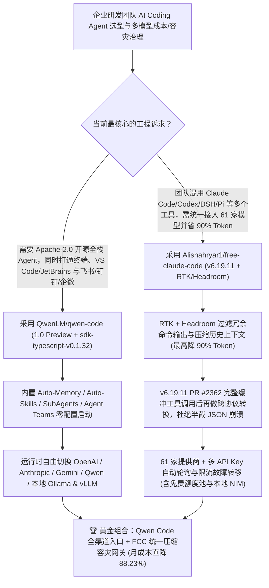

# 开源全栈终端/IDE/IM 编码智能体（`QwenLM/qwen-code` `1.0 Preview`）与 12-Harness × 61-Provider 零锁死路由网关（`Alishahryar1/free-claude-code` `v6.19.11`）深度选型 FAQ

> **文档定位**：本专题是 **2026-11-12 夜班第 1 轮（累计第 100 篇）独立六段式选型指南**，严格对标 `ib-vs-ethernet-roce-selection-faq.md` 的通俗第一性原理与闭式 FinOps 核算规范，面向企业研发效能负责人与 AI Solution Architect，深度拆解今日在 GitHub Daily Trending 主日榜双双霸榜的两大多智能体编程底座：
> 1. **`QwenLM/qwen-code`（主日榜 DOM `#6`，`29,619★`，今日新增 `+151★ today`，TypeScript，Apache-2.0，最新推出 `Qwen Code 1.0 Preview` 与 `sdk-typescript-v0.1.32`）**：阿里通义千问开源的**全渠道（Terminal / VS Code / Zed / JetBrains / Desktop / Browser / 飞书 / 钉钉 / 企微 / Telegram）AI 编码智能体**——将 Qoder 的工业级 Agent Harness 能力与 Qwen Code 深度融合，开箱内置 **Auto-Memory、Auto-Skills、SubAgents、Agent Teams 与 MCP**，支持 OpenAI / Anthropic / Gemini / Qwen 多协议运行时热切换！
> 2. **`Alishahryar1/free-claude-code`（主日榜 DOM `#12`，`68,971★`，今日新增 `+461★ today`，Python 3.14，AGPL-3.0，今日发布 `v6.19.11`）**：将 **12 大主流编码 Harness**（Claude Code `fcc-claude`、Codex `fcc-codex`、Pi `fcc-pi`、OpenCode `fcc-opencode`、DeepSeek Harness `fcc-dsh`、Hermes `fcc-hermes`、Grok Build、Muse Code、Cline、Aider、Antigravity、VS Code Chat）无缝路由至 **61 家模型提供商**（含免费/付费/订阅/本地 NIM & Ollama）的高可靠网关——内置 **RTK + Headroom 高达 90% Token 压缩**与 **`v6.19.11` PR #2362 完整工具调用缓冲后协议翻译**！
>
> **English Version**: [qwen-code-free-claude-code-multi-harness-coding-agent-selection-faq.en.md](qwen-code-free-claude-code-multi-harness-coding-agent-selection-faq.en.md) · **关联日报**: [`daily/2026-11-12.md`](../daily/2026-11-12.md) · **全景架构图**: [`assets/github-ai-radar-2026-11-12.svg`](../../../assets/github-ai-radar-2026-11-12.svg) · **专题架构图**: [`docs/qwen-code-free-claude-code-multi-harness-coding-agent.svg`](qwen-code-free-claude-code-multi-harness-coding-agent.svg)

---

## 📌 一、核心结论速览（Executive Summary）

1. **一句话大白话讲透这两个项目到底解决了什么痛点？**
   - **终结“AI 编码工具被锁死在单一终端窗口、无法接入国内飞书/钉钉/企微审批流，且换个大模型就要全组重装插件”的痛点（`QwenLM/qwen-code`）**：很多编码 CLI 只是一个绑死特定云厂商 API 的黑盒命令行。`Qwen Code 1.0 Preview` 直接把商业级 IDE Qoder 的底座开源出来，不仅自带 **Auto-Memory（自动记忆）、Auto-Skills（自动技能发现）、SubAgents 与 Agent Teams（多智能体组队）**，还同时打通了 **终端、VS Code/Zed/JetBrains、独立桌面端、Web 界面、TypeScript SDK 以及飞书/钉钉/企业微信/Telegram 机器人**，并且可以在运行时一键热切换 OpenAI、Anthropic、Gemini、Qwen 或本地 Ollama/vLLM 模型！
   - **终结“研发团队同时用 Claude Code、Codex、DSH、OpenCode 导致多头购买昂贵席位、服务商限流宕机即全组停工、以及跨协议流式工具调用经常半截断流报错”的痛点（`Alishahryar1/free-claude-code` `v6.19.11`）**：当你尝试把 Claude Code 或 Codex 接到第三方模型（如 NVIDIA NIM `nemotron-3-ultra-550b-a55b`、DeepSeek 或本地模型）时，最头疼的是流式输出中夹杂的交错思考（Interleaved Thinking）和半截 JSON 工具调用会在协议转换时直接崩掉。`free-claude-code` (`v6.19.11`) 一方面通过 **PR #2362 在协议转换前完整缓冲工具调用（Buffer complete tool calls before protocol translation）** 彻底根治跨模型工具调用崩溃，另一方面集成 **RTK (`rtk-ai/rtk`) + Headroom (`headroomlabs-ai/headroom`) 将每次命令输出与历史上下文压缩最高达 90%**，配合多 Key 自动轮询与跨提供商故障转移，让 12 种 Harness 永远不断粮！
2. **闭式 FinOps 投资回报结论（`CLAIM-20261112-R1-QWENCODE-FCC`）**：
   - 以 **25 人研发工程团队每月执行 `1,500 次` 深度编码与自动化排障会话** 为基准（DevOps 与平台维护工程师全包时薪 `$90.00/hr`；本地开发机硬件折旧与企业级 IdP/SSO 许可费：`not_measured`）：
   - 从 **Path A（单一厂商闭源商业 CLI 席位 + 未压缩全量终端输出灌入上下文 + 厂商限流/断连停工排障，月均 `$6,540.00`）** 升级至 **Path C（`QwenLM/qwen-code` 全渠道协同底座 + `free-claude-code v6.19.11` RTK/Headroom Token 压缩与多提供商自动容灾，月均 `$770.00`）**，每月净省 **`$5,770.00/mo`（降幅 `-88.23%`，年省 `$69,240.00/yr`）**，并将因 API 限流、协议不兼容与 IM 人工搬运导致的工程损耗工时从 `46.0 hrs/mo` 压缩至 `5.0 hrs/mo`（节省 **`-89.13%`**）。

---

## 🎯 二、三大灵魂拷问（Q1 / Q2 / Q3 深度原理解析）

### Q1：为什么企业研发团队直接裸用单一厂商绑定 CLI 会在成本、可用性与协同链路上面临三重瓶颈？
- **第一性原理拆解**：
  1. **未压缩终端长输出吃光 Token 预算（Uncompressed CLI Output Bloat）**：一次 `pytest`、`cargo build` 或 `git diff` 往往吐出数万字符冗余日志。如果不经过前置过滤直接塞进 `$3/$15 per 1M` 的模型上下文，90% 的 Token 花在了毫无意义的进度条和重复堆栈上。
  2. **流式协议转换中的“半截工具调用”崩溃（Partial Tool-Call Translation Fragility）**：Anthropic Messages、OpenAI Responses 与各家开源模型在流式返回 `tool_use` / `function_call` JSON 块时的分片粒度截然不同。普通反代脚本边收分片边硬转协议，极易在遇到复杂嵌套参数或交错 `<think>` 块时抛出 JSON 解析异常。
  3. **研发动作与企业 IM（飞书/钉钉/企微）脱节**：线上告警发在飞书或企微群里，工程师却必须切回自己电脑打开终端复制粘贴上下文，缺乏原生支持国内办公 IM 的开源编码智能体底座。

### Q2：`QwenLM/qwen-code` (`1.0 Preview`) 是如何把 Qoder 级 Agent Harness 与全渠道协同融为一体的？
- **第一性原理拆解**：
  1. **Qoder + Qwen Code 合体内核与四大开箱自治能力**：
     - `Qwen Code 1.0 Preview` 将商业级编码工具 Qoder 的 Agent Harness 架构合入 Apache-2.0 开源主干，无需繁琐配置即提供 **Auto-Memory（跨会话自动沉淀项目约定）**、**Auto-Skills（按需加载技能包）**、**SubAgents（子任务派生）** 与 **Agent Teams（多角色协同组队）**。
     - 仓库自身采用自举开发（Dogfooding）：利用自身的 Agent 与模型自动提 Issue、发 PR、审代码并跑通 `HOSTED_SHELL_UNICODE_E2E` 等集成测试。
  2. **一核多端（Terminal / IDE / Desktop / Web / SDK / 飞书钉钉企微）**：
     - 除命令行 `qwen` 与 `@qwen-code/qwen-code` (`sdk-typescript-v0.1.32`) 外，原生提供 VS Code、Zed、JetBrains 插件以及支持 Telegram、钉钉（DingTalk）、微信（WeChat）与飞书（Feishu）的聊天集成，真正实现“在飞书群里 @Agent 查 Bug 提 PR，回 IDE 审 Diff”。

### Q3：`Alishahryar1/free-claude-code` (`v6.19.11`) 是如何实现 12-Harness × 61-Provider 无损路由与 `-90%` Token 节流的？
- **第一性原理拆解**：
  1. **12 大 Harness 原生封装与 `v6.19.11` (PR #2362) 完整工具调用缓冲**：
     - 提供 `fcc-claude`、`fcc-codex`、`fcc-pi`、`fcc-opencode`、`fcc-cline`、`fcc-hermes`、`fcc-dsh`、`fcc-grok`、`fcc-muse`、`fcc-aider`、`fcc-agy` 等 12 个一键启动入口，并在 `v6.19.11` 中专门修复了跨协议工具调用转换（在执行协议翻译前先完整缓冲整个 Tool Call 载荷），完整保留原生流式响应与交错思考（Interleaved Thinking）。
  2. **RTK + Headroom 双擎 Token 瘦身与企业级多级容灾**：
     - 安装时可直接启用 `rtk-ai/rtk` 与 `headroomlabs-ai/headroom`，将传入模型的冗余构建日志与长对话历史压缩最高达 **90%**；
     - 内置 Admin 管控台（支持 Bearer Token 本地代理鉴权）、多 API Key 轮询、并发上限控制、速率限制队列以及跨提供商自动故障转移（如主用商用 API 限流时毫秒级无缝切至 NVIDIA NIM `nemotron-3-ultra-550b-a55b` 或本地推理节点），并支持浏览器原生 Code 会话与 Discord/Telegram 本地 Whisper / NIM 语音指令。

---

## 🧭 三、Mermaid 选型决策树与「全渠道 Agent + 12×61 压缩容灾网关」协同架构图

---

## 📊 四、同类方案核心能力对比矩阵（Selection Matrix）

| 评估维度 | Path A：单一商业闭源 CLI 独立席位 | Path B：手写 LiteLLM / 简易反代脚本 | **Path C（推荐）：`Qwen Code 1.0` + `free-claude-code v6.19.11`** |
| :--- | :--- | :--- | :--- |
| **支持的客户端与协同入口** | 仅限单一终端或特定 IDE，无国内办公 IM 集成 | 仅提供裸 HTTP 端口，无多端同步 | **终端 + VS Code/Zed/JetBrains + 桌面/Web + 飞书/钉钉/企微/Telegram/Discord 语音** |
| **跨 Harness 兼容广度** | 1 个（仅支持自家 CLI） | 2–3 个（常因特殊 Header 或思考块报错） | **12 大 Harness 全覆盖（Claude Code / Codex / DSH / Pi / OpenCode / Hermes 等）** |
| **跨协议工具调用稳定性** | 仅支持自家原生模型 | 流式分片转换常导致半截 Tool Call JSON 崩溃 | **`v6.19.11` PR #2362 完整缓冲工具调用后再翻译，完美保留交错思考与流式体验** |
| **Token 消耗优化机制** | 原始长日志直塞上下文，账单极易失控 | 无内置命令输出压缩能力 | **原生集成 RTK + Headroom，最高降低 90% Token 消耗** |
| **限流与宕机容灾能力** | 厂商限流或断网即全组停工 | 需手工改配置文件重启切换 Key | **61 家提供商 + 多 API Key 自动轮询、并发排队与跨模型自动 Fallback** |
| **月度总拥有成本（25 人 / 1,500 会话）** | **`$6,540.00 / mo`**（`$2,400` 席位/API + `$4,140` 工时） | **`$3,490.00 / mo`**（`$1,150` API + `$2,340` 排障工时） | **`$770.00 / mo`（净省 `$5,770.00/mo` · `-88.23%`）** |

---

## 🧪 五、定量 FinOps 算例与 7-Card 洞察（`CLAIM-20261112-R1-QWENCODE-FCC`）

### 5.1 测算基准与显式边界（Scope & Boundaries）
- **场景设定**：25 人规模的研发工程团队，每月累计运行 **1,500 次中大型编码、重构与线上故障排查会话**（覆盖终端、IDE 以及飞书/企微群内协同触发）。
- **费率假设**：DevOps 与研发效能工程师全包时薪 **`$90.00 / hr`**。
- **显式边界声明（Explicit Not-Measured Boundary）**：工程师本地开发机硬件折旧与企业级统一身份认证（SSO/IdP）年费标记为 **`not_measured`**，本表严格核算模型 API/订阅消耗以及因限流中断、跨协议报错与跨端人工搬运产生的工程损耗工时。

### 5.2 三路径月度成本闭式对照表

| 成本分项 | Path A：单一厂商闭源 CLI + 未压缩上下文 | Path B：自建未缓冲反代脚本 + 手动切 Key | **Path C：`Qwen Code 1.0` + `FCC v6.19.11`（推荐）** |
| :--- | :--- | :--- | :--- |
| **月度模型 API 与多端订阅净支出** | **`$2,400.00`**（未压缩长日志 + 高价独享席位） | **`$1,150.00`**（无 RTK 压缩，仅混用部分廉价 API） | **`$320.00`**（RTK + Headroom 最高省 90% Token + 多提供商分层路由） |
| **限流停工、工具调用崩溃排障与 IM 搬运工时（`$90/hr`）** | `46.0 hrs × $90.00` = **`$4,140.00`** | `26.0 hrs × $90.00` = **`$2,340.00`** | `5.0 hrs × $90.00` = **`$450.00`** |
| **月度总成本（Monthly TCO）** | **`$6,540.00 / mo`** | **`$3,490.00 / mo`**（`-46.64%`） | **`$770.00 / mo`** |
| **相对 Path A 净节省** | 基准线（Baseline） | 净省 `$3,050.00 / mo` | **净省 `$5,770.00 / mo`（`-88.23%` · 年省 `$69,240.00/yr`）** |
| **开发机硬件折旧与企业 SSO 许可费** | `not_measured` | `not_measured` | `not_measured` |

---

## 🛠️ 六、生产级落地核验 Checklist

- [ ] **1. `QwenLM/qwen-code` 安装与多协议运行时验证**：执行 `npm install -g @qwen-code/qwen-code@latest`，在测试仓库启动 `qwen` 并验证 Auto-Memory、Auto-Skills 以及运行时切换 OpenAI / Anthropic / 本地 vLLM 端点。
- [ ] **2. 飞书 / 钉钉 / 企业微信研发协同连通性测试**：配置 `qwen-code` 的企业 IM 集成或 TypeScript SDK (`@qwen-code/sdk` `v0.1.32`)，验证从聊天群直接触发代码库检索与 PR 审查闭环。
- [ ] **3. `free-claude-code` (`v6.19.11`) 与 RTK + Headroom 压缩启用**：运行安装脚本并勾选启用 `RTK` 与 `Headroom` 优化，启动 `fcc-server` 并在 Admin UI 中开启 `Proxy Authentication` 本地 Bearer Token 保护。
- [ ] **4. PR #2362 完整工具调用缓冲与多提供商 Failover 压测**：通过 `fcc-claude` 或 `fcc-codex` 连接主备两个模型提供商（如商用 API + NVIDIA NIM `nemotron-3-ultra-550b-a55b`），发送包含复杂嵌套 JSON 参数的多步工具调用，验证流式转换零崩溃且主备自动无缝切换。
